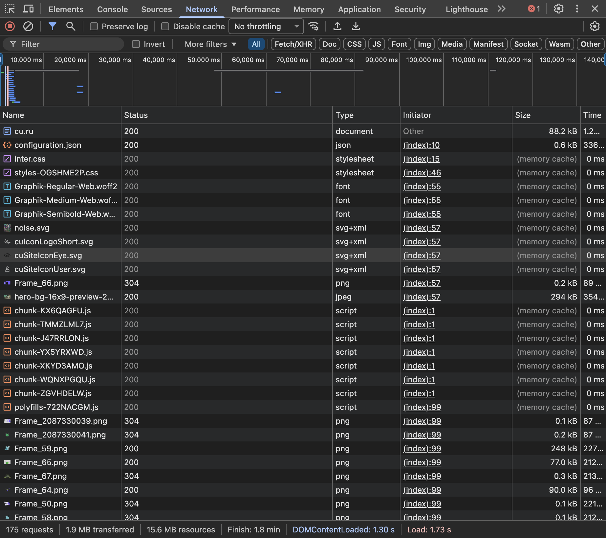
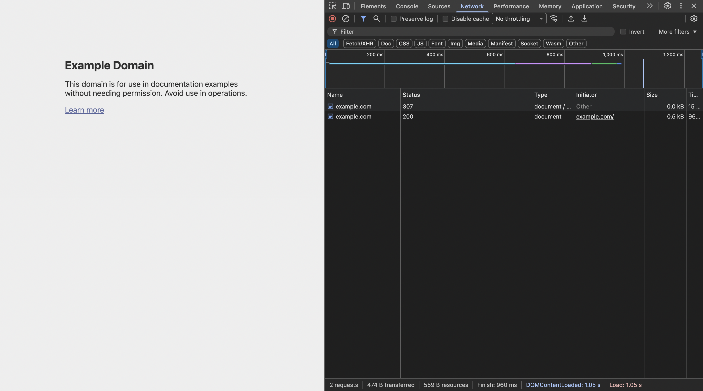
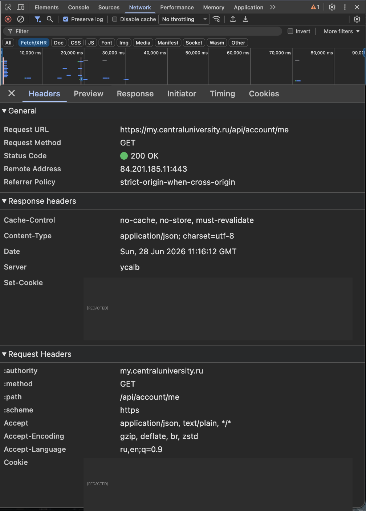
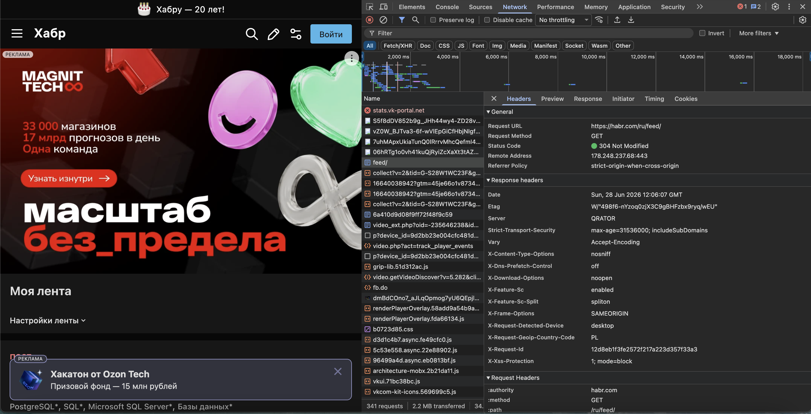
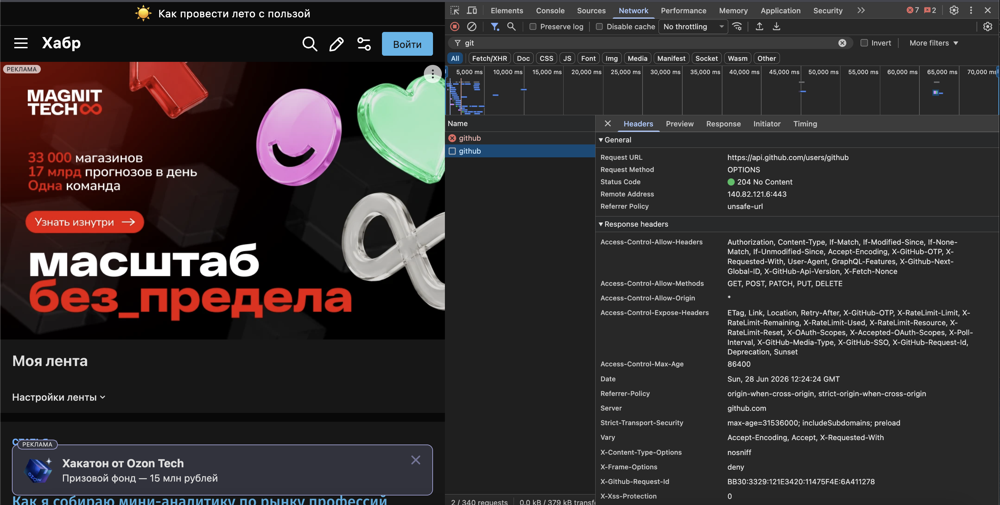
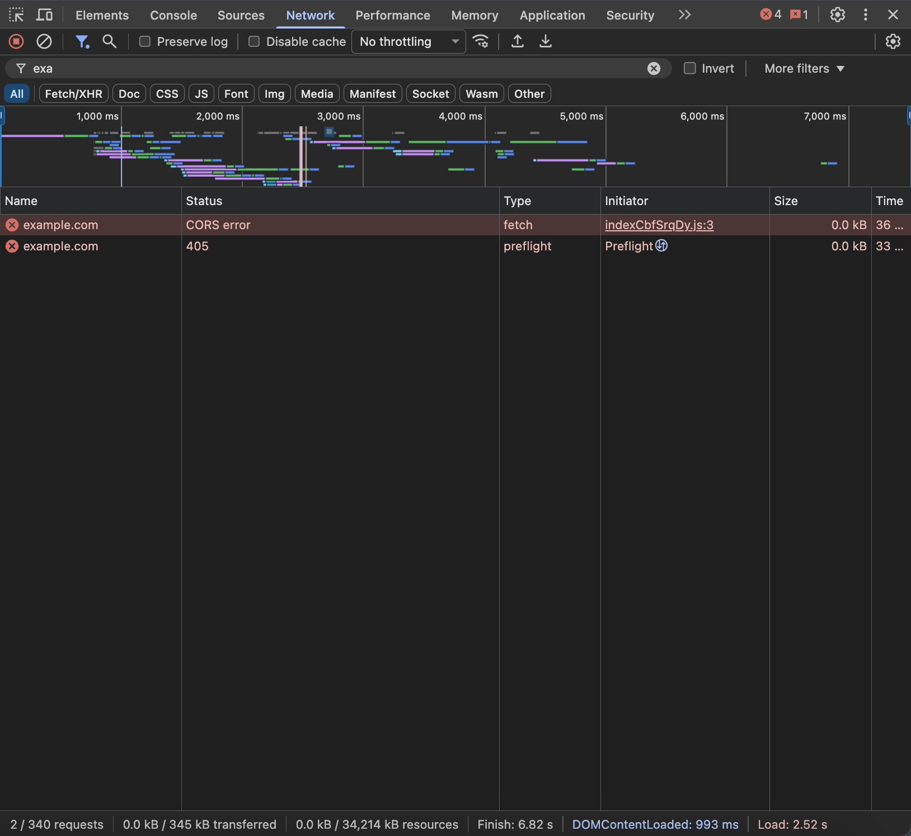
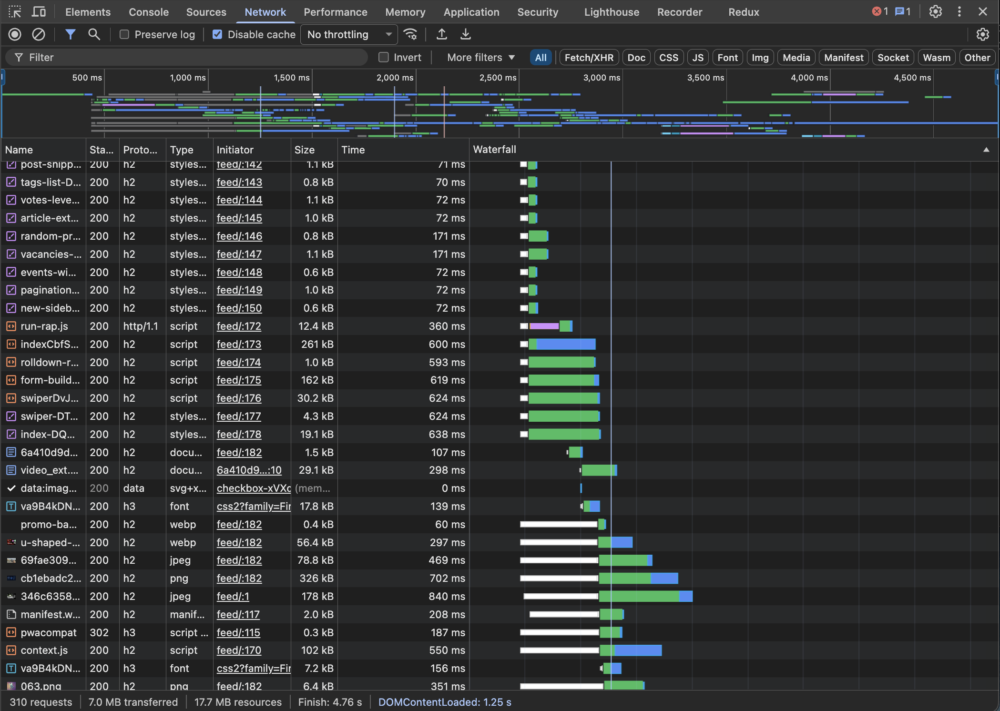

# Как работает веб

Материал и все скриншоты сделаны в Chrome. Если у тебя Safari или другой браузер, то общая логика та же, но некоторые панели DevTools называются иначе и расположены в других местах.

В этой теме разберём, что происходит между вводом адреса сайта и появлением готовой страницы: путь HTTP-запроса, структуру сообщения, статус-коды, cookies, кеширование, CORS и разницу между HTTP/2 и HTTP/3. Всё это — на реальных запросах, открытых в DevTools.

Главная цель недели — научиться видеть и объяснять сетевую работу браузера, а не запоминать список фактов про HTTP. К концу темы ты сможешь:

- открыть DevTools на любом сайте и объяснить, что за запросы уходят и в каком порядке;
- прочитать структуру HTTP-запроса и ответа: метод, заголовки, тело, статус-код;
- воспроизвести запрос вручную через curl и Postman и сверить результат с браузером;
- по статус-коду и картине в Network определить, на чьей стороне проблема — клиента, сервера или браузера;
- найти и прочитать cookies, заголовки кеша и CORS-ошибку, объяснив, что и почему происходит.

Это и есть навык диагностики: посмотреть на сетевую активность и поставить «диагноз», не заглядывая в код. Он пригодится на всех следующих неделях курса.

Перед тем как переходить к теории, стоит зафиксировать текущий уровень понимания нескольких вещей без поиска правильного ответа, а просто для себя.

1. Адрес сайта введён, Enter нажат. Что произойдёт раньше, чем браузер увидит первый байт HTML? Минимум 3 шага.
2. Страница не открылась, браузер показал «503». На чьей стороне проблема — клиента, сети или сервера?
3. Мы залогинились на сайте, закрыли вкладку, открыли снова — сессия всё ещё активна. Где хранится то, что это именно тот же пользователь? HTTP ведь не помнит предыдущие запросы.
4. В консоли браузера ошибка `blocked by CORS policy`. Это ошибка кода, сервера или самого браузера? Где её чинить?

Если хотя бы на один вопрос ответа нет, это нормально.
К концу темы на каждый из них появится не просто ответ, а возможность показать его в DevTools на реальном сайте.
Первый вопрос разбирается в разделе про путь запроса, второй — в разделе про статус-коды, третий — в разделе про cookies, четвёртый — в разделе про CORS.

## Содержание

- [Как работает веб](#как-работает-веб)
  - [Содержание](#содержание)
  - [1. Клиент-сервер и путь запроса](#1-клиент-сервер-и-путь-запроса)
    - [DevTools](#devtools)
    - [Практика](#практика)
  - [2. HTTP-сообщение: методы, структура, заголовки](#2-http-сообщение-методы-структура-заголовки)
    - [Структура сообщения](#структура-сообщения)
    - [Методы](#методы)
    - [Заголовки](#заголовки)
    - [Проверяем руками: curl и Postman](#проверяем-руками-curl-и-postman)
    - [Практика](#практика-1)
  - [3. Статус-коды и редиректы](#3-статус-коды-и-редиректы)
    - [Ловушки](#ловушки)
    - [Редиректы в Network](#редиректы-в-network)
    - [Практика](#практика-2)
  - [4. Состояние и cookies](#4-состояние-и-cookies)
    - [Ловушки](#ловушки-1)
    - [Практика](#практика-3)
  - [5. HTTP-кеширование](#5-http-кеширование)
    - [Cache-Control](#cache-control)
    - [Ловушки](#ловушки-2)
    - [Кеш и обновление файлов](#кеш-и-обновление-файлов)
    - [Практика](#практика-4)
  - [6. Origin, same-origin policy и CORS](#6-origin-same-origin-policy-и-cors)
    - [Origin](#origin)
    - [CORS](#cors)
    - [Preflight](#preflight)
    - [Где чинить ошибку CORS](#где-чинить-ошибку-cors)
    - [Ловушки](#ловушки-3)
    - [Практика](#практика-5)
  - [7. HTTP/2 vs HTTP/3 и чтение waterfall](#7-http2-vs-http3-и-чтение-waterfall)
    - [Почему в колонке Protocol соседствуют разные версии](#почему-в-колонке-protocol-соседствуют-разные-версии)
    - [WebSocket](#websocket)
    - [Waterfall](#waterfall)
    - [Диагностика по Network](#диагностика-по-network)
    - [Практика](#практика-6)
  - [Если кратко](#если-кратко)
  - [Глубже](#глубже)
  - [Полезные ссылки](#полезные-ссылки)

В конце каждого раздела есть блок **«Практика»** — он идёт сразу за теорией своего раздела.

Каждый раздел построен одинаково: сначала разбираем идею на реальном запросе, потом проверяем её в DevTools, curl или Postman.
Нестрашно, если эти названия тоже пока незнакомы, далее все разберём.
Начнём с того, что вообще происходит в момент нажатия Enter.

## 1. Клиент-сервер и путь запроса

Адрес сайта введён, Enter нажат, и через долю секунды на экране появляется страница.
Кажется, что это происходит мгновенно и само собой.
На деле между нажатием клавиши и первым байтом HTML проходит целая цепочка шагов и каждый из них можно увидеть и объяснить.

В основе всего лежит модель *клиент-сервер*. Браузер выступает клиентом, он отправляет запрос и ждёт ответа.
Сервер принимает запрос, обрабатывает его и возвращает ответ.
Браузер не знает, откуда взять данные: он умеет попросить и показать. Пока для нас источник данных и логики — сервер, но начиная с недели 6 своя логика появится и на стороне клиента, в браузере.

> Клиент-сервер — модель взаимодействия, в которой один участник (клиент) инициирует запрос, а другой (сервер) — обрабатывает его и отвечает. Браузер выступает клиентом, веб-сервер — сервером.

Общаются клиент и сервер по протоколу `HTTP` (`HyperText Transfer Protocol`).
Это набор правил, по которым формируется запрос и ответ.
Сегодня практически все сайты работают по HTTPS, и это тот же HTTP, но только поверх TLS-шифрования (про него можно почитать подробнее отдельно).
Структура запроса и ответа от этого не меняется ни на байт, меняется только то, что содержимое становится нечитаемым для любого, кто перехватит трафик между браузером и сервером.
При этом сам факт обращения к конкретному домену всё равно виден стороннему наблюдателю, потому что шифруется содержимое запроса, а не то, к какому домену идёт обращение.

> HTTP — протокол передачи данных между клиентом и сервером в виде текстовых сообщений запроса и ответа.

> HTTPS — это тот же HTTP, но поверх TLS. Данные шифруются перед отправкой и расшифровываются при получении.

Но прежде чем HTTP-запрос вообще сможет уйти, нужно решить две предварительные задачи.
- Во-первых, браузер знает только доменное имя, например google.com, а отправлять данные нужно на конкретный IP-адрес.
  Поэтому он обращается к `DNS` (`Domain Name System`), который работает как телефонный справочник. Знаешь имя, получаешь номер.

- Во-вторых, прежде чем слать данные, нужно установить соединение с сервером.
  Для этого используется протокол `TCP/IP`, который выступает транспортом, по которому дальше поедут все байты.
  Это обзорные вещи. Для текущей задачи достаточно понимать роль DNS и TCP/IP, а в устройство пакетов и рукопожатий мы здесь не идём, про это можно почитать отдельно.
  А более подробно познакомиться на курсе по сетям.

> DNS (Domain Name System) — служба, которая преобразует доменное имя в IP-адрес сервера.

> TCP/IP — набор протоколов, обеспечивающих доставку данных между двумя узлами сети. TCP отвечает за транспортный уровень (надёжную доставку байтов), IP — за сетевой (маршрутизацию пакетов). HTTP работает поверх этой связки, опираясь в первую очередь на TCP.

Если сложить всё вместе, путь от ввода адреса до отрисованной страницы выглядит так.

1. Браузер обращается к DNS и получает IP-адрес сервера.
2. Браузер устанавливает TCP-соединение с этим IP.
3. Если сайт работает по HTTPS, поверх TCP-соединения происходит TLS-рукопожатие, в ходе которого браузер и сервер договариваются о шифровании.
4. Браузер отправляет HTTP-запрос, например просьбу отдать HTML-страницу.
5. Сервер обрабатывает запрос и присылает HTTP-ответ с этим HTML.
6. Браузер начинает разбирать полученный HTML и по ходу разбора обнаруживает ссылки на дополнительные ресурсы, такие как CSS, JS, шрифты, картинки. На каждый такой ресурс уходит свой отдельный HTTP-запрос.
7. Когда необходимые для первого экрана ресурсы загружены, браузер строит и показывает страницу.

Из этого следует важный вывод. Страница — это не один файл, а результат работы множества независимых HTTP-запросов. Открытие сайта — это не одно действие, а целое дерево запросов, у которого есть корень.

Чтобы увидеть весь процесс не на словах, а вживую, понадобится `DevTools`, встроенный в браузер набор инструментов разработчика.

> DevTools — набор инструментов браузера для анализа того, как загружается и работает страница. Какие запросы отправляются, как устроен DOM, какие стили применены, что выводит код в консоль.

### DevTools

Это не разовый инструмент для одной темы, а то, чем мы будем пользоваться на каждом занятии. Вкладка `Network` покажет весь список запросов, заголовки и CORS-ошибки, вкладка `Console` покажет сообщения об ошибках, вкладка `Elements` покажет структуру страницы. Сейчас разберём вкладку `Network`, а к остальным будем возвращаться по ходу темы.

Открываем DevTools либо через F12, либо Cmd + Option + I на Mac, либо через контекстное меню, пункт «Просмотреть код» или «Inspect». Переходим во вкладку Network и перезагружаем страницу.



Самая первая строка в списке запросов — это запрос с типом document. Это и есть тот самый корень, запрос за HTML-страницей, с которого всё начинается. В колонке Type он помечен как document, в отличие от остальных строк, где будут script, stylesheet, image, font и подобные. Всё, что появляется в списке следом, — это уже не магия, а конкретные запросы за CSS, JS, шрифтами и картинками, которые браузер инициировал, разбирая полученный HTML.

Чтобы почувствовать разницу в масштабе, стоит сравнить два сайта. Открываем [example.com](https://example.com). У него почти нет внешних ресурсов, поэтому в Network будет всего два запроса.



Теперь открываем любой крупный сайт, новостной портал, маркетплейс или агрегатор.
В Network уже десятки, а то и сотни запросов.
Трекеры аналитики, шрифты, изображения, скрипты рекламы, отдельные JS-чанки приложения.

Разница наглядна. Оба сайта показывают пользователю страницу, но за одной стоит пара десятков запросов, а за другой — сотни.

### Практика

Перед тем как открывать Network, фиксируем прогноз. Сколько запросов уйдёт при загрузке простой страницы, один или много.

Дальше открываем [opennet.ru](https://opennet.ru) с включённым Network и пересчитываем запросы вживую.

Теперь открываем [habr.com](https://habr.com) (любую статью) и сравниваем число запросов с предыдущим сайтом.

На каждом из двух сайтов находим самый первый запрос в списке с типом document.
Это и есть точка входа, из которой выросло всё дерево остальных запросов.

В завершение пересказываем своими словами путь запроса от ввода адреса до появления страницы: DNS, затем TCP и TLS, затем HTTP-запрос, HTTP-ответ, разбор HTML, дополнительные запросы и отрисовка.

**Вопросы для обсуждения**
- Почему одна страница — это десятки запросов, а не один?
- Что именно шифрует HTTPS, а что остаётся видимым стороннему наблюдателю?

## 2. HTTP-сообщение: методы, структура, заголовки

В прошлом разделе мы увидели запрос как строку в списке Network. Пора открыть его и посмотреть, из чего он на самом деле состоит.

### Структура сообщения

Кликаем по любому запросу из списка, например по тому самому `document`.
Справа открывается панель с несколькими вкладками: `Headers`, `Payload`, `Preview`, `Response`, `Timing`. На вкладке `Headers` показано, как выглядит сам запрос. В сыром виде он выглядит примерно так.

```
GET /index.html HTTP/1.1
Host: example.ru
Accept: text/html
User-Agent: Mozilla/5.0
```

HTTP-запрос устроен как письмо.
У него есть стартовая строка (кому и что мы просим), заголовки (служебные пометки, которые не видны в самом содержимом, но влияют на то, как сообщение будет обработано) и тело (собственно содержимое, если оно есть).

> HTTP-сообщение состоит из стартовой строки, набора заголовков и опционального тела. Запрос и ответ устроены по одному и тому же принципу, только стартовая строка у них разная.

### Методы

В стартовой строке запроса указан метод и адрес ресурса, например `GET /index.html`. Метод сообщает серверу, что именно мы хотим сделать с ресурсом.

> Метод HTTP-запроса — глагол, который описывает действие над ресурсом. `GET` означает прочитать, `POST` означает создать или отправить данные, `PUT` и `PATCH` означают изменить, `DELETE` означает удалить. `HEAD` и `OPTIONS` — служебные методы, используются реже и напрямую с данными не работают.

`GET` запрашивает данные и ничего не меняет на сервере. У таких запросов нет тела, а параметры часто передаются прямо в адресе и называются query-параметрами. `POST` чаще всего создаёт что-то новое, а данные у него обычно передаются в теле запроса, например, при отправке формы или создании новой записи.
`PUT` и `PATCH` меняют уже существующий ресурс, разница в том, что `PUT` обычно заменяет ресурс целиком, а `PATCH` меняет только часть полей. `DELETE` удаляет ресурс.

С этим связано понятие *идемпотентности*.
Повторный GET ничего не сломает, сервер просто ещё раз отдаст те же данные. А POST, отправленный дважды, может создать два одинаковых ресурса вместо одного, например задвоить заказ в интернет-магазине.

> *Идемпотентность* — свойство операции, при котором повторное выполнение запроса даёт тот же результат, что и однократное. `GET`, `PUT`, `DELETE` идемпотентны, а `POST` нет.

Список методов пополняется. Недавно появился новый метод `QUERY`, который решает старую проблему GET — невозможность передать большое тело запроса. Почитать поподробнее можно в [RFC 10008](https://www.rfc-editor.org/info/rfc10008/).

### Заголовки

Дальше идут заголовки.
Их в любом запросе или ответе может быть много, и в этом курсе мы не будем заучивать список из десятка штук.
Вместо этого будем встречать их по ходу разбора реальных запросов и разбираться, что они значат именно в той ситуации, где встретились.

Например, в запросе почти всегда есть заголовок `Accept`, который сообщает серверу, в каком формате клиент готов принять ответ.

> Accept — заголовок запроса, который сообщает серверу, в каком формате клиент ожидает получить ответ. Например, сервер может вернуть данные в формате JSON (`application/json`) или обычную HTML-страницу (`text/html`).

А если запрос отправляет данные (например, при POST), то появляется заголовок `Content-Type`, который сообщает серверу, в каком формате эти данные закодированы.

> Content-Type — заголовок, который описывает формат содержимого тела запроса или ответа, например application/json для JSON или multipart/form-data для файлов и формы.

Без верного Content-Type сервер может неправильно прочитать присланные данные, даже если само тело запроса полностью корректно.

### Проверяем руками: curl и Postman

Теперь давай попытаемся воспроизвести всё то, что только что узнали. Возьмём тестовый эхо-сервис `https://webdev-kanban.culab.ru`.
Он устроен как зеркало: что бы ты ни отправил(а), сервис вернёт это обратно в виде JSON со всеми заголовками, параметрами и телом запроса. Удобно, чтобы проверить, что именно ушло на сервер.

Когда браузер открывает URL, который возвращает JSON, он показывает его как сплошную строку без форматирования. Часто в таком виде ответ читать неудобно. Чтобы это исправить, достаточно поставить расширение `JSON Prettifier` (или любой аналог, например JSON Formatter). После установки браузер будет автоматически форматировать JSON с отступами и подсветкой синтаксиса прямо на странице.

Сначала открываем в браузере `https://webdev-kanban.culab.ru/get?name=frontend` и смотрим в Network, что произошло. Сервис возвращает JSON примерно такого вида.

```json
{
  "args": { "name": "frontend" },
  "headers": { "host": "webdev-kanban.culab.ru", "accept": "*/*" },
  "url": "https://webdev-kanban.culab.ru/get?name=frontend"
}
```

В ответе видно поле `args`, в котором лежит переданный параметр `name`.
Это и есть query-параметр, он передаётся прямо в адресе после знака вопроса.

Теперь повторим тот же запрос через curl в терминале. `curl` — это утилита командной строки, которая умеет отправлять HTTP-запросы и печатать ответ прямо в терминал. За ней нет графического интерфейса, весь запрос описывается одной командой. Именно это и делает её удобной: запрос можно точно сформулировать, сохранить, вставить в документацию или переслать коллеге, и он выполнится у всех одинаково.

На macOS и Linux curl обычно уже установлен, проверить можно командой `curl --version`. Если в ответ печатается версия, то всё готово. На Windows curl входит в состав системы начиная с Windows 10, а также доступен внутри WSL. Если команды нет, curl можно скачать с официального сайта [curl.se](https://curl.se/download.html).

Поведение команды меняется флагами. Их много, но на этой неделе достаточно нескольких:
- `-X` задаёт метод запроса (без него используется GET);
- `-H` добавляет заголовок, флаг можно повторять по одному на каждый заголовок;
- `-d` передаёт тело запроса (если указан `-d`, но не указан `-X`, curl автоматически считает запрос POST-запросом);
- `-i` добавляет к выводу заголовки ответа вместе со статус-кодом (по умолчанию печатается только тело);
- `-v` (verbose) показывает всё: что curl отправил, что получил, включая служебную информацию о соединении.

Самый простой запрос — это `curl` и адрес, такая команда отправляет GET и печатает тело ответа.

```bash
curl "https://webdev-kanban.culab.ru/get?name=frontend"
```

Ответ будет тем же самым JSON, что и в Network, только без интерфейса браузера вокруг.

Может возникнуть вопрос: зачем curl, если браузер делает то же самое и ещё показывает результат красиво?
Разница в контроле.
Браузер автоматически добавляет к каждому запросу кучу своих заголовков, следует редиректам, подставляет cookies и многое другое.
Иногда это мешает. Например, когда нужно отправить ровно тот запрос, который ты написал(а), без лишнего. curl даёт именно это: отправляешь ровно то, что указал(а), и получаешь ровно то, что вернул сервер.

Это особенно удобно при отладке API. API (Application Programming Interface) — это набор правил и адресов, через которые одна программа может запрашивать данные или отправлять их другой. Отдельный такой адрес часто называют эндпоинтом. С curl удобно быстро проверить, как ведёт себя конкретный эндпоинт, или воспроизвести запрос из Network в терминале через Copy as cURL и передать коллеге.

Дальше отправим POST-запрос с JSON-телом, как если бы заполняли форму.

```bash
curl -X POST https://webdev-kanban.culab.ru/post \
  -H "Content-Type: application/json" \
  -d '{"name": "frontend", "level": "junior"}'
```

В ответе сервис вернёт поле `json` с тем же объектом, что мы отправили, и поле `headers`, где будет виден отправленный `Content-Type`.

То же самое можно сделать в `Postman`.

`Postman` — это десктопное приложение с графическим интерфейсом для отправки HTTP-запросов. В отличие от curl, здесь не нужно держать в голове синтаксис команд: метод выбирается из выпадающего списка, заголовки и тело заполняются в отдельных вкладках, а ответ отображается с подсветкой и форматированием. Скачать можно на [postman.com](https://www.postman.com/downloads/), установка стандартная для любой ОС.

Чтобы отправить наш POST-запрос, выбираем метод POST, вставляем адрес `https://webdev-kanban.culab.ru/post`, на вкладке `Body` выбираем `raw` и `JSON`, вставляем тот же объект. На вкладке `Headers` добавляем `Accept: application/json`.

Результат будет идентичен тому, что вернул curl, и тому, что видно было бы в Network, если бы такой запрос отправила настоящая веб-страница.
Это полезно держать в голове: curl, Postman и форма на сайте в конечном счёте делают одно и то же, отправляют HTTP-запрос с определённым методом, заголовками и телом.

### Практика

Открываем любой реальный сайт, находим в Network запрос, который не является `document` (например, какой-то fetch или XHR-запрос). Смотрим вкладку `Headers`, называем метод запроса и значение `Content-Type`, если оно есть.

Берём тот же запрос (или похожий по структуре) и воспроизводим его сначала в curl, потом в Postman. Сверяем результат с тем, что показывал Network.

Отправляем на `webdev-kanban.culab.ru` POST-запрос с JSON-телом и добавляем заголовок `Accept`. Передаём какой-нибудь query-параметр в адресе и находим его в ответе сервиса.

В завершение для пары операций, например «получить список товаров» и «создать новый товар», проговариваем, какой метод стоило бы использовать и почему.

**Вопросы для обсуждения**
- Почему нельзя отправить GET-запрос с телом, хотя технически это иногда возможно?
- Чем PUT отличается от PATCH по смыслу?
- Зачем нужен Content-Type, если содержимое тела и так видно в запросе?


## 3. Статус-коды и редиректы

В начале темы был вопрос: страница не открылась, браузер показал 503, на чьей стороне проблема? Чтобы ответить на него, нужно понять, как сервер сообщает об исходе запроса.

Каждый HTTP-ответ начинается с трёхзначного числа — статус-кода. Это короткий сигнал от сервера: что случилось с запросом и кто за это отвечает. Все коды поделены на группы по первой цифре.

**2xx — всё прошло хорошо.** Запрос принят и обработан. Самые частые:

- `200 OK` — стандартный успешный ответ с телом;
- `201 Created` — ресурс создан (обычно в ответ на POST);
- `204 No Content` — успех, но тела в ответе нет (например, после DELETE).

**3xx — иди в другое место.** Сервер говорит, что ресурс находится по другому адресу. Браузер автоматически идёт туда — это и есть редирект.

- `301 Moved Permanently` — ресурс переехал навсегда, браузер запомнит новый адрес и в следующий раз пойдёт сразу туда.
- `302 Found` — временный редирект, каждый раз нужно спрашивать заново.

**4xx — ошибка на стороне клиента.** Сервер запрос получил, но что-то не так с самим запросом.

- `400 Bad Request` — запрос сформирован неправильно. Например, передан невалидный JSON или пропущено обязательное поле.
- `401 Unauthorized` — нужна авторизация, запрос пришёл без токена или с невалидным.
- `403 Forbidden` — авторизация есть, но доступа всё равно нет.
- `404 Not Found` — ресурс не существует.
- `405 Method Not Allowed` — метод не поддерживается для этого эндпоинта. Например, попытка отправить DELETE туда, где он не предусмотрен.
- `409 Conflict` — конфликт состояния. Например, попытка создать пользователя с email, который уже зарегистрирован.
- `422 Unprocessable Entity` — запрос синтаксически корректен, но содержит логические ошибки. Например, значение поля не прошло валидацию.
- `429 Too Many Requests` — слишком много запросов за короткое время: сервер посчитал запросы и включил rate limiting — ограничение на число запросов от одного клиента за период времени, чтобы защититься от перегрузки или злоупотреблений.

**5xx — ошибка на стороне сервера.** Запрос был корректным, но сервер не смог его обработать.
- `500 Internal Server Error` — что-то сломалось внутри сервера, чаще всего необработанное исключение в коде.
- `502 Bad Gateway` — сервер получил некорректный ответ от вышестоящего сервиса, до которого пытался достучаться, чтобы обработать твой запрос.
- `503 Service Unavailable` — сервер временно недоступен, перегружен или на обслуживании.
- `504 Gateway Timeout` — вышестоящий сервер не ответил в отведённое время, запрос завис.

Вот и ответ на вопрос из начала темы. 503 — это всегда проблема на стороне сервера.
Запрос ушёл корректно, сервер его получил, но не смог обработать.
Искать причину в своём коде или соединении бессмысленно.

> Статус-код — трёхзначное число в начале HTTP-ответа, которое сообщает об исходе запроса. Первая цифра определяет группу: 2xx — успех, 3xx — редирект, 4xx — ошибка клиента, 5xx — ошибка сервера.

### Ловушки

Несколько пар кодов, которые часто путают.

**401 vs 403.** На первый взгляд похожи — оба про отказ в доступе. Разница в том, что 401 означает «мы не знаем, кто ты, сначала войди», а 403 означает «мы знаем, кто ты, но тебе сюда нельзя».
Если API вернул 401, нужно передать токен авторизации. Если 403, то токен есть, но прав недостаточно.

**301 vs 302.** Оба редиректа, но с разными последствиями.
301 браузер запоминает и кеширует — в следующий раз он даже не будет спрашивать старый адрес, сразу пойдёт на новый.
302 каждый раз проверяет заново.
Поставить 301 вместо 302 по ошибке, потом придётся долго ждать, пока кеш браузеров у всех пользователей обновится.

**200 vs 204.** Оба означают успех, но 204 приходит без тела ответа. Это нормально для операций, где возвращать нечего: удалили запись — получили 204, и это правильно. Проблема возникает, когда код ожидает тело ответа и пытается его распарсить, а тела нет — это источник ошибок.


### Редиректы в Network

Редирект-цепочку удобно наблюдать прямо в Network.
Когда браузер получает 301 или 302, он автоматически уходит по адресу из заголовка `Location` и делает новый запрос. В Network это выглядит как несколько строк подряд: первая — с кодом 301 или 302, следующая — уже по новому адресу.

> Location — заголовок ответа, который при редиректе содержит адрес, по которому нужно перейти.

Чтобы увидеть это вживую, открываем в браузере `https://webdev-kanban.culab.ru/redirect-to?url=https://webdev-kanban.culab.ru/get`. Сервис вернёт 302 и перенаправит на другой эндпоинт. В Network будет видна цепочка из двух запросов.

```
1. GET /redirect-to?url=...   → 302   Location: /get
2. GET /get                   → 200
```

Первый запрос возвращает 302 и заголовок Location с новым адресом, браузер сам идёт по нему, и второй запрос уже завершается кодом 200.

Если в Network включена колонка `Status`, коды 3xx обычно выделены синим, 4xx и 5xx — красным. Это помогает сразу видеть проблемные запросы на странице, даже не открывая каждый из них.

Попрактикуемся с кодами напрямую. `webdev-kanban.culab.ru` умеет возвращать любой код по запросу.

```bash
# Получить 404
curl -i https://webdev-kanban.culab.ru/status/404
 
# Получить 500
curl -i https://webdev-kanban.culab.ru/status/500
```

Флаг `-i` покажет заголовки ответа вместе с телом, так видно и статус-код, и все заголовки, которые сервер вернул.

### Практика

Перед тем как открывать Network, посмотри на список ситуаций и предскажи, какой группой кода ответит сервер в каждом случае.
Ресурс не найден. Сервер упал. Запрос пришёл без токена авторизации. Файл успешно удалён. Страница переехала на другой домен навсегда.

Открой habr.com с включённым Network и найди хотя бы один запрос с кодом, отличным от 200. Определи, что означает этот код и на чьей стороне проблема.

Открой в браузере `https://webdev-kanban.culab.ru/redirect-to?url=https://webdev-kanban.culab.ru/get` с включённым Network и проследи цепочку редиректов.
Найди заголовок `Location` в первом ответе и посмотри, куда он указывает.

Отправь через curl запросы на `https://webdev-kanban.culab.ru/status/404` и `https://webdev-kanban.culab.ru/status/500` с флагом `-i`.
По коду определи, на чьей стороне проблема в каждом случае.

**Вопросы для обсуждения**
- Сайт не работает, как по коду понять, нужно ли смотреть в свой код или звонить в поддержку сайта?
- Почему 404 — это не ошибка сервера, хотя сервер и отвечает?
- Чем опасно случайно поставить 301 вместо 302?

## 4. Состояние и cookies

В начале темы был вопрос: залогинились на сайте, закрыли вкладку, открыли снова, сессия всё ещё активна, а где хранится информация о том, что это именно тот же пользователь?

Ответ неочевиден, потому что HTTP по своей природе не помнит ничего. Каждый запрос для сервера — новый и самостоятельный, никак не связанный с предыдущим.
Отправили запрос за страницей, получили ответ — всё, сервер уже не знает, кто ты. Это называется stateless, протокол без состояния.

> Stateless — принцип работы HTTP, при котором каждый запрос обрабатывается независимо. Сервер не хранит информацию о предыдущих запросах от того же клиента.

Чтобы сайт мог помнить пользователя между запросами, нужен отдельный механизм.
Один из самых распространённых — cookies.

Работает это так: при входе на сайт сервер возвращает в ответе заголовок `Set-Cookie` с небольшим фрагментом данных, например идентификатором сессии.
Браузер сохраняет эту cookie и автоматически отправляет её в заголовке `Cookie` при каждом следующем запросе к тому же домену.
Сервер видит cookie, находит по ней сессию в своей базе и понимает, что это тот же пользователь.

> Cookie — небольшой фрагмент данных, который сервер передаёт браузеру через заголовок Set-Cookie. Браузер хранит его и автоматически отправляет обратно при последующих запросах к тому же домену.

Посмотреть это вживую можно в Network. После входа на любой сайт с авторизацией найди ответ сервера на запрос логина и открой вкладку `Headers`. В разделе Response Headers должен быть заголовок `Set-Cookie`.



Те же cookies можно увидеть в другом месте DevTools — во вкладке `Application`, в разделе `Cookies`. Разница в том, что Network показывает момент установки cookie (заголовок Set-Cookie в конкретном ответе), а Application показывает итоговое хранилище: все cookies, которые сейчас есть у сайта, с их значениями, доменом, сроком жизни и флагами.

Дальше пригодятся два коротких термина. `XSS (Cross-Site Scripting)` — атака, при которой злоумышленник добивается, чтобы его собственный JavaScript выполнился на чужой странице, например через незаэкранированный пользовательский ввод. `CSRF (Cross-Site Request Forgery)` — атака, при которой пользователя, уже залогиненного на сайте, заманивают на страницу злоумышленника, а та незаметно шлёт запрос на нужный сайт от имени пользователя, пользуясь тем, что браузер сам подставит его cookies.

`HttpOnly` означает, что cookie недоступна из JavaScript. Страница не может прочитать её через `document.cookie`.
Это защищает от XSS-атак: даже если злоумышленник сумел выполнить свой скрипт на странице, добраться до такой cookie он не сможет.

`Secure` означает, что браузер будет отправлять cookie только по HTTPS. По обычному HTTP она не уйдёт.
Это защищает от перехвата cookie в незашифрованном трафике.

`SameSite` контролирует, в каких случаях браузер отправляет cookie при запросах с других сайтов.
Значение `Strict` означает, что cookie отправляется только при запросах с того же домена.
`Lax` разрешает отправку при навигации (например, при переходе по ссылке), но блокирует при запросах с других доменов через fetch.
`None` снимает ограничения, но тогда обязательно должен быть флаг `Secure`.
Этот флаг защищает от CSRF-атак, описанных выше.

> HttpOnly — флаг, запрещающий доступ к cookie из JavaScript.

> Secure — флаг, разрешающий отправку cookie только по HTTPS.

> SameSite — флаг, контролирующий отправку cookie при кросс-доменных запросах.

Теперь посмотрим на весь заголовок целиком и прочитаем его как одно сообщение.

```
Set-Cookie: sessionId=a3f8b2c1d4e9; Path=/; Max-Age=86400; HttpOnly; Secure; SameSite=Lax
```

Сервер говорит: сохрани cookie с именем `sessionId` и значением `a3f8b2c1d4e9`, отправляй её при любых запросах к сайту (`Path=/`), храни 24 часа (`Max-Age=86400`), не давай JavaScript к ней доступа (`HttpOnly`), отправляй только по HTTPS (`Secure`) и только при навигации с других сайтов, но не при fetch-запросах (`SameSite=Lax`).

На практике сессионные cookie, которые хранят идентификатор пользователя, почти всегда имеют флаги `HttpOnly` и `Secure`. Если их нет, то это тревожный сигнал о безопасности сайта.

### Ловушки

**`HttpOnly` не шифрует cookie.** Значение по-прежнему лежит в открытом виде и видно в DevTools, заголовках запроса любому, кто перехватит трафик по HTTP. Флаг всего лишь запрещает доступ к cookie из JavaScript на странице — это защита от одного конкретного вектора (XSS), а не шифрование.

Cookies — это только один из способов хранить состояние между запросами. В современных приложениях часто используют токены, которые передаются в заголовке `Authorization`. Подробнее об этом поговорим в теме про авторизацию и аутентификацию.

### Практика

Перед тем как открывать DevTools, сделай прогноз, сколько cookies установит сайт при логине и будут ли у сессионной cookie флаги `HttpOnly` и `Secure`. Затем проверь себя.

Зайди на любой сайт с авторизацией и войди в аккаунт. Открой Network и найди в ответе сервера заголовок `Set-Cookie`. Посмотри, какие cookies установил сервер и какие флаги у каждой из них.

Перейди во вкладку `Application` и открой раздел `Cookies`. Найди те же cookies в списке и проверь их атрибуты: есть ли `HttpOnly`, `Secure`, какое значение у `SameSite`?

По флагам ответь на вопросы: доступна ли эта cookie из JavaScript? Уйдёт ли она по обычному HTTP? Отправится ли она при запросе с другого домена?

**Вопросы для обсуждения**
- Почему пароль не кладут в обычную cookie?
- Что мешает другому сайту прочитать твои cookies с банковского сайта?
- Зачем нужен SameSite, если уже есть HttpOnly?

## 5. HTTP-кеширование

Открой любой сайт, подожди, пока загрузится, и перезагрузи его.
Вторая загрузка окажется заметно быстрее первой.
Причина в том, что браузер не стал заново скачивать всё с сервера, часть ресурсов он взял из кеша.

Кеширование в HTTP устроено так: сервер вместе с ресурсом передаёт инструкции, как долго браузер может хранить его локально и когда нужно спрашивать снова.
Это позволяет не гонять по сети одни и те же файлы при каждом запросе.

### Cache-Control

Основной инструмент управления кешем — заголовок `Cache-Control`. Сервер возвращает его вместе с ресурсом в ответе.

```
Cache-Control: max-age=31536000
```

`max-age` задаёт время в секундах, в течение которого браузер считает ресурс актуальным и не обращается к серверу вообще.
В примере выше это ровно год. Пока срок не истёк, браузер будет отдавать ресурс прямо из своего хранилища — мгновенно и без сетевого запроса.

В Network такие ресурсы легко узнать по колонке `Size`, вместо размера файла там будет написано `memory cache` (взято из оперативной памяти) или `disk cache` (взято с диска). Сетевого запроса при этом не происходит вообще.

> Cache-Control — заголовок ответа, который задаёт правила кеширования ресурса. max-age указывает время жизни в секундах, no-cache требует валидацию перед использованием, no-store запрещает кеширование полностью.

### Ловушки

**`no-cache` не значит «не кешировать».** Несмотря на название, ресурс всё равно сохраняется. Значение говорит браузеру: «Перед тем как использовать кеш, всегда проверь у сервера, актуален ли он». Полный запрет кеширования — это `no-store`, там ресурс действительно нигде не сохраняется.

Когда срок `max-age` истёк, браузеру нужно проверить, не изменился ли ресурс на сервере.
Вместо того чтобы скачивать его заново целиком, браузер может спросить: «У меня есть версия X, она ещё актуальна?»
Для этого используется механизм ETag.

При первой отдаче ресурса сервер добавляет к ответу заголовок `ETag` — это что-то вроде отпечатка текущей версии файла, обычно хеш его содержимого (хеш — короткая строка фиксированной длины, которая вычисляется из содержимого файла: если поменять в файле хотя бы один байт, хеш изменится полностью).

```
ETag: "33a64df551425fcc55e4d42a148795d9f25f89d4"
```

Браузер сохраняет это значение.
При следующем обращении к тому же ресурсу он отправляет его обратно в заголовке `If-None-Match`.
Сервер сравнивает полученный ETag с текущим.
Если файл не изменился, то возвращает ответ `304 Not Modified` без тела. Браузер понимает, что его кешированная копия актуальна, и использует её.



Это экономит трафик: вместо повторной передачи всего файла уходит только маленький запрос и короткий ответ.

> ETag — заголовок ответа, содержащий идентификатор текущей версии ресурса. Используется для валидации кеша.
> 304 Not Modified — статус-код, который сервер возвращает, если кешированная копия у клиента актуальна. Тело ответа при этом не передаётся.

Спровоцировать 304 несложно. Загрузи любую страницу, дождись полной загрузки, нажми Enter в адресной строке ещё раз (именно Enter, а не Ctrl + R). Браузер перепроверит ресурсы с истёкшим max-age и для некоторых из них получит в ответ 304.

Если нажать Ctrl + Shift + R (hard reload), браузер намеренно игнорирует кеш и скачивает всё заново. В Network пропадут записи с `memory cache` и `disk cache`, а вместо 304 снова появятся 200.

### Кеш и обновление файлов

Здесь есть одна практическая проблема.
Если сервер отдал файл с `max-age` на год, браузер год не будет его перезапрашивать.
А если вышел новый релиз и файл изменился? Заставить браузер забыть кеш нельзя: это за пределами возможностей сервера.

Решение, которое используют в реальных проектах: вшивать хеш содержимого прямо в имя файла.

```
main.3f9a2b.js   →   main.7c4e1a.js
```

Поменялся код — поменялся хеш — поменялось имя файла.
Для браузера это уже другой ресурс, которого в кеше нет, поэтому он скачает его заново.
Старый файл при этом можно кешировать на год без опасений.

Именно так работают сборщики вроде Vite и Webpack: они автоматически добавляют хеши к именам файлов при каждой сборке.
Подробнее об этом поговорим в теме про инструменты сборки.

### Практика

Перед тем как открывать Network, предскажи, сколько ресурсов при повторной загрузке страницы вообще не уйдут в сеть, а возьмутся из кеша. Затем проверь прогноз.

Открой любой сайт с включённым Network. Загрузи страницу, потом нажми Enter в адресной строке ещё раз — не Ctrl + R, а именно Enter. Найди в Network ресурсы с пометкой `memory cache` или `disk cache` в колонке Size и запрос с кодом 304. Убедись, что у 304-ответа нет тела.

Открой один из ресурсов с 304 и найди в его заголовках `ETag` и `If-None-Match`. Сравни значения — они должны совпадать.

Сделай hard reload через Ctrl + Shift + R. Посмотри, как изменилась картина в Network: пропали ли записи из кеша, появились ли снова 200 вместо 304.

Найди в Network любой JS или CSS файл и посмотри на его имя. Есть ли в нём хеш? Если да, то открой заголовки и проверь значение `Cache-Control`.

**Вопросы для обсуждения**
- Зачем нужен 304, если можно просто отдать файл заново?
- Почему обновлённый CSS иногда не подхватывается после деплоя и что с этим делать?
- Чем отличается no-cache от no-store?

## 6. Origin, same-origin policy и CORS

В начале темы был вопрос: в консоли браузера ошибка `blocked by CORS policy` — это ошибка кода, сервера или самого браузера? И где её чинить?

Этот раздел обзорный. CORS вплотную связан с запросами из JavaScript через fetch, а их мы будем разбирать позже, на отдельной неделе. Сейчас задача проще: понять, что такое CORS, почему браузер блокирует часть запросов и на чьей стороне это чинится. Полноценно щупать это руками будем, когда дойдём до fetch. Пока достаточно узнать ошибку в лицо и понимать её природу.

Чтобы понять, откуда берётся ошибка `blocked by CORS policy`, нужно сначала разобраться в двух вещах: что такое CORS и что такое origin. Без origin нельзя понять, какие запросы браузер считает чужими и почему он их блокирует.

### Origin

Origin — это комбинация трёх вещей: схемы, домена и порта. Два адреса считаются одним origin, только если все три совпадают.

```
https://example.com:443/page   →   origin: https://example.com:443
http://example.com/page        →   другой origin (схема отличается)
https://api.example.com/page   →   другой origin (домен отличается)
https://example.com:8080/page  →   другой origin (порт отличается)
```

> Origin — комбинация схемы, домена и порта. Два URL имеют одинаковый origin, только если все три компонента совпадают.

Браузер по умолчанию ограничивает код страницы в том, что он может делать с ресурсами других origin.
Если JavaScript на `https://myapp.com` пытается сделать fetch-запрос на `https://api.other.com`, браузер заблокирует его. Это и есть same-origin policy.

Политика существует по соображениям безопасности.
Без неё любой сайт мог бы из JavaScript делать запросы к твоему банку, почте или любому другому сервису от твоего имени и с твоими cookies, которые браузер автоматически подставляет к запросам.
Same-origin policy отрезает этот вектор атаки.

Важно: curl и Postman никакой same-origin policy не имеют. Это ограничение браузера, а не HTTP-протокола.
Поэтому запрос через curl к чужому API всегда проходит, а тот же запрос из JavaScript в браузере — нет.

> Same-origin policy — политика безопасности браузера, которая запрещает JavaScript на одном origin делать запросы к ресурсам другого origin.

### CORS

Если серверу нужно разрешить запросы с других origin (например, фронтенд на `https://myapp.com` должен ходить в API на `https://api.myapp.com`), то сервер может явно это разрешить.
Механизм называется `CORS (Cross-Origin Resource Sharing)`.

Сервер добавляет к ответу заголовок `Access-Control-Allow-Origin` с указанием, каким origin разрешён доступ.

```
Access-Control-Allow-Origin: https://myapp.com
```

Браузер видит этот заголовок, убеждается что текущий origin в списке разрешённых, и пропускает запрос.
Если заголовка нет или origin не совпадает, то блокирует и показывает ошибку в консоли.

> CORS (Cross-Origin Resource Sharing) — механизм, с помощью которого сервер сообщает браузеру, каким сторонним origin разрешено обращаться к его ресурсам.

### Preflight

Для некоторых запросов браузер не сразу отправляет сам запрос, а сначала спрашивает у сервера разрешение.
Это называется preflight.
Браузер отправляет предварительный запрос методом `OPTIONS` с заголовками, описывающими будущий запрос.

Preflight отправляется только для не простых запросов.
Простым считается запрос, который одновременно удовлетворяет трём условиям: метод GET, HEAD или POST; используются только заголовки из короткого списка «безопасных для CORS» — `Accept`, `Accept-Language`, `Content-Language`, `Content-Type` (и только с одним из трёх значений: `text/plain`, `application/x-www-form-urlencoded` или `multipart/form-data`), `Range`; нет остальных заголовков, включая `Authorization`, он такой же стандартный HTTP-заголовок, как и остальные, просто в этот безопасный список не входит.
Если хотя бы одно условие нарушено, то браузер сначала отправит OPTIONS.

На практике это означает, что большинство реальных запросов из фронтенда триггерят preflight: JSON-тело (`Content-Type: application/json` уже делает запрос не простым), заголовок `Authorization` с токеном, методы PUT, PATCH, DELETE.

```
OPTIONS /api/data HTTP/1.1
Origin: https://myapp.com
Access-Control-Request-Method: POST
Access-Control-Request-Headers: Content-Type
```

Сервер отвечает, разрешает ли он такой запрос.
Если да, то браузер отправляет основной запрос. Если нет, то блокирует.

В Network preflight выглядит как дополнительная строка с методом `OPTIONS` перед основным запросом.



> Preflight — предварительный запрос методом OPTIONS, который браузер отправляет перед основным кросс-доменным запросом, чтобы проверить, разрешит ли его сервер.

### Где чинить ошибку CORS

Вот ответ на вопрос из начала темы.
Ошибку `blocked by CORS policy` показывает браузер, но причина в том, что сервер не прислал нужные заголовки `Access-Control-*`.
Чинить нужно на сервере — добавить заголовок с разрешёнными origin. В коде фронтенда эту ошибку не исправить никак.

Если хочется увидеть ошибку вживую прямо сейчас, можно открыть консоль браузера на любом сайте и выполнить готовый запрос (сам JavaScript мы разберём позже, здесь достаточно вставить и посмотреть на результат).

```javascript
fetch('https://example.com', {
  method: 'POST',
  headers: { 'Content-Type': 'application/json' }
})
```

`example.com` не настроил CORS, поэтому браузер заблокирует запрос и покажет ту самую ошибку `blocked by CORS policy` в консоли.

На скриншоте ниже видно, как та же история выглядит во вкладке Network: preflight-запрос методом OPTIONS к `example.com` получил в ответ `405 Method Not Allowed`. Сервер вообще не умеет отвечать на OPTIONS. Из-за этого браузер решает, что сервер не разрешил кросс-доменный запрос, и блокирует основной запрос, даже не отправляя его. Код 405 здесь не признак сломанного сервера в привычном смысле — это способ, которым сервер, не настроенный на CORS, косвенно говорит «нет».



Именно так эта ошибка выглядит в реальной работе: иногда в виде текста в консоли, иногда как проваленный preflight в Network. Разбираться, как её обходить и настраивать, будем на неделе про fetch почти каждый раз, когда фронтенд обращается к стороннему API, CORS будет так или иначе в этом участвовать.

### Ловушки

**CORS «ошибается» в браузере, но чинится на сервере.** Сообщение видно в консоли или Network на стороне клиента, и первый порыв — искать причину в своём JS-коде. Но правит ситуацию только сервер, добавляя нужные заголовки `Access-Control-*`. Во фронтенд-коде эту ошибку исправить нельзя в принципе, можно только обойти через прокси, а это уже совсем другая история.

### Практика

Раздел обзорный, поэтому практика — на наблюдение и понимание, без написания кода.

Перед тем как открывать код из примера ниже, предскажи, увидим ли мы в Network ответ сервера, если браузер заблокировал запрос из-за CORS. Проверь себя после выполнения.

Открой любой крупный сайт с Network и найди запросы к сторонним origin (например, к доменам аналитики или CDN, отличным от основного сайта). Посмотри в их ответах заголовок `Access-Control-Allow-Origin` — так выглядит разрешённый кросс-доменный запрос.

Если хочешь увидеть заблокированный запрос, выполни готовый сниппет из раздела выше в консоли и прочитай ошибку `blocked by CORS policy`. Определи по тексту ошибки, на чьей стороне причина.

Разбери на словах, чем отличается ситуация, когда сервер прислал `Access-Control-Allow-Origin`, от ситуации, когда не прислал, и почему в обоих случаях «виноват» именно сервер, а не браузер.

**Вопросы для обсуждения**
- Почему браузер запрещает то, что curl спокойно делает?
- Ошибка CORS возникла в консоли, где искать причину — во фронтенде или на бэкенде?
- Зачем нужен preflight, если можно сразу отправить основной запрос?

## 7. HTTP/2 vs HTTP/3 и чтение waterfall

К этому моменту мы разобрали, из чего состоит HTTP-запрос, что означают статус-коды, как работают cookies, кеш и CORS.
Последний раздел собирает всё это вместе и учит читать картину загрузки страницы целиком.

В `HTTP/1.1` браузер отправляет запросы по одному соединению последовательно: пока не получит ответ на текущий запрос, следующий не уйдёт.
Чтобы ускорить загрузку, браузеры открывали несколько параллельных соединений (обычно 6 на домен), но это всё равно создавало очередь и задержки.

`HTTP/2` решил эту проблему через мультиплексинг: несколько запросов идут параллельно по одному соединению, не мешая друг другу.
Страница, которая в HTTP/1.1 грузила ресурсы последовательными волнами, в HTTP/2 загружает их одновременно.

> Мультиплексинг — механизм HTTP/2, при котором несколько запросов и ответов передаются параллельно по одному TCP-соединению.

`HTTP/3` идёт дальше: он переносит всё на протокол QUIC поверх UDP вместо TCP.
Главное практическое следствие: потеря одного пакета в HTTP/2 блокирует всё соединение (потому что TCP ждёт доставки), а в HTTP/3 она затрагивает только один поток.
Это особенно заметно на нестабильных мобильных сетях. Для нас сейчас это обзорная информация — углубляться в устройство QUIC не будем.

Узнать, по какому протоколу работает сайт, можно прямо в Network, за это отвечает колонка `Protocol`, где стоит `h2` для HTTP/2 или `h3` для HTTP/3.

### Почему в колонке Protocol соседствуют разные версии

На реальном сайте в колонке `Protocol` можно увидеть сразу несколько значений: `h2`, `h3`, `http/1.1` и даже `websocket`.
Это нормально: разные ресурсы могут приходить по разным протоколам.

Причин есть несколько.
- Во-первых, переход на HTTP/2 и HTTP/3 требует поддержки на стороне сервера. Основной домен сайта может уже работать на `h2`, а сторонние сервисы (аналитика, реклама, виджеты) — всё ещё на `http/1.1`, потому что их владельцы ещё не обновили инфраструктуру.
- Во-вторых, HTTP/3 поддерживается не всеми серверами и не всеми браузерами, поэтому браузер сначала пробует `h3`, если не получается, то откатывается на `h2` или `http/1.1`.
- В-третьих, некоторые корпоративные прокси и файрволы намеренно блокируют UDP (на котором работает QUIC/HTTP/3), из-за чего HTTP/3 недоступен в части сетей.

**Кратко о различиях версий**

`HTTP/1.1` — запросы в очереди по одному на соединение, браузер компенсирует открытием нескольких параллельных соединений. До сих пор встречается на старых или небольших сайтах.

`HTTP/2` — мультиплексинг: много запросов параллельно по одному соединению. Сжатие заголовков. Поддерживается большинством современных серверов и браузеров. Сегодня это стандарт де-факто.

`HTTP/3` — это то же, что HTTP/2, но поверх QUIC/UDP вместо TCP. Устойчивее к потере пакетов, быстрее на нестабильных сетях. Постепенно набирает распространение.

### WebSocket

В колонке `Protocol` иногда появляется значение `websocket`.
Это отдельный протокол, не версия HTTP.

Обычный HTTP-запрос работает по схеме «запрос — ответ»: клиент спрашивает, сервер отвечает, соединение закрывается. Если нужны свежие данные, клиент должен спросить снова.
WebSocket работает иначе: клиент и сервер устанавливают постоянное двустороннее соединение, любая сторона может отправить сообщение в любой момент без нового запроса.

Соединение начинается как обычный HTTP-запрос с заголовком `Upgrade: websocket` — браузер просит сервер переключиться на WebSocket-протокол.
Если сервер соглашается, соединение «апгрейдится» и HTTP больше не используется.

> WebSocket — протокол постоянного двустороннего соединения между браузером и сервером. В отличие от HTTP, не требует нового запроса для каждого сообщения.

WebSocket используется там, где нужны данные в реальном времени: чаты, онлайн-игры, биржевые котировки, совместное редактирование документов.

Если откроешь Network на таком сайте и увидишь строку с типом `websocket`, это оно.

### Waterfall

Waterfall — крайняя правая колонка в таблице запросов Network. Напротив каждого запроса стоит горизонтальная полоска, которая показывает, когда запрос начался и сколько длился относительно остальных. Вместе полоски образуют каскадную диаграмму загрузки страницы, которую можно читать как временную шкалу.



На скриншоте выше видна лесенка: полоски начинаются не одновременно, а один за другим со сдвигом. Важно не путать это напрямую с версией протокола: на этой же странице запросы идут по HTTP/2 (в колонке `Protocol` стоит `h2`), но лесенка всё равно есть, потому что браузер узнаёт про очередной ресурс только по ходу разбора HTML, а не раньше.

Лесенка бывает двух видов, и различаются они не самим фактом ступенек, а тем, сколько запросов к одному домену активны одновременно:
- если в моменте к одному домену идёт только один запрос, а следующий стартует лишь после того, как предыдущий завершился, то это последовательная загрузка, типичный признак HTTP/1.1 или упёршегося в лимит соединения;
- если несколько запросов к одному домену идут внахлёст, каждый следующий стартует раньше, чем закончился предыдущий, просто с небольшим сдвигом по времени, то это мультиплексинг HTTP/2, лесенка здесь чисто визуальная, от порядка обнаружения ресурсов.

Полоска каждого запроса в waterfall делится на несколько цветных сегментов, которые соответствуют этапам из раздела про путь запроса.
Белый (в некоторых версиях DevTools светло-серый) — время до начала запроса, ожидание в очереди.
Фиолетовый — Connect и SSL, то есть установка TCP-соединения и TLS-рукопожатие, которые мы разбирали в самом начале темы; сегмент появляется не у всех запросов, а только там, где соединение устанавливается заново.
Зелёный — время до первого байта ответа (TTFB, включает время сервера).
Синий — время загрузки тела ответа.

Длинный белый сегмент означает, что запрос долго ждал в очереди — признак перегруженного соединения или блокировки. Длинный фиолетовый — соединение долго устанавливалось, стоит проверить DNS и TLS. Длинный зелёный — сервер долго думал, проблема на бэкенде. Длинный синий — медленная передача данных, большой файл или медленная сеть.

Те же данные в числах доступны на вкладке `Timing` внутри конкретного запроса.

### Диагностика по Network

Умение читать waterfall и заголовки запросов — это навык диагностики. По картине в Network можно поставить диагноз, не заглядывая в код.

Посмотри на эти сценарии и попробуй сформулировать, что именно пошло не так в каждом из них, и где искать причину.

- Запрос с кодом 404 и пустым телом ответа.
- Запрос с кодом 200, но в консоли ошибка `blocked by CORS policy`. Запрос с кодом 401 к API, хотя пользователь залогинен.
- Запрос, который занял 8 секунд, — весь waterfall зелёный. Все ресурсы страницы грузятся последовательно, хотя сайт современный.
- Запрос возвращает 200, но данные не обновились после POST.

### Практика

Перед тем как открывать Network, предскажи, на выбранном сайте самый длинный сегмент в waterfall будет ожиданием, установкой соединения, ответом сервера или передачей данных. Затем проверь себя.

Открой любой современный сайт в Network и добавь колонку `Protocol`. Определи, по какому протоколу он работает.
Найди в waterfall самый долгий запрос и определи, какой сегмент занимает больше всего времени — ожидание, сервер или передача данных.

Найди сайт на HTTP/1.1 (можно попробовать старые или некоммерческие сайты) и сравни форму waterfall с HTTP/2-сайтом.
Опиши разницу, где запросы идут параллельно, а где — выстраиваются в очередь.

Разбери сценарии из раздела выше — для каждого назови вероятную причину и то, где её искать: в коде фронтенда, на сервере или в конфигурации.

**Вопросы для обсуждения**
- Почему в HTTP/1.1 «накидать больше запросов» было дорого, а в HTTP/2 уже нет?
- Что важнее для скорости страницы — протокол или то, что и как грузится?
- По waterfall определи, медленный сайт из-за сервера или сети.


## Если кратко

**Клиент-сервер и путь запроса.** Страница — это не один файл, а дерево HTTP-запросов. Прежде чем уйдёт первый запрос, браузер спрашивает DNS за IP-адресом, устанавливает TCP-соединение и, если HTTPS, договаривается о шифровании через TLS. Всё это видно в Network вкладке DevTools.

**HTTP-сообщение.** Каждый запрос состоит из стартовой строки с методом (GET, POST, PUT, PATCH, DELETE), заголовков и опционального тела. Метод описывает намерение прочитать, создать, изменить, удалить. Content-Type говорит серверу, в каком формате пришли данные. Accept — в каком формате клиент хочет ответ. Тот же запрос можно отправить из браузера, curl или Postman: результат будет одинаковым.

**Статус-коды.** Трёхзначное число в начале ответа характеризует успех запроса. 2xx — успех, 3xx — редирект, 4xx — ошибка клиента, 5xx — ошибка сервера. 503 всегда означает, что проблема на стороне сервера. 404 — ресурс не найден, но сервер работает нормально. Цепочку редиректов видно в Network по заголовку Location.

**Cookies.** HTTP не помнит предыдущих запросов: он stateless. Чтобы сайт помнил пользователя, сервер кладёт идентификатор сессии в cookie через заголовок Set-Cookie. Браузер автоматически отправляет её при каждом следующем запросе. Флаги HttpOnly, Secure и SameSite защищают cookie от перехвата, доступа из JavaScript и кросс-доменных атак.

**Кеширование.** Cache-Control задаёт, как долго браузер хранит ресурс без обращения к серверу. ETag — это версия файла: если она не изменилась, сервер возвращает 304 без тела, браузер берёт ресурс из кеша. Чтобы обновлённый файл не застрял в кеше после деплоя, в имя файла вшивается хеш. Это делают сборщики вроде Vite и Webpack автоматически.

**CORS.** Same-origin policy запрещает JavaScript делать запросы на другой origin (схема + домен + порт). CORS — механизм, которым сервер явно разрешает доступ через заголовок Access-Control-Allow-Origin. Для не простых запросов браузер сначала отправляет preflight методом OPTIONS. Ошибка «blocked by CORS policy» показывается браузером, но чинится на сервере.

**HTTP/2, HTTP/3 и waterfall.** HTTP/2 решил проблему очередей через мультиплексинг — несколько запросов параллельно по одному соединению. HTTP/3 делает то же самое поверх QUIC/UDP — устойчивее к потере пакетов. Waterfall — крайняя правая колонка в Network — показывает, когда начался и сколько длился каждый запрос. Длинный зелёный сегмент — проблема на сервере, длинный серый — очередь, длинный синий — медленная передача. WebSocket — отдельный протокол для двустороннего соединения в реальном времени, начинается как HTTP с заголовком Upgrade.

<a id="глубже"></a>

## Глубже

Базовой модели недели достаточно, чтобы читать запросы и ориентироваться в Network.
Но в реальной работе быстро появляются вопросы, на которые она не отвечает. Этот раздел необязателен, если основной материал ещё не устоялся, смело пропускай.

**Перешли на HTTP/2, а на плохой сети всё равно тормозит. Разве не должно быть быстрее?**

HTTP/2 научился слать запросы параллельно по одному соединению, и это правда помогает. Но только до уровня TCP.
Стоит потеряться одному пакету — встаёт всё соединение, потому что TCP ждёт его повторной доставки. HTTP/3 решает именно это, он работает поверх QUIC на UDP, где потоки независимы и потеря пакета бьёт только по своему потоку. Вспомни это в следующий раз, когда будешь мерить скорость своей страницы с телефона в метро или на даче и не сможешь понять, почему цифры каждый раз пляшут. Дело может быть не в твоём коде, а в том, по какому протоколу отдаёт ресурсы сервер и насколько нестабилен канал. На хорошей сети разница почти незаметна.
Подробнее и без лишней теории можно почитать в статье на «Хабре»: [HTTP/3 и QUIC: почему интернет обновляется, и что это даёт приложениям](https://habr.com/ru/companies/ruvds/articles/947478/).

**Первый запрос к сайту всегда подтормаживает. Это сервер медленный?**

Не обязательно. Прежде чем сервер вообще получит запрос, проходят DNS-резолвинг, TCP-рукопожатие и TLS-рукопожатие — каждый из этих шагов это отдельный round-trip по сети. Поэтому медленный первый байт (TTFB) часто оказывается не медленным бэкендом, а дорогим установлением соединения.
Это хорошо видно в waterfall во вкладке Timing: там DNS, Connect и SSL показываются отдельными строками. Ускоряют это через переиспользование соединений, preconnect-хинты и 0-RTT в HTTP/3. Подробнее про эти механизмы можно почитать на [web.dev](https://web.dev/articles/preconnect-and-dns-prefetch).

**Делаю fetch с cookies, сервер вернул `Access-Control-Allow-Origin: *`, а браузер всё равно ругается на CORS. Почему?**

Потому что как только в запросе появляются credentials (cookies или заголовок Authorization), звёздочка `*` перестаёт работать: браузер считает это небезопасным. Сервер обязан назвать конкретный origin и добавить отдельный заголовок `Access-Control-Allow-Credentials: true`.
Это более строгий режим CORS, и наткнуться на него почти гарантированно при первом авторизованном запросе на другой домен. Детали — в MDN: [Requests with credentials](https://developer.mozilla.org/en-US/docs/Web/HTTP/CORS#requests_with_credentials).

**Токен после логина — в cookie или localStorage?**

Вопрос встаёт у каждого на первом же проекте с авторизацией, и однозначного «правильного» ответа нет, есть разные компромиссы. Cookie с флагами `HttpOnly` и `Secure` недоступна из JavaScript, а значит, недосягаема для XSS-атаки, но подвержена CSRF и автоматически летит на сервер с каждым запросом, даже туда, где она не нужна. `localStorage` полностью в руках JavaScript — удобно доставать и класть, не тянется на сервер сама, но именно поэтому любой чужой скрипт, который выполнится на странице через XSS, может её прочитать.
На практике многие современные приложения используют комбинацию: короткоживущий access-токен в памяти или localStorage и долгоживущий refresh-токен в `HttpOnly`-cookie. Подробнее про плюсы и минусы каждого варианта — в разборе на [Auth0](https://auth0.com/blog/secure-browser-storage-the-facts/).

**А если вкладки Network уже не хватает?**

Тогда начинается следующий уровень. Весь список запросов из Network можно экспортировать в HAR-файл (через пункт «Save all as HAR» в контекстном меню списка) и передать коллеге. Он увидит ровно ту же картину, что и ты.
Удобно для отладки на чужой машине. Если нужно заглянуть глубже HTTP, то это Wireshark и анализ трафика на уровне пакетов. А когда захочется первоисточника, как оно устроено по-настоящему, то есть [RFC 9110](https://www.rfc-editor.org/rfc/rfc9110), официальная спецификация HTTP. Нужно это не каждый день, но приятно знать, что за DevTools есть куда идти дальше.

Важная оговорка: HAR-файл — это полный дамп сессии, в нём остаются все cookies, токены авторизации и заголовки в открытом виде, ровно как они уходили на сервер. Делиться таким файлом (например, выкладывать его в публичный репозиторий) можно только осознанно и только с уже обезличенными или тестовыми данными, иначе ты буквально раздаёшь свою сессию всем, у кого есть доступ к файлу.

На следующей неделе научимся верстать разметку — тот самый HTML-документ, который сегодня видели как первый запрос с типом document в Network.


## Полезные ссылки

- [HTTP-Кэширование (1 часть)](https://habr.com/ru/companies/timeweb/articles/954906/)
- [HTTP-Кэширование (2 часть)](https://habr.com/ru/companies/timeweb/articles/958898/)
