# Тема 2. HTML: семантика, формы, доступность

На прошлой неделе ты увидел(а), как браузер получает страницу с сервера. Самый первый запрос `document` — это и есть HTML-документ.

Теперь разберёмся, из чего этот документ состоит и почему разметка бывает хорошей и плохой. На первый взгляд HTML кажется простым: набор тегов, который браузер превращает в страницу. Но очень быстро оказывается, что одну и ту же страницу можно разметить десятками разных способов.

Например, можно собрать весь сайт из `<div>`. А можно использовать `<header>`, `<nav>`, `<main>`, `<article>`, `<footer>` и другие семантические элементы.

В браузере обе страницы будут выглядеть одинаково.
Но одинаковы ли они на самом деле?

## Что стоит знать до чтения

Этот лонгрид не объясняет базовые HTML-теги с нуля.

Перед занятием предполагается, что ты уже видел(а):

- основные семантические теги HTML5,
- основные элементы форм,
- основные типы `input`.

Если названия вроде `fieldset`, `legend`, `article`, `aside`, `input type="email"` для тебя совершенно новые, то сначала пробеги соответствующие страницы MDN, затем возвращайся сюда.

Наша цель — не запомнить список тегов.

Наша цель — понять:

- зачем существует семантика;
- как страницу видят screen reader и поисковый бот;
- почему доступность начинается с HTML;
- когда ARIA помогает, а когда — ломает страницу;
- почему `<button>` лучше, чем `<div onclick>`;
- почему зелёный Lighthouse не гарантирует доступность.

## Перед началом попробуем угадать ответы

Перед тем как читать дальше, попробуй ответить на вопросы.
### Вопрос 1

Две страницы выглядят одинаково.

Первая собрана на `<div>`.
Вторая — на `<header>`, `<nav>`, `<main>`, `<article>`.
Для пользователя разницы нет.

Для кого она есть? 

Ответ ищи в разделах 1 и 4.

### Вопрос 2

Ты сделал(а) кликабельный элемент:

```html
<div onclick="...">
```

вместо следующего элемента.

```html
<button>
```

Выглядит одинаково. Кликается одинаково. Но что ты потерял(а)?

Ответ ищи в разделах 4 и 5.

### Вопрос 3

Тебе сказали следующее.

> Добавь побольше ARIA — станет доступнее.

Может ли ARIA сделать страницу менее доступной?

Ответ ищи в разделе 4.

### Вопрос 4

Форма использует

```html
required
type="email"
```

и не даёт отправить неправильные данные.
Можно ли теперь не проверять данные на сервере?

Ответ ищи в разделе 3.

Если хотя бы на один вопрос ответить сложно, это отлично.
К концу темы ответы станут очевидными.

## Содержание

- [Что стоит знать до чтения](#что-стоит-знать-до-чтения)
- [Перед началом попробуем угадать ответы](#перед-началом-попробуем-угадать-ответы)
- [1. Семантика vs div-суп и структура документа](#1-семантика-vs-div-суп-и-структура-документа)
  - [Почему проблема вообще существует](#почему-проблема-вообще-существует)
  - [Кто читает HTML, кроме человека](#кто-читает-html-кроме-человека)
  - [Правильная структура HTML-документа](#правильная-структура-html-документа)
- [2. Формы: поля, label и группировка](#2-формы-поля-label-и-группировка)
  - [Форма глазами пользователя и глазами браузера](#форма-глазами-пользователя-и-глазами-браузера)
  - [Почему каждому полю нужно имя](#почему-каждому-полю-нужно-имя)
  - [Почему placeholder не заменяет label](#почему-placeholder-не-заменяет-label)
  - [Выбираем тип поля по смыслу данных](#выбираем-тип-поля-по-смыслу-данных)
  - [Когда появляются группы полей](#когда-появляются-группы-полей)
- [3. Нативная валидация и её границы](#3-нативная-валидация-и-её-границы)
  - [Валидация, которую браузер делает за нас](#валидация-которую-браузер-делает-за-нас)
  - [Проверка через тип данных](#проверка-через-тип-данных)
  - [Ограничения длины](#ограничения-длины)
  - [Ограничения диапазона](#ограничения-диапазона)
  - [Атрибут step](#атрибут-step)
  - [Pattern: когда стандартных проверок недостаточно](#pattern-когда-стандартных-проверок-недостаточно)
  - [Где заканчиваются возможности нативной валидации](#где-заканчиваются-возможности-нативной-валидации)
  - [Самое опасное заблуждение о валидации](#самое-опасное-заблуждение-о-валидации)
  - [Клиентская и серверная валидация решают разные задачи](#клиентская-и-серверная-валидация-решают-разные-задачи)
  - [Ошибка должна быть не только видна](#ошибка-должна-быть-не-только-видна)
- [4. Доступность: screen reader, нативность и ARIA](#4-доступность-screen-reader-нативность-и-aria)
  - [Как screen reader видит веб-страницу](#как-screen-reader-видит-веб-страницу)
  - [Почему семантика внезапно оказывается критичной](#почему-семантика-внезапно-оказывается-критичной)
  - [Alt-текст: один из самых известных инструментов доступности](#alt-текст-один-из-самых-известных-инструментов-доступности)
  - [ARIA](#aria)
  - [Когда ARIA действительно нужна](#когда-aria-действительно-нужна)
  - [aria-label и aria-labelledby](#aria-label-и-aria-labelledby)
- [5. Клавиатура и фокус-менеджмент](#5-клавиатура-и-фокус-менеджмент)
  - [Эксперимент на одну минуту](#эксперимент-на-одну-минуту)
  - [Что такое фокус](#что-такое-фокус)
  - [Как браузер перемещает фокус](#как-браузер-перемещает-фокус)
  - [Почему порядок табуляции определяется HTML, а не дизайном](#почему-порядок-табуляции-определяется-html-а-не-дизайном)
  - [Почему div снова оказывается проблемой](#почему-div-снова-оказывается-проблемой)
  - [Видимый фокус: единственный ориентир пользователя](#видимый-фокус-единственный-ориентир-пользователя)
  - [Как правильно работать с фокусом](#как-правильно-работать-с-фокусом)
  - [tabindex: инструмент управления фокусом](#tabindex-инструмент-управления-фокусом)
- [6. SEO, Open Graph и Schema.org](#6-seo-open-graph-и-schemaorg)
  - [Что такое SEO и какую роль играет HTML](#что-такое-seo-и-какую-роль-играет-html)
  - [Заголовок страницы: элемент title](#заголовок-страницы-элемент-title)
  - [Meta description](#meta-description)
  - [Почему структура заголовков важна](#почему-структура-заголовков-важна)
  - [Open Graph: как страница выглядит в социальных сетях](#open-graph-как-страница-выглядит-в-социальных-сетях)
  - [Что такое Schema.org](#что-такое-schemaorg)
- [7. Инструменты проверки: DevTools, дерево доступности и Lighthouse](#7-инструменты-проверки-devtools-дерево-доступности-и-lighthouse)
  - [DevTools: окно во внутренний мир браузера](#devtools-окно-во-внутренний-мир-браузера)
  - [Вкладка Elements](#вкладка-elements)
  - [Проверка атрибутов](#проверка-атрибутов)
  - [Вкладка Accessibility](#вкладка-accessibility)
  - [Lighthouse](#lighthouse)
  - [Что Lighthouse никогда не проверит](#что-lighthouse-никогда-не-проверит)
  - [Чек-лист проверки HTML-страницы](#чек-лист-проверки-html-страницы)
- [Возвращаемся к вопросам в начале](#возвращаемся-к-вопросам-в-начале)
- [★ Глубже](#глубже)

В конце каждого раздела идут блоки **«Практика»** и **«Если кратко»**.

## 1. Семантика vs div-суп и структура документа

### Почему проблема вообще существует

Если спросить начинающего разработчика, что такое HTML, ответ обычно будет примерно таким: это язык, который описывает структуру страницы. Формально это верно, но такая формулировка почти ничего не объясняет. После нескольких первых проектов у многих возникает ощущение, что HTML — это скорее набор технических ограничений, чем полезный инструмент. Браузер ведь всё равно отображает страницу. Какая разница, использовали мы `<header>` или обычный `<div>` с классом `header`? Какая разница между `<article>` и ещё одним контейнером? Если страница выглядит одинаково, зачем вообще нужны десятки различных тегов?

Эти вопросы появляются не случайно. Если смотреть на страницу исключительно глазами пользователя, различия действительно могут быть незаметны.

Ведь на практике можно написать 

```html
<div class="header">
  ...
</div>

<div class="navigation">
  ...
</div>

<div class="content">
  ...
</div>
```

и получить вполне рабочую страницу.

Такой подход часто называют **div-супом**, так как страница существует с рабочими стилями без ошибок, однако это только до тех пор, пока страницу не начинает читать кто-то, кроме человека.
### Кто читает HTML, кроме человека

Когда мы смотрим на страницу глазами, мы видим внешний вид.
Но существует ещё несколько потребителей HTML:

- поисковые роботы,
- screen reader,
- браузерные инструменты,
- голосовые помощники,
- системы автоматического анализа.

Для них внешний вид не существует, они читают именно структуру документа. Семантические теги могут сообщить браузеру дополнительную информацию:

- здесь шапка;
- здесь навигация;
- здесь основной контент;
- здесь подвал.

 **Семантическая разметка** — это подход к оформлению информации, где каждому элементу задаётся смысл, а не только внешний вид.

#### Практические преимущества семантики

Часто можно услышать утверждение: «Используйте семантические теги, потому что так правильно». Проблема такого объяснения в том, что оно ничего не объясняет. Гораздо полезнее рассмотреть реальные последствия.

Первое преимущество связано с доступностью. Screen reader позволяет незрячему пользователю перемещаться между крупными областями страницы. Он может быстро перейти к навигации, основному контенту или поиску. Для этого ему необходимы семантические ориентиры. Если вместо них используются безымянные контейнеры, навигация становится значительно сложнее.

Второе преимущество касается поисковых систем. Поисковик тоже пытается понять структуру документа. Конечно, современные алгоритмы умеют извлекать информацию и из плохо размеченных страниц, однако наличие осмысленной структуры упрощает анализ и снижает вероятность ошибок.

Третье преимущество — читаемость кода. Разметка существует гораздо дольше, чем кажется в момент написания. Через полгода или год код будет читать другой разработчик или ты сам(а). Семантические элементы помогают понять структуру документа без необходимости разбираться в десятках классов и вспомогательных контейнеров.

Наконец, четвёртое преимущество связано с машинной обработкой. Современный веб давно перестал быть системой, где страницу анализирует только браузер. Структура документа используется инструментами тестирования, расширениями браузеров, поисковыми роботами, системами автоматической генерации контента и множеством других сервисов. Чем точнее HTML описывает смысл документа, тем надёжнее работают все эти инструменты.

Посмотрим на сайте okko.tv, где размечены шапка, футер и также каждая подборка задаётся отдельным тегом `<article>`. Открой эту страницу в браузере, вызови DevTools (F12) и перейди на вкладку **Elements**, там ты увидишь дерево элементов точно в том виде, в каком его интерпретировал браузер.

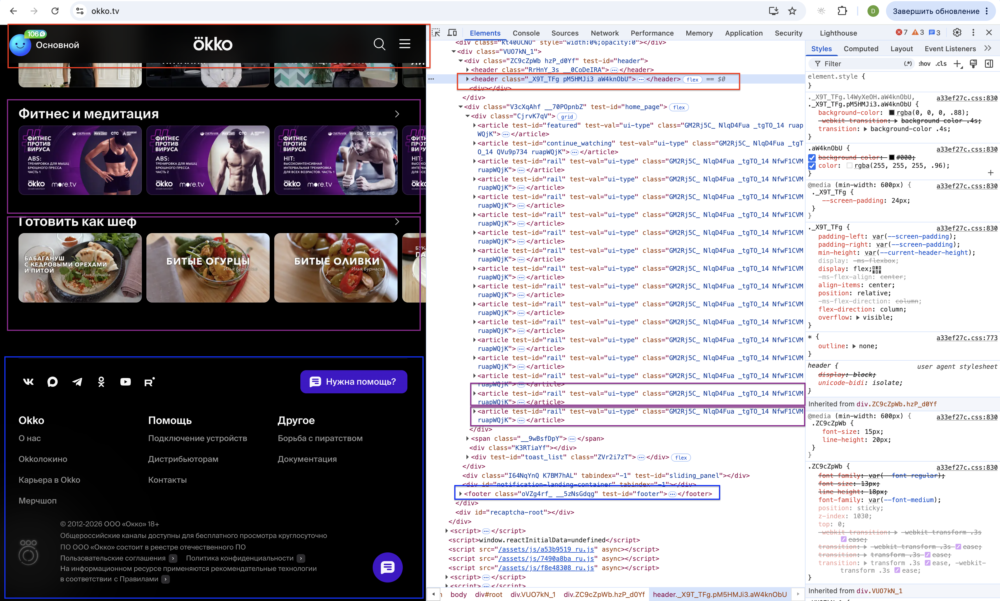

В примере можно увидеть, что структура документа не состоит только из «особенных» тегов, но также используются и обычные `div`.

При этом важно не идеализировать реальный сайт. Даже если в разметке есть `header`, `footer`, `article` и другие полезные элементы, дерево доступности всё равно может выглядеть проблемно. На скриншоте вкладки **Accessibility** в разделе 7 можно встретить записи вроде `link ""`, `button "" focusable: true`, `image ""`: это элементы без доступного имени. То есть структура страницы может быть семантической, но половина интерактивных элементов всё равно останется непонятной для screen reader, если у них нет текста, `alt`, `aria-label` или другой корректной подписи.

После знакомства с семантическими элементами некоторые разработчики впадают в другую крайность и начинают считать, что `<div>` использовать вообще нельзя. Это тоже ошибка. Элемент `<div>` остаётся важной частью HTML. Его задача — быть универсальным контейнером в ситуациях, когда специальной семантики не существует или не требуется.

Хороший практический вопрос выглядит так.

> Если убрать этот блок со страницы и показать его отдельно, могу ли я объяснить его назначение одним словом?

Если ответ звучит как «навигация», «статья», «боковая колонка», «подвал», скорее всего, существует подходящий семантический элемент.

Если ответ звучит как «контейнер для сетки», «обёртка для позиционирования», «группа элементов для стилизации», то обычный `<div>` вполне уместен.

Семантика не заменяет контейнеры. Она помогает использовать их там, где контейнер действительно нужен.
### Правильная структура HTML-документа

Каждая страница должна иметь базовую структуру. Рассмотрим минимальный каркас современной страницы.

```html
<!DOCTYPE html>
<html lang="ru">
<head>
  <meta charset="UTF-8">
  <meta name="viewport"
        content="width=device-width, initial-scale=1.0">

  <title>Моя страница</title>
</head>
<body>

</body>
</html>
```

Рассмотрим теги в самом начале документа, практически каждая строка здесь несёт смысловую нагрузку.
#### Зачем нужен DOCTYPE

Строка

```
<!DOCTYPE html>
```

сообщает браузеру, что документ написан по современным правилам HTML.

Исторически браузеры долгое время поддерживали различные режимы совместимости со старыми версиями веба. Если не указать doctype, браузер может перейти в специальный режим отображения, который имитирует поведение очень старых версий движков. Строка помогает браузеру правильно интерпретировать документ и использовать современный стандарт HTML.
#### Почему важен атрибут lang

Строка

```
<html lang="ru">
```

кажется ещё менее значимой. Многие новички вообще её пропускают. На самом деле этот атрибут нужен сразу нескольким системам.

Во-первых, его использует screen reader. Если страница написана на русском языке, программа должна выбрать соответствующие правила произношения. Если язык указан неверно или не указан вовсе, результат может звучать довольно забавно.

Во-вторых, информацию о языке используют поисковые системы. Она помогает лучше понять аудиторию страницы и её содержание.

В-третьих, на этот атрибут ориентируются встроенные переводчики браузеров.

#### Зачем нужен viewport

Есть ещё один атрибут, который часто копируют без понимания смысла.

```
<meta name="viewport"
      content="width=device-width, initial-scale=1.0">
```

Он связан с мобильными устройствами. Современные смартфоны имеют очень высокое разрешение экрана. Если не указать viewport, браузер может попытаться отобразить страницу так, будто она предназначена для большого монитора, а затем просто уменьшить её масштаб.

Результат обычно выглядит плохо: текст становится слишком мелким, элементы управления неудобно нажимать, а интерфейс оказывается рассчитан не на реальные размеры экрана, а на некую виртуальную область просмотра. Viewport сообщает браузеру, что страница должна адаптироваться под фактическую ширину устройства.
### Практика

Перед тобой следующий фрагмент.

```HTML
<div class="header">
    ...
</div>

<div class="navigation">
    ...
</div>

<div class="content">
    <div class="post">
        ...
    </div>
</div>

<div class="sidebar">
    ...
</div>

<div class="footer">
    ...
</div>
```

Переразметь его с использованием семантических элементов.

После этого ответь на вопросы.
- Какие элементы удалось заменить без сомнений?
- Где возникли неоднозначности?
- Остались ли места, где div всё ещё выглядит лучшим решением?
- Что изменилось в дереве Elements?

Обсуди результаты. Если получились разные варианты, попробуй аргументировать каждый выбор.
### Если кратко

Семантика — это не способ сделать код красивее и не набор формальных правил для прохождения проверки. Её задача — сообщить смысл документа браузеру, поисковым системам, screen reader и другим инструментам.

Семантические элементы помогают описывать структуру страницы через её назначение, а не через внешний вид. Благодаря этому код становится понятнее людям и легче обрабатывается машинами.

При этом семантика не отменяет использование div. Семантические элементы применяются там, где существует смысловая роль, а div остаётся универсальным контейнером для случаев, когда нужен только механизм группировки или стилизации.

## 2. Формы: поля, label и группировка

Если семантическая разметка отвечает на вопрос, из каких смысловых частей состоит страница, то формы отвечают на вопрос, как пользователь взаимодействует с сайтом и передаёт ему данные.

Практически любой современный веб-сервис построен вокруг форм. Регистрация, авторизация, поиск, оформление заказа, комментарии, обратная связь, настройки профиля — всё это разные варианты одной и той же идеи: пользователь вводит информацию, а приложение её обрабатывает.

Из-за этого качество разметки форм влияет не только на внешний вид интерфейса, но и на его удобство, доступность и даже конверсию. Форма может выглядеть красиво, но при этом быть неудобной для заполнения. Более того, она может оказаться практически непригодной для пользователей screen reader, несмотря на то что разработчик не увидит никаких визуальных проблем.

Поэтому при работе с формами важно думать не только о том, какие поля нужно показать пользователю, но и о том, как браузер и вспомогательные технологии будут интерпретировать эти поля.

### Форма глазами пользователя и глазами браузера

Когда человек смотрит на форму, он воспринимает её визуально. Он видит подписи, поля ввода, кнопки и подсказки.

Пример
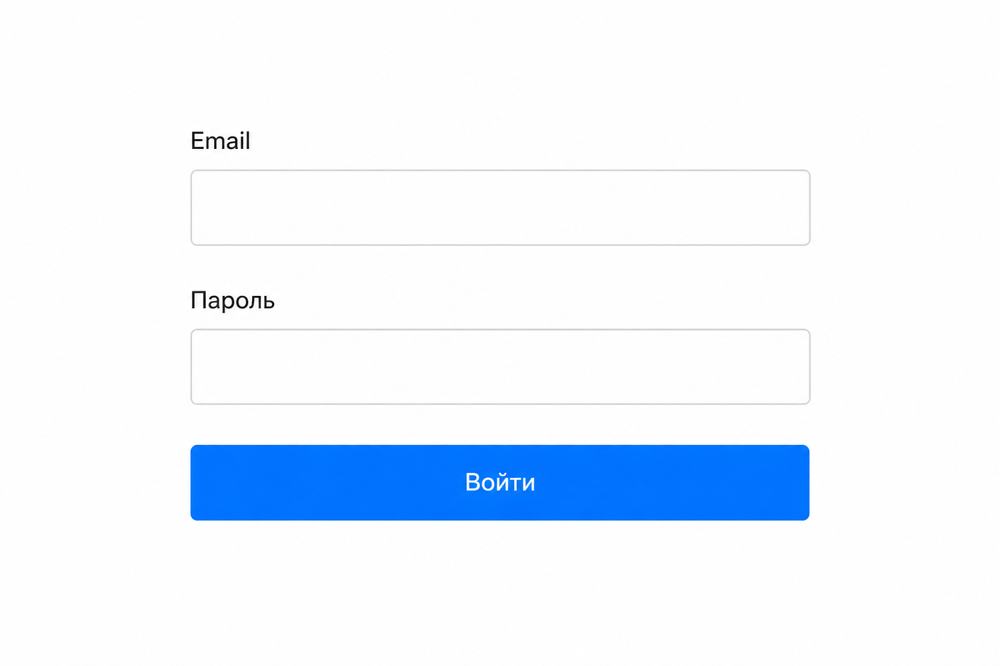

Для человека всё очевидно. Верхнее поле предназначено для email, нижнее — для пароля.

Но браузер не анализирует страницу так же, как человек. Он не умеет автоматически понимать, что текст над полем относится именно к этому полю. Если между подписью и элементом ввода нет специальной связи, для браузера это могут быть два независимых объекта. Поэтому важно подбирать доступное имя элемента.
### Почему каждому полю нужно имя

Представим самый простой пример.

```html
<input type="email">
```

С точки зрения браузера это поле ввода электронной почты. Но как screen reader должен его озвучить?

Обычно пользователь услышит что-то вроде следующего.

> Поле ввода текста.

Возникает проблема: поле есть, но его назначение неизвестно. Пользователь понимает, что что-то нужно ввести, но не знает, что именно.

Добавим подпись.

```html
<label for="email">
    Email
</label>

<input
    id="email"
    type="email">
```

Теперь ситуация меняется. Между подписью и полем появилась явная связь. Screen reader сможет озвучить элемент примерно так.

> Email, поле ввода.

Используя `label`, мы задали элементу доступное имя — то, как screen reader его представит пользователю. Но это далеко не единственный способ повлиять на то, что услышит человек за клавиатурой. Позже мы познакомимся с ARIA-атрибутами, которые позволяют точнее описывать роли, состояния и связи элементов и которые иногда оказываются единственным способом сделать интерфейс по-настоящему понятным.

То есть пользователь получает не только возможность взаимодействовать с формой, но и понимание того, что от него требуется.

На первый взгляд это выглядит как небольшая деталь. На практике именно такие детали определяют, сможет ли человек пользоваться сайтом самостоятельно.
### Почему placeholder не заменяет label

Одна из самых распространённых ошибок начинающих разработчиков выглядит так.

```html
<input
    type="email"
    placeholder="Введите email">
```

Кажется, что отдельная подпись больше не нужна. Пользователь и так видит текст внутри поля. Однако у такого решения есть несколько серьёзных недостатков.

Во-первых, placeholder исчезает после начала ввода. Если пользователь отвлёкся или вернулся к форме позже, он может уже не помнить, что именно требовалось указать.

Во-вторых, визуальное оформление placeholder обычно менее контрастное, чем обычный текст. Это может создавать проблемы для людей с нарушениями зрения.

В-третьих, placeholder не является полноценной заменой доступного имени элемента. Многие вспомогательные технологии работают с ним иначе, чем с настоящим label.

Поэтому правило очень простое.

> Placeholder может дополнять подпись, но не заменять её. Если поле существует, у него должен быть label.

**Каким же образом связать label и само поле?**

HTML предоставляет два основных способа создания связи между подписью и элементом управления.

Первый способ использует атрибуты `for` и `id`.

```html
<label for="username">
    Имя пользователя
</label>

<input
    id="username"
    type="text">
```

Когда пользователь нажимает на текст подписи, фокус автоматически переходит к соответствующему полю.

Кроме того, такая связь используется браузером при построении дерева доступности. Этот способ считается наиболее универсальным и чаще всего встречается в реальных проектах.
Второй вариант основан на вложенности.

```html
<label>
    Имя пользователя
    <input type="text">
</label>
```

Здесь связь возникает автоматически, потому что элемент ввода находится внутри label.

Оба способа корректны. Выбор обычно зависит от структуры документа и предпочтений команды.

Тег `label` нужен не только screen reader, но также имеет и другое преимущество. Рассмотрим чекбокс согласия с условиями использования.

Без label разметка может выглядеть так.

```html
<input
    type="checkbox"
    id="agree">

Я согласен с условиями
```

В этом случае пользователь должен попасть курсором точно по маленькому квадрату чекбокса.

Теперь добавим label.

```html
<input
    type="checkbox"
    id="agree">

<label for="agree">
    Я согласен с условиями
</label>
```

После этого кликабельной становится вся подпись. Так пользователю проще взаимодействовать с интерфейсом, особенно на мобильных устройствах.
### Выбираем тип поля по смыслу данных

При работе с формами начинающие разработчики часто используют вариант

```html
<input type="text">
```

для всех случаев жизни.

Технически это работает, однако HTML предоставляет гораздо более точные способы описания данных.

Например,

```html
<input type="email">
```

говорит браузеру, что ожидается адрес электронной почты.

```html
<input type="tel">
```

предназначен для телефонного номера.

```html
<input type="date">
```

используется для выбора даты.

```html
<input type="number">
```

для числовых значений.

```html
<input type="password">
```

для паролей.

Для выбора одного варианта из списка есть отдельный элемент.

```html
<label for="city">
    Город
</label>

<select id="city" name="city">
    <option value="">Выберите город</option>
    <option value="moscow">Москва</option>
    <option value="spb">Санкт-Петербург</option>
</select>
```

А для длинного свободного текста лучше подходит не `input`, а `textarea`.

```html
<label for="comment">
    Комментарий
</label>

<textarea
    id="comment"
    name="comment"
    rows="5"></textarea>
```

**Почему это важно?**
Потому что браузер получает дополнительную информацию о данных и может использовать её для улучшения пользовательского опыта.

Например, на мобильных устройствах для поля телефона может открываться цифровая клавиатура, а для email — клавиатура с удобным доступом к символу @. Кроме того, некоторые типы автоматически участвуют в нативной валидации, о которой мы поговорим в следующем разделе.
### Когда появляются группы полей

Пока форма состоит из независимых полей, всё достаточно просто. Но что делать, если несколько элементов образуют единую логическую группу?

Пример

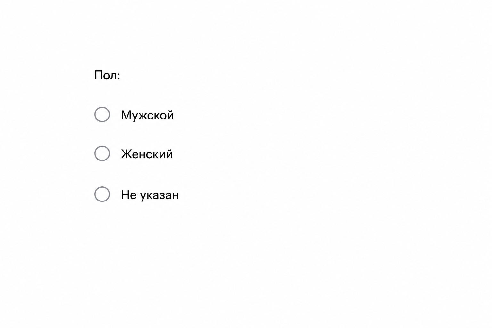

Каждая радиокнопка имеет собственную подпись. Но где находится подпись всей группы? Если её не указать явно, пользователь screen reader может услышать только отдельные варианты выбора и не понять, на какой вопрос он отвечает.

Для таких ситуаций HTML предоставляет элементы `fieldset` и `legend`.

Рассмотрим пример.

```html
<fieldset>

    <legend>
        Укажите пол
    </legend>

    <label>
        <input type="radio" name="gender">
        Мужской
    </label>

    <label>
        <input type="radio" name="gender">
        Женский
    </label>

</fieldset>
```

Теперь группа получила собственное название.

Для пользователя screen reader это означает, что перед перечислением вариантов будет озвучен общий контекст.

Другими словами, браузер понимает не только отдельные элементы, но и их логическую связь друг с другом.

**Важно понять, что `fieldset` необходимо использовать тогда, когда он действительно нужен.**

Как и любой инструмент, `fieldset` можно использовать чрезмерно. Не стоит помещать в него каждое отдельное поле формы. Если у вас есть независимые поля имени, email и пароля, дополнительная группировка обычно не нужна.

Но если элементы отвечают на один и тот же вопрос или образуют единый смысловой блок, `fieldset` становится хорошим решением.

Прежде чем перейти к практике, полезно настроить среду просмотра. HTML-файл можно просто открыть в браузере через `File → Open File`, однако такой подход не обновляется автоматически при сохранении. Расширение **Live Server** для VS Code решает эту проблему: правый клик по файлу → **Open with Live Server** — страница откроется с адресом вроде `127.0.0.1:5500`, а при каждом сохранении браузер подхватит изменения без перезагрузки. Если ты не используешь VS Code, подойдёт любой локальный сервер: важна не конкретная кнопка, а возможность открыть страницу через локальный адрес и быстро видеть изменения.

### Практика

Создай форму регистрации пользователя, содержащую:

- имя,
- адрес электронной почты,
- пароль,
- дату рождения,
- город через `select`,
- короткий комментарий через `textarea`,
- выбор пола,
- кнопку отправки.

Запусти файл через Live Server и убедись, что страница открывается по адресу `127.0.0.1:5500` и обновляется при сохранении.

После завершения проверь себя по следующему чек-листу.

1. У каждого поля есть связанный label.
2. Для данных выбраны подходящие типы input.
3. Радиокнопки объединены через fieldset и legend.
4. По нажатию на текст рядом с чекбоксами и радиокнопками активируется соответствующий элемент.
5. Форма остаётся понятной, даже если смотреть только на её HTML-разметку.

### Если кратко

Главная задача формы — не просто собрать данные, а сделать их ввод понятным и удобным.

Поэтому каждое поле должно иметь доступное имя, которое обычно задаётся через `label`. `placeholder` может дополнять подпись, но не заменяет её. Тип элемента следует выбирать по смыслу данных, а не по привычке использовать универсальный `text`. Когда несколько полей образуют единую логическую группу, их следует объединять через `fieldset` и `legend`.

Именно такие, на первый взгляд небольшие решения превращают форму из набора полей ввода в интерфейс, которым удобно пользоваться и человеку, и вспомогательным технологиям.
## 3. Нативная валидация и её границы

В предыдущем разделе мы научились правильно описывать поля формы: выбирать подходящие типы данных, связывать поля с `label` и группировать связанные элементы через `fieldset` и `legend`. Однако форма, которая позволяет ввести что угодно, редко бывает полезной.

Представим страницу регистрации. Пользователь должен указать адрес электронной почты и придумать пароль. Что произойдёт, если он случайно введёт вместо email строку вроде

```text
abrakadabra
```

или оставит поле пустым?

С точки зрения браузера это обычный текст. Если ничего не проверять, форма будет успешно отправлена на сервер. Приложение получит данные, которые не соответствуют ожиданиям, и дальнейшая работа может пойти не по плану.

Именно поэтому практически любая форма содержит механизм проверки введённых данных. Этот процесс называется **валидацией**.

**Валидация** — это проверка того, что введённые пользователем данные соответствуют определённым правилам.
### Валидация, которую браузер делает за нас

Рассмотрим простое поле.

```html
<input
    type="email"
    required>
```

На первый взгляд здесь нет ничего особенного. Но браузер уже получил две важные инструкции.

Во-первых, поле обязательно для заполнения. Во-вторых, введённое значение должно соответствовать формату email. Если пользователь попытается отправить форму пустой, браузер покажет сообщение об ошибке. Если вместо адреса электронной почты будет введён произвольный текст, результат будет тем же.

Заметим важную особенность: мы не написали ни одной строки JavaScript. Проверка появилась автоматически благодаря правильному использованию HTML.
### Проверка через тип данных

Во втором разделе мы говорили, что тип поля нужно выбирать по смыслу данных. Одной из причин является встроенная проверка.

Например,

```html
<input type="email">
```

сообщает браузеру, что ожидается адрес электронной почты.

А поле

```html
<input type="url">
```

ожидает веб-адрес.

Для пользователя это выглядит как дополнительная защита от опечаток. Если он случайно забудет символ @ или введёт значение, которое совсем не похоже на адрес, браузер предупредит его ещё до отправки формы.

Важно понимать, что такие проверки не являются идеальными. Браузер не может гарантировать существование почтового ящика или доступность сайта. Он лишь проверяет, соответствует ли значение ожидаемому формату.
### Ограничения длины

Во многих формах существуют требования к количеству символов. Например, пароль должен содержать минимум восемь символов, а имя пользователя — не более двадцати.

Для этого используются следующие атрибуты.

```html
<input
    minlength="8"
    maxlength="20">
```

Теперь браузер сможет предупредить пользователя о нарушении этих ограничений. Подобные проверки кажутся мелочью, но именно из таких мелочей складывается удобный интерфейс. Гораздо приятнее узнать об ошибке сразу, чем заполнить длинную форму и получить отказ только после отправки данных на сервер.

### Ограничения диапазона

Для числовых значений часто важно не только то, что пользователь ввёл число, но и то, в каком диапазоне оно находится. Представим поле возраста.

```html
<input
    type="number"
    min="0"
    max="120">
```

Теперь браузер знает допустимые границы значений. Аналогичным образом можно ограничивать цены, количество товаров, проценты скидок и любые другие числовые параметры.

### Атрибут step

Иногда недостаточно ограничить диапазон. Нужно также указать допустимый шаг изменения значения.

Пример
```html
<input
    type="number"
    min="0"
    max="100"
    step="5">
```

В этом случае допустимыми будут следующие значения.

```text
0
5
10
15
...
```
### Pattern: когда стандартных проверок недостаточно

Бывают ситуации, когда встроенных возможностей HTML недостаточно. Например, компания решила, что логин должен состоять только из латинских букв и цифр.

Для таких случаев существует атрибут `pattern`.

```html
<input
    pattern="[A-Za-z0-9]+">
```

Он позволяет описывать допустимые значения через регулярные выражения. Однако здесь стоит быть осторожным. Регулярные выражения быстро становятся сложными для чтения и поддержки. Кроме того, слишком строгие правила могут создавать проблемы для пользователей.

Например, если в учебной форме нужно принять российский номер в формате `+7 999 123-45-67`, можно написать так.

```html
<label for="phone">
    Телефон
</label>

<input
    id="phone"
    name="phone"
    type="tel"
    placeholder="+7 999 123-45-67"
    pattern="^\+7\s\d{3}\s\d{3}-\d{2}-\d{2}$">
```

Это рабочий пример для конкретного формата, но не универсальное правило для всех телефонов. Телефонные номера в реальных продуктах часто вводят с пробелами, скобками, без дефисов, через `8` вместо `+7` и в международных форматах. Поэтому в продакшене номера обычно нормализуют и проверяют на сервере, а не пытаются описать все случаи одной регуляркой в HTML.

Поэтому pattern обычно используют только там, где действительно необходима дополнительная проверка.
### Где заканчиваются возможности нативной валидации

На этом этапе может показаться, что HTML способен решить практически любую задачу. Однако это не так.

Попробуем сформулировать несколько правил:

- пароль должен содержать минимум одну цифру;
- пользователь должен быть старше восемнадцати лет;
- email не должен быть уже зарегистрирован в системе;
- дата окончания курса должна быть позже даты начала.

Некоторые из этих требований можно частично реализовать через HTML. Некоторые — нет.

Главная проблема состоит в том, что браузер умеет проверять только отдельное поле или ограниченный набор формальных условий. Он не знает ничего о бизнес-логике приложения и не может обратиться к базе данных. Он не знает, какие пользователи уже существуют в системе. Именно поэтому рано или поздно любая серьёзная форма требует дополнительных проверок.
### Самое опасное заблуждение о валидации

На этом этапе многие начинающие разработчики делают ошибочный вывод.

> Если браузер проверил данные, значит, серверу можно доверять результат.

Но это неверно. Чтобы понять, почему нужно вспомнить одну важную особенность веба: HTML находится на стороне клиента. А значит, пользователь контролирует его полностью. Он может открыть DevTools и удалить атрибут required, может изменить значение min или max, может отключить JavaScript.

Также он может вообще не использовать форму, а, например, запрос отправить напрямую через curl.

```bash
curl -X POST http://localhost:3000/register
```

В этом случае никакая клиентская валидация вообще не будет выполнена. Сервер получит данные такими, какими их отправили. Если сервер доверяет клиенту, система становится уязвимой.
Поэтому существует фундаментальное правило веб-разработки.
> Никогда не доверяй данным, пришедшим от клиента.

Какими бы надёжными ни казались проверки на стороне браузера, сервер обязан проверить данные заново.
### Клиентская и серверная валидация решают разные задачи

После этого может возникнуть следующий вопрос.

> Если сервер всё равно обязан проверять данные, зачем тогда нужна клиентская валидация?

Потому что она решает другую проблему. Серверная проверка отвечает за безопасность и корректность работы системы. Клиентская проверка отвечает за удобство пользователя.

### Ошибка должна быть не только видна

Большинство разработчиков думают об ошибках исключительно визуально. Появился красный текст, значит, пользователь поймёт, что произошло. Но мы уже знаем, что страницу могут использовать люди, которые не видят экран.

Поэтому сообщение об ошибке должно быть доступно и для screen reader.

Рассмотрим пример.

```html
<label for="email">
    Email
</label>

<input
    id="email"
    aria-describedby="email-error">

<p id="email-error">
    Введите корректный адрес электронной почты
</p>
```

Атрибут `aria-describedby` связывает поле и поясняющий текст.
Теперь screen reader сможет озвучить сообщение вместе с полем ввода.
Получается, что ошибка становится доступной не только визуально, но и семантически.

Если сообщение появляется уже после действия пользователя, например после неудачной отправки формы, то одной связи через `aria-describedby` может быть недостаточно. Screen reader не обязан сам перечитывать всю страницу и искать новый текст. Для динамических сообщений используют `aria-live`.

```html
<p
    id="email-error"
    aria-live="polite">
</p>
```

Атрибут `aria-live="polite"` сообщает вспомогательным технологиям: если текст внутри этого элемента изменится, нужно озвучить изменение, когда это не перебьёт текущее чтение. Поэтому контейнер для ошибки лучше держать в DOM заранее, а при ошибке менять его текст.

```html
<input
    id="email"
    aria-describedby="email-error">

<p
    id="email-error"
    aria-live="polite">
    Введите корректный адрес электронной почты
</p>
```

Подробнее об атрибутах вроде `aria-describedby`, `aria-label` и `aria-labelledby` мы поговорим в разделе про ARIA.

### Практика

Возьми форму из предыдущего раздела и добавь в неё:

- обязательные поля через required;
- проверки длины через minlength и maxlength;
- ограничения диапазона через min и max;
- подходящие типы input;
- связанное через aria-describedby сообщение об ошибке;
- контейнер для динамического текста ошибки с `aria-live="polite"`.

После этого попробуй ответить на вопрос.

Какие из твоих проверок браузер может выполнить самостоятельно, а какие — обязательно придётся реализовывать на сервере?

### Если кратко

Нативная валидация позволяет получить базовую проверку данных практически бесплатно. Атрибуты required, minlength, maxlength, min, max, step и корректно выбранные типы input помогают отлавливать многие ошибки ещё до отправки формы.

Однако возможности HTML ограничены. Браузер не знает бизнес-логику приложения и не может гарантировать безопасность данных. Поэтому клиентская валидация существует для удобства пользователя, а серверная — для защиты системы. Первая полезна, но никогда не заменяет вторую.

## 4. Доступность: screen reader, нативность и ARIA

До этого момента мы говорили о семантике и формах в основном с точки зрения структуры документа. Мы выяснили, что HTML нужен не только браузеру, но и поисковым системам, инструментам анализа и вспомогательным технологиям. Теперь пришло время поговорить о том, для кого вся эта семантика создаётся в первую очередь. Когда разработчик впервые слышит слово «доступность» (accessibility), он часто представляет себе очень узкую группу пользователей — людей с серьёзными нарушениями зрения. Из-за этого доступность воспринимается как дополнительная функция, которая нужна только в особых проектах. На практике ситуация выглядит совершенно иначе.

**Доступность** — это не набор специальных возможностей для небольшой группы пользователей. Это свойство интерфейса, которое показывает, насколько им можно пользоваться в разных условиях и с разными ограничениями.

Однако прежде чем обсуждать конкретные инструменты, нужно понять, как вспомогательные технологии вообще воспринимают страницу.

### Как screen reader видит веб-страницу

**Screen reader** — это программа, которая преобразует информацию на экране в речь или в вывод на специальное устройство Брайля. Наиболее известные примеры — NVDA на Windows, VoiceOver на macOS и iOS, TalkBack на Android.

Когда браузер получает документ, он строит не только DOM-дерево, которое мы видим во вкладке Elements. Параллельно создаётся ещё одно представление страницы — дерево доступности, или accessibility tree.

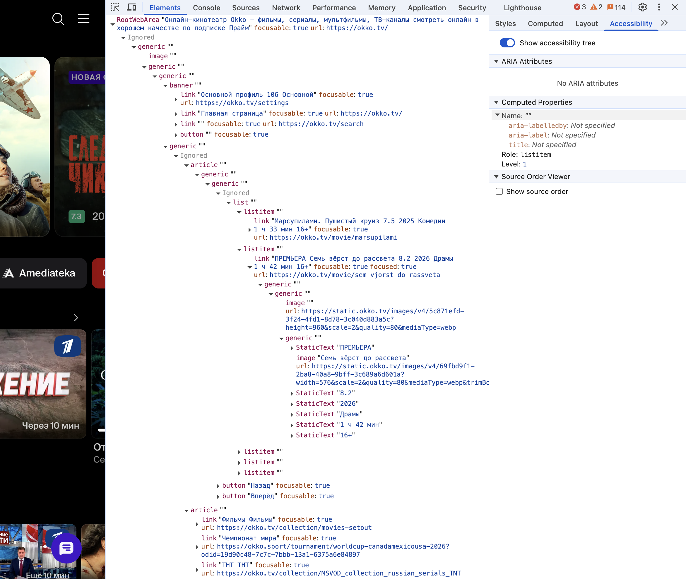

Именно его читает screen reader.

Увидеть это дерево можно прямо в DevTools. Выбери любой элемент на странице (через инспектор или кликом) и открой вкладку **Accessibility** в правой панели. Если вкладки нет, нажми на `>>` и найди её в списке. На скриншоте видны **accessibility tree** (дерево доступности), **ARIA attributes** (ARIA-атрибуты выбранного элемента), **computed properties** (вычисленные свойства) и **source order viewer** (проверка порядка элементов в документе). В дереве для каждого элемента будут перечислены его роль, доступное имя, описание и состояние — именно то, что screen reader передаст пользователю.

Для каждого элемента в этом дереве браузер пытается определить несколько характеристик:

- роль элемента,
- его доступное имя,
- описание,
- состояние,
- связи с другими элементами.

Рассмотрим простой пример.

```html
<button>
    Отправить
</button>
```

Для нас это обычная кнопка.

Для screen reader этот элемент превращается примерно в следующую информацию.

```text
Роль: кнопка
Имя: Отправить
Состояние: доступна
```

Когда пользователь доходит до неё с клавиатуры, screen reader может произнести следующее.

> Кнопка «Отправить».

Обрати внимание: программа озвучивает не HTML и не внешний вид элемента. Она озвучивает его смысл.

Именно поэтому семантика становится настолько важной.

### Почему семантика внезапно оказывается критичной

Вернёмся к примеру из первого раздела. Представим два варианта навигации.

Первый вариант

```html
<div class="navigation">
    ...
</div>
```

Второй вариант

```html
<nav>
    ...
</nav>
```

Для зрячего пользователя различий может не существовать. Но браузер воспринимает эти варианты совершенно по-разному. Во втором случае он понимает следующее.

> Передо мной навигационная область.

Эта информация попадает в дерево доступности.

Получается, что семантическая разметка помогает не только поисковым системам и разработчикам. Она напрямую влияет на то, насколько удобно незрячий пользователь сможет работать с сайтом. Именно поэтому доступность начинается не с ARIA и не с специальных инструментов, а с обычного HTML.
### Alt-текст: один из самых известных инструментов доступности

Практически каждый разработчик хотя бы раз слышал про атрибут alt, но его назначение часто понимают неправильно. Некоторые считают, что alt нужен исключительно для SEO. Другие используют его как место для перечисления ключевых слов.

На самом деле основная задача alt — заменить изображение в ситуациях, когда пользователь не может его увидеть. Представим страницу интернет-магазина. На ней есть фотография товара. Если пользователь работает со screen reader, он не увидит изображение.

Значит, браузер должен предоставить альтернативное описание.

Пример

```html

```

Теперь пользователь получит ту же информацию, что и зрячий посетитель.

Но не каждое изображение нужно описывать словами. Если картинка ничего не добавляет к содержанию и служит только украшением, правильный вариант — пустой `alt`.

```html

```

В этом случае screen reader пропустит изображение. Это лучше, чем заставлять пользователя слушать мусор вроде «звёздочка», «декор» или имя файла. Смысл простой: если изображение несёт информацию, `alt` должен заменить её текстом. Если не несёт, `alt=""` честно убирает его из озвучивания.

### ARIA

**ARIA (Accessible Rich Internet Applications)** — это набор специальных атрибутов, которые позволяют дополнить информацию о компонентах интерфейса.

Например,

```html
<button
    aria-expanded="true">
```

сообщает screen reader, что связанный элемент сейчас раскрыт. Это полезная информация, которой нет в обычном HTML. В таких случаях ARIA действительно помогает. Но заметим важную особенность: ARIA не исправляет плохую разметку автоматически. Если использовать её неправильно, доступность может стать хуже.

Рассмотрим пример.

```html
<button role="heading">
```

Здесь нет непредсказуемого конфликта. ARIA-роль детерминированно перекрывает нативную роль элемента в дереве доступности. Для screen reader этот элемент перестанет быть кнопкой и станет заголовком. В список кнопок он не попадёт, зато всё ещё будет кликаться мышью и получать фокус, потому что ARIA меняет только то, как элемент представлен вспомогательным технологиям, и не меняет его поведение в браузере.

Пользователь screen reader получит ложную информацию: слышит заголовок, а фактически перед ним кликабельный элемент. Дополнительная проблема: `role="heading"` требует `aria-level`, иначе у заголовка нет уровня.

```html
<button
    role="heading"
    aria-level="2">
    Отправить
</button>
```

Даже с `aria-level` это плохая разметка: кнопка не должна притворяться заголовком. ARIA ничего не чинит и ничего не ломает в поведении элемента. Она только говорит правду или врёт про смысл. Из-за этого `div` с `role="button"` всё равно остаётся недоступным с клавиатуры, если разработчик отдельно не добавил фокус, обработку Enter и Space и остальные детали настоящей кнопки.

### Когда ARIA действительно нужна

ARIA становится полезной тогда, когда HTML не способен выразить нужный смысл самостоятельно.

Например:
- описание ошибок через aria-describedby,
- уведомления через aria-live,
- состояние раскрывающихся блоков через aria-expanded,
- дополнительные связи между элементами через aria-labelledby.

То есть ARIA не заменяет семантический HTML. Она дополняет его там, где возможностей HTML недостаточно.
### aria-label и aria-labelledby

Иногда у элемента нет подходящего текстового содержимого.
Например, кнопка может содержать только иконку.

```html
<button>
    🔍
</button>
```

Зрячий пользователь понимает, что это кнопка поиска. Screen reader может не понять этого вовсе. В такой ситуации можно явно задать имя.

```html
<button aria-label="Поиск">
    🔍
</button>
```

Теперь браузер сможет использовать значение aria-label как доступное имя.
Другой вариант — сослаться на уже существующий текст.

```html
<h2 id="search-title">
    Поиск по сайту
</h2>

<button
    aria-labelledby="search-title">
    🔍
</button>
```

В примере на скрине используется `aria-label` как описание кнопок «Вперёд» и «Назад», чтобы screen reader смог понять функциональное назначение `button`.

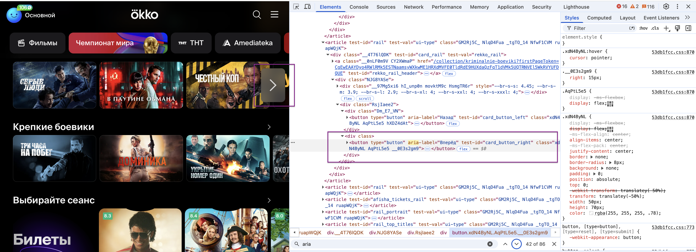

В этом случае имя будет взято из элемента с указанным идентификатором. Такие атрибуты полезны, но важно помнить: они используются тогда, когда обычной семантики недостаточно. Если имя уже может быть получено через содержимое кнопки или связанный label, дополнительные атрибуты чаще всего не нужны.

Причина в том, что браузер вычисляет доступное имя по специальному алгоритму. Упрощённая лестница выглядит так.

1. Если задан `aria-labelledby`, имя берётся из связанного элемента.
2. Если задан `aria-label`, используется его текст.
3. Если поле связано с `label`, имя берётся из `label`.
4. Если элемент содержит собственный текст, используется этот текст.
5. Для изображения источником имени становится `alt`.

Порядок важен. Если у поля уже есть видимый `label`, а поверх него добавить другой `aria-label`, screen reader может озвучить именно ARIA-текст, а не видимую подпись. Для зрячего пользователя поле называется «Email», а для screen reader — «Логин». Это не улучшение, а расхождение между интерфейсом и деревом доступности.

### Практика

Установи NVDA, если работаешь на Windows, используй VoiceOver на macOS или iOS, TalkBack на Android. На Linux можно попробовать Orca: он обычно доступен в репозиториях дистрибутива и работает вместе с браузером и системной средой доступности. После этого попробуй пройти любую знакомую страницу.

Ответь на несколько вопросов.
- Какие элементы screen reader распознаёт без проблем?
- Какие части интерфейса оказываются неудобными?
- Как озвучиваются кнопки?
- Что происходит с полями без label?

После этого замени несколько кнопок на div с обработчиком клика и сравни результат.
### Если кратко

Screen reader работает не с внешним видом страницы, а с деревом доступности, которое браузер строит на основе HTML. Поэтому качественная доступность начинается с правильной семантики и использования нативных элементов.

Элементы вроде button, input или nav уже содержат встроенное поведение и информацию для вспомогательных технологий. Используя их, разработчик получает доступность практически бесплатно.

ARIA нужна для дополнения семантики в тех случаях, когда возможностей HTML недостаточно. Однако неправильное использование ARIA способно ухудшить доступность интерфейса. Поэтому главным правилом остаётся принцип: сначала нативный HTML, затем ARIA и только при реальной необходимости.

## 5. Клавиатура и фокус-менеджмент

В предыдущем разделе мы говорили о том, как screen reader воспринимает страницу. Мы выяснили, что браузер строит дерево доступности, определяет роли элементов и вычисляет их доступные имена. Однако даже идеально размеченная страница остаётся бесполезной, если пользователь не может до этих элементов добраться.

Большинство разработчиков работают с сайтами при помощи мыши и трекпада. Из-за этого возникает опасная иллюзия: если элемент можно нажать мышью, значит, интерфейс работает правильно.

На практике существует множество пользователей, которые взаимодействуют с сайтом иначе. Кто-то использует только клавиатуру. Кто-то работает со screen reader, где клавиатура становится основным способом навигации. Кто-то временно не может пользоваться мышью из-за травмы. Наконец, даже опытный пользователь часто предпочитает клавиатуру, потому что она позволяет выполнять многие действия быстрее.

Поэтому доступность интерфейса определяется не только тем, что пользователь может сделать, но и тем, **может ли он добраться до нужного элемента без мыши**.

Чтобы понять, насколько хорошо работает твоя страница, достаточно провести простой эксперимент.

### Эксперимент на одну минуту

Открой любой знакомый сайт и убери руку с мыши.

Попробуй выполнить простую задачу, например заполнить форму входа или оформить заказ, используя только следующие клавиши.

```text
Tab
Shift + Tab
Enter
Space
```

Уже через несколько минут становятся заметны проблемы, которые раньше оставались незаметными. Иногда невозможно добраться до нужной кнопки. Иногда порядок перемещения выглядит хаотичным. Иногда непонятно, где именно находится курсор. Иногда элемент выглядит как кнопка, но вообще не реагирует на клавиатуру.

Подобные ошибки встречаются гораздо чаще, чем кажется. И все они связаны с одной фундаментальной концепцией — фокусом.

### Что такое фокус

Фокус показывает, какой элемент страницы сейчас готов принять действие пользователя. Если пользователь нажмёт Enter, действие будет выполнено именно над этим элементом. Если пользователь начнёт вводить текст, ввод попадёт именно в это поле. Можно представить фокус как невидимый указатель, который постоянно перемещается по странице. Для пользователей мыши наличие фокуса не всегда очевидно. Они просто кликают по нужному элементу. Для пользователей клавиатуры фокус является главным инструментом навигации.

### Как браузер перемещает фокус

Когда пользователь нажимает клавишу Tab, браузер начинает последовательно переходить между интерактивными элементами страницы.

Обычно это:

- ссылки,
- кнопки,
- поля ввода,
- чекбоксы,
- радиокнопки,
- элементы select,
- некоторые другие интерактивные компоненты.

Важно заметить, что браузер делает это автоматически. Разработчику не нужно писать дополнительный код для стандартных элементов HTML.
### Почему порядок табуляции определяется HTML, а не дизайном

Многие начинающие разработчики предполагают, что клавиша Tab перемещается по странице так же, как пользователь воспринимает её визуально.

На самом деле браузер ориентируется не на внешний вид, а на порядок элементов в DOM.

Рассмотрим пример.

```html
<input placeholder="Имя">

<input placeholder="Email">

<button>
    Отправить
</button>
```

При последовательном нажатии Tab фокус будет двигаться сверху вниз именно в таком порядке. Теперь представим, что при помощи CSS мы визуально переставили элементы местами. Для пользователя страница выглядит иначе. Однако браузер по-прежнему ориентируется на исходный порядок HTML.

В результате пользователь клавиатуры может столкнуться с неожиданным поведением: визуальный порядок и порядок навигации перестают совпадать.

Поэтому хорошая практика заключается в том, чтобы логика документа определялась прежде всего HTML-разметкой, а не только визуальным расположением элементов.
### Почему div снова оказывается проблемой

В разделе про доступность мы уже сравнивали button и div. Теперь можно посмотреть на ту же проблему с точки зрения клавиатурной навигации.

Рассмотрим элемент.

```html
<div>
    Купить
</div>
```

Внешне он может выглядеть как кнопка. Однако попробуй добраться до него клавишей Tab. И ничего не произойдёт, так как для браузера это просто обычный контейнер и он не участвует в навигации.

Теперь рассмотрим настоящий button.

```html
<button>
    Купить
</button>
```

Этот элемент автоматически включается в порядок табуляции. Пользователь может добраться до него с клавиатуры и активировать его без мыши.

### Видимый фокус: единственный ориентир пользователя

По умолчанию браузер обычно отображает фокус в виде рамки вокруг элемента. Многие дизайнеры считают такую рамку некрасивой и пытаются убрать её. Из-за этого в проектах регулярно появляется код вроде следующего.

```css
*:focus {
    outline: none;
}
```

Синтаксис CSS мы подробно разберём на следующей неделе. Сейчас достаточно понять смысл: эта строка выключает стандартную рамку фокуса для всех элементов. С точки зрения доступности это одна из самых вредных строк CSS, которые можно написать. После удаления outline пользователь продолжает перемещаться по странице клавишей Tab, но перестаёт понимать, где находится фокус.
### Как правильно работать с фокусом

Из этого не следует, что стандартную рамку браузера нельзя менять. Важно соблюдать одно правило.

> Фокус можно стилизовать, но нельзя скрывать.

Пример 1

```css
:focus-visible {
    outline: 2px solid blue;
}
```

Пример 2

```css
:focus-visible {
    box-shadow: 0 0 0 3px rgba(0,0,0,.3);
}
```

Конкретный внешний вид может различаться.

Главное, чтобы пользователь всегда видел, какой элемент сейчас активен.

Если в домашнем задании нужно поправить фокус, можно использовать готовый минимальный вариант.

```css
button:focus-visible,
a:focus-visible,
input:focus-visible,
select:focus-visible,
textarea:focus-visible {
    outline: 2px solid blue;
    outline-offset: 2px;
}
```

На следующей неделе мы разберём, как именно работают селекторы и свойства. Сейчас важно не запомнить весь CSS, а увидеть разницу: `outline: none` скрывает фокус, а `outline` вместе с `:focus-visible` задаёт заметную рамку для клавиатурной навигации.

### tabindex: инструмент управления фокусом

До этого момента браузер самостоятельно решал, какие элементы участвуют в навигации. Иногда разработчику требуется изменить это поведение. Для таких ситуаций существует атрибут `tabindex`.
Однако использовать его нужно очень осторожно.
Большинство проблем с клавиатурной навигацией связаны именно с неправильным использованием tabindex.
#### tabindex="0"

Рассмотрим пример.

```html
<div tabindex="0">
    Дополнительная информация
</div>
```

Теперь элемент станет доступным через Tab. Он будет участвовать в общем порядке навигации вместе с другими интерактивными объектами.
Чаще всего tabindex="0" используют для специальных компонентов, которые действительно должны получать фокус.
#### tabindex="-1"

Рассмотрим другой распространённый вариант.

```html
<div tabindex="-1">
```

Такой элемент не участвует в обычной табуляции. Однако разработчик может перевести на него фокус программно.

Этот подход часто используется для модальных окон, уведомлений и других компонентов, которые должны получать фокус в определённый момент работы интерфейса.
#### Почему положительные значения считаются антипаттерном

HTML также позволяет писать следующее.

```html
<div tabindex="1">
<div tabindex="2">
<div tabindex="3">
```

На первый взгляд идея кажется удобной, так как можно вручную определить порядок переходов между элементами. Проблема становится заметна по мере роста проекта. Представь страницу из нескольких десятков интерактивных элементов.
Добавляется новая кнопка.
Удаляется старая.
Меняется структура документа.

Разработчику приходится постоянно пересчитывать значения tabindex и следить за тем, чтобы они не конфликтовали между собой. Поддерживать такую систему крайне сложно.

Кроме того, искусственный порядок навигации часто начинает противоречить логике документа.

Поэтому положительные значения tabindex сегодня считаются плохой практикой.

В большинстве случаев рекомендуется использовать только

```text
tabindex="0"
tabindex="-1"
```

и позволять браузеру самостоятельно определять порядок переходов.

### Практика

Возьми любой популярный сайт.

1. Убери руки с мыши.
2. Попробуй полностью заполнить форму только с клавиатуры.
3. Используй исключительно Tab, Shift + Tab, Enter и Space.
4. Зафиксируй все моменты, которые вызвали затруднения.

После проверки ответь на вопросы.

- До всех ли элементов удалось добраться?
- Соответствует ли порядок табуляции логике формы?
- Всегда ли видно положение фокуса?
- Есть ли элементы, которые работают только мышью?
- Используются ли где-либо положительные значения tabindex?
Если были найдены проблемы выше, предложи, как можно это исправить.

### Если кратко

Для пользователей клавиатуры фокус играет ту же роль, что указатель мыши для остальных пользователей. Именно поэтому он должен быть логичным, предсказуемым и визуально заметным.

Браузер автоматически обеспечивает корректную навигацию для нативных интерактивных элементов. Использование button, input, select и других стандартных компонентов позволяет получить поддержку клавиатуры практически бесплатно.

Атрибут tabindex следует использовать осторожно. Значение 0 добавляет элемент в общий порядок навигации, значение −1 позволяет переводить на него фокус программно, а положительные значения в большинстве случаев создают больше проблем, чем решают.

Наконец, важно помнить, что никакой Lighthouse не заменит реальную проверку интерфейса с клавиатуры. Если страницу невозможно использовать без мыши, она не может считаться по-настоящему доступной.
## 6. SEO, Open Graph и Schema.org

В самом начале темы мы говорили, что HTML читают не только люди. До этого момента мы в основном рассматривали взаимодействие HTML с браузером и screen reader. Теперь посмотрим на страницу глазами ещё одного важного участника веба — поискового робота.

От того, как поисковая система оценит твою страницу, напрямую зависит, как высоко она появится в выдаче, а значит, сколько людей вообще найдут сайт. Именно поэтому владельцы коммерческих проектов часто подходят к этому вопросу крайне серьёзно: нанимают SEO-специалистов, проводят аудиты, перестраивают разметку и отслеживают каждое изменение алгоритмов. Для них HTML — это не просто разметка, а инструмент, от которого зависят трафик и, как следствие, деньги.

Когда поисковая система обнаруживает новую страницу, она не видит её так же, как человек. Робот не оценивает красивую анимацию, не восхищается удачной цветовой схемой и не обращает внимания на современный дизайн. Его задача — понять, **о чём эта страница**, какую информацию она содержит и насколько она соответствует запросу пользователя. Именно здесь снова оказывается важной семантика HTML.
### Что такое SEO и какую роль играет HTML

**SEO (Search Engine Optimization)** — это комплекс методов, направленных на то, чтобы сделать сайт более понятным для поисковых систем и повысить вероятность его появления в результатах поиска.
На положение сайта влияет огромное количество факторов: качество контента, скорость загрузки страниц, количество внешних ссылок, удобство использования, техническое состояние проекта и многое другое. Однако HTML создаёт основу, без которой поисковой системе значительно сложнее понять содержание страницы.
### Заголовок страницы: элемент title

Одним из важнейших элементов документа является тег `<title>`. Он располагается внутри раздела `<head>`.

Пример

```html
<head>
    <title>Как приготовить домашнюю пиццу</title>
</head>
```

Именно содержимое `title` поисковая система часто использует в качестве заголовка страницы в результатах поиска, поэтому он должен кратко и точно описывать содержание документа.
### Meta description

Следующий важный элемент располагается рядом с `title`. Речь идёт о метатеге `description`.

Пример

```html
<meta
    name="description"
    content="Каталог современных ноутбуков для работы, учёбы и игр.">
```

В отличие от title, description обычно не отображается непосредственно на странице. Его основная задача — предоставить краткое описание документа для поисковых систем. Во многих случаях именно этот текст используется в качестве описания страницы в поисковой выдаче. Важно понимать, что поисковая система не обязана использовать именно этот текст. Иногда она формирует описание самостоятельно. Тем не менее наличие качественного description значительно увеличивает вероятность того, что пользователь сразу поймёт содержание страницы ещё до перехода на сайт.

### Почему структура заголовков важна

Мы уже обсуждали семантические элементы документа. Ещё одним способом описания структуры являются заголовки.

HTML предоставляет шесть уровней заголовков.

```html
<h1>
<h2>
<h3>
<h4>
<h5>
<h6>
```

Хорошая структура заголовков одновременно улучшает:

- читаемость документа,
- доступность,
- понимание страницы поисковыми системами.

Именно поэтому рекомендуется использовать один h1 для основной темы документа, а остальные уровни строить последовательно, не пропуская уровни без необходимости.

Пример

```text
H1 Каталог ноутбуков

    H2 Игровые модели

        H3 ASUS

        H3 Lenovo

    H2 Ноутбуки для работы
```

Такая структура значительно понятнее, чем случайный набор заголовков разных уровней.
### Open Graph: как страница выглядит в социальных сетях

Когда ты отправляешь другу ссылку в мессенджере, вместо голого URL обычно появляется красивая карточка:

- изображение,
- заголовок,
- краткое описание.

Откуда берётся эта информация?

Её формируют специальные метатеги стандарта **Open Graph**.
Пример

```html
<meta property="og:title"
      content="Каталог ноутбуков">

<meta property="og:description"
      content="Выберите ноутбук для работы и игр">

<meta property="og:image"
      content="cover.jpg">
```

Когда социальная сеть или мессенджер обнаруживает такие теги, она использует их для создания предпросмотра ссылки.
Пример того, как выглядит карточка настройки страницы и карточка в соцсетях. 
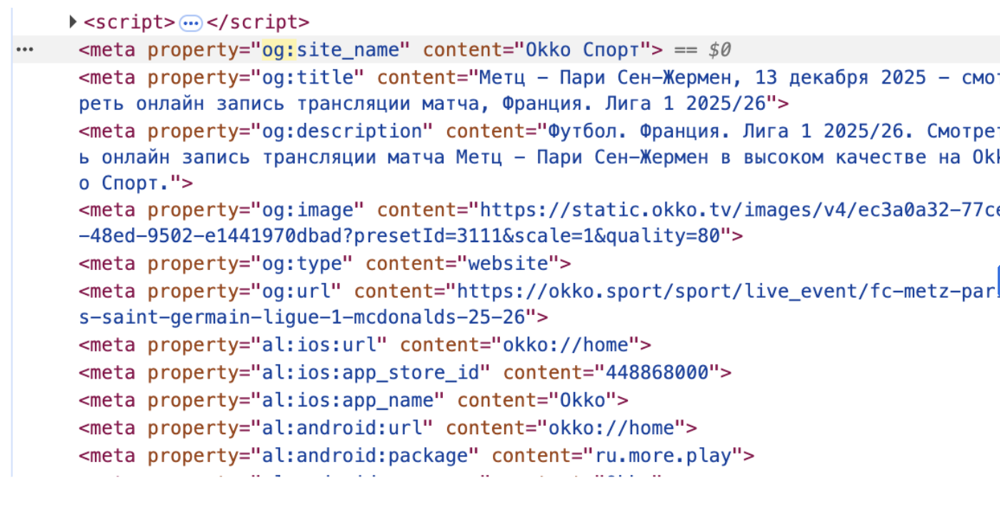
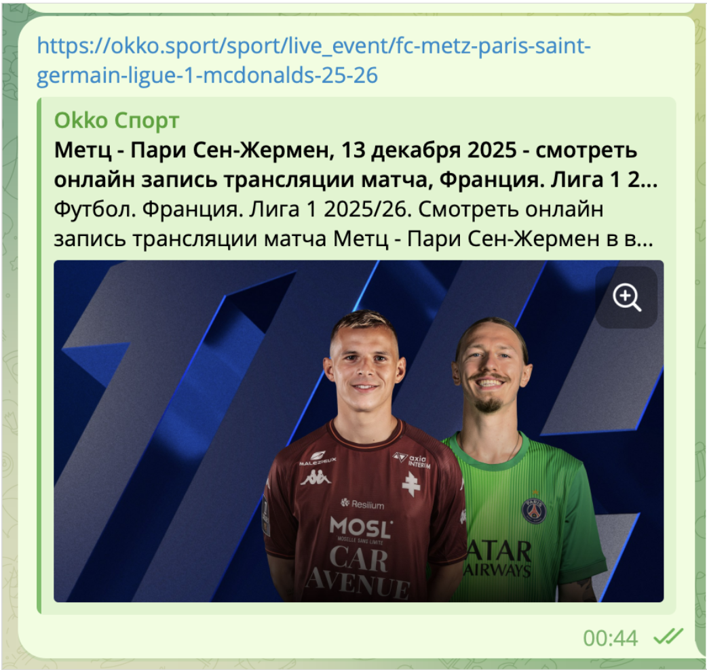
### Что такое Schema.org

Иногда поисковой системе недостаточно понять общий смысл страницы.
Например, интернет-магазин публикует карточку товара. Для человека очевидно, что перед ним товар стоимостью 39 990 рублей. Но поисковая система должна самостоятельно догадаться, где находятся цена, название, рейтинг и отзывы. Для подобных ситуаций существует стандарт Schema.org.
Он позволяет явно сообщить поисковой системе, что именно означает определённая информация.

Например, можно описать:

- товар,
- организацию,
- статью,
- рецепт,
- мероприятие,
- вакансию.

Чаще всего такие данные записываются в формате JSON-LD.

Пример

```html
<script type="application/ld+json">
{
  "@context": "https://schema.org",
  "@type": "Product",
  "name": "Ноутбук Example X15",
  "price": "79990"
}
</script>
```

На картинках представлены примеры Schema.org для рейтинга, даты обновления информации, описания и картинки.
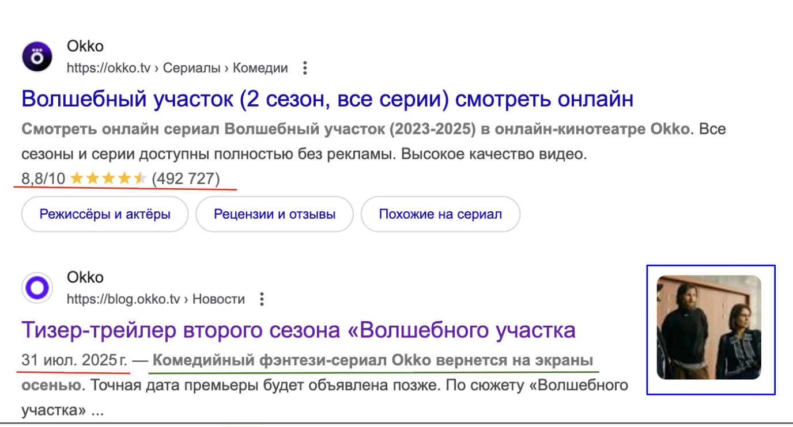

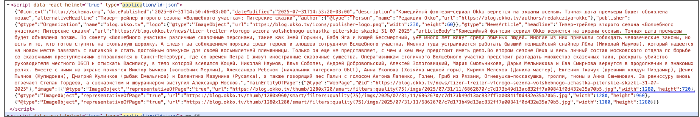

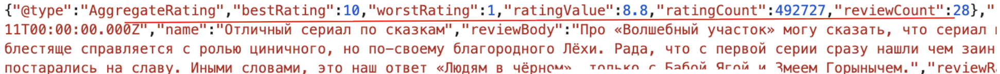

Страницы с расширенными данными выделяются в поисковой выдаче заметнее обычных ссылок — у них есть звёзды рейтинга, цена, наличие, дата публикации и другие детали прямо в результатах поиска. Это повышает кликабельность (CTR), а значит, привлекает больше переходов на сайт без увеличения бюджета на рекламу. Для интернет-магазинов это напрямую влияет на продажи: пользователь видит цену и рейтинг ещё до перехода и с большей вероятностью кликает именно на тот товар, который выглядит надёжнее и информативнее.
### Практика

Возьми страницу, созданную в предыдущих разделах, и дополни её следующими элементами:

- уникальным title,
- meta description,
- одним заголовком h1,
- логичной иерархией h2 и h3,
- базовыми тегами Open Graph.

После этого ответь на вопросы.

- Может ли поисковая система понять основную тему страницы только по её HTML?
- Какие элементы будут использованы при создании карточки ссылки в социальной сети?
- Почему неправильная структура заголовков ухудшает одновременно и SEO, и доступность?

### Если кратко

Поисковые системы анализируют HTML-документ так же, как screen reader анализирует дерево доступности: они пытаются понять смысл страницы, а не её внешний вид.

Элементы `<title>`, meta description и корректная структура заголовков помогают поисковым алгоритмам определить содержание документа и сформировать понятную поисковую выдачу.

Стандарт Open Graph отвечает за внешний вид ссылки при публикации в социальных сетях и мессенджерах, а Schema.org позволяет дополнительно описывать содержимое страницы для формирования расширенных результатов поиска.

Важно помнить, что HTML является лишь одной из составляющих SEO. Он не гарантирует высоких позиций в поисковой выдаче, но создаёт необходимую основу, без которой поисковым системам значительно сложнее интерпретировать содержимое сайта.
## 7. Инструменты проверки: DevTools, дерево доступности и Lighthouse

На протяжении всей темы мы неоднократно возвращались к одной и той же мысли: качественная HTML-разметка должна быть не только корректной с точки зрения синтаксиса, но и понятной для браузера, поисковых систем и вспомогательных технологий. Мы научились использовать семантические элементы, связывать поля форм с подписями, настраивать базовую валидацию, работать с доступностью и клавиатурной навигацией. Возникает закономерный вопрос: **как понять, действительно ли всё сделано правильно?**

Браузер способен корректно отобразить страницу даже в том случае, если она содержит серьёзные проблемы с семантикой или доступностью. Пользователь, работающий с мышью, может не заметить этих проблем вовсе. Однако они проявятся сразу, как только страницу попытается использовать screen reader, клавиатурный пользователь или поисковый робот.

Поэтому современная фронтенд-разработка невозможна без инструментов проверки. Они позволяют увидеть страницу глазами браузера и обнаружить ошибки ещё до того, как они попадут к пользователям.

В этом разделе мы познакомимся с двумя такими инструментами: **DevTools** и **Lighthouse**.
### DevTools: окно во внутренний мир браузера

Инструменты разработчика (Developer Tools, DevTools) входят в состав практически каждого современного браузера. Чаще всего они открываются клавишей **F12** или сочетанием **Ctrl + Shift + I**. На протяжении курса мы уже использовали вкладку **Network**, чтобы наблюдать за HTTP-запросами. Теперь теперь рассмотрим другие вкладки.

### Вкладка Elements

Вкладка **Elements** отображает DOM-дерево страницы. Здесь можно увидеть все элементы документа именно в том виде, в каком их интерпретировал браузер. Мы уже сталкивались с этой вкладкой раньше, когда смотрели структуру okko.tv и рассматривали дерево доступности. В обоих случаях именно вкладка Elements позволяла заглянуть внутрь страницы.

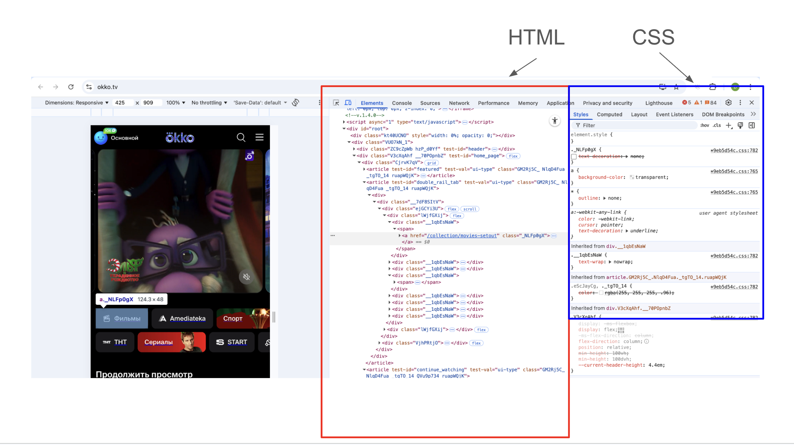

Помимо самой разметки, вкладка Elements показывает подключённые CSS-правила для выбранного элемента. Выдели любой тег — справа ты увидишь блок **Styles**, где перечислены все стили, действующие на него: от подключённых файлов и медиазапросов до правил, заданных inline. Каждое свойство можно временно отключить или изменить прямо здесь, и результат мгновенно отразится на странице. Это удобно не только для отладки верстки, но и для быстрого понимания того, почему элемент выглядит так, а не иначе.

Именно поэтому вкладка Elements полезна не только для поиска ошибок CSS. Она позволяет оценить качество структуры HTML-документа.

Если дерево выглядит хаотично уже здесь, велика вероятность, что проблемы возникнут и у вспомогательных технологий.
### Проверка атрибутов

DevTools позволяет быстро проверить, действительно ли браузер получил все необходимые атрибуты.

Пример 1

```html
<html lang="ru">
```

Пример 2

```html
<input
    type="email"
    required>
```

Пример 3

```html

```

Иногда ошибка оказывается настолько простой, что её сложно заметить глазами в редакторе кода.

Например:

- забыли атрибут alt,
- перепутали id,
- не связали label и input,
- указали неправильное значение aria-describedby.

Проверка через Elements позволяет быстро обнаружить подобные проблемы.

---
### Вкладка Accessibility

В предыдущем разделе мы говорили о дереве доступности. Теперь пришло время использовать его на практике.
Выбери любой элемент страницы и открой вкладку **Accessibility**.
В этой вкладке мы можем посмотреть, как именно screen reader понимает и читает страницу.

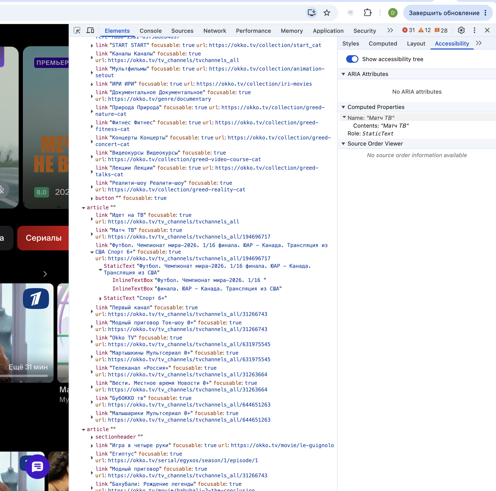

На скриншоте видно несколько важных областей. Слева находится **accessibility tree** — дерево доступности: иерархия элементов с их ролями (`button`, `heading`, `link` и т. д.). Справа для выбранного элемента показаны **ARIA attributes** и **computed properties**: здесь можно увидеть, откуда взялись роль, доступное имя, описание и состояние. Ниже находится **Source Order Viewer** — инструмент для проверки того, совпадает ли визуальный порядок элементов с порядком в DOM.

На этом же скриншоте видна полезная проблема реального сайта: в дереве встречаются элементы вроде `link ""`, `button "" focusable: true`, `image ""`. Пустые кавычки означают, что у элемента нет доступного имени. Такой элемент может быть семантически интерактивным, но пользователь screen reader не поймёт, куда ведёт ссылка или что делает кнопка. Поэтому проверка доступности — это не только поиск правильных тегов, но и проверка того, есть ли у элементов понятные имена.

### Lighthouse

До этого момента мы проверяли отдельные элементы вручную. Но что делать, если хочется быстро получить общую оценку качества страницы? Для этого существует инструмент **Lighthouse**. Он встроен в Chrome и основанные на Chromium браузеры.

Запустить его можно прямо из DevTools.

После запуска Lighthouse автоматически анализирует страницу и формирует отчёт по нескольким категориям.

- **Performance** оценивает скорость загрузки и отклика страницы. Показывает, насколько быстро появляется контент, как долго блокируется основной поток и насколько эффективно используются ресурсы. Напрямую влияет на пользовательский опыт: медленная страница теряет посетителей, а поисковые системы понижают её в выдаче.
- **Accessibility** проверяет, насколько страница доступна для людей с ограничениями. Оценивает наличие alt-текстов у изображений, связь label с полями форм, достаточность контраста текста, корректность использования ARIA и другие параметры. Низкая оценка означает, что часть пользователей не сможет комфортно пользоваться сайтом.
- **Best practices** проверяет соблюдение общепринятых рекомендаций по безопасности и качеству кода. Обнаруживает использование устаревших API, небезопасные внешние ссылки, отсутствие HTTPS, некорректные MIME-типы и подобные проблемы. Влияет на надёжность и безопасность проекта.
- **SEO** оценивает, насколько хорошо страница подготовлена для поисковых систем. Проверяет наличие title и meta description, корректность заголовков, адаптивность для мобильных устройств, наличие ссылок и метатега viewport. Чем выше оценка, тем лучше шансы страницы появиться в поисковой выдаче.

Важно понимать, что Lighthouse не пытается заменить человека. Он автоматически ищет типичные ошибки, которые можно обнаружить формальными правилами.

Например, он умеет находить:

- изображения без alt,
- поля формы без label,
- недостаточный контраст текста,
- отсутствие title,
- отсутствие meta description,
- неправильную структуру заголовков,
- интерактивные элементы без доступного имени.

Каждая найденная проблема сопровождается пояснением. После завершения анализа разработчик получает список замечаний.

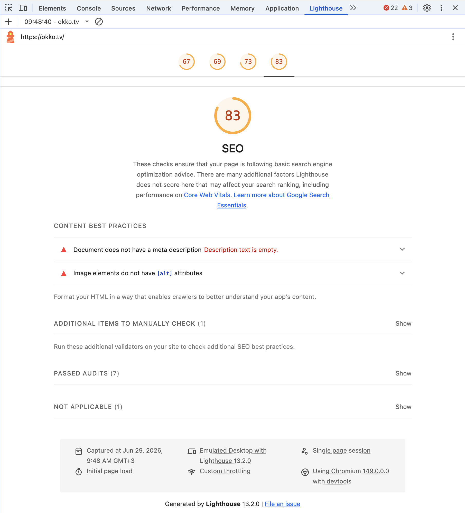

На скриншоте открыт отчёт Lighthouse для крупного коммерческого сайта. Видны оценки сразу по нескольким категориям: Performance, Accessibility, Best practices и SEO. Даже такой сайт не набирает идеальные значения во всех блоках, а зелёная или почти зелёная оценка не означает, что интерфейс действительно удобен для всех пользователей. Это хороший повод смотреть не только на число в кружке, но и на конкретные замечания отчёта.

### Что Lighthouse никогда не проверит

Существует целый класс проблем, которые невозможно обнаружить автоматически.

Например:

- удобно ли пользоваться страницей только с клавиатуры;
- логичен ли порядок переходов между элементами;
- понятны ли сообщения об ошибках;
- правильно ли озвучивается страница screen reader;
- не вводит ли пользователя в заблуждение неверно использованная ARIA.

Все эти вопросы требуют участия человека. Именно поэтому профессиональная проверка доступности всегда включает несколько этапов. Сначала используются автоматические инструменты. Затем интерфейс проверяется вручную.


### Чек-лист проверки HTML-страницы

После завершения работы над страницей полезно пройти небольшой чек-лист.

Проверь:

- используется ли семантическая разметка вместо div-супа;
- есть ли один основной h1;
- соблюдена ли иерархия заголовков;
- имеют ли изображения корректный alt;
- связаны ли label со всеми полями формы;
- используются ли нативные элементы там, где это возможно;
- отсутствуют ли очевидные ошибки в Lighthouse.

Если на каждый вопрос можно ответить утвердительно, страница уже будет заметно качественнее большинства учебных проектов.

### Практика

Возьми страницу, которую ты создавал(а) на протяжении всей темы.

Выполни следующие действия.

1. Открой вкладку Elements и проверь структуру документа.
2. Посмотри дерево доступности для нескольких элементов.
3. Запусти Lighthouse.
4. Изучи замечания в разделах Accessibility и SEO.
5. Исправь найденные ошибки.
6. Запусти проверку повторно.

После этого попробуй ответить на следующий вопрос.

> Какие проблемы обнаружил Lighthouse автоматически, а какие — пришлось искать самостоятельно?

Обсуди результаты с одногруппниками. Скорее всего, разные проекты получат разные замечания, и это поможет лучше понять типичные ошибки HTML-разметки.

### Если кратко

DevTools позволяют увидеть страницу такой, какой её воспринимает браузер. Вкладка **Elements** помогает анализировать структуру HTML-документа, а вкладка **Accessibility** — проверять роли, доступные имена и другие характеристики дерева доступности.

Lighthouse автоматически анализирует страницу и помогает обнаружить типичные проблемы, связанные с доступностью и SEO. Однако его возможности ограничены. Он способен проверить только те ошибки, которые можно обнаружить формально.

Поэтому профессиональная проверка интерфейса всегда сочетает несколько подходов: автоматический анализ, проверку клавиатурной навигации, тестирование со screen reader и экспертную оценку. Именно такая последовательность позволяет убедиться, что страница не только корректно отображается в браузере, но и действительно удобна для всех пользователей.

## Возвращаемся к вопросам в начале

Теперь можно коротко собрать ответы.

**Вопрос 1. Для кого есть разница между `div`-супом и семантической разметкой?** Для браузера, поисковых роботов, screen reader, DevTools и любых инструментов, которые анализируют структуру документа. Человек может видеть одинаковую страницу, но машина читает смысл HTML.

**Вопрос 2. Что теряется при замене `<button>` на `<div onclick>`?** Теряются нативная роль кнопки, участие в табуляции, активация с клавиатуры через Enter и Space, корректное имя и ожидаемое поведение для вспомогательных технологий. Клик мышью — это только малая часть работы кнопки.

**Вопрос 3. Может ли ARIA сделать страницу менее доступной?** Да. ARIA меняет представление элемента в дереве доступности, но не меняет его поведение. Если заставить кнопку называться заголовком или дать полю невидимое имя, которое расходится с видимой подписью, то screen reader получит ложную картину интерфейса.

**Вопрос 4. Можно ли не проверять данные на сервере, если форма использует `required` и `type="email"`?** Нет. HTML находится на стороне клиента, и пользователь может изменить разметку, отключить проверки или отправить запрос напрямую. Клиентская валидация нужна для удобства, серверная — для безопасности и корректности данных.


<a id="глубже"></a>

## ★ Глубже

Базовой семантики, нативных элементов и проверки через Lighthouse вполне достаточно, чтобы сделать хороший учебный проект и научиться писать качественный HTML. Для большинства задач этого уровня знаний хватит.

Но доступность — очень большая область. Когда ты начнёшь разрабатывать сложные интерфейсы, окажется, что многие вопросы нельзя решить простым добавлением `label`, `alt` или `aria-label`. Более того, некоторые проблемы вообще невозможно обнаружить автоматически.

<a id="доступное-имя-и-описание--это-одно-и-то-же"></a>

### ❓ Доступное имя и описание — это одно и то же?

В основном тексте мы разобрали, откуда берётся доступное имя элемента. Но у элемента может быть ещё и описание. Имя отвечает на вопрос «Что это?», а описание добавляет детали: ошибку, подсказку, ограничение формата.

Например, у поля имя может быть «Email», а описание — «Введите адрес в рабочем домене». Поэтому `label`, `aria-label` и `aria-labelledby` обычно задают имя, а `aria-describedby` — описание.

Отсюда становится понятно, почему `title` — плохой основной источник имени. Он часто появляется только при наведении мышью, плохо работает на сенсорных устройствах и не всегда предсказуемо озвучивается. Студент обычно вспоминает об этом, когда делает иконку без текста и пытается «быстро подписать» её через `title`, а потом не может нормально проверить результат с клавиатуры и screen reader.

Куда смотреть дальше: [Accessible Name and Description Computation 1.2](https://www.w3.org/TR/accname-1.2/) — официальный алгоритм вычисления имени и описания; на MDN полезны страницы про [`aria-label`](https://developer.mozilla.org/en-US/docs/Web/Accessibility/ARIA/Reference/Attributes/aria-label), [`aria-labelledby`](https://developer.mozilla.org/en-US/docs/Web/Accessibility/ARIA/Reference/Attributes/aria-labelledby) и [`aria-describedby`](https://developer.mozilla.org/en-US/docs/Web/Accessibility/ARIA/Reference/Attributes/aria-describedby).

<a id="хочу-сделать-красивый-собственный-выпадающий-список-вместо-select-насколько-это-сложно"></a>

### ❓ Хочу сделать красивый собственный выпадающий список вместо `<select>`. Насколько это сложно?

На первый взгляд кажется, что достаточно нарисовать красивый список и добавить обработчики кликов. Однако настоящий элемент `<select>` делает значительно больше, чем может показаться.

Он уже умеет:

- получать фокус,
- открываться клавишами,
- перемещаться стрелками,
- реагировать на Enter и Escape,
- правильно работать на мобильных устройствах,
- сообщать screen reader текущий выбранный вариант,
- участвовать в формах и нативной валидации.

Если отказаться от `<select>` в пользу собственного компонента, всё это придётся реализовывать самостоятельно. Причём не только визуально, но и с точки зрения доступности.

Именно поэтому доступный кастомный combobox — это десятки строк JavaScript, большое количество ARIA-атрибутов и сложная логика управления клавиатурой. Опытные разработчики стараются использовать нативный `<select>` настолько долго, насколько это возможно.

Если же требования проекта действительно требуют собственного компонента, обычно используют рекомендации **WAI-ARIA Authoring Practices (APG)**, где подробно описано, каким должно быть поведение подобных элементов.

Вы столкнётесь с этим на первом проекте, где дизайнер нарисует выпадающий список, не похожий на системный `select`: внезапно окажется, что клика мышью недостаточно, а стрелки, Escape, фокус, мобильное поведение и озвучивание выбранного значения нужно проектировать отдельно.

Куда смотреть дальше: [MDN про `<select>`](https://developer.mozilla.org/en-US/docs/Web/HTML/Reference/Elements/select) — что уже умеет нативный элемент; [WAI-ARIA APG: Combobox Pattern](https://www.w3.org/WAI/ARIA/apg/patterns/combobox/) — какие требования появляются у кастомного combobox.

<a id="почему-aria-live-иногда-не-работает"></a>

### ❓ Почему `aria-live` иногда не работает?

В основном тексте мы использовали `aria-live` для сообщений об ошибках.
На первый взгляд всё выглядит просто.

Добавили следующее.

```html
<p aria-live="polite"></p>
```

Изменили текст — screen reader его озвучил. Однако на практике возникают ситуации, когда ничего не происходит.

Причина в том, что это работает не совсем так, как ожидают начинающие разработчики. Во-первых, элемент с `aria-live` должен существовать в DOM заранее.

Если создать уже заполненный элемент динамически, некоторые screen reader могут проигнорировать его содержимое.
Во-вторых, существует несколько режимов работы.

Например,

```html
aria-live="polite"
```

означает следующее.

> Сообщить информацию тогда, когда это не помешает текущему чтению.

А

```html
aria-live="assertive"
```

просит screen reader объявить изменение как можно быстрее, даже если придётся прервать текущую речь.

Использовать режим `assertive` следует осторожно, иначе интерфейс может стать навязчивым.

Кроме того, слишком частые обновления `aria-live` некоторые программы просто не успевают произносить.

Поэтому при разработке динамических интерфейсов сообщения всегда стоит проверять вручную при помощи screen reader.

Ты вспомнишь об этом, когда форма будет показывать ошибку «Сохранить не удалось», визуально всё будет работать, а screen reader промолчит. Часто причина не в тексте ошибки, а в том, что live-region появился слишком поздно или обновляется слишком часто.

Куда смотреть дальше: [MDN про ARIA live regions](https://developer.mozilla.org/en-US/docs/Web/Accessibility/ARIA/Guides/Live_regions) — базовые режимы и ограничения; [WAI-ARIA APG: Alert Pattern](https://www.w3.org/WAI/ARIA/apg/patterns/alert/), когда подходит `role="alert"`.

<a id="почему-форма-на-телефоне-открывает-не-ту-клавиатуру"></a>

### ❓ Почему форма на телефоне открывает не «ту» клавиатуру?

При разработке форм многие сосредотачиваются на валидации и полностью забывают о мобильных устройствах.

Между тем HTML предоставляет несколько малоизвестных возможностей, которые заметно улучшают пользовательский опыт.

Во-первых, правильный выбор типа поля.

Например,

```html
<input type="email">
```

позволяет мобильной операционной системе показать клавиатуру с удобным доступом к символу `@`.

Для телефона используется следующее.

```html
<input type="tel">
```

Для чисел — следующее.

```html
<input
    type="text"
    inputmode="numeric">
```

Во-вторых, браузер умеет автоматически подставлять данные пользователя.

Пример 1

```html
<input
    autocomplete="email">
```

Пример 2

```html
<input
    autocomplete="current-password">
```

Если браузер уже знает эти данные, пользователю не придётся вводить их повторно.

Ещё один малоизвестный атрибут — `enterkeyhint`.

Он позволяет изменить подпись клавиши Enter на виртуальной клавиатуре.

Пример

```html
<input
    enterkeyhint="search">
```

В результате вместо универсальной кнопки Enter пользователь увидит кнопку «Поиск».

Каждая из этих возможностей кажется небольшой деталью. Но студент обычно вспоминает о них на первом же проекте, когда тестировщик откроет форму с телефона и не сможет удобно ввести номер, email или код подтверждения. Форма формально работает, но каждый ввод превращается в лишнюю борьбу с клавиатурой.

Куда смотреть дальше: [MDN про `inputmode`](https://developer.mozilla.org/en-US/docs/Web/HTML/Reference/Global_attributes/inputmode) — выбор виртуальной клавиатуры; [MDN про `autocomplete`](https://developer.mozilla.org/en-US/docs/Web/HTML/Reference/Attributes/autocomplete) — автозаполнение; [MDN про `enterkeyhint`](https://developer.mozilla.org/en-US/docs/Web/HTML/Reference/Global_attributes/enterkeyhint) — подпись клавиши Enter.


<a id="если-семантика-такая-полезная-почему-на-реальных-сайтах-всё-равно-много-div"></a>

### ❓ Если семантика такая полезная, почему на реальных сайтах всё равно много `div`?

После первого похода в DevTools легко решить, что учебная теория расходится с практикой: открываешь крупный сайт, а там — десятки вложенных `div`.

Причин несколько. Часть интерфейсов написана давно и несёт легаси. Часть разметки генерируют фреймворки и дизайн-системы. Иногда доступность просто не входит в критерии приёмки, поэтому никто не проверяет дерево доступности и клавиатурную навигацию. Бывает и нормальная причина: `div` действительно нужен как контейнер для сетки, позиционирования или группировки без собственного смысла.

Проблема начинается не там, где есть `div`, а там, где `div` заменяет кнопку, ссылку, заголовок, список, поле формы или другой элемент с готовым смыслом и поведением. Ты столкнёшься с этим при ревью чужой разметки: визуально всё будет похоже на интерфейс, но клавиатура и screen reader покажут, что HTML почти ничего не сообщает.

Куда смотреть дальше: [MDN про семантику HTML](https://developer.mozilla.org/en-US/docs/Glossary/Semantics#semantics_in_html) — общий принцип; [HTML Living Standard: sections](https://html.spec.whatwg.org/multipage/sections.html) — семантические секции документа.

<a id="screen-reader-читает-страницу-не-в-том-порядке-хотя-визуально-всё-правильно"></a>

### ❓ Screen reader читает страницу не в том порядке, хотя визуально всё правильно

Браузер и screen reader ориентируются на порядок элементов в DOM. CSS может визуально переставить блоки: через Flexbox `order`, Grid-размещение, абсолютное позиционирование. В результате зрячий пользователь видит один порядок, а пользователь клавиатуры или screen reader проходит страницу в другом.

Это особенно неприятный баг: на скриншоте всё выглядит правильно, а при нажатии Tab фокус прыгает «назад» или «через блок». На третьей неделе, когда появятся Flexbox и Grid, об этом нужно будет помнить постоянно: визуальная перестановка не должна ломать логический порядок документа.

Куда смотреть дальше: [MDN про порядок фокуса клавиатуры](https://developer.mozilla.org/en-US/docs/Web/Accessibility/Guides/Understanding_WCAG/Keyboard) — почему интерфейс должен работать с клавиатуры; [WCAG 2.2 Success Criterion 1.3.2 Meaningful Sequence](https://www.w3.org/WAI/WCAG22/Understanding/meaningful-sequence.html) — требование к осмысленному порядку содержимого.

<a id="как-доступность-проверяют-в-настоящих-компаниях"></a>

### ❓ Как доступность проверяют в настоящих компаниях?

Автоматическая проверка — это только первый слой. В реальной работе доступность обычно проверяют по требованиям WCAG: это набор критериев, разделённых по уровням A, AA и AAA. Для большинства коммерческих и государственных интерфейсов ориентиром часто становится уровень AA.

Обычно процесс выглядит так: разработчик запускает автоматические проверки, затем вручную проходит интерфейс с клавиатуры, проверяет формы и ошибки, смотрит дерево доступности, тестирует ключевые сценарии со screen reader. В зрелых командах часть проверок попадает в дизайн-ревью, код-ревью, QA и приёмку задачи.

Ты столкнёшься с этим, когда зелёный Lighthouse перестанет быть достаточным аргументом. В задаче могут попросить не просто оценку инструмента, а подтверждение, какие сценарии проверены, с какой клавиатурной навигацией, какими screen reader и против каких критериев WCAG.

Куда смотреть дальше: [WCAG 2.2 Overview](https://www.w3.org/WAI/standards-guidelines/wcag/) — что такое WCAG и уровни A/AA/AAA; [How to Meet WCAG](https://www.w3.org/WAI/WCAG22/quickref/) — фильтруемый список критериев; [WAI Easy Checks](https://www.w3.org/WAI/test-evaluate/preliminary/) — простые ручные проверки для старта.

Сейчас у тебя есть осмысленный, доступный скелет страницы. На следующей неделе мы наденем на него внешний вид: возьмёмся за CSS и вёрстку по макету, не сломав семантику и доступность, которые только что собрали.