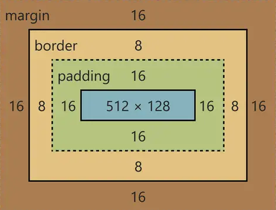
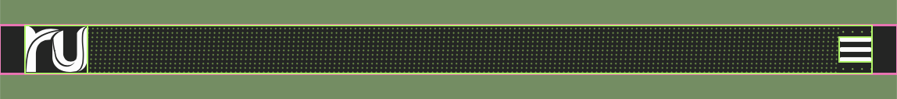
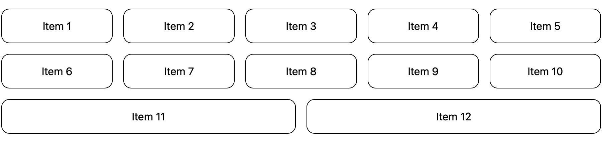
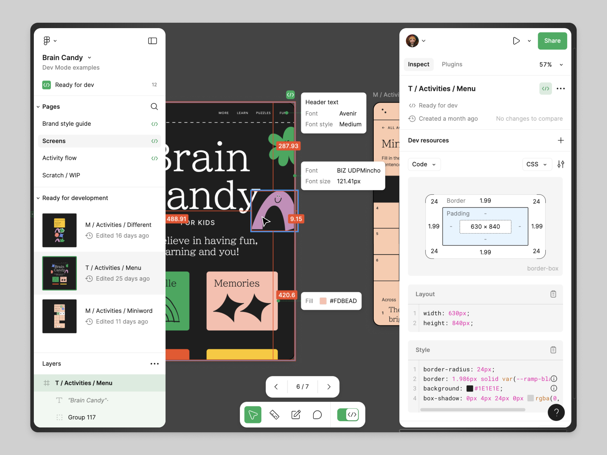
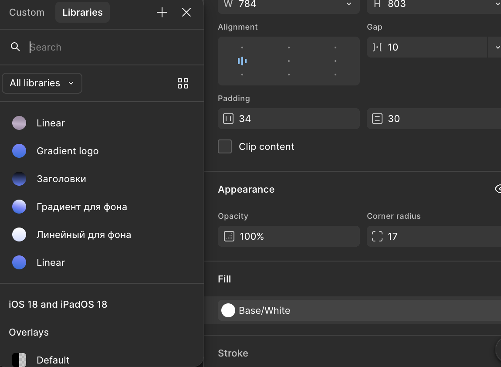
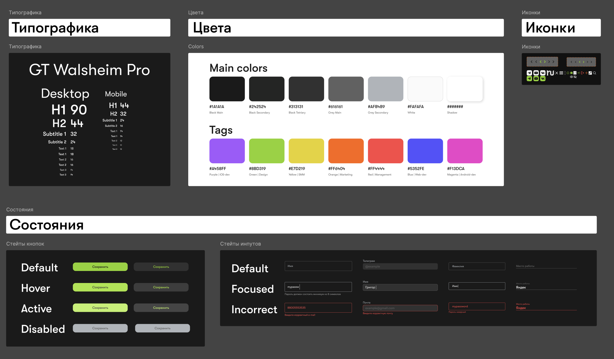
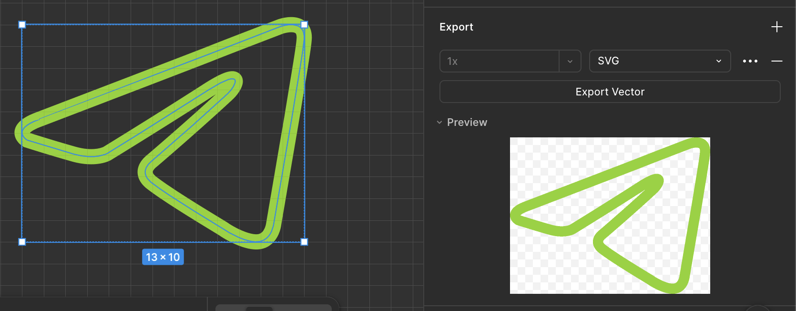

# Тема 3. CSS: специфичность, расположение элементов и перенос макета в код

На прошлой неделе страница была собрана из HTML. Теперь у неё есть содержимое, но пока нет оформления: всё стоит по умолчанию, сверху вниз, без отступов и выравнивания.

CSS нужен, чтобы задать странице внешний вид. Он делает блоки меньше или больше, ставит элементы рядом или друг под другом, добавляет отступы, цвета и другие детали, из которых собирается интерфейс.

Одна и та же разметка может выглядеть совсем по-разному в зависимости от стилей, при этом на один элемент часто действует сразу несколько правил одновременно. Поэтому CSS — это не просто список свойств, а система правил, в соответствии с которой страница приобретает свой итоговый вид.

---

Прежде чем разбирать теорию, полезно сформулировать вопросы, ради которых она вообще нужна. Вот с чем реально сталкивается верстальщик в первую неделю работы с CSS.

- Почему блок шириной 200px занимает на экране 244px?
- Почему написанный стиль не применился, хотя опечатки нет?
- Почему `z-index: 9999` проигрывает соседнему блоку с `z-index: 10`?
- Почему шапка с `position: sticky` не прилипает при прокрутке?

Каждый из этих вопросов разберём в ходе лонгрида — с конкретными примерами и объяснением, почему браузер ведёт себя именно так.

---

## Что стоит знать до чтения

Здесь не разбирается с нуля синтаксис CSS: что такое селектор, свойство и значение. Предполагается, что есть базовое знакомство с этими понятиями.

Мы сделаем упор на то, как браузер вычисляет размер и расположение элементов, как решаются конфликты между стилями, с помощью каких инструментов располагать элементы на странице, как сделать вёрстку одинаково удобной на телефоне и на широком экране, как избежать дублирования значений и оживить интерфейс анимацией и, наконец, как переносить макет из Figma в код.

---

## Содержание

- [Что стоит знать до чтения](#что-стоит-знать-до-чтения)
- [1. Блочная модель](#1-блочная-модель)
  - [Из чего состоит размер элемента](#из-чего-состоит-размер-элемента)
  - [Как сделать ширину предсказуемой](#как-сделать-ширину-предсказуемой)
- [2. Специфичность и каскад](#2-специфичность-и-каскад)
  - [Почему стиль может не сработать](#почему-стиль-может-не-сработать)
  - [Вес селектора](#вес-селектора)
  - [Каскад: что решает при равном весе](#каскад-что-решает-при-равном-весе)
  - [Игнорирование специфичности](#игнорирование-специфичности)
  - [Наследование](#наследование)
- [3. Поток документа и позиционирование](#3-поток-документа-и-позиционирование)
  - [Как элементы стоят по умолчанию](#как-элементы-стоят-по-умолчанию)
  - [Как вывести элемент из потока](#как-вывести-элемент-из-потока)
  - [Контекст наложения](#контекст-наложения)
- [4. Flexbox](#4-flexbox)
  - [Главная и поперечная ось](#главная-и-поперечная-ось)
  - [Ряд с переносом](#ряд-с-переносом)
  - [Полезный приём: margin: auto внутри flex](#полезный-приём-margin-auto-внутри-flex)
- [5. Grid](#5-grid)
  - [Сетка сразу по двум осям](#сетка-сразу-по-двум-осям)
  - [Адаптивная сетка без media queries](#адаптивная-сетка-без-media-queries)
  - [Именованные области](#именованные-области)
  - [Flexbox или Grid](#flexbox-или-grid)
- [6. Адаптивная вёрстка](#6-адаптивная-вёрстка)
  - [Media queries и mobile-first](#media-queries-и-mobile-first)
  - [Другие media queries](#другие-media-queries)
  - [Container queries](#container-queries)
- [7. CSS-переменные и анимации](#7-css-переменные-и-анимации)
  - [Переменные](#переменные)
  - [transition и animation](#transition-и-animation)
- [8. Tailwind, SCSS и CSS Modules](#8-tailwind-scss-и-css-modules)
  - [Tailwind](#tailwind)
  - [SCSS](#scss)
  - [CSS Modules](#css-modules)
- [9. Перенос макета из Figma в код](#9-перенос-макета-из-figma-в-код)
  - [Значения берутся из панели, а не подбираются на глаз](#значения-берутся-из-панели-а-не-подбираются-на-глаз)
  - [Дизайн-токены — это переменные, только в макете](#дизайн-токены--это-переменные-только-в-макете)
  - [Экспорт ассетов](#экспорт-ассетов)
  - [DevTools в процессе вёрстки](#devtools-в-процессе-вёрстки)
  - [Типичные проблемы](#типичные-проблемы)
- [Если кратко](#если-кратко)
- [★ Глубже](#глубже)
- [Ссылки на источники](#ссылки-на-источники)

В конце каждого раздела идут блоки **«Проверь себя»** и **«Задания на закрепление»**.

---

## 1. Блочная модель

Любой элемент на странице занимает какое-то место — прямоугольную область определённой ширины и высоты. Логично ожидать, что заданная в CSS ширина совпадёт с тем, что видно на экране, но это не всегда так: итоговый размер элемента складывается из нескольких частей, и, если не учитывать их все, реальная ширина будет отличаться от задуманной. Разберёмся, как браузер считает итоговый размер любого элемента и почему заданная ширина иногда не совпадает с реальной.

### Из чего состоит размер элемента

> **Блочная модель (box model)** — способ, которым браузер рассчитывает итоговый размер элемента: `content`, `padding`, `border` и `margin`, вложенные друг в друга.



Разберём на примере. Блоку задаётся ширина 200px и внутренний отступ 20px:

```css
.box {
  width: 200px;
  padding: 20px;
}
```

Что здесь происходит: `width: 200px` задаёт размер только области `content` — самого содержимого. `padding: 20px` добавляется поверх этой области с каждой стороны, а не входит в неё. В итоге браузер прибавляет по 20px слева и справа, и реальная ширина блока на экране становится 240px, а не 200px.

Если добавить ещё рамку:

```css
.box {
  width: 200px;
  padding: 20px;
  border: 2px solid black;
}
```

Итоговая ширина — 200 + 20 + 20 + 2 + 2 = 244px. `margin` в этот расчёт не входит — он не увеличивает сам блок, а лишь отодвигает его от соседей.

### Как сделать ширину предсказуемой

> **`box-sizing`** — свойство, определяющее, что именно входит в заданные `width` и `height`.

По умолчанию действует `box-sizing: content-box` — тот самый режим из примера выше, где `width` не включает `padding` и `border`. Второй режим, `border-box`, меняет логику: `width` уже включает `padding` и `border`, и браузер сам уменьшает область содержимого, чтобы всё сошлось.

```css
.box {
  box-sizing: border-box;
  width: 200px;
  padding: 20px;
  border: 2px solid black;
}
```

Что изменилось: `width: 200px` теперь описывает не содержимое, а весь блок целиком. Браузер сам вычисляет, сколько места внутри осталось под содержимое: 200 минус отступы и рамка. Итоговая ширина на экране — ровно 200px.

Поэтому почти в любом проекте в самом начале стилей встречается такая строка:

```css
*,
*::before,
*::after {
  box-sizing: border-box;
}
```

Она переключает расчёт для всех элементов сразу — дальше заданная ширина совпадает с реальной без ручных вычислений.

Тот же эффект видно прямо в DevTools. Выдели элемент во вкладке Elements, открой панель Styles и найди там свойство `box-sizing` — рядом с ним есть чекбокс, который позволяет временно отключить это правило прямо в браузере, не трогая код. Если выключить `border-box` на элементе, где оно задано, на схеме блочной модели с числами внизу панели Styles сразу видно, что область `content` увеличивается на величину `padding` и `border`, а сама ширина элемента на странице визуально меняется.

Коротко: браузер по умолчанию считает `width` только по содержимому, а `padding` и `border` добавляет сверху. `box-sizing: border-box` включает `padding` и `border` в заданную ширину — это делает размеры предсказуемыми и почти всегда включается глобально.

> **Справочно: единицы измерения.** Запоминать сразу не обязательно — таблица пригодится, когда возникнет вопрос, чем `rem` отличается от `px`.
>
> | Единица | От чего считается | Когда использовать |
> |---|---|---|
> | `px` | Ни от чего, абсолютное значение | Рамки, тени, иконки фиксированного размера |
> | `rem` | От шрифта корневого `<html>` | Отступы и размеры текста — реагирует на настройки доступности браузера, в отличие от `px` |
> | `em` | От шрифта текущего элемента | Значения, которые должны масштабироваться вместе с локальным шрифтом, но при вложенности могут неожиданно перемножаться |
> | `ch` | От ширины символа `0` в текущем шрифте | Ограничение ширины текстового блока по числу символов, например `max-width: 60ch` для читаемой строки |
> | `vw` / `vh` | От ширины/высоты окна браузера | Элементы, зависящие от размера экрана целиком: `100vh` — высота экрана |
> | `fr` | От свободного места в Grid | Разберём отдельно в разделе про Grid |

**Проверь себя**

- Знаю, куда встраиваются `padding` и `border` при `content-box` и при `border-box`.
- Могу быстро посчитать реальную ширину блока по заданным `width`, `padding` и `border`.

**Задания на закрепление**

1. Даны два блока с разным `padding` (`16px` и `32px`), но одинаковым `width: 240px`. Сделай так, чтобы оба блока имели одинаковую видимую ширину на экране, — сначала при `box-sizing: content-box`, посчитав нужные значения вручную, а затем переключив на `border-box`. Проверь результат в панели Computed.
2. Открой любой существующий сайт в DevTools и найди элемент, у которого `box-sizing: border-box`. Сравни, как изменится его ширина, если временно переключить на `content-box`.

Но в реальном проекте проблема часто не только в размере блока. Один и тот же элемент может получить несколько стилей сразу, и нужно понимать, как они взаимодействуют. Дальше разберём, как браузер выбирает, какое правило применить.

---

## 2. Специфичность и каскад

Разберёмся, почему написанный стиль иногда не применяется и как браузер выбирает победителя среди конфликтующих правил.

### Почему стиль может не сработать

После первых примеров CSS может казаться прямолинейным: точечно указываем свойство для элемента, и оно сразу отображается. Но в реальном проекте почти никогда не бывает так, что на элемент действует только одно правило. Один и тот же блок может получать стили из общего файла, из класса компонента и из правил, написанных ниже по коду. Браузер не игнорирует ни одно из них — он сравнивает все подходящие правила и применяет в зависимости от их специфичности.

### Вес селектора

> **Специфичность** — вес CSS-селектора, по которому браузер решает, какое из конфликтующих правил применить.

Вес считается по трём разрядам:

| Тип селектора | Вес |
|---|---|
| `#id` | 1-0-0 |
| `.class`, `[attr]`, `:hover` | 0-1-0 |
| `div`, `::before` | 0-0-1 |

Инлайновый стиль (`style="..."` в HTML) в эту таблицу не попадает — у него нет селектора, а значит, и веса. Он побеждает не потому, что тяжелее любого разряда, а потому, что браузер применяет его на более раннем этапе каскада, ещё до того, как начинает сравнивать веса селекторов между собой. По той же причине `!important` в обычном правиле перебивает инлайн без `!important`: это тоже отдельный уровень каскада, а не «очень тяжёлый селектор», и он проверяется раньше веса.

Разберём на примере:

```css
.button {
  color: blue;
}

#submit {
  color: red;
}
```

Что здесь происходит: у `.button` вес 0-1-0, у `#submit` — 1-0-0. Разряды сравниваются слева направо, и первый разряд у `#submit` больше нуля, а у `.button` он равен нулю. Значит, `#submit` весит больше независимо от того, что происходит в остальных разрядах. Элемент `<button class="button" id="submit">` станет красным, даже если правило `.button` написано ниже по файлу.

Если попытаться понять, почему именно такой вес у каждого селектора, станет ясно, что это связано с конкретикой указания элемента. `id` — уникальный идентификатор, поэтому он весит больше, чем класс, который может быть у нескольких элементов. Класс, в свою очередь, весит больше, чем тег, потому что тег может быть у любого элемента на странице. Выстраивается иерархия от более конкретного к более общему: `id` → `class` → `tag` — а инлайн и `!important` стоят вообще вне этой шкалы, на уровнях каскада, которые проверяются раньше.

Вес растёт и при повторении одного типа селектора в цепочке. Разберём ещё пример — с двумя похожими на вид правилами:

```css
.card .title {
  color: gray;
}

.card--featured .title {
  color: black;
}
```

Оба селектора состоят из двух классов подряд, поэтому у обоих одинаковый вес — 0-2-0. Здесь специфичность не определяет победителя: раз веса равны, решает каскад, и применится  правило, которое написано ниже.

Ещё один пример, где вес складывается не так, как ожидается на глаз:

```css
nav a {
  color: gray;
}

.nav-link {
  color: black;
}
```

`nav a` — это два тега, вес 0-0-2. `.nav-link` — один класс, вес 0-1-0. Разряд с классами у `.nav-link` больше нуля, а у `nav a` он равен нулю — значит, класс перевешивает комбинацию из двух тегов, сколько бы тегов туда ни добавили.

### Каскад: что решает при равном весе

> **Каскад** — правило, по которому при равной специфичности применяется правило, написанное позже.

```css
.button {
  color: blue;
}

.button {
  color: green;
}
```

Оба селектора — `.button` — имеют одинаковый вес 0-1-0. Раз веса равны, браузер применяет правило, которое находится ниже по коду.

На практике вес селекторов редко считают в уме — гораздо быстрее проверить это в DevTools. Открой вкладку Elements, выдели нужный элемент и посмотри в панель Styles справа. Там перечислены все правила, которые целятся в этот элемент, в порядке от более специфичных к менее специфичным. Проигравшее правило показано зачёркнутым — так сразу видно, что оно не применилось. Если навести курсор на выигравшее правило выше в списке, DevTools подсветит сам селектор, и станет ясно, какое именно правило и почему победило, — без подсчёта весов вручную.


### Игнорирование специфичности

Но у всех правил есть исключения, и у специфичности в том числе. Для свойств, которые не применяются из-за конфликта стилей, иногда добавляют `!important` в конце значения, например:

```css
#button {
  color: red;
}

.button {
  color: blue !important;
}
```

В результате, несмотря на больший вес селектора `#button`, цвет текста станет синим. Но это не решение конфликта, а его обход. Важно понимать, что частое использование этого приёма говорит о проблемах в архитектуре CSS: либо селекторы слишком специфичны, либо структура HTML не позволяет писать простые селекторы. В таких случаях лучше пересмотреть структуру и переписать стили, чем добавлять `!important` к каждому правилу. И это не значит, что использование `!important` находится под запретом: иногда это оправданно — например, при переопределении стилей сторонних библиотек. Но в целом чем меньше `!important`, тем проще поддерживать проект.

> Специфичность между несколькими `!important`-правилами решается по обычным правилам: сначала сравнивается вес селектора, а затем — порядок в коде.

### Наследование

Некоторые свойства передаются от родителей к детям. Например, `color` и `font-family` достаточно задать один раз на верхнеуровневом элементе (чаще всего на `<body>`). `border`, `padding`, `width` так не работают: их нужно указывать для каждого элемента отдельно. Наследование очень хорошо работает в паре с каскадностью: при работе с отдельными элементами оформления часто надо точечно поменять шрифт, цвет или просто отойти от дизайн-системы, не меняя при этом глобальные стили. Здесь и помогает переопределение на уровне конкретного элемента, которое будет работать только для него, а не для всех потомков.

**Проверь себя**

- Могу на глаз сравнить вес двух селекторов и предсказать, какой из них победит.
- Умею найти в DevTools, какое правило перебило моё и почему.

**Задания на закрепление**

1. Дана страница с тремя конфликтующими правилами для одной кнопки: по классу, по `id` и с `!important`. Посчитав вес вручную, определи для каждой пары правил, кто победит, а затем проверь себя в панели Styles.
2. Найди в панели Styles любого сайта перечёркнутое правило и определи, какое правило его перебило и почему.

Разобрались с применением стилей к элементам; далее надо понять, как именно располагаются элементы на странице. За это отвечает не специфичность, а поток документа и позиционирование.

---

## 3. Поток документа и позиционирование

Ещё до того, как мы указали любые свойства позиционирования, браузер уже как-то расположил элементы на странице: по умолчанию сверху вниз, друг под другом. Это называется **нормальный поток**. Разберёмся, как он работает.

### Как элементы стоят по умолчанию

> **Нормальный поток** — способ, которым браузер размещает элементы, если не задано иное: блочные занимают всю доступную ширину и идут друг под другом, строчные встраиваются в текст и переносятся вместе с ним.

За то, как именно элемент участвует в потоке, отвечает `display`:

| Значение | Как ведёт себя |
|---|---|
| `block` | Своя строка, растягивается на всю ширину |
| `inline` | В строке, ширина по содержимому, `width`/`height` не действуют |
| `inline-block` | В строке, но `width` и `height` уже работают |
| `none` | Убирается из потока полностью: не виден и недоступен для скринридеров |

```css
.title {
  display: block;
}

.tag {
  display: inline-block;
  padding: 4px 8px;
}
```

`.title` получит собственную строку и растянется на всю ширину — это поведение подходит для заголовка. `.tag` встанет в строку рядом с соседними элементами, и, в отличие от обычного `inline`, сможет управлять своей высотой через `width`/`height`. Вертикальный `padding` у `inline`-элемента формально применяется — фон растягивается на заданную величину, — но не влияет на высоту строки и просто наезжает на соседние строки текста. А вот вертикальный `margin` у `inline` действительно игнорируется полностью.

Нормальный поток управляет расположением большинства элементов на странице. Но иногда элемент нужно вывести из этой логики — прикрепить его к конкретной точке независимо от соседей. Для этого используется `position`.

### Как вывести элемент из потока

> **`position`** — свойство, которое определяет, позиционируется ли элемент в общем потоке или относительно конкретной точки отсчёта.

| Значение | Что происходит |
|---|---|
| `static` | Элемент в потоке — значение по умолчанию |
| `relative` | В потоке; становится точкой отсчёта для дочерних элементов, вышедших из потока |
| `absolute` | Выходит из потока, привязывается к ближайшему предку с `position`, отличным от `static` |
| `fixed` | Выходит из потока, привязывается к окну браузера |
| `sticky` | Ведёт себя как обычный элемент, пока страница не долистает до заданной точки, затем закрепляется |

Разберём `absolute` на примере — бейдж со скидкой в углу карточки:

```css
.card {
  position: relative;
}

.card__badge {
  position: absolute;
  top: 8px;
  right: 8px;
}
```

Что здесь происходит по шагам.

1. `.card` получает `position: relative`. Саму карточку это не двигает — она остаётся там же, где была бы без этого свойства.
2. `.card__badge` получает `position: absolute` — элемент выходит из потока.
3. Браузер ищет ближайшего предка с `position`, отличным от `static`. Им оказывается `.card` — она становится точкой отсчёта для `top` и `right`.
4. Бейдж встаёт в правый верхний угол карточки, а не страницы.

Если убрать `position: relative` у `.card`, шаг 3 не найдёт подходящего предка и продолжит поиск выше по дереву элементов — вплоть до `<html>`. В этом случае бейдж прикрепится к углу всей страницы.

**Типичная ошибка.** `sticky`-элемент иногда не прилипает при прокрутке, хотя код написан верно. Причин две, и обе стоит держать в голове по очереди.

- Первая: у одного из родителей стоит `overflow: hidden` или `overflow: auto` — это обрезает контекст, в котором `sticky` может закрепиться. Как исправить: убрать `overflow` у родителя или перенести sticky-элемент выше по дереву разметки.
- Вторая, менее очевидная: родитель по высоте равен самому sticky-элементу. Прилипать в этом случае некуда — внутри родителя просто нет прокрутки, относительно которой элемент мог бы «отстать» от соседей. Здесь помогает не трогать `overflow`, а дать родителю нормальную высоту — например, обернуть sticky-элемент вместе с содержимым, которое должно проскроллиться мимо него.
- Правило: `sticky` работает, только если ни один родитель не обрезает прокрутку через `overflow` и если родителю есть куда прокручиваться.

### Контекст наложения

Пример с типичной ошибкой выше поднимает соседний вопрос: что вообще определяет, какой элемент окажется выше другого при наложении.

> **Контекст наложения (stacking context)** — группа элементов, внутри которой браузер сравнивает `z-index` друг с другом. Между элементами из разных контекстов `z-index` не сравнивается вообще — побеждает контекст, а не число.

Контекст наложения создают позиционированные элементы: `position`, отличный от `static`, в паре с заданным `z-index`. Но это не единственный способ — `transform`, `opacity < 1` и `filter` тоже создают новый контекст, даже без `position` вообще. К этому мы ещё вернёмся в разделе про анимации.

Практическое следствие: если элемент с `z-index: 9999` сидит внутри контейнера, у которого контекст наложения ниже, чем у соседнего блока, число ничего не изменит — сравнение идёт не по элементу напрямую, а по контексту, в котором он находится. Отсюда и частый баг вёрстки: `z-index: 9999` проигрывает соседу с `z-index: 10`, потому что сравниваются не сами эти элементы, а их родительские контексты.

Коротко: нормальный поток — это расположение по умолчанию. `position` управляет им точечно: `relative` не двигает элемент, но задаёт точку отсчёта для потомков с `absolute`, `fixed` не зависит от предков вообще, а `sticky` — гибрид обычного элемента и `fixed`. `z-index` работает только внутри одного контекста наложения, а не глобально по странице.

**Проверь себя**

- Понимаю, к какому предку привяжется `absolute`-элемент, если у ближайшего родителя не задан `position`.
- Знаю обе причины, по которым `sticky` может не прилипнуть при прокрутке.
- Понимаю, почему `z-index: 9999` иногда проигрывает элементу с меньшим значением.

**Задания на закрепление**

1. Сверстай карточку товара с бейджем «Новинка» в левом верхнем углу — без `position: relative` на карточке. Проверь в DevTools, куда прикрепился бейдж, затем добавь `relative` и сравни результат.
2. Сделай шапку сайта, которая прилипает к верху экрана при прокрутке.

Разобравшись с точечным позиционированием, перейдём к инструменту, который расставляет сразу несколько элементов по общим правилам, — Flexbox.

---

## 4. Flexbox

Разберёмся, как расставить сразу несколько элементов по общим правилам вдоль одной оси, не двигая каждый вручную. Использование Flexbox позволяет быстро и предсказуемо выстраивать элементы в ряд или колонку, а также управлять их выравниванием и отступами.
Это самый частотный и эффективный способ расположения элементов на странице.


### Главная и поперечная ось

> **Flexbox** — модель раскладки, которая распределяет элементы вдоль одной оси: горизонтальной или вертикальной.

До Flexbox одноосевую раскладку собирали через `float` или `inline-block`, и оба способа требовали обходных путей. `float` выводил элемент из потока лишь частично и ломал высоту родителя — приходилось добавлять отдельный clearfix, чтобы контейнер снова замечал свои float-элементы. `inline-block` добавлял между элементами непредсказуемые пробелы из-за пробельных символов в самой разметке, и от них избавлялись то через `font-size: 0` на родителе, то через отрицательные `margin`. Flexbox решает обе проблемы декларативно: выравнивание и распределение задаются свойствами контейнера напрямую, без хаков вокруг дочерних элементов.

Разберём на типичной задаче — верстаем шапку сайта: логотип слева, меню справа, оба по центру по высоте:


```html
<header class="header">
  
  <button class="header__menu-button">
    
  </button>
</header>
```
```css
.header {
  display: flex;
  justify-content: space-between;
  align-items: center;
}
```



Что здесь происходит: `display: flex` превращает `.header` в flex-контейнер и задаёт ему главную ось — по умолчанию горизонтальную. За направление этой оси отвечает `flex-direction`: значение по умолчанию `row` укладывает элементы в ряд, `column` — друг под другом, и тогда `justify-content` с `align-items` меняются местами по смыслу, потому что «вдоль оси» и «поперёк оси» — это уже вертикаль и горизонталь наоборот. Вдоль главной оси элементы распределяет `justify-content`: значение `space-between` растолкало первый и последний дочерний элемент по краям контейнера. Поперёк главной оси элементы выравнивает `align-items`: `center` поставил их посередине по высоте.

### Ряд с переносом

```css
.cards {
  display: flex;
  flex-wrap: wrap;
  gap: 16px;
}

.card {
  flex: 1 1 280px;
}
```



Что здесь происходит: `flex-wrap: wrap` разрешает элементам переноситься на новую строку, если в ряду не хватает места, — без этого свойства карточки сжимались бы до бесконечности вместо переноса. `gap` задаёт отступ между элементами сразу по обеим осям, поэтому не нужно вручную считать `margin` и убирать лишний отступ у последнего элемента в ряду.

`flex: 1 1 280px` — сокращение сразу для трёх свойств: `flex-grow`, `flex-shrink`, `flex-basis`. Единицы говорят элементу расти и сжиматься при изменении доступного места, а `280px` — стартовый размер, от которого идёт расчёт.

Такая раскладка хорошо подходит, когда число карточек в ряду не принципиально. Если нужна сетка со строго фиксированным числом колонок, Flexbox начнёт требовать вычислений вроде `calc(33.333% - 16px)`, и для этой задачи лучше подойдёт Grid.

### Полезный приём: margin: auto внутри flex

```css
.nav {
  display: flex;
  align-items: center;
  gap: 16px;
}

.nav__logout {
  margin-left: auto;
}
```

Внутри flex-контейнера `margin: auto` забирает себе всё доступное свободное пространство в заданную сторону. Кнопка выхода окажется у правого края без единого `justify-content` на весь контейнер — это предусмотренное поведение, а не побочный эффект.

Коротко: Flexbox распределяет элементы вдоль одной оси. `justify-content` работает вдоль главной оси, `align-items` — поперёк неё, `gap` задаёт отступы без ручных вычислений, а `flex-wrap` разрешает перенос на новую строку.

**Вопрос на понимание**

Контейнер с шестью дочерними элементами имеет `display: flex; flex-wrap: wrap;`, и у каждого дочернего элемента задано `flex-basis: 30%`. Ширина контейнера позволяет уместить в ряд ровно три элемента такой ширины. Сколько элементов окажется в одной строке?

- 2.
- 3.
- 6.
- Зависит от содержимого элементов.

Ответ: 3 — три элемента с `flex-basis: 30%` суммарно занимают 90% ширины контейнера, для четвёртого места уже не остаётся, и он переносится на новую строку.

**Проверь себя**

- Различаю, что делает `justify-content`, а что — `align-items`.
- Умею сделать так, чтобы ряд элементов переносился без ручного подсчёта отступов.

**Задания на закрепление**

1. Сверстай шапку сайта с логотипом слева, меню из трёх пунктов по центру и кнопкой справа, используя только Flexbox и `gap`.
2. Собери ряд из 6 карточек с `flex-wrap: wrap`, а затем попробуй разложить те же карточки в сетку строго 3 × 2 без переноса — обрати внимание на то, сколько вычислений вручную для этого понадобится.

Flexbox отлично справляется с рядом или колонкой. Но стоит попробовать разложить через него сетку 3×3 с ровным выравниванием по обеим осям, и станет ясно, что для двумерных задач нужен инструмент помощнее.

---

## 5. Grid

Разберёмся, как расположить элементы сразу по двум осям — колонкам и строкам — одновременно.

### Сетка сразу по двум осям

> **Grid** — модель раскладки для двумерного размещения: одновременно по колонкам и строкам.

```css
.grid {
  display: grid;
  grid-template-columns: repeat(3, 1fr);
  gap: 16px;
}
```

Что здесь происходит: `repeat(3, 1fr)` создаёт три колонки равной ширины — сокращённая запись для `1fr 1fr 1fr`. `fr` — доля свободного пространства сетки, поэтому `1fr 2fr 1fr` сделал бы среднюю колонку вдвое шире крайних.

В отличие от Flexbox, здесь количество колонок задано явно: их всегда три, и неполный последний ряд остаётся выровненным по сетке, а не растягивается на всю ширину.

### Адаптивная сетка без media queries

```css
.gallery {
  display: grid;
  grid-template-columns: repeat(auto-fit, minmax(200px, 1fr));
  gap: 16px;
}
```

Что здесь происходит: `minmax(200px, 1fr)` задаёт каждой колонке минимум 200px, но разрешает растягиваться при наличии свободного места. `auto-fit` на каждый пересчёт раскладки считает, сколько таких колонок помещается в текущую ширину контейнера, и меняет их количество — без единого `@media`.

`auto-fill` отличается тем, что создаёт ровно столько треков, сколько поместится, даже пустых: колонки не растягиваются, чтобы заполнить пустое место. `auto-fit` схлопывает пустые треки и отдаёт освободившееся пространство существующим колонкам.

### Именованные области

```css
.layout {
  display: grid;
  grid-template-columns: 240px 1fr;
  grid-template-rows: 60px 1fr 60px;
  grid-template-areas:
    "header  header"
    "sidebar main"
    "footer  footer";
}

.header  { grid-area: header; }
.sidebar { grid-area: sidebar; }
.main    { grid-area: main; }
.footer  { grid-area: footer; }
```

Структура страницы читается прямо из `grid-template-areas`, без подсчёта номеров строк и колонок: каждое имя в разметке соответствует ячейке или группе ячеек сетки.

### Flexbox или Grid

Правило простое: одна ось — Flexbox, две оси — Grid. Панель навигации, ряд тегов, список кнопок — одна ось. Галерея товаров с ровными рядами и колонками, структура страницы целиком — две оси.

Grid и Flexbox комбинируются в рамках одной страницы без проблем: Grid задаёт общую структуру, Flexbox наводит порядок внутри отдельных её частей.

```css
.page {
  display: grid;
  grid-template-rows: auto 1fr auto;
}

.page__header {
  display: flex;
  justify-content: space-between;
  align-items: center;
}
```

Коротко: Grid распределяет элементы по колонкам и строкам одновременно, `auto-fit` с `minmax()` даёт адаптивную сетку без медиазапросов, а `grid-template-areas` описывает структуру страницы по именам, а не по номерам.

**Проверь себя**

- Могу объяснить разницу между `auto-fit` и `auto-fill`.
- Понимаю, когда для конкретной задачи выбрать Grid, а когда — Flexbox.

**Задания на закрепление**

1. Собери адаптивную галерею из 8 карточек с помощью `repeat` и проверь, как меняется число колонок при изменении ширины окна браузера.
2. Собери макет страницы (шапка, сайдбар, основной контент, подвал) через `grid-template-areas`, а затем реализуй ту же структуру с помощью `grid-column` / `grid-row` с номерами. Сравни, какой вариант читается легче.

Grid и Flexbox уже решают, как элементы расположены друг относительно друга. Но даже идеальная сетка на широком мониторе может развалиться на экране телефона. Дальше рассмотрим, как стилизовать контент для экранов разной ширины.

---

## 6. Адаптивная вёрстка

Разберёмся, зачем вообще нужна адаптивная вёрстка и как одна и та же страница может подстраиваться под разные экраны без переписывания разметки. На практике это обычно сводится к нескольким базовым приёмам: изменению числа колонок, перестройке блоков, выбору разных размеров отступов и управлению тем, какие элементы показывать на узком или широком экране.

Один из распространённых подходов к этому — mobile-first: сначала задают базовые стили для узкого экрана, а затем с помощью `media queries` наращивают правила для более широких. Но это не единственный способ думать об адаптивности, поэтому начнём с самого принципа работы таких правил.

### Media queries и mobile-first

> **Mobile-first** — один из подходов, при котором базовые стили пишутся для узкого экрана, а `media queries` с `min-width` добавляют слои для более широких.

Разберём, в чём разница, на одной и той же задаче. Если писать стили для широкого экрана первыми, а затем сужать их под меньшие ширины, получится примерно так:

```css
.cards {
  grid-template-columns: repeat(3, 1fr);
}

@media (max-width: 1199px) {
  .cards {
    grid-template-columns: repeat(2, 1fr);
  }
}

@media (max-width: 767px) {
  .cards {
    grid-template-columns: 1fr;
  }
}
```

Проблема не в количестве строк кода, а в направлении мышления: на каждом брейкпойнте приходится держать в голове предыдущее значение и переопределять его, а с ростом проекта таких переопределений становится всё больше. Диапазоны `max-width` к тому же легко перепутать местами или задать пересекающимися, и тогда правила начнут конфликтовать друг с другом.

Mobile-first устроен обратным способом: сначала создаются стили для самого узкого экрана, а затем `min-width` добавляет более широкие раскладки поверх:

```css
.cards {
  display: grid;
  grid-template-columns: 1fr;
  gap: 16px;
}

@media (min-width: 768px) {
  .cards {
    grid-template-columns: repeat(2, 1fr);
  }
}

@media (min-width: 1200px) {
  .cards {
    grid-template-columns: repeat(3, 1fr);
  }
}
```

Что здесь происходит: базовые стили `.cards` рассчитаны на самый узкий экран — одна колонка. Первый `@media` добавляет второй слой стилей, если ширина экрана от 768px, — две колонки. Второй `@media` добавляет ещё один слой при ширине от 1200px — три колонки. Каждый следующий брейкпойнт только дополняет предыдущее состояние, ничего не отменяя.

При обратном подходе — сначала стили для широкого экрана — на каждом брейкпойнте пришлось бы отменять уже написанное. Mobile-first устроен так, что откатывать ничего не нужно.

### Другие media queries

Медиазапросы реагируют не только на ширину экрана. Например, можно учитывать системные настройки пользователя:

```css
@media (prefers-color-scheme: dark) {
  body {
    background: #111;
  }
}

@media (prefers-reduced-motion: reduce) {
  *, *::before, *::after {
    animation-duration: 0.01ms !important;
    animation-iteration-count: 1 !important;
    transition-duration: 0.01ms !important;
    scroll-behavior: auto !important;
  }
}
```

Приём из второго примера важен для доступности: часть пользователей отключает анимации из-за вестибулярных нарушений, и эту настройку стоит уважать так же, как `alt` у изображений. Здесь стоит присмотреться к самому селектору: у `*` специфичность нулевая, и любое правило с классом — например, `.button:hover { transition: transform 150ms ease; }` из раздела про анимации — его перебьёт. Поэтому в правиле для `prefers-reduced-motion` каждое значение помечено `!important`: это тот самый оправданный случай, когда `!important` обходит специфичность осознанно, а не маскирует проблему архитектуры, о которой шла речь в разделе про каскад. `animation-iteration-count: 1` отдельно нужен, чтобы остановить бесконечные анимации, — одного укороченного `animation-duration` для этого недостаточно, — а `transition-duration` покрывает уже плавные переходы, которые `animation-duration` не затрагивает вовсе.

### Container queries

Представь карточку товара, которая используется в двух местах на одной странице: в основной сетке на всю ширину и в узкой колонке «Рекомендуем» сбоку. В широкой сетке ей удобно быть горизонтальной, в узкой колонке — вертикальной. При этом экран пользователя в обоих случаях один и тот же, и он может быть сколь угодно широким.

Media query здесь не поможет: она реагирует на ширину вьюпорта целиком, а не на ширину конкретного блока. С помощью одного и того же правила `@media (min-width: ...)` нельзя по-разному стилизовать один и тот же компонент в зависимости от того, в каком контейнере он оказался на странице, — вьюпорт-то у обоих мест один.

> **Container queries** — адаптивность по размеру ближайшего контейнера, а не вьюпорта.

```css
.card-wrapper {
  container-type: inline-size;
}

@container (min-width: 400px) {
  .card {
    display: flex;
    flex-direction: row;
  }
}
```

Что здесь происходит: `container-type: inline-size` объявляет `.card-wrapper` контейнером, ширину которого можно отслеживать. `@container (min-width: 400px)` — это правило сработает, если сам контейнер шире 400px, независимо от ширины всего экрана. Компонент `.card` станет горизонтальным, если места вокруг него достаточно, и останется вертикальным в узкой колонке даже на широком мониторе.

Важная деталь, которую легко упустить: `container-type` и стилизуемый через `@container` элемент — это два разных узла. Контейнер задаёт границы отслеживания, но сам себя внутри `@container` стилизовать не может: правила в блоке применяются к его потомкам. Именно поэтому в примере выше `container-type` стоит на `.card-wrapper`, а меняется под `@container` — `.card` у него внутри. Если повесить `container-type` прямо на `.card` и написать `@container` для него же, правило просто не сработает.

Если коротко, то mobile-first наслаивает стили по мере роста экрана, ничего не отменяя. Container queries идут дальше — компонент реагирует на размер своего контейнера, а не всего окна, что особенно полезно при переиспользовании компонентов.

**Проверь себя**

- Пишу стили от узкого экрана к широкому, а не наоборот.
- Понимаю, чем container query отличается от media query и когда он нужен.

**Задания на закрепление**

1. Сверстай ряд карточек mobile-first: одна колонка на узком экране, три — на широком, с двумя брейкпойнтами.
2. Возьми любой компонент с несколькими элементами (например, карточку) и заставь его менять раскладку через `@container`, а не через `@media`, поместив его в контейнеры разной ширины на одной странице.

Раскладка теперь подстраивается и под экран, и под контейнер. Следующая проблема другого рода: одни и те же цвета и отступы копируются по всему CSS-файлу, а изменения интерфейса происходят рывками, без плавности. Для этого нужны переменные и анимации.

---

## 7. CSS-переменные и анимации

Мы плавно подходим к работе с реальными макетами: в них почти всегда есть повторяющиеся цвета, отступы и радиусы, а также элементы, которые появляются и исчезают с анимацией.

Разберёмся, как не повторять одни и те же значения по всему CSS-файлу и как плавно анимировать изменения интерфейса. 

### Переменные

> **CSS custom properties** — переменные, объявленные в CSS и доступные через `var()` в любом месте стилей.

```css
:root {
  --color-primary: #3b82f6;
  --space-md: 16px;
  --radius: 8px;
}

.button {
  background: var(--color-primary);
  padding: var(--space-md);
  border-radius: var(--radius);
}
```

Что здесь происходит: переменные объявляются в `:root` — это делает их доступными для всей страницы. `var(--color-primary)` подставляет значение переменной в свойство `background`. Если позже изменить значение `--color-primary` в одном месте, оно обновится сразу везде, где используется `var(--color-primary)`.

CSS-переменные существуют в рантайме браузера: их можно читать и менять через DevTools или JavaScript, они каскадируются и переопределяются на уровне любого элемента:

```css
@media (prefers-color-scheme: dark) {
  :root {
    --color-primary: #60a5fa;
  }
}
```

Здесь переопределяется только значение переменной для тёмной темы системы — остальной код, использующий `var(--color-primary)`, менять не нужно.


При работе с Figma дизайнеры обычно выносят все используемые дизайн-токены на отдельную страницу. При правильном проектировании дизайнеры сильно облегчают жизнь разработчикам: достаточно перенести значения в CSS-переменные и менять их в одном месте, чтобы поменялась вся тема.

Дальше разберём, как сделать плавные переходы между состояниями и анимации появления элементов.

### transition и animation

> **`transition`** — плавный переход между двумя состояниями. Нужен триггер: `:hover`, `:focus`, смена класса.

```css
.button {
  transform: scale(1);
  transition: transform 150ms ease;
}

.button:hover {
  transform: scale(1.02);
}
```

Что здесь происходит: без наведения курсора `.button` находится в состоянии `transform: scale(1)`. При наведении срабатывает `.button:hover`, и значение `transform` меняется на `scale(1.02)`. Свойство `transition` говорит браузеру не применять новое значение мгновенно, а плавно перейти к нему за 150 миллисекунд.

> **`animation` с `@keyframes`** — движение по заданным кадрам без внешнего триггера. Используется для более сложных анимаций, чем просто переход между двумя состояниями.

```css
@keyframes circle-to-square {
  from {
    border-radius: 50%;
    background-color: red;
  }
  50% {
    border-radius: 25%;
    background-color: green;
  }
  to {
    border-radius: 0;
    background-color: blue;
  }
}

.figure {
  animation: circle-to-square 250ms ease forwards;
}
```

Что здесь происходит: `@keyframes circle-to-square` описывает три состояния фигуры — от круглой (`from`) через промежуточную на середине анимации (`50%`), где скругление и цвет уже другие, к квадратной (`to`). Промежуточный кадр не обязателен: `@keyframes` можно задать и всего двумя точками, `from` и `to`, если движение должно быть равномерным на всём протяжении. `.figure` получает эту анимацию через свойство `animation` — она запускается сама, как только элемент появляется в DOM, без наведения курсора или другого триггера.

Анимировать лучше `transform` и `opacity` — браузер обрабатывает их без пересчёта позиций соседних элементов. `width`, `height`, `top` заметно дороже: каждый кадр требует пересчёта всей раскладки страницы. Побочный эффект здесь тот же, что и с `position` в третьем разделе: `transform` и `opacity < 1` создают собственный контекст наложения даже без явного `z-index`. Если после добавления анимации элемент вдруг стал перекрывать соседний блок или, наоборот, прятаться за него, вероятная причина не в самой анимации, а в том, что у элемента появился новый контекст наложения.

Коротко: CSS-переменные убирают дублирование значений и позволяют менять тему в одном месте. `transition` анимирует переход между состояниями и требует триггера, `animation` с `@keyframes` запускается сама по заданным кадрам.

**Проверь себя**

- Умею поменять тему интерфейса, изменив значения только в одном месте.
- Различаю, когда нужен `transition`, а когда — `animation` с `@keyframes`.

**Задания на закрепление**

1. Вынеси три-четыре цвета интерфейса в CSS-переменные и сделай переключение темы (светлая/тёмная) через переопределение этих переменных в одном месте.
2. Добавь кнопке `transition` на `:hover` и отдельно сделай `@keyframes`-анимацию появления для модального окна. Сравни, чем в твоём решении поведение одного отличается от другого.

Всё, что описано выше, — это чистый CSS. В реальных проектах поверх него часто стоит ещё один слой инструментов, которые упрощают работу или решают те же задачи по-своему.

---

## 8. Tailwind, SCSS и CSS Modules

Разбирать эти инструменты подробно на этой неделе не будем — достаточно узнавать их в реальных проектах и понимать, какую проблему решает каждый.

### Tailwind

**Tailwind** — утилитарный CSS: готовые классы прямо в разметке вместо написания собственных:

```html
<button class="bg-blue-500 hover:bg-blue-600 text-white px-4 py-2 rounded-lg">
  Отправить
</button>
```

Выигрыш — скорость и согласованность значений из единой шкалы, не нужно придумывать имена классов. Плата — разметка становится шумнее классами. Несмотря на это, во многих продуктовых командах Tailwind — стандарт по умолчанию. Здесь упор идёт именно на скорость разработки и переиспользуемость самих компонентов, а не стилей.

### SCSS

**SCSS** — препроцессор, добавляющий вложенность, переменные и повторное использование кода поверх обычного CSS. Компилируется в CSS до того, как попадёт в браузер:

```scss
.card {
  padding: 16px;

  &:hover {
    box-shadow: 0 4px 12px rgba(0, 0, 0, 0.1);
  }
}
```

### CSS Modules

**CSS Modules** — изоляция стилей на уровне компонента: имена классов автоматически становятся уникальными, стили разных компонентов не сталкиваются. Помогает при работе с React и другими фреймворками, где компоненты живут в отдельных файлах и важно, чтобы их стили не пересекались.

Все три инструмента решают проблемы, которые возникают при росте проекта: скорость написания стилей, переиспользование кода и изоляция классов. Выбор между ними зависит от команды, стека, проекта и личных предпочтений.

**Проверь себя**

- Могу отличить Tailwind-разметку от обычного CSS по внешнему виду классов.

**Задания на закрепление**

1. Открой в DevTools любой знакомый сайт и попробуй определить по именам классов, использует ли он Tailwind, CSS Modules или собственные соглашения об именовании.

С помощью какого бы инструмента ни писался CSS, значения в нём не берутся из головы — они приходят из макета. Разберёмся, как переносить их точно.

---

## 9. Перенос макета из Figma в код

Любая задача по вёрстке начинается с макетов дизайнера, поэтому важно понимать, как переносить их в код. Очень хороший скилл для разработчика интерфейсов — базово разбираться в Figma. Гораздо легче работать с макетами, если понимать, что именно дизайнеры закладывают в макет и как это переносится в код.

Часто можно встретить в Figma похожие принципы проектирования, как в CSS, например Flexbox и Grid или что-то вроде box-model у элементов. Поэтому если дизайнеры используют эти принципы в макете, то разработчику стоит опираться на них.

### Значения берутся из панели, а не подбираются на глаз

У каждого элемента в Figma есть панель Inspect — она открывается справа при выделении. В ней указаны точные значения: отступы, размер и межстрочный интервал шрифта, цвет в HEX или RGBA, скругление углов. Эти числа переносятся в код напрямую, без округления.




### Дизайн-токены — это переменные, только в макете

Если один и тот же цвет встречается в макете многократно и назван, например, `primary`, — это дизайн-токен. В коде ему соответствует CSS-переменная из седьмого раздела:

```css
:root {
  --color-primary: #3b82f6;
  --space-4: 16px;
}
```



На примере в макете есть токен Base/White. Открыв панель токенов, можно посмотреть, какие значения или даже комбинации вынес дизайнер.

Часто дизайнеры дополнительно выносят токены и состояния в отдельную страницу макета (UI Kit), чтобы разработчику было проще их найти.
Выглядеть это может вот так:



Видно, что здесь не только цвета и размеры шрифта, но и состояния элементов: различные версии кнопок при разных взаимодействиях с пользователем, инпуты, иконки и так далее, — все они задуманы как переиспользуемые стилизованные компоненты.

### Экспорт ассетов

Токены и размеры покрывают текст и цвет, но в макете почти всегда есть иконки и картинки, которые нужно вынуть из Figma отдельными файлами. Для этого выделяется нужный слой или фрейм, и на панели справа внизу находится блок Export — там задаётся формат и добавляется настройка кнопкой `+`.



Для иконок обычно выбирают SVG — векторный формат не теряет качество на любом разрешении экрана и весит меньше растровых аналогов. Для фотографий и сложных изображений с градиентами — PNG, а если через настройку экспорта нужно несколько размеров сразу (например, под Retina-экраны), добавляют вторую строчку с суффиксом `@2x` и множителем 2x.

Свежескачанные файлы раскладываются по структуре проекта: обычно это папка `assets`, а внутри неё — `img` для растровых картинок и `svg` для векторных иконок. Имена файлов лучше сразу приводить к единому стилю (например, `icon-cart.svg`, а не `Group 14.svg`, как Figma называет слои по умолчанию) — так проще искать нужный файл через полгода работы над проектом.

### DevTools в процессе вёрстки

Перенос макетов в код сопровождается постоянной проверкой в DevTools. Там можно увидеть, какие стили применяются к элементу, какие перебиты, а какие не применяются. Это помогает понять, почему элемент выглядит не так, как в макете.

Разберём, какие проблемы часто возникают при переносе макета в код и как их не допускать.

### Типичные проблемы


- **Схлопывание вертикальных отступов** — частая причина, по которой блоки вёрстки стоят не так, как в макете. Если у одного элемента стоит `margin-bottom: 24px`, а у следующего `margin-top: 16px`, браузер не складывает их, а оставляет большее значение. Это нормальное поведение `margin` из [«Доки»](https://doka.guide/css/margin/), а не баг вёрстки. Чтобы избежать сюрпризов, в реальных интерфейсах чаще задают расстояние между соседними элементами с помощью `gap` внутри flex- или grid-контейнера.

- **Переполнение** появляется, когда содержимое оказывается шире контейнера, — например, большое изображение не ограничено по ширине или длинное слово не может перенестись на новую строку. В [«Доке» про overflow](https://doka.guide/css/overflow/) это как раз подаётся как вопрос: показывать содержимое целиком или обрезать его. Для изображений обычно хватает базового правила `img { max-width: 100%; }`, чтобы картинка не распирала блок изнутри. Для длинного текста могут понадобиться переносы, например `overflow-wrap: break-word`, а иногда и отдельное ограничение ширины в духе [блочной модели](https://doka.guide/css/box-model/).

- **Конфликт специфичности** уже разбирался во втором разделе, но именно в макетах он всплывает очень часто: правило есть в CSS, а в браузере оно зачёркнуто, потому что его перебил более сильный селектор или `!important`. В [«Доке» про специфичность](https://doka.guide/css/specificity/) и [принцип каскада](https://doka.guide/css/cascade/) это описано как нормальная механика браузера, а не как поломка. В такой ситуации сначала смотрят на панель Styles в DevTools и ищут, какое правило победило, а уже потом решают, нужно ли ослабить селектор или перестроить структуру.

- **Сломанное расположение элементов** чаще всего связано не с одним конкретным свойством, а с контекстом вокруг элемента. Если блок неожиданно уехал, наложился на соседний или перестал вести себя как в макете, сначала стоит проверить нормальный поток и родителей: нет ли там `display: flex` или `display: grid`, которые меняют раскладку дочерних элементов. Затем стоит свериться с [«Докой» про position](https://doka.guide/css/position/): `absolute` привязывается к ближайшему позиционированному предку, а `sticky` зависит ещё и от прокрутки родителя. Если элемент не закрепляется или внезапно обрезается, отдельно проверь `overflow` у родителей: это уже классический случай из [«Доки» про overflow](https://doka.guide/css/overflow/).

**Проверь себя**

- Беру значения из Inspect, а не подбираю на глаз.
- Умею быстро определить в DevTools причину одной из типичных поломок расположения элементов.

**Задания на закрепление**

1. Открой [фрагмент макета в Figma](https://www.figma.com/design/PdBFTAxgG3wcVkU9QX8VGO/%D0%A6%D0%A3-%D0%9C%D0%B0%D0%BA%D0%B5%D1%82?node-id=0-1&t=KPEAjtXgDhTrbGyc-1), перенеси токены в проект и сверстай. Пользуйся панелью DevTools, чтобы убедиться, что стили применяются корректно, и сверь с макетом.
2. Отработай дебаг в DevTools: [устрани конфликт отступов](https://codepen.io/zvdymijf-the-vuer/pen/GgrQMMz)

---

## Если кратко

Блочная модель определяет реальный размер элемента на экране — `box-sizing: border-box` делает эту величину предсказуемой, поэтому его почти всегда включают глобально.

Специфичность и каскад решают, какое правило победит при конфликте: сначала считается вес селектора, при равенстве побеждает написанное позже. Инлайн и `!important` — не часть этого веса, а отдельные уровни каскада, которые проверяются раньше.

Нормальный поток — расположение элементов по умолчанию. Позиционирование выводит элемент из него управляемо: `absolute` привязывается к ближайшему позиционированному предку, `fixed` — к окну целиком, а `z-index` сравнивается только внутри одного контекста наложения.

Flexbox работает вдоль одной оси, Grid — сразу по двум. Это не конкурирующие инструменты — они комбинируются: Grid задаёт структуру страницы, Flexbox наводит порядок внутри её частей.

Mobile-first наслаивает стили по мере роста экрана, ничего не отменяя. Container queries идут дальше — компонент реагирует на размер своего контейнера, а не всего окна.

Значения для вёрстки берутся из Figma Inspect, а не подбираются на глаз. Повторяющиеся значения превращаются в CSS-переменные — это те же дизайн-токены, только в коде.

---

<a id="глубже"></a>

## ★ Глубже

Обязательный минимум темы разобран — с ним можно верстать макеты этой недели и не спотыкаться в типичных местах. Дальше — то, что не входит в базовую практику, но рано или поздно всплывает в реальных проектах: вопросы, которые обычно задают коллеге в чат, а не гуглят заранее.

**Положил длинный текст или картинку во flex- или grid-ячейку, и раскладка расползлась, хотя размеры заданы явно. Почему?**

У flex- и grid-элементов `min-width` и `min-height` по умолчанию равны `auto`: элемент не становится меньше своего содержимого. Непрерывное длинное слово или картинка без ограничения ширины распирают ячейку изнутри — это хорошо сочетается с тем, как работает [блочная модель в «Доке»](https://doka.guide/css/box-model/), а технические детали о минимальном размере удобно добрать в [MDN про min-width](https://developer.mozilla.org/en-US/docs/Web/CSS/min-width#values). Лечится это обычно с помощью `min-width: 0` на самой ячейке. Ты вспомнишь это на первой же карточке товара с длинным названием в домашке этой недели: без `min-width: 0` вся сетка карточек сдвинется вправо, хотя `width` у ячеек задан честно.

---

**Длинный заголовок в карточке помещается по ширине, но растягивает её по высоте сильнее остальных, и ряд карточек становится неровным.**

Это соседняя, но другая проблема: контент не распирает ячейку вширь, а увеличивает её высоту, потому что заголовок переносится на две-три строки вместо одной. Обычно решают ограничением числа строк — `line-clamp` — и фиксацией высоты контентной области, а при необходимости дополняют `overflow: hidden`. Так карточки остаются одной высоты вне зависимости от длины текста внутри. Базовую механику переполнения удобно сверить в [MDN про overflow](https://developer.mozilla.org/en-US/docs/Web/CSS/overflow), а само свойство `line-clamp` описано в [«Доке»](https://doka.guide/css/line-clamp/). Ты вспомнишь это, когда в макете заголовки карточек будут разной длины «для примера», а в реальных данных с бэкенда — длиннее любого из них.

---

**В карточке есть картинка. Как стилизовать блок в зависимости от того, что внутри него, если вешать класс из JS не хочется?**

Для этого есть `:has()` — псевдокласс, который проверяет содержимое элемента: `.card:has(img) { padding-top: 0; }` сработает только для карточек с картинкой внутри, без единой строчки JS. Поддерживается во всех современных браузерах. Базовое объяснение — в [«Доке»](https://doka.guide/css/has/), более широкая практика современного CSS — на [web.dev](https://web.dev/learn/css/) и в [MDN](https://developer.mozilla.org/en-US/docs/Web/CSS/:has).

---

**В карточках заголовки разной длины, и кнопки внизу не выравниваются между собой по одной линии.**

Если сама карточка — flex-колонка, кнопку можно прижать к низу через `margin-top: auto`, тот же приём, что и с `.nav__logout` в разделе про Flexbox. Но когда нужно выровнять элементы не внутри одной карточки, а между несколькими вложенными сетками, — например, когда заголовок, описание и кнопка должны стоять на одной высоте сразу во всех карточках ряда, — помогает `subgrid`: вложенная сетка наследует треки родительской, и не нужно вручную высчитывать высоту каждой строки. Про сам механизм лучше почитать в [MDN про subgrid](https://developer.mozilla.org/en-US/docs/Web/CSS/CSS_grid_layout/Subgrid).

---

**В макете 1440, а монитор — 1920. Растягивать вёрстку на всю ширину или центрировать?**

Ты столкнёшься с этим в момент открытия первого макета, и в базовой части лонгрида ответа на это нет специально: решение зависит от продукта, а не от CSS. Частый паттерн — центрировать контентную область через `max-width` на обёртке и `margin: 0 auto`, а фон при необходимости растягивать на всю ширину экрана отдельным элементом позади. Так текст не растягивается до нечитаемой длины строки на широких мониторах, а страница всё равно занимает весь экран визуально.

---

**Почему в проектах у всех такие длинные имена классов вроде `card__title--large`?**

Это нотация БЭМ (`Блок__Элемент--Модификатор`) — соглашение об именовании, а не требование CSS. Она нужна, чтобы по одному имени класса сразу было понятно, какому блоку принадлежит элемент и какой у него вариант, без риска случайно задеть чужой стиль похожим коротким классом. В крупных проектах вместо ручного БЭМ часто ставят CSS Modules из восьмого раздела — они решают ту же задачу изоляции автоматически, генерируя уникальные имена классов на этапе сборки, и длинные имена в разметке становятся не нужны.

---

На этом CSS-часть темы заканчивается: теперь у нас есть база для того, чтобы не только красиво раскладывать элементы на странице, но и понимать, как они меняют внешний вид и поведение. На следующей неделе перейдём к JavaScript и разберём основы языка. Далее научимся связывать JS с HTML и CSS, чтобы создавать интерактивные интерфейсы.


## Ссылки на источники

- [«Дока» — «Блочная модель»](https://doka.guide/css/box-model/)
- [«Дока» — «Специфичность»](https://doka.guide/css/specificity/)
- [Дока — «Принцип каскада»](https://doka.guide/css/cascade/)
- [MDN — Flexbox](https://developer.mozilla.org/en-US/docs/Learn_web_development/Core/CSS_layout/Flexbox)
- [MDN — CSS Grid layout](https://developer.mozilla.org/en-US/docs/Learn_web_development/Core/CSS_layout/Grids)
- [MDN — Container queries](https://developer.mozilla.org/en-US/docs/Web/CSS/CSS_containment/Container_queries)
- [MDN — Using CSS custom properties](https://developer.mozilla.org/en-US/docs/Web/CSS/Using_CSS_custom_properties)
- [Josh Comeau — An Interactive Guide to Flexbox](https://www.joshwcomeau.com/css/interactive-guide-to-flexbox/)
- [Josh Comeau — An Interactive Guide to CSS Grid](https://www.joshwcomeau.com/css/interactive-guide-to-grid/)