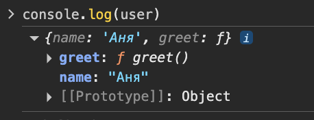
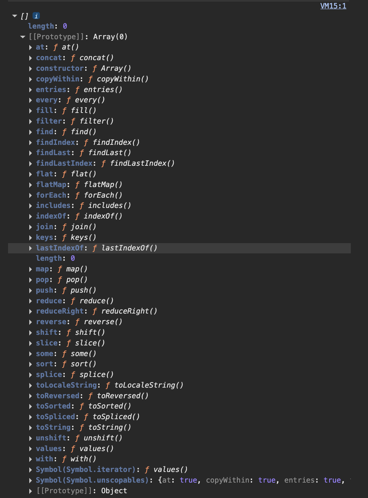
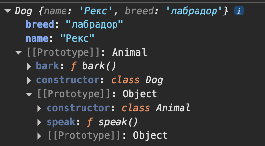
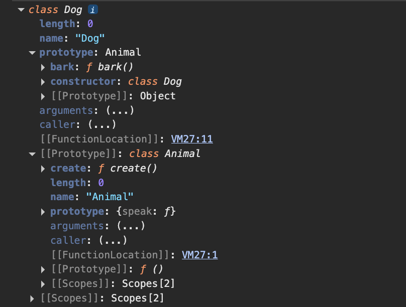

# Тема 5. JavaScript: объекты, прототипы, ООП

Ты уже писал(а) классы в Python много раз: `class`, `__init__`, `self`, наследование через круглые скобки в заголовке класса. Всё это выглядит стройно и предсказуемо: есть класс, есть экземпляр, есть чёткая иерархия. В JavaScript первое время всё это тоже вроде бы есть: тоже можно написать `class Animal { }`, унаследовать `class Dog extends Animal { }`, вызвать `super()`. Велик соблазн просто перенести питоновские привычки один в один. И тут начинаются сюрпризы: метод, вырванный из объекта и переданный как колбэк, вдруг теряет доступ к своим же данным; два объекта, ничего общего не имеющие в коде, вдруг «шарят» один и тот же массив через общий прототип; `this` внутри функции оказывается не тем, что ожидалось.

Дело в том, что `class` в JS — это красивая обёртка поверх совершенно другого механизма наследования, прототипного, а не классового. Если понимать, что происходит под этой обёрткой, все перечисленные сюрпризы перестают быть сюрпризами и превращаются в предсказуемое поведение языка. Это основы, без которых невозможно уверенно писать фронтенд: React-компоненты, замыкания в обработчиках событий, любая библиотека, использующая `Object.freeze` для иммутабельности состояния, — всё это опирается на то, что будет в этой теме.

К концу темы ты сможешь:

- создавать объекты через литералы с вычисляемыми ключами и сокращённым синтаксисом, а также глубоко деструктурировать вложенные объекты и массивы с дефолтами и переименованием;
- объяснить, откуда взялось значение любого свойства объекта, пройдя вручную по прототипной цепочке;
- настраивать поведение свойств через дескрипторы (`writable`, `enumerable`, `configurable`) и писать геттеры/сеттеры;
- предсказать значение `this` в любом вызове — как обычном методе, так и переданном колбэке — и чинить потерю `this` через `bind` или стрелочную функцию;
- писать классы с наследованием, `super`, статическими методами и приватными полями, понимая, во что они разворачиваются «под капотом», и объяснить, как класс и его экземпляры устроены в памяти;
- объяснить программисту, который знает только Python, чем прототипное наследование JS принципиально отличается от классового.

Держи в уме несколько вопросов — ответы на них раскиданы по разделам ниже. Попробуй вернуться к ним в конце темы.

1. У объекта `cat` нет собственного метода `speak`, но `cat.speak()` прекрасно работает. Откуда JS взял этот метод?
2. Ты сделал(а) `const frozen = Object.freeze(obj)`, а потом `frozen.list.push(1)` — почему это сработало, хотя объект вроде бы заморожен?
3. `const handler = obj.method; handler();` — метод «сломался», `this` внутри стал `undefined`. Почему, если метод тот же самый?
4. `class Dog extends Animal {}` — это вообще что: новая языковая конструкция или переиспользование чего-то, что в JS уже было?

Если на что-то из этого с ходу ответа нет — это нормально, вопросы 1 и 2 разбираются в разделах 3–5, вопрос 3 — в разделе 6, вопрос 4 — в разделе 7.

## Содержание

- [1. Объекты: литералы, свойства, методы](#1-объекты-литералы-свойства-методы)
  - [Литерал объекта](#литерал-объекта)
  - [Методы объекта](#методы-объекта)
  - [Сокращённый синтаксис свойств](#сокращённый-синтаксис-свойств)
  - [Вычисляемые ключи](#вычисляемые-ключи)
- [2. Деструктуризация и spread/rest](#2-деструктуризация-и-spreadrest)
  - [Деструктуризация объектов](#деструктуризация-объектов)
  - [Деструктуризация массивов](#деструктуризация-массивов)
  - [Rest в деструктуризации](#rest-в-деструктуризации)
  - [Spread для объектов и массивов](#spread-для-объектов-и-массивов)
- [3. Прототипы и прототипная цепочка](#3-прототипы-и-прототипная-цепочка)
  - [На пальцах: откуда у объекта чужие методы](#на-пальцах-откуда-у-объекта-чужие-методы)
  - [`__proto__` и `Object.getPrototypeOf`](#__proto__-и-objectgetprototypeof)
  - [Поиск свойства по цепочке](#поиск-свойства-по-цепочке)
  - [`Object.create` подробнее](#objectcreate-подробнее)
  - [Почти всё в JS — объект](#почти-всё-в-js--объект)
- [4. Дескрипторы свойств, геттеры и сеттеры](#4-дескрипторы-свойств-геттеры-и-сеттеры)
  - [Свойство — это не просто значение](#свойство--это-не-просто-значение)
  - [`Object.defineProperty`](#objectdefineproperty)
  - [Геттеры и сеттеры](#геттеры-и-сеттеры)
- [5. Object.freeze / seal / preventExtensions](#5-objectfreeze--seal--preventextensions)
  - [`Object.preventExtensions` — нельзя добавлять новые свойства](#objectpreventextensions--нельзя-добавлять-новые-свойства)
  - [`Object.seal` — плюс нельзя удалять и переконфигурировать](#objectseal--плюс-нельзя-удалять-и-переконфигурировать)
  - [`Object.freeze` — плюс нельзя изменять значения](#objectfreeze--плюс-нельзя-изменять-значения)
- [6. `this` и способы вызова, `call` / `apply` / `bind`](#6-this-и-способы-вызова-call--apply--bind)
  - [`this` определяется не там, где функция объявлена, а там, где она вызвана](#this-определяется-не-там-где-функция-объявлена-а-там-где-она-вызвана)
  - [Вызов как метод объекта](#вызов-как-метод-объекта)
  - [Обычный вызов функции — и потеря `this`](#обычный-вызов-функции--и-потеря-this)
  - [Стрелочные функции: `this` берётся снаружи](#стрелочные-функции-this-берётся-снаружи)
  - [`new` — создание нового объекта](#new--создание-нового-объекта)
  - [`call`, `apply`, `bind` — явное управление `this`](#call-apply-bind--явное-управление-this)
- [7. Классы: сахар над прототипами](#7-классы-сахар-над-прототипами)
  - [Зачем нужны классы, если есть объекты](#зачем-нужны-классы-если-есть-объекты)
  - [Класс — это функция-конструктор плюс прототип](#класс--это-функция-конструктор-плюс-прототип)
  - [Наследование: `extends` и `super`](#наследование-extends-и-super)
  - [Статические методы и поля](#статические-методы-и-поля)
  - [Приватные поля](#приватные-поля)
  - [Класс vs экземпляр: в чём разница при хранении в памяти?](#класс-vs-экземпляр-в-чём-разница-при-хранении-в-памяти)
- [8. Сравнение с ООП в Python](#8-сравнение-с-ооп-в-python)
  - [Классовое наследование (Python) vs прототипное (JS)](#классовое-наследование-python-vs-прототипное-js)
  - [Приватность: `#field` vs `_name`](#приватность-field-vs-_name)
  - [`this`/`self` — неявное vs явное](#thisself--неявное-vs-явное)
  - [Множественное наследование и mixins](#множественное-наследование-и-mixins)
  - [Итоговое сопоставление](#итоговое-сопоставление)
- [Если кратко](#если-кратко)
- [★ Глубже](#глубже)
- [Что дальше](#что-дальше)

Разделы идут от базового синтаксиса к внутреннему устройству. Если в разделе 3 встретится незнакомое слово из раздела 4 (например, «дескриптор»), не пугайся, до него дойдёт очередь чуть позже.

В конце каждого раздела идут блоки **«Мини-практика»** и **«Вывод»**.

## 1. Объекты: литералы, свойства, методы

### Литерал объекта

Объект в JS — это, по сути, коллекция пар «ключ — значение», где ключ почти всегда строка (или `Symbol`, но об этом отдельно не сегодня), а значением может быть что угодно: число, строка, массив, функция, другой объект.

> **Объект** — неупорядоченная коллекция свойств, где каждое свойство — это пара «ключ: значение».

Самый частый способ создания объекта — литерал в фигурных скобках:

```js
const user = {
  name: "Аня",
  age: 21,
  isStudent: true,
};
```

Обратиться к свойству можно двумя способами: через точку (`user.name`) или через квадратные скобки (`user["name"]`). Разница не косметическая: точечная нотация требует, чтобы имя свойства являлось валидным идентификатором и было известно заранее, а скобочная принимает произвольную строку, в том числе вычисленную во время выполнения:

```js
const key = "age";
console.log(user[key]); // 21 — ключ выбирается динамически
console.log(user.age);  // 21 — тот же результат, но ключ "зашит" в код
```

### Методы объекта

Если значением свойства становится функция, такое свойство называют методом. До ES6 методы приходилось объявлять, используя полный синтаксис:

```js
const user = {
  name: "Аня",
  greet: function () {
    return `Привет, я ${this.name}`;
  },
};
```

Начиная с ES6, есть сокращённый синтаксис методов — без `function` и двоеточия:

```js
const user = {
  name: "Аня",
  greet() {
    return `Привет, я ${this.name}`;
  },
};
```

Это не просто эстетика: сокращённая запись компактнее читается в объектах с десятком методов (характерно для конфигов, обработчиков событий, mixin-объектов), и именно эта форма стала стандартом в современном коде.

### Сокращённый синтаксис свойств

Ещё одно частое сокращение — когда имя переменной совпадает с именем ключа. Такой код:

```js
const name = "Аня";
const age = 21;
const user = { name: name, age: age };
```

можно написать короче:

```js
const name = "Аня";
const age = 21;
const user = { name, age }; // JS сам поймёт, что ключ = имя переменной
```

Это особенно приятно при возврате объекта из функции — распространённый паттерн, когда функция собирает несколько локальных переменных в один объект результата.

### Вычисляемые ключи

Иногда имя ключа заранее не известно — оно приходит из переменной или вычисляется выражением. Для этого ключ оборачивают в квадратные скобки прямо внутри литерала:

```js
const field = "email";
const index = 3;

const user = {
  [field]: "ann@example.com",       // ключ = значение переменной field
  [`item_${index}`]: "значение",    // ключ = результат шаблонной строки
};

console.log(user.email);   // "ann@example.com"
console.log(user.item_3);  // "значение"
```

Без вычисляемых ключей пришлось бы сначала создавать объект, а потом отдельной строкой дописывать в него нужное свойство через скобочную нотацию — вычисляемые ключи позволяют собрать весь объект в одном литерале, что особенно удобно, когда динамически строишь объект в цикле.

### Мини-практика

Загляни в консоль браузера (DevTools → Console) и набери объект с сокращёнными свойствами и методом — при разворачивании объекта в консоли ты увидишь, что метод помечен как `ƒ`, а обычное свойство — просто как значение.


*Разворачивание объекта в консоли: видно и данные, и методы в одном списке — с точки зрения структуры объекта разницы между ними нет*

### Вывод

Объект — это набор пар «ключ: значение», и метод в нём — такое же свойство, только со значением-функцией. Точка подходит, когда ключ известен заранее, квадратные скобки — когда ключ вычисляется во время выполнения. Сокращённые методы и свойства и вычисляемые ключи позволяют собрать весь объект одним литералом — это стандартная форма современного кода.

Дальше вопрос: а что, если нужно быстро скопировать часть полей объекта в отдельные переменные или собрать новый объект из кусков старого? Для этого в JS есть деструктуризация и spread/rest — переходим к разделу 2.

## 2. Деструктуризация и spread/rest

### Деструктуризация объектов

Деструктуризация — это способ «распаковать» объект или массив сразу в отдельные переменные, не обращаясь к каждому свойству по отдельности через точку.

> **Деструктуризация** — синтаксис, который позволяет извлечь значения из объекта или массива и присвоить их переменным одной конструкцией.

Без деструктуризации:

```js
const user = { name: "Аня", age: 21, city: "Москва" };

const name = user.name;
const age = user.age;
```

С деструктуризацией — то же самое в одну строку:

```js
const { name, age } = user;
console.log(name, age); // "Аня" 21
```

Имена переменных слева должны совпадать с именами ключей объекта — порядок при этом не важен, в отличие от массивов (об этом ниже).

**Переименование.** Если имя ключа неудобно использовать как имя переменной (конфликтует с другой переменной в области видимости или просто хочется имя понагляднее), можно переименовать через двоеточие:

```js
const { name: userName, age: userAge } = user;
console.log(userName, userAge); // "Аня" 21
// user.name — доступа к переменной name больше нет, она называется userName
```

**Значения по умолчанию.** Если свойства может не быть в объекте, деструктуризация позволяет задать значение по умолчанию — оно применится, только если значение в объекте `undefined` (не `null`, именно `undefined`):

```js
const settings = { theme: "dark" };
const { theme, fontSize = 14 } = settings;

console.log(theme, fontSize); // "dark" 14 — fontSize взят из дефолта
```

Переименование и дефолт можно комбинировать:

```js
const { theme: colorTheme = "light" } = settings;
```

**Вложенная деструктуризация.** Объекты часто вложены друг в друга, и деструктуризация умеет «нырять» вглубь структуры сразу за нужным значением:

```js
const response = {
  status: 200,
  data: {
    user: { name: "Аня", address: { city: "Москва" } },
  },
};

const {
  data: {
    user: { name, address: { city } },
  },
} = response;

console.log(name, city); // "Аня" "Москва"
```

Обрати внимание: промежуточные имена (`data`, `user`, `address`) в этом примере не становятся переменными — они используются только как «путь» внутрь структуры. Переменными стали лишь `name` и `city`.

### Деструктуризация массивов

С массивами работает похожий синтаксис, но через квадратные скобки, и — в отличие от объектов — порядок здесь имеет значение, потому что у элементов массива нет имён, только позиция:

```js
const colors = ["red", "green", "blue"];
const [first, second] = colors;

console.log(first, second); // "red" "green"
```

Пропустить элемент можно, оставив место пустым:

```js
const [, , third] = colors;
console.log(third); // "blue"
```

Дефолтные значения работают так же, как в объектах:

```js
const [a, b, c = "black"] = ["red", "green"];
console.log(c); // "black" — в исходном массиве третьего элемента не было
```

Классический практический пример — деструктуризация результата `useState` в React (даже если ты ещё не писал(а) на React, эту строчку встретишь почти сразу): `const [count, setCount] = useState(0)` — это деструктуризация массива из двух элементов, где порядок принципиален: первый элемент — значение, второй — функция для его изменения.

### Rest в деструктуризации

Когда нужно забрать «первые несколько» полей/элементов, а всё остальное собрать в отдельную структуру, используется rest-синтаксис (`...`) — но только последним элементом деструктуризации:

```js
const user = { name: "Аня", age: 21, city: "Москва", role: "student" };
const { name, ...rest } = user;

console.log(name); // "Аня"
console.log(rest);  // { age: 21, city: "Москва", role: "student" }
```

Для массивов — аналогично:

```js
const numbers = [1, 2, 3, 4, 5];
const [head, ...tail] = numbers;

console.log(head); // 1
console.log(tail);  // [2, 3, 4, 5]
```

### Spread для объектов и массивов

Spread выглядит идентично rest (те же три точки), но используется в обратной ситуации — не «собрать остаток», а «развернуть» объект или массив в новый.

> `Spread` (`...`) — оператор, который разворачивает содержимое итерируемой структуры (массива) или объекта поэлементно/попольно в новом литерале.

Самые частые способы применения — копирование и слияние:

```js
const defaults = { theme: "light", fontSize: 14 };
const overrides = { fontSize: 18 };

const merged = { ...defaults, ...overrides };
console.log(merged); // { theme: "light", fontSize: 18 }
```

Порядок здесь ключевой: свойства, которые идут правее, перезаписывают одноимённые свойства, которые шли левее, — так `fontSize` из `overrides` победил `fontSize` из `defaults`. Этот паттерн — стандартный способ применить пользовательские настройки поверх конфига по умолчанию, ты будешь видеть его во всех сколько-нибудь взрослых JS-проектах.

Для массивов принцип тот же:

```js
const first = [1, 2];
const second = [3, 4];

const combined = [...first, ...second, 5];
console.log(combined); // [1, 2, 3, 4, 5]
```

Важная деталь: и spread, и деструктуризация с rest создают **новый** объект/массив верхнего уровня (это называют поверхностным, «shallow», копированием) — но если внутри значений есть вложенные объекты или массивы, то они не клонируются, а копируются как ссылки:

```js
const original = { name: "Аня", address: { city: "Москва" } };
const copy = { ...original };

copy.address.city = "Питер";
console.log(original.address.city); // "Питер" — изменилось и в оригинале!
```

Это частый источник багов: разработчик уверен, что сделал независимую копию, а на деле вложенный объект остался общим. Для полного (глубокого) клонирования нужны либо ручная рекурсивная функция, либо `structuredClone(original)`, — но это уже за рамками сегодняшней темы.

### Мини-практика

Попробуй руками: открой консоль, создай объект с вложенным массивом, скопируй его через spread и измени элемент вложенного массива в копии — убедись, что оригинал тоже изменился.

### Вывод

Деструктуризация распаковывает объект или массив в переменные одной конструкцией: у объектов важны имена ключей, у массивов — позиция. Переименование, значения по умолчанию (они срабатывают только на `undefined`) и вложенность можно комбинировать. Spread разворачивает структуру в новый литерал, rest собирает остаток — но оба делают поверхностную копию: вложенные объекты остаются общими ссылками.

Дальше будет тема, без которой непонятно, откуда `cat.speak()` берёт метод, если ты его туда не клал, — прототипы.

## 3. Прототипы и прототипная цепочка

### На пальцах: откуда у объекта чужие методы

Возьми пустой массив и вызови у него метод:

```js
const arr = [];
console.log(arr.push);   // ƒ push() { [native code] }
console.log(arr.map);    // ƒ map() { [native code] }
```

Ты не писал(а) `push` и `map` для этого конкретного массива — их там физически нет как собственных свойств. Тем не менее они доступны. JS устроен так, что у каждого объекта есть скрытая ссылка на другой объект — «родителя», у которого можно позаимствовать свойства и методы, если своих не нашлось. Этот родитель, в свою очередь, может иметь своего родителя — и так образуется цепочка.

> **Прототип** — объект, на который ссылается скрытое внутреннее свойство `[[Prototype]]` другого объекта; используется как источник свойств и методов, когда они не находятся у самого объекта.

Квадратные скобки в `[[Prototype]]` — это не опечатка и не синтаксис JS, это обозначение из спецификации языка для внутренних свойств, недоступных напрямую через точку. Обратиться к прототипу из кода можно двумя способами.

### `__proto__` и `Object.getPrototypeOf`

Исторически первым появился аксессор `__proto__` — он до сих пор часто встречается в старом коде и в консоли DevTools, но считается устаревшим для прямого использования в коде:

```js
const arr = [];
console.log(arr.__proto__ === Array.prototype); // true
```

Современный рекомендуемый способ — метод `Object.getPrototypeOf`:

```js
console.log(Object.getPrototypeOf(arr) === Array.prototype); // true
```

Разверни в консоли любой массив или объект — под обычными свойствами ты увидишь служебную запись `[[Prototype]]`, а в ней — методы вроде `push`, `map`, `filter`. Это и есть `Array.prototype`, общий для всех массивов объект-склад методов.


*В самом низу списка свойств массива — служебная запись [[Prototype]], а в ней методы, общие для всех массивов*

### Поиск свойства по цепочке

Когда ты обращаешься к `obj.someProperty`, движок JS действует по алгоритму:

1. Проверить, есть ли `someProperty` как собственное свойство у самого `obj`.
2. Если нет — подняться к `obj.[[Prototype]]` и проверить там.
3. Если и там нет — подняться ещё на уровень выше, к прототипу прототипа.
4. Повторять, пока не найдётся свойство либо пока не будет достигнут `null` — это не прототип, а признак того, что цепочка закончилась. «Вершиной» цепочки обычно оказывается `Object.prototype`: своего прототипа у него уже нет, то есть его собственный `[[Prototype]]` равен `null`.

> **Прототипная цепочка** — последовательность объектов, связанных через `[[Prototype]]`, по которой JS ищет свойство, если оно не найдено у самого объекта.

Посмотрим на примере с `Object.create` — методом, который явно создаёт объект с заданным прототипом:

```js
const animal = {
  eats: true,
  walk() {
    console.log("Иду вперёд");
  },
};

const rabbit = Object.create(animal); // rabbit.[[Prototype]] === animal
rabbit.jumps = true;

console.log(rabbit.jumps); // true — собственное свойство rabbit
console.log(rabbit.eats);  // true — не собственное, найдено в animal через цепочку
rabbit.walk();              // "Иду вперёд" — метод тоже найден в прототипе
```

Здесь важно чётко различать два случая, которые снаружи выглядят одинаково, а по факту принципиально разные.

> **Собственное свойство** (own property) объекта — свойство, физически хранящееся в самом объекте.
> **Унаследованное свойство** — свойство, которого нет в самом объекте, но которое находится по прототипной цепочке.

Проверить разницу можно с помощью метода `hasOwnProperty`:

```js
console.log(rabbit.hasOwnProperty("jumps")); // true — своё
console.log(rabbit.hasOwnProperty("eats"));  // false — унаследовано от animal
```

Это разграничение — не теоретическая тонкость, а рабочий источник багов. Если `animal.eats` внезапно поменять на `false`, у `rabbit` тоже «изменится» унаследованное значение — потому что физически `eats` хранится только в одном месте, в `animal`, и все объекты, у которых `animal` в прототипе, обращаются к одному и тому же значению.

**А что при записи?** Здесь поведение отличается от чтения. Присваивание `rabbit.eats = false` не изменит `animal.eats` — вместо этого у `rabbit` появится **собственное** свойство `eats`, которое «затенит» (shadowing) одноимённое свойство прототипа при последующих обращениях:

```js
rabbit.eats = false;
console.log(rabbit.eats);        // false — собственное свойство
console.log(animal.eats);        // true — не тронуто
console.log(rabbit.hasOwnProperty("eats")); // true — теперь собственное
```

Именно поэтому баг «мутация общего прототипа» обычно возникает не через простое присваивание, а через **изменение содержимого** унаследованного объекта или массива — например, `rabbit.someSharedArray.push(1)` — потому что `push` не создаёт нового свойства у `rabbit`, а изменяет тот самый общий массив, на который смотрят все объекты цепочки.

### `Object.create` подробнее

`Object.create(proto)` — единственный способ явно создать объект с заданным прототипом, минуя конструкторы и классы:

```js
const nullProtoObj = Object.create(null);
// у nullProtoObj вообще нет прототипа — даже toString() унаследовать неоткуда
console.log(nullProtoObj.toString); // undefined
```

Объект без прототипа (`Object.create(null)`) иногда специально используют как «чистый словарь» — когда точно нужно, чтобы никакие унаследованные методы (`toString`, `hasOwnProperty` и так далее) случайно не попали в перебор собственных ключей объекта, который используется как хранилище произвольных данных.

Второй параметр `Object.create` позволяет сразу задать дескрипторы собственных свойств, но это уже тема следующего раздела.

### Почти всё в JS — объект

Теперь, когда разобраны прототипы и поиск свойства по цепочке, становится видно кое-что важное: массивы, функции и даже объекты-обёртки над числами и строками в JS устроены по тем же правилам, что и обычный `{ }`, — потому что это тоже объекты, просто со своим специализированным прототипом.

Массив `[]` — это объект, у которого `[[Prototype]]` указывает на `Array.prototype`, а индексы (`0`, `1`, `2`, ...) — фактически строковые ключи, только с особым поведением (автоматическое обновление `length`):

```js
const arr = [10, 20, 30];
console.log(typeof arr);                          // "object"
console.log(Object.getPrototypeOf(arr) === Array.prototype); // true

arr.customField = "не элемент, а обычное свойство объекта";
console.log(arr.length);       // 3 — customField не индекс, длину не увеличил
console.log(arr.customField);  // "не элемент, а обычное свойство объекта"
```

Функция — тоже объект: у неё, как у любого объекта, могут быть собственные свойства (к этому мы ещё вернёмся в разделе про классы: там `Animal.prototype`, `Dog.someStaticMethod` окажутся ровно такими свойствами на объекте-функции) и свой прототип, `Function.prototype`, откуда и берутся знакомые уже `call`/`apply`/`bind`:

```js
function greet() {}
console.log(typeof greet);                              // "function"
console.log(Object.getPrototypeOf(greet) === Function.prototype); // true

greet.description = "просто функция с дополнительным свойством";
console.log(greet.description); // сработало — функция хранит свойство как обычный объект
```

Именно поэтому `call`, `apply`, `bind` вообще доступны у любой функции без исключения — это не особый синтаксис языка, а обычные унаследованные методы, которые каждая функция получает через `Function.prototype`, тем же механизмом поиска по цепочке, что и `push` у массива.

Даже строки и числа, будучи примитивами (не объектами в строгом смысле), временно «оборачиваются» в объект в момент обращения к методу или свойству — поэтому `"hello".toUpperCase()` вообще работает, хотя строка — примитив, а не объект:

```js
const str = "hello";
console.log(typeof str);              // "string" — примитив, не объект
console.log(str.toUpperCase());        // "HELLO" — но метод всё равно доступен

console.log(Object.getPrototypeOf(Object(str)) === String.prototype); // true
```

Разберём это по шагам. При обращении `str.toUpperCase()` движок делает три вещи подряд.

1. **Боксинг (boxing)** — на мгновение создаёт временный объект-обёртку через встроенный конструктор, эквивалент `new String(str)`, у которого `[[Prototype]]` указывает на `String.prototype`.
2. Ищет `toUpperCase` в этой обёртке — своего свойства нет, поднимается по цепочке к `String.prototype`, находит метод, вызывает его с `this`, указывающим на обёртку, — тот же самый поиск по прототипной цепочке, что и всюду в разделе 3.
3. **Анбоксинг** — возвращает результат вызова (обычную примитивную строку `"HELLO"`), а временная обёртка тут же удаляется сборщиком мусора; сама переменная `str` как была, так и остаётся примитивом.

Ключевое здесь — слово «временный». Обёртка живёт ровно время одного обращения к свойству и не сохраняется между вызовами. Это можно наглядно увидеть на характерной ловушке: если попробовать записать свойство прямо в примитив, поведение зависит от режима выполнения.

В обычном, нестрогом режиме запись теряется молча, без ошибки: движок создаёт временную обёртку, пишет свойство в неё, а затем обёртку уничтожает:

```js
const str = "hello";
str.customProp = "запомнюсь ли я?"; // боксинг создаёт временную обёртку, пишет в неё
console.log(str.customProp);         // undefined — обёртка уже уничтожена к этому моменту
```

А вот в строгом режиме (`"use strict"` и — важно — автоматически внутри ES-модулей и тела любого класса, то есть почти во всём современном коде) та же самая запись не молчит, а бросает исключение:

```js
"use strict";
const str = "hello";
str.customProp = "запомнюсь ли я?"; // TypeError: Cannot create property 'customProp' on string 'hello'
```

Этот принцип ещё не раз встретится дальше в теме (например, в разделе 4 при разговоре о `writable: false`): нестрогий режим предпочитает тихо игнорировать невозможную запись, строгий — сообщает о ней явно через `TypeError`. Поскольку весь код внутри классов и ES-модулей выполняется в строгом режиме автоматически, на практике такая попытка гораздо чаще будет падать с ошибкой, чем молчать, — и это скорее хорошо: явная ошибка проще для отладки, чем тихо потерянное значение.

Обрати внимание на разницу с массивом из примера выше: `arr.customField = ...` сохраняется в любом режиме, потому что массив — настоящий объект, живущий в памяти постоянно, а не временная обёртка, создаваемая заново при каждом обращении.

**Явное создание обёртки — и почему так делать не стоит.** Тот же конструктор, что неявно используется при автоупаковке, доступен и напрямую: `new String(...)`, `new Number(...)`, `new Boolean(...)`. В отличие от автоупаковки, объект, созданный так, не исчезает — и это источник трудноуловимых багов:

```js
const primitive = "hello";
const wrapped = new String("hello");

console.log(typeof primitive); // "string"
console.log(typeof wrapped);    // "object" — совсем другой тип!

console.log(primitive === "hello"); // true — сравнение примитивов по значению
console.log(wrapped === "hello");    // false — объект никогда не равен примитиву через ===

if (new Boolean(false)) {
  console.log("это выполнится!"); // да, выполнится: любой ОБЪЕКТ, даже обёртка над false, truthy
}
```

Последняя строка — не опечатка: `new Boolean(false)` создаёт объект, а любой объект в булевом контексте — истинный (`truthy`), независимо от того, какое значение «упаковано» внутри. Поэтому создавать обёртки вручную (`new String`, `new Number`, `new Boolean`) — устойчивая плохая практика: она незаметно меняет тип значения и ломает интуитивно ожидаемые сравнения. Автоупаковка при обращении к методу примитива — то, что движок делает сам, безопасно и незаметно для тебя; создавать обёртки самостоятельно не нужно почти никогда.

**Обратный процесс — распаковка.** Если у тебя всё же оказался объект-обёртка (например, достался из чужого кода), вернуть примитивное значение можно через `valueOf()` или явное приведение:

```js
const wrapped = new Number(42);
console.log(wrapped.valueOf()); // 42, и typeof этого результата — "number"
console.log(+wrapped);            // 42 — унарный плюс тоже приводит к примитиву
```

Практический вывод: если в чужом коде встретится `Object.getPrototypeOf(someValue)`, `someValue.hasOwnProperty(...)` или `someValue instanceof SomeClass` применительно к массиву, функции или даже строке — это не какое-то отдельное «объектное» поведение специально для этого типа, а всё тот же единый механизм прототипов, который мы разобрали на примере обычных `{ }`. А если где-то встретится `typeof x === "object"` там, где ты ожидаешь строку или число, — первым делом проверь, не создан ли этот `x` через `new String`/`new Number`/`new Boolean` вместо обычного литерала.

### Мини-практика

Попробуй на паре: построй цепочку из трёх объектов (`base → middle → leaf`) через `Object.create`, добавь разным уровням разные свойства и предскажи на бумаге, что вернёт обращение к каждому свойству с `leaf`, прежде чем проверять в консоли.

### Вывод

У каждого объекта есть скрытая ссылка `[[Prototype]]`, и если свойства нет у самого объекта, JS ищет его вверх по цепочке, пока не дойдёт до `null`. Чтение может найти унаследованное значение, а присваивание всегда создаёт собственное свойство и затеняет прототип; общее состояние ломается не присваиванием, а мутацией унаследованного объекта или массива. По тем же правилам устроены массивы и функции, а примитивы на время обращения к методу оборачиваются в объект — поэтому `"hello".toUpperCase()` работает, а создавать обёртки через `new String` самому не стоит.

## 4. Дескрипторы свойств, геттеры и сеттеры

### Свойство — это не просто значение

До сих пор мы говорили о свойстве как о паре «ключ: значение», но у каждого свойства объекта на самом деле есть набор внутренних настроек — их называют дескрипторами.

> **Дескриптор свойства** — объект, описывающий поведение конкретного свойства: можно ли менять, перечислять и переопределять его, а также его текущее значение.

У свойства, созданного обычным способом (через литерал или присваивание `obj.x = 1`), дескриптор по умолчанию выглядит так:

```js
const user = { name: "Аня" };
console.log(Object.getOwnPropertyDescriptor(user, "name"));
// { value: "Аня", writable: true, enumerable: true, configurable: true }
```

Четыре флага дескриптора отвечают за разное:

- `value` — собственно значение свойства;
- `writable` — можно ли изменить значение через присваивание;
- `enumerable` — попадёт ли свойство в перебор (`for...in`, `Object.keys`, spread);
- `configurable` — можно ли удалить свойство или изменить сам дескриптор (кроме `value`/`writable`, когда `writable: true`).

По умолчанию, если ты создаёшь свойство обычным присваиванием, все три флага (`writable`, `enumerable`, `configurable`) выставляются в `true` — свойство «полностью открыто». Управлять этим напрямую позволяет `Object.defineProperty`.

### `Object.defineProperty`

```js
const config = {};

Object.defineProperty(config, "apiUrl", {
  value: "https://api.example.com",
  writable: false,    // нельзя переписать
  enumerable: false,  // не появится в Object.keys / for...in
  configurable: false, // нельзя удалить или переопределить дескриптор
});

console.log(config.apiUrl); // "https://api.example.com"

config.apiUrl = "https://evil.example.com"; // тихо игнорируется (в нестрогом режиме)
console.log(config.apiUrl); // "https://api.example.com" — не изменилось

console.log(Object.keys(config)); // [] — свойство скрыто от перебора
```

Обрати внимание: при попытке записи в `writable: false` свойство в обычном режиме JS **молча** игнорирует присваивание, без ошибки — это частая ловушка при отладке. Код вроде бы отработал без исключений, а значение так и не поменялось. В строгом режиме (`"use strict"`, а также автоматически — внутри классов и ES-модулей) такая попытка бросит `TypeError` — тот же принцип «тихо в нестрогом / явная ошибка в строгом», что уже встречался в разделе 3 на примере записи свойства в примитивную строку.

`writable: false` не защищает от изменения содержимого объекта или массива, если сам объект хранится как `value`, — она защищает только саму привязку «ключ → это конкретное значение». Изменить внутренности того, на что указывает `value`, всё ещё можно:

```js
Object.defineProperty(config, "list", {
  value: [1, 2, 3],
  writable: false,
});

config.list.push(4);          // сработает — массив мутировали, не переприсвоили
console.log(config.list);     // [1, 2, 3, 4]

config.list = [];             // а вот это проигнорируется — writable: false
```

Это ровно то же различие, что мы уже видели при spread-копировании: `writable` контролирует **саму ссылку** в дескрипторе, а не то, что происходит «внутри» объекта, на который эта ссылка указывает.

### Геттеры и сеттеры

Помимо свойств-данных (`value` + `writable`), есть свойства-аксессоры — вместо `value` у них пара функций `get`/`set`, которые выполняются при чтении и записи.

> **Геттер** (`get`) — функция, которая выполняется при чтении свойства и возвращает вычисляемое значение.
> **Сеттер** (`set`) — функция, которая выполняется при записи в свойство и может проверять/преобразовывать входные данные.

В литерале объекта их можно объявить прямо inline:

```js
const person = {
  firstName: "Анна",
  lastName: "Иванова",

  get fullName() {
    return `${this.firstName} ${this.lastName}`;
  },

  set fullName(value) {
    [this.firstName, this.lastName] = value.split(" ");
  },
};

console.log(person.fullName);   // "Анна Иванова" — вызвался геттер
person.fullName = "Мария Петрова"; // вызвался сеттер
console.log(person.firstName);  // "Мария"
```

Снаружи `person.fullName` выглядит как обычное свойство — обращение без скобок, без вызова функции, — но фактически при каждом чтении выполняется код геттера. Это удобно для двух типичных случаев: вычисляемых значений (как `fullName`, которого физически нет в объекте) и валидации при записи:

```js
const account = {
  _balance: 0, // «приватность» через соглашение об именовании, подробнее — в разделе 8

  get balance() {
    return this._balance;
  },

  set balance(value) {
    if (value < 0) {
      throw new Error("Баланс не может быть отрицательным");
    }
    this._balance = value;
  },
};

account.balance = 100; // ок, сеттер пропустил
console.log(account.balance); // 100

account.balance = -50; // Error: Баланс не может быть отрицательным
```

Геттеры/сеттеры уместны там, где снаружи объект должен выглядеть как обычное хранилище данных, но внутри нужна логика — вычисление, кеширование, проверка допустимости значения. Если логика не нужна и достаточно простого чтения/записи значения — используй обычное свойство, не усложняй объект аксессорами без причины.

Через `Object.defineProperty` геттер/сеттер задаётся так же, только вместо `value`/`writable` указываются `get`/`set`:

```js
Object.defineProperty(person, "initials", {
  get() {
    return `${this.firstName[0]}.${this.lastName[0]}.`;
  },
  enumerable: true,
});
```

### Мини-практика

1. Создай объект и через `Object.defineProperty` добавь свойство с `writable: false` и `enumerable: false`. Попробуй перезаписать его и выведи `Object.keys` — сначала в обычном режиме, затем добавив `"use strict"`. Сравни поведение.
2. Добавь объекту геттер для вычисляемого значения и сеттер, который бросает ошибку на недопустимом значении. Проверь оба через обычное чтение и присваивание.

### Вывод

У каждого свойства есть дескриптор: `value`, `writable`, `enumerable`, `configurable`. Через `Object.defineProperty` их задают явно; при записи в `writable: false` нестрогий режим молчит, а строгий бросает `TypeError`. `writable` защищает только ссылку, а не содержимое объекта, на который она указывает. Геттеры и сеттеры снаружи выглядят как обычные свойства, но выполняют код — для вычисляемых значений и проверки при записи.

Дескрипторы — это тот самый механизм, на котором держится следующий раздел: `freeze`/`seal` — это, по сути, массовое применение определённых значений `writable`/`configurable`/расширяемости ко всем свойствам объекта разом.

## 5. Object.freeze / seal / preventExtensions

Три метода образуют «лестницу» уровней неизменяемости объекта — от самого мягкого ограничения к самому строгому. Разберём снизу вверх.

### `Object.preventExtensions` — нельзя добавлять новые свойства

```js
const obj = { a: 1 };
Object.preventExtensions(obj);

obj.b = 2;               // проигнорируется (в строгом режиме — TypeError)
console.log(obj);        // { a: 1 } — b не добавился

obj.a = 100;              // а вот это сработает — a уже существовал
console.log(obj.a);       // 100

delete obj.a;              // тоже сработает — удаление старых свойств разрешено
console.log(obj);          // {}
```

`preventExtensions` запрещает ровно одну вещь — появление новых свойств. Изменять и удалять существующие можно свободно.

### `Object.seal` — плюс нельзя удалять и переконфигурировать

```js
const sealed = { a: 1 };
Object.seal(sealed);

sealed.b = 2;         // не добавится — как и preventExtensions
delete sealed.a;       // не удалится
sealed.a = 100;         // а вот это сработает!
console.log(sealed);   // { a: 100 }
```

`seal` эквивалентен `preventExtensions` + у каждого существующего свойства `configurable: false`. Значения существующих свойств **менять по-прежнему можно** — `seal` не трогает `writable`.

### `Object.freeze` — плюс нельзя изменять значения

```js
const frozen = Object.freeze({ a: 1, list: [1, 2] });

frozen.a = 100;        // проигнорируется
frozen.b = 2;           // проигнорируется
delete frozen.a;         // проигнорируется
console.log(frozen);     // { a: 1, list: [1, 2] } — ничего не изменилось
```

`freeze` — это `seal` + у каждого свойства ещё и `writable: false`. Это самый строгий из трёх уровней: нельзя ни добавить, ни удалить свойство, ни изменить существующее.

**Но именно здесь чаще всего ошибаются** — вернёмся к вопросу из начала темы про `frozen.list.push(1)`:

```js
frozen.list.push(3);
console.log(frozen.list); // [1, 2, 3] — сработало!
```

`freeze` — **поверхностный** (shallow). Он замораживает только свойства верхнего уровня самого объекта, но не трогает объекты/массивы, на которые эти свойства ссылаются. `frozen.list` как ссылка неизменна (её нельзя переприсвоить другому массиву), но содержимое массива, на который она указывает, — обычный, ничем не защищённый массив. Чтобы заморозить вложенность, пришлось бы рекурсивно применять `freeze` к каждому вложенному объекту вручную.

Проверить состояние объекта можно соответствующими проверочными методами:

```js
console.log(Object.isExtensible(frozen)); // false
console.log(Object.isSealed(frozen));      // true
console.log(Object.isFrozen(frozen));       // true
```

Сводная таблица уровней:

| Метод | Новые свойства | Удаление | Изменение значений | Изменение конфигурации |
|---|---|---|---|---|
| `preventExtensions` | нет | да | да | да |
| `seal` | нет | нет | да | нет |
| `freeze` | нет | нет | нет | нет |

На практике `Object.freeze` чаще всего встречается там, где нужна предсказуемость, — например, при экспорте конфигурационных констант из модуля, чтобы случайная мутация в другом файле не поменяла поведение всего приложения. Многие библиотеки управления состоянием (Redux и его аналоги) в дев-режиме используют `freeze` над state именно для того, чтобы поймать случайные прямые мутации на раннем этапе.

### Мини-практика

Попробуй руками: заморозь объект с вложенным объектом, попробуй изменить вложенное значение, убедись, что оно меняется, — а затем напиши рекурсивную функцию `deepFreeze`, которая обходит все вложенные объекты и замораживает их тоже.

### Вывод

Три метода дают три уровня защиты: `preventExtensions` запрещает новые свойства, `seal` — ещё и удаление, `freeze` — ещё и изменение значений. Все три поверхностные: вложенные объекты и массивы остаются изменяемыми, поэтому `frozen.list.push(...)` работает. Для полной защиты нужен рекурсивный `deepFreeze`.

Дальше переходим к теме, без которой не разобраться в методах объектов по-настоящему, — к тому, что такое `this` и почему оно «плавает».

## 6. `this` и способы вызова, `call` / `apply` / `bind`

### `this` определяется не там, где функция объявлена, а там, где она вызвана

В Python `self` — это первый параметр метода, который ты явно передаёшь (пусть и неявно, через синтаксис вызова `obj.method()`, но `self` — это просто обычный параметр функции, который можно даже переименовать). В JavaScript `this` — совсем другой механизм: это не параметр, а специальное значение, которое устанавливается заново при **каждом вызове функции** в зависимости от того, **как именно** эта функция была вызвана, а не от того, где она была объявлена.

> `this` — ссылка на объект, определяемая способом вызова функции, а не местом её объявления.

Разберём все основные способы вызова по очереди.

### Вызов как метод объекта

```js
const user = {
  name: "Аня",
  greet() {
    console.log(`Привет, я ${this.name}`);
  },
};

user.greet(); // "Привет, я Аня" — this === user
```

Правило простое: если функция вызывается через точку у объекта (`obj.method()`), внутри `this` будет ссылаться на объект слева от точки — на `user`.

### Обычный вызов функции — и потеря `this`

Вот тот самый сюрприз из начала темы:

```js
const handler = user.greet; // просто скопировали ссылку на функцию
handler(); // "Привет, я undefined" (или ошибка в строгом режиме)
```

Функция та же самая, но вызвана она уже не как `obj.method()`, а как самостоятельная `handler()` — точки перед вызовом больше нет, и правило «this = объект слева от точки» не срабатывает. При обычном вызове функции в нестрогом режиме `this` становится глобальным объектом (`window` в браузере), а в строгом режиме (и всегда — внутри классов и модулей) — `undefined`.

Это ровно то, что происходит, когда метод передают колбэком:

```js
setTimeout(user.greet, 1000); // "Привет, я undefined" — та же потеря контекста
```

`setTimeout` вызовет переданную функцию сам, без объекта `user` слева от точки, — значит, к моменту вызова связь с `user` уже потеряна.

### Стрелочные функции: `this` берётся снаружи

Стрелочные функции — особый случай: у них вообще нет собственного `this`. Вместо этого стрелка использует `this` из того места кода, где она была **объявлена** (лексически, как и обычные переменные) — а не из места, где она вызвана.

```js
const user = {
  name: "Аня",
  greetLater() {
    setTimeout(() => {
      console.log(`Привет, я ${this.name}`); // this — из greetLater, то есть user
    }, 1000);
  },
};

user.greetLater(); // "Привет, я Аня" — сработало!
```

Здесь стрелочная функция внутри `setTimeout` «подсмотрела» `this` у окружающего метода `greetLater`, где `this` — это `user`. Это и есть самый частый способ починить потерю `this` в колбэках — заменить обычную функцию на стрелочную, если контекст объявления совпадает с нужным `this`.

Обратная сторона: стрелочную функцию нельзя использовать как метод объекта, если внутри нужен `this` этого объекта:

```js
const broken = {
  name: "Аня",
  greet: () => {
    console.log(this.name); // undefined — this тут не broken, а внешний контекст объявления
  },
};

broken.greet(); // не "Привет, я Аня"
```

### `new` — создание нового объекта

При вызове функции с `new` создаётся новый пустой объект, `this` внутри функции указывает на него, и (если функция явно не возвращает другой объект) этот новый объект возвращается как результат:

```js
function User(name) {
  this.name = name; // this — новый создаваемый объект
}

const u = new User("Аня");
console.log(u.name); // "Аня"
```

Подробнее к вызову через `new` мы вернёмся в разделе про классы — `class` внутри всё ещё использует именно этот механизм.

### `call`, `apply`, `bind` — явное управление `this`

Раз `this` зависит от способа вызова, должен быть способ **явно** его задать, не полагаясь на точку перед вызовом. Для этого есть три метода, которые есть у любой функции (потому что сами функции — тоже объекты и наследуют эти методы от `Function.prototype`, — прямая иллюстрация прототипной цепочки из раздела 3).

> `call`, `apply`, `bind` — методы функции, позволяющие явно задать значение `this` при вызове, независимо от того, как функция объявлена.

**`call`** вызывает функцию немедленно, `this` передаётся первым аргументом, остальные аргументы — по одному через запятую:

```js
function greet(greeting) {
  console.log(`${greeting}, я ${this.name}`);
}

const user = { name: "Аня" };
greet.call(user, "Привет"); // "Привет, я Аня"
```

**`apply`** делает то же самое, но аргументы функции передаются не по одному, а массивом:

```js
greet.apply(user, ["Привет"]); // "Привет, я Аня" — тот же результат
```

Разница между `call` и `apply` — только в форме передачи аргументов функции, поведение `this` идентично. `apply` особенно удобен, когда аргументы уже лежат в массиве (например, пришли из `arguments` или собраны динамически) и незачем их распаковывать вручную.

**`bind`** отличается от первых двух принципиально: он не вызывает функцию сразу, а возвращает **новую** функцию с намертво привязанным `this` (и, опционально, частью аргументов), которую можно вызвать позже:

```js
const boundGreet = greet.bind(user, "Привет");
boundGreet(); // "Привет, я Аня" — вызвали позже, this уже "зашит"
```

Именно `bind` — второй (наряду со стрелочными функциями) стандартный способ починить потерю `this` в колбэках:

```js
setTimeout(user.greet.bind(user), 1000); // this внутри greet теперь всегда user
```

Разница между двумя способами починки: `bind` создаёт привязку один раз и явно, стрелочная функция использует контекст объявления автоматически. На практике внутри классов и React-компонентов чаще выбирают стрелочные функции для методов-колбэков именно потому, что не нужно отдельно вызывать `bind` в конструкторе.

Сводка по способам вызова:

| Способ вызова | Чему равен `this` |
|---|---|
| `obj.method()` | `obj` |
| `func()` (обычный вызов) | `undefined` (строгий режим) / глобальный объект |
| `() => {}` (стрелка) | `this` из места объявления |
| `new Func()` | новый создаваемый объект |
| `func.call(ctx, ...)` / `func.apply(ctx, [...])` | `ctx`, явно |
| `func.bind(ctx)()` | `ctx`, зафиксирован заранее |

### Мини-практика

Попробуй на паре: возьми объект с методом, скопируй метод в отдельную переменную, продемонстрируй потерю `this`, а затем почини её тремя разными способами — `bind`, оборачиванием в стрелочную функцию и явным `call`.

### Вывод

`this` вычисляется при каждом вызове и зависит от того, как функция вызвана: через точку — объект слева, обычный вызов — `undefined` в строгом режиме, `new` — новый объект. Поэтому метод, переданный колбэком, теряет `this`. Чинят это стрелочной функцией, которая берёт `this` из места объявления, или `bind`, который фиксирует `this` заранее; `call` и `apply` задают `this` для разового вызова.

Теперь, когда прототипы и `this` разобраны по отдельности, можно собрать их вместе. Именно на этих двух механизмах и построены классы JS.

## 7. Классы: сахар над прототипами

### Зачем нужны классы, если есть объекты

Резонный вопрос после разделов 1–6: если объект можно создать одним литералом, а прототипное наследование делается через `Object.create`, зачем языку вообще понадобился отдельный синтаксис `class`?

Дело в том, что литералы объектов хорошо описывают **одну конкретную вещь**, но плохо масштабируются, когда нужно создавать много однотипных объектов с общим поведением. Сравни:

```js
// Через литералы — придётся дублировать структуру и методы под каждого пользователя
const user1 = {
  name: "Аня",
  age: 21,
  greet() { console.log(`Привет, я ${this.name}`); },
};
const user2 = {
  name: "Игорь",
  age: 25,
  greet() { console.log(`Привет, я ${this.name}`); }, // тот же метод продублирован
};
```

Каждый литерал создаёт метод `greet` заново, как отдельную функцию в памяти для каждого объекта — а не одну общую. Класс (как и функция-конструктор, стоящая за ним) решает две задачи разом: даёт шаблон для создания множества однотипных объектов через `new` и гарантирует, что все методы физически хранятся один раз — в общем прототипе, а не копируются в каждый экземпляр:

```js
class User {
  constructor(name, age) {
    this.name = name;
    this.age = age;
  }
  greet() { console.log(`Привет, я ${this.name}`); } // один метод на всех
}

const user1 = new User("Аня", 21);
const user2 = new User("Игорь", 25);

console.log(user1.greet === user2.greet); // true — это буквально одна и та же функция
```

Второй довод — наследование. Литералами и spread можно приблизительно сымитировать «общие поля» (`{ ...base, extra: 1 }`), но это разовое копирование значений на момент создания, а не живая связь: изменения в `base` после такого слияния уже не отразятся в производном объекте. Классы через `extends` дают именно живую иерархию, основанную на прототипной цепочке (раздел 3), — и вместе с ней понятный, предсказуемый синтаксис конструктора (`constructor`, `super`) для инициализации объекта с обязательными полями.

Итого: объектный литерал — быстрый способ описать одну структуру данных здесь и сейчас; класс — шаблон для многократного создания однотипных объектов с общими, экономно хранящимися методами и предсказуемым наследованием. Дальше в этом разделе разберём, что класс в JS в буквальном смысле не привносит новой сущности в язык, а лишь удобно упаковывает то, что ты уже видел(а), — функцию-конструктор и прототип.

### Класс — это функция-конструктор плюс прототип

До появления `class` в ES6 «классы» в JS писали через функции-конструкторы напрямую:

```js
function Animal(name) {
  this.name = name;
}

Animal.prototype.speak = function () {
  console.log(`${this.name} издаёт звук`);
};

const cat = new Animal("Кот");
cat.speak(); // "Кот издаёт звук"
```

Здесь `Animal` — обычная функция. При вызове с `new` создаётся новый объект, его `[[Prototype]]` автоматически устанавливается равным `Animal.prototype`, а сам `Animal.prototype` — это обычный объект, в который вручную дописан метод `speak`. Если вызвать `cat.speak()`, JS не находит `speak` в самом `cat` и поднимается по прототипной цепочке к `Animal.prototype` — ровно тот же механизм поиска свойства, что и в разделе 3.

Синтаксис `class`, появившийся в ES6, делает то же самое, но с другим, более привычным (особенно после Python) синтаксисом:

```js
class Animal {
  constructor(name) {
    this.name = name;
  }

  speak() {
    console.log(`${this.name} издаёт звук`);
  }
}

const cat = new Animal("Кот");
cat.speak(); // "Кот издаёт звук"
```

> **Класс** в JS — синтаксический сахар над функцией-конструктором и её прототипом: методы, объявленные в теле класса (кроме `constructor`), автоматически попадают в `ClassName.prototype`.

Проверим это утверждение прямо в консоли:

```js
console.log(typeof Animal);                       // "function" — класс это и есть функция
console.log(Animal.prototype.speak === Animal.prototype.speak); // true
console.log(Object.getPrototypeOf(cat) === Animal.prototype); // true — та же схема, что и раньше
console.log(Object.getOwnPropertyNames(Animal.prototype)); // ["constructor", "speak"]
```

`typeof Animal` возвращает `"function"`, а не какой-то особый тип `"class"` — потому что классов как отдельной сущности в движке JS не существует, есть только функции и прототипы, `class` — это способ их удобно записать.

### Наследование: `extends` и `super`

До классов наследование через прототипы делалось так:

```js
function Dog(name, breed) {
  Animal.call(this, name); // вызвать "родительский конструктор" вручную
  this.breed = breed;
}

Dog.prototype = Object.create(Animal.prototype); // связать прототипные цепочки
Dog.prototype.constructor = Dog;

Dog.prototype.bark = function () {
  console.log(`${this.name} лает`);
};
```

Обрати внимание на `Animal.call(this, name)` — это прямое использование `call` из раздела 6, чтобы выполнить код родительского конструктора с `this`, указывающим на создаваемый объект `Dog`. С классами то же самое пишется через `extends`/`super`:

```js
class Dog extends Animal {
  constructor(name, breed) {
    super(name); // эквивалент Animal.call(this, name)
    this.breed = breed;
  }

  bark() {
    console.log(`${this.name} лает`);
  }
}

const rex = new Dog("Рекс", "лабрадор");
rex.speak(); // "Рекс издаёт звук" — унаследовано от Animal
rex.bark();   // "Рекс лает" — собственный метод Dog
```

`super(name)` внутри `constructor` — обязательный первый вызов, если класс использует `extends`: он вызывает конструктор родителя, передавая туда `this` создаваемого объекта, — без этого вызова обращение к `this` внутри дочернего конструктора вызовет ошибку. `super.speak()` (без скобок конструктора) внутри обычного метода позволяет вызвать одноимённый метод родителя, если дочерний класс его переопределил, но всё ещё хочет использовать часть родительской логики.

Под капотом `extends` делает ровно то же, что раньше делали руками через `Object.create(Animal.prototype)`: связывает `Dog.prototype.[[Prototype]]` с `Animal.prototype`, продолжая ту же прототипную цепочку, что уже знакома по разделу 3:

```js
console.log(Object.getPrototypeOf(Dog.prototype) === Animal.prototype); // true
```


*Экземпляр Dog, развёрнутый в консоли: видно вложенные [[Prototype]] — сначала Dog.prototype с методом bark, затем внутри него Animal.prototype со speak*

### Статические методы и поля

Модификатор `static` позволяет свойству или методу принадлежать не экземплярам, а самому классу — то есть самой функции-конструктору. Это не просто «удобное место для того, чтобы положить утилитную функцию»: у static есть несколько отдельных способов практического применения, и у каждого своя механика.

**Фабричные методы вместо перегрузки конструктора.** В JS нельзя, как в некоторых языках, иметь несколько конструкторов с разными сигнатурами — у класса ровно один `constructor`. Static-метод это компенсирует, давая альтернативный, именованный, способ создать объект:

```js
class User {
  constructor(name, age) {
    this.name = name;
    this.age = age;
  }

  static fromJSON(json) {
    const data = JSON.parse(json);
    return new User(data.name, data.age);
  }

  static guest() {
    return new User("Гость", 0);
  }
}

const u1 = User.fromJSON('{"name":"Аня","age":21}');
const u2 = User.guest();
```

Без static пришлось бы городить отдельные функции снаружи класса или продавливать через конструктор странные флаги вроде `new User(null, null, true)`.

**`this` внутри static-метода — это класс, а не экземпляр.** И здесь начинается по-настоящему интересная часть: static-методы **наследуются**, а `this` внутри такого метода указывает на тот класс, через который его реально вызвали, а не обязательно на класс, где метод объявлен:

```js
class Animal {
  static create() {
    return new this(); // this === класс-вызыватель, не обязательно Animal!
  }
}

class Dog extends Animal {}

console.log(Dog.create() instanceof Dog); // true
```

Хотя `create` физически лежит только в `Animal`, `Dog.create()` создаёт именно `Dog`, а не `Animal` — потому что `this` в static-контексте подчиняется тому же принципу «объект слева от точки», что и обычный `this` (раздел 6), только вместо экземпляра слева от точки здесь стоит класс. Это стандартный паттерн для полиморфных фабрик в иерархии классов.

**Static недоступен на экземпляре напрямую — но наследуется.** Разберём это явно, потому что интуиция здесь обманывает:

```js
const rex = new Dog();

console.log(typeof Dog.create);            // "function" — на классе метод есть
console.log(typeof rex.create);            // undefined — на экземпляре его нет!
console.log(typeof rex.constructor.create); // "function" — а вот так снова есть
```

Причина: static-методы физически лежат не в `Dog.prototype` (по которому ищутся обычные методы экземпляра), а прямо на самой функции-классе `Dog`, как её собственное свойство. А `rex.[[Prototype]]` указывает на `Dog.prototype`, а не на `Dog` — это две разные цепочки поиска, и они нигде не пересекаются.

Но при этом static **наследуется** — потому что `class Dog extends Animal` создаёт не одну, а сразу **две** прототипные связи:

```js
console.log(Object.getPrototypeOf(Dog) === Animal);                     // true — это static-цепочка
console.log(Object.getPrototypeOf(Dog.prototype) === Animal.prototype); // true — а это цепочка экземпляров
```



Первая строка — то, что обычно не бросается в глаза: `extends` связывает не только `Dog.prototype` с `Animal.prototype` (цепочка для методов экземпляра, уже знакомая из раздела 3), но и сам `Dog` с самим `Animal` — отдельная, параллельная цепочка специально для static. Именно по ней `Dog.create()` находит `create`: у самого `Dog` такого собственного свойства нет, поиск поднимается к `Animal`, ровно тем же алгоритмом, что и всюду в этой теме, только цепочка не `экземпляр → прототип`, а `класс → класс-родитель`.

Так что `rex.constructor.create` работает не потому, что static «просочился» в экземпляр, а потому, что `rex.constructor` — это обычная обратная ссылка на `Dog`, а у самого `Dog` доступ к `create` есть через его собственную, static-цепочку. Экземпляры в эту параллельную цепочку не заглядывают вовсе.

**А как вообще функция-класс связана со своим объектом-прототипом?** Здесь легко запутаться, потому что слово «прототип» используется для двух разных механизмов. Связь между `Dog` (функцией) и `Dog.prototype` (объектом) — это не `[[Prototype]]`, а самое обычное свойство: `prototype` физически лежит на `Dog` как собственное свойство и просто хранит ссылку на объект совершенно так же, как хранило бы любое твоё собственное static-поле:

```js
console.log(Dog.hasOwnProperty("prototype")); // true — обычное собственное свойство
console.log(Object.getOwnPropertyDescriptor(Dog, "prototype"));
// { value: {...}, writable: false, enumerable: false, configurable: false } — просто защищено от перезаписи
```

Есть и обратная связь: у самого объекта `Dog.prototype` есть своё собственное свойство `constructor`, указывающее назад на `Dog`:

```js
console.log(Dog.prototype.constructor === Dog); // true
```

Получаются две связи через два обычных, видимых свойства, направленные навстречу друг другу: `Dog.prototype` смотрит на объект-прототип, `Dog.prototype.constructor` смотрит обратно на функцию. Это принципиально иной механизм, чем скрытый внутренний слот `[[Prototype]]` из раздела 3: свойства `prototype`/`constructor` — это просто данные, которые можно прочитать через точку, и они никак не участвуют в поиске по цепочке при обращении к `Dog` как к объекту. Когда движок ищет у `Dog` унаследованный static-метод, он смотрит именно на скрытый `Dog.[[Prototype]]`, а не на видимое свойство `Dog.prototype` — это два разных указателя, которые просто одинаково называются «прототипом» и из-за этого путаются.

Если собрать всю картину для `class Dog extends Animal` в одном месте, получится четыре разные связи:

- `Dog.prototype` (свойство) → объект `Dog.prototype`;
- `Dog.prototype.constructor` (свойство) → обратно на `Dog`;
- `Dog.[[Prototype]]` (скрытый слот) → `Animal` — это static-цепочка;
- `Dog.prototype.[[Prototype]]` (скрытый слот) → `Animal.prototype` — это цепочка методов экземпляров.

Все четыре настраиваются автоматически одним `extends` — но это ровно та причина, по которой тема классов первое время запутывает: «прототип» здесь означает две разные вещи одновременно.

**Служебное состояние на уровне класса.** Static-поля удобны для данных, которые логически принадлежат классу как единой сущности, а не каждому экземпляру по отдельности, — например, счётчик созданных объектов:

```js
class User {
  static count = 0;

  constructor(name) {
    this.name = name;
    User.count++;
  }
}

new User("Аня");
new User("Игорь");
console.log(User.count); // 2
```

Если бы `count` не было static, оно превратилось бы в собственное поле каждого экземпляра — и вместо общего счётчика получалась бы независимая копия `count` у каждого `user`, что бессмысленно.

Итого: `static` — это способ явно сказать, что поведение или данные принадлежат самому классу как единой сущности, а не каждому экземпляру по отдельности, но при этом полноценно участвуют и в наследовании, и в полиморфизме через `this`.

### Приватные поля

До недавнего времени «приватность» полей в JS обеспечивалась только соглашением об именовании — префиксом `_` (как уже было в примере с `_balance` в разделе 4). Но это именно соглашение, не защита на уровне языка: ничто не мешает написать `account._balance = -1000` напрямую, обойдя весь сеттер с проверкой.

Настоящие приватные поля появились в классах через префикс `#`:

```js
class Account {
  #balance = 0; // приватное поле, доступно только внутри класса

  deposit(amount) {
    if (amount < 0) throw new Error("Сумма должна быть положительной");
    this.#balance += amount;
  }

  get balance() {
    return this.#balance;
  }
}

const acc = new Account();
acc.deposit(100);
console.log(acc.balance); // 100
```

А вот эту строку стоит попробовать отдельно, не дописывая к блоку выше, — иначе она не даст выполниться вообще ничему:

```js
console.log(acc.#balance); // SyntaxError: обращение к #balance извне запрещено на уровне синтаксиса
```

Разница с `_balance` принципиальна: `acc._balance` снаружи прекрасно читается и перезаписывается, это просто обычное свойство с «предупреждающим» именем — не более. А `acc.#balance` за пределами тела класса — не просто «не рекомендуется», а вызывает `SyntaxError` уже на этапе разбора кода, до всякого выполнения. Из этого следует практическое отличие от всех остальных ошибок недели: `SyntaxError` на этапе разбора нельзя поймать никаким `try/catch` вокруг обращения — `try/catch` ловит ошибки во время выполнения кода, а этот код попросту не запустится целиком, потому что движок не смог его разобрать. `#`-поля физически не видны и не перечисляются снаружи класса — даже `Object.keys(acc)` их не покажет.

```js
console.log(Object.keys(acc)); // [] — приватное поле не попадает в перебор
```

Практическое следствие: если библиотека или компонент должны гарантированно защитить внутреннее состояние от случайного вмешательства извне (а не просто «попросить» через нижнее подчёркивание не трогать), нужны именно `#`-поля, а не соглашение об именовании.

### Класс vs экземпляр: в чём разница при хранении в памяти?

Мы уже видели, что и класс, и его экземпляры — это объекты: у `Animal` есть собственные свойства (например, `prototype`), у `cat` — тоже. Но тогда закономерный вопрос: если оба они «просто объекты», в чём вообще разница между классом и экземпляром при хранении в памяти? Может, это на деле совсем разные сущности, которые просто одинаково называются «объектами»?

Разница действительно есть, но не в уровне абстракции — оба одинаково реальные объекты в памяти, — а в том, какие это объекты и сколько их создаётся.

При объявлении `class Animal { ... }` движок создаёт не один объект, а два.

1. **Функцию-объект `Animal`** — у неё, как у любого объекта, есть своя таблица свойств, но плюс к этому — способность быть вызванной через `new` (откуда именно берётся эта способность — отдельный вопрос, к нему естественнее вернуться в теме про функции). Static-поля и static-методы, которые мы только что разобрали, становятся собственными свойствами именно этого объекта.
2. **Отдельный обычный объект**, на который у `Animal` есть собственное свойство `prototype`: сюда попадают все не-static-методы из тела класса (в примере выше — `speak`).

```js
console.log(Object.getOwnPropertyDescriptor(Animal, "prototype"));
// { value: {...}, writable: false, enumerable: false, configurable: false } — обычное, но защищённое свойство

console.log(Animal.hasOwnProperty("prototype"));       // true — собственное свойство самого Animal
console.log(Animal.prototype.hasOwnProperty("speak"));  // true — метод лежит в этом втором объекте
```

При каждом `new Animal(...)` создаётся ещё один, отдельный объект — новый участок памяти со своей собственной таблицей свойств. Единственное, что связывает его с классом, — внутренний слот `[[Prototype]]`, который движок при `new` выставляет равным значению свойства `Animal.prototype`. Не копирует содержимое — именно ссылается на тот же самый, один-единственный общий объект:

```js
const cat = new Animal("Кот");
const dog = new Animal("Пёс");

console.log(cat === dog); // false — два разных объекта, два разных участка памяти
console.log(Object.getPrototypeOf(cat) === Object.getPrototypeOf(dog)); // true — но прототип общий, один на двоих
console.log(cat.hasOwnProperty("speak")); // false — метода физически нет в cat, он не копируется
console.log(cat.hasOwnProperty("name"));  // true — а вот name — собственное поле именно этого экземпляра
```

Отсюда и структурная разница между классом и экземпляром:

| | Класс (`Animal`) | Экземпляр (`cat`) |
|---|---|---|
| Сколько создаётся | Один раз, при объявлении класса | Новый объект на каждый `new` |
| Где лежат методы | В отдельном объекте `Animal.prototype`, общем для всех экземпляров | Нигде — экземпляр только ссылается на `Animal.prototype` через `[[Prototype]]` |
| Где лежат собственные данные (`this.name = ...`) | Нигде на классе | Прямо в таблице свойств самого экземпляра |
| Где лежат static-поля/методы | Собственные свойства самого класса (`Animal`) | Недоступны напрямую — только через `instance.constructor` |

Здесь полезно явно развести две похоже называющиеся, но совершенно разные вещи: **`Animal.prototype`** — это обычное, видимое свойство самого класса (можно заглянуть в него, дописать метод и так далее), а **`cat.[[Prototype]]`** — скрытый внутренний слот экземпляра, недоступный напрямую через точку (только через `Object.getPrototypeOf`). Они просто связаны друг с другом одним присваиванием: при `new` движок берёт значение первого и кладёт его во второе.

Практический смысл этого устройства — экономия: сколько бы экземпляров `Animal` ни было создано, метод `speak` физически хранится в памяти ровно один раз, в общем объекте `Animal.prototype`, а не тиражируется на каждый `new` — та же идея, которая уже звучала в начале этого раздела при сравнении класса с литералами.

### Мини-практика

Попробуй на паре: реализуй одну и ту же мини-библиотеку двумя способами — сначала через функции-конструкторы и ручную работу с `prototype`/`call`, затем через `class`/`extends`/`super` — и убедись с помощью `Object.getPrototypeOf`, что итоговая прототипная цепочка в обоих случаях одинаковая.

### Вывод

`class` не вводит в язык новую сущность: это функция-конструктор и объект `ClassName.prototype`, где один раз хранятся все методы экземпляров. `extends` и `super` автоматизируют `Object.create(Parent.prototype)` и `Parent.call(this, ...)`, а заодно связывают сами классы — по этой второй цепочке наследуются static-методы, в которых `this` указывает на класс-вызыватель. Приватные `#`-поля, в отличие от `_name`, защищены синтаксисом: обращение снаружи — `SyntaxError`.

Осталось сопоставить всё это с тем, что ты уже знаешь из Python, — и явно проговорить, где аналогии работают, а где ломаются.

## 8. Сравнение с ООП в Python

### Классовое наследование (Python) vs прототипное (JS)

В Python наследование — это отношение между **классами**: у класса `Dog` есть родительский класс `Animal`, это отдельная, статически описанная сущность, зафиксированная в момент объявления класса. Поиск метода при вызове `dog.speak()` идёт по MRO (method resolution order) — заранее вычисленному порядку обхода классов в иерархии.

В JS, как было показано в разделах 3 и 7, никакой отдельной «классовой» сущности с собственным поведением поиска нет — есть только объекты, связанные ссылками `[[Prototype]]`, и `class` — это просто удобный синтаксис для настройки этих ссылок. Поиск свойства у `rex.speak()` — это буквально обход связного списка объектов через `[[Prototype]]`, тот же механизм, что работает и без единого `class` в коде (как в примере с `Object.create(animal)` из раздела 3).

Практическое следствие этой разницы: в JS прототип можно менять **динамически**, уже после создания объекта, — например, добавить метод в `Animal.prototype` после того, как экземпляры `cat` и `rex` уже созданы, и они оба немедленно «увидят» новый метод, потому что прототип для них общий и ищется каждый раз заново, а не копируется при создании:

```js
const cat = new Animal("Кот");

Animal.prototype.sleep = function () {
  console.log(`${this.name} спит`);
};

cat.sleep(); // "Кот спит" — метод появился уже после создания cat
```

В Python подобная динамическая модификация тоже технически возможна (через `MyClass.new_method = ...`), но идиоматически не характерна для языка и обычно расценивается как редкий приём, а не рабочий паттерн — в то время как в JS прототипы **и есть** основной механизм наследования, и его «живая», изменяемая природа — не побочный эффект, а прямое следствие того, что прототип — это просто объект, а не отдельная неизменяемая конструкция языка.

### Приватность: `#field` vs `_name`

В Python приватность полей — тоже соглашение (одно подчёркивание `_name` — «не трогайте снаружи, но технически можно», двойное `__name` — включает механизм name mangling, слегка усложняющий прямой доступ, но не блокирующий его полностью). В JS до `#`-полей было ровно то же самое — соглашение с одним подчёркиванием, ничем не подкреплённое на уровне языка.

Ключевое отличие в том, что `#`-поля в JS проверяются на уровне синтаксиса: обращение `obj.#field` вне тела класса, которому принадлежит `#field`, — это `SyntaxError`, ошибка, которую движок ловит ещё до выполнения кода, а не в рантайме и не «по договорённости». Python-эквивалента такому уровню приватности, встроенному в сам синтаксис языка, нет — там любая приватность остаётся условностью, пусть даже частично поддержанной интерпретатором (name mangling).

### `this`/`self` — неявное vs явное

В Python `self` — обычный первый параметр метода, его явно пишут в сигнатуре (`def speak(self):`), и он не «теряется» при передаче метода как значения — `self` остаётся связан с объектом, потому что в Python bound-методы устроены так, что связка с экземпляром хранится в самом объекте метода:

```python
class Animal:
    def __init__(self, name):
        self.name = name
    def speak(self):
        print(f"{self.name} издаёт звук")

cat = Animal("Кот")
handler = cat.speak
handler()  # "Кот издаёт звук" — self не потерялся, в отличие от this в JS
```

В JS, как подробно разобрано в разделе 6, `this` — не параметр, а значение, вычисляемое заново при каждом вызове по способу вызова, и именно поэтому `const handler = cat.speak; handler()` в JS ломается, а питоновский аналог — нет. Это одно из мест, где привычки из Python чаще всего активно мешают в JS: интуиция подсказывает, что метод «помнит» свой объект сам по себе, а в JS это не так — связка должна либо создаваться заново при каждом вызове через точку, либо фиксироваться явно через `bind` / стрелочную функцию.

### Множественное наследование и mixins

Python поддерживает множественное наследование прямо в синтаксисе класса: `class C(A, B):`. У JS `extends` — строго единичное наследование, у класса может быть только один родитель в прототипной цепочке. Для похожего эффекта в JS используют паттерн mixin — функции, которые добавляют набор методов в прототип класса, комбинируя несколько источников функциональности без формального множественного наследования; это выходит за рамки сегодняшней темы, но стоит знать термин на случай, если встретишь его в чужом коде.

### Итоговое сопоставление

| | Python | JavaScript |
|---|---|---|
| Механизм наследования | Классы, MRO | Объекты, связанные `[[Prototype]]` |
| Можно ли менять иерархию после создания экземпляров | Не идиоматично | Стандартный сценарий (прототип — обычный объект) |
| `self` / `this` | Явный параметр, не теряется | Вычисляется при вызове, легко теряется |
| Приватность | Соглашение (`_`, `__` с name mangling) | Соглашение (`_`) **или** синтаксическая защита (`#field`) |
| Множественное наследование | Поддерживается напрямую | Нет, только через mixin-паттерн |
| `class` — отдельная сущность языка? | Да | Нет, синтаксический сахар над функцией + прототипом |

### Мини-практика

Предскажи результат, потом проверь в Console:

```js
class Animal {
  constructor(name) {
    this.name = name;
  }

  speak() {
    console.log(`${this.name} издаёт звук`);
  }
}

const cat = new Animal("Кот");
const handler = cat.speak;
handler();
```

Объясни, почему питоновский аналог из этого раздела работает, а здесь вызов падает, и почини его двумя способами из раздела 6. Затем добавь новый метод в `Animal.prototype` уже после создания `cat` и проверь, что `cat` его видит.

### Вывод

В Python наследование — это отношение между классами с порядком поиска MRO, в JS — цепочка ссылок между обычными объектами, которую можно менять даже после создания экземпляров. `self` в Python — явный параметр, который не теряется, а `this` в JS вычисляется заново при каждом вызове. Именно здесь питоновские привычки подводят чаще всего: метод в JS сам по себе не «помнит» свой объект.

## Если кратко

**Объекты: литералы, свойства, методы.** Объект — коллекция пар «ключ: значение», где значением метода становится функция. Современный синтаксис даёт сокращённую запись методов и свойств (`{ name, greet() {} }`) и вычисляемые ключи (`{ [expr]: value }`), которые особенно полезны при динамическом построении объекта. Доступ к свойству — через точку (статичный, известный ключ) или через квадратные скобки (динамический ключ).

**Деструктуризация и spread/rest.** Деструктуризация распаковывает объект/массив в переменные с поддержкой переименования, дефолтов и произвольной вложенности; для объектов порядок не важен, для массивов — важен, потому что там нет имён, только позиция. `Spread` разворачивает структуру в новый литерал (частый паттерн слияния конфигов), `rest` — собирает «остаток» в отдельную структуру. И spread, и деструктуризация с rest создают только поверхностную (shallow) копию: вложенные объекты остаются общими ссылками.

**Прототипы и прототипная цепочка.** У каждого объекта есть скрытая ссылка `[[Prototype]]` на другой объект — источник свойств; обратиться к ней можно через `Object.getPrototypeOf` или устаревший `__proto__`. Поиск свойства при обращении `obj.prop` идёт вверх по цепочке прототипов, пока свойство не найдётся или цепочка не оборвётся на `null`. Собственное свойство физически хранится в объекте, унаследованное — только «видно» через цепочку; запись всегда создаёт собственное свойство (затенение), а не меняет прототип, но мутация *содержимого* унаследованного объекта/массива меняет общее для всех состояние.

**Дескрипторы свойств, геттеры и сеттеры.** У каждого свойства есть дескриптор с флагами `value`/`writable`/`enumerable`/`configurable`, задающийся вручную через `Object.defineProperty`. Геттеры и сеттеры (`get`/`set`) выглядят как обычные свойства снаружи, но выполняют код при чтении/записи — удобны для вычисляемых значений и валидации, но не нужны там, где достаточно простого хранения значения.

**Object.freeze / seal / preventExtensions.** Три уровня неизменяемости: `preventExtensions` запрещает только добавление новых свойств, `seal` дополнительно запрещает удаление и переконфигурирование (но не изменение значений), `freeze` запрещает всё, включая изменение значений. Все три — поверхностные: вложенные объекты и массивы остаются изменяемыми, если не заморозить их отдельно.

**`this` и способы вызова, `call`/`apply`/`bind`.** `this` определяется способом вызова функции в момент вызова, а не местом её объявления — отсюда потеря `this` при передаче метода как значения (колбэка). Стрелочные функции — исключение: у них нет своего `this`, они берут его из места объявления. `call`/`apply` вызывают функцию немедленно с явно заданным `this` (различие — только в форме передачи аргументов), `bind` возвращает новую функцию с зафиксированным `this` для отложенного вызова.

**Классы: сахар над прототипами.** `class` — синтаксическая обёртка: методы попадают в `ClassName.prototype`, `typeof ClassName === "function"`. `extends`/`super` автоматизируют то, что раньше писали вручную через `Object.create(Parent.prototype)` и `Parent.call(this, ...)`. `static`-методы и поля принадлежат самому классу, а не экземплярам, — недоступны напрямую на `instance`, но наследуются через отдельную, параллельную прототипную цепочку (`Object.getPrototypeOf(Child) === Parent`), а `this` внутри static-метода указывает на класс-вызыватель, что даёт полиморфные фабрики (`new this()`). Приватные поля `#field`, в отличие от соглашения `_name`, защищены синтаксически: обращение снаружи класса — это `SyntaxError`, а не просто «не рекомендуется». При объявлении класса создаётся не один, а два объекта в памяти — сама функция-класс и отдельный объект `ClassName.prototype`, где физически лежат методы; каждый `new` создаёт ещё один, отдельный объект-экземпляр, который лишь ссылается на общий прототип через `[[Prototype]]`, а не копирует методы в себя.

**Сравнение с ООП в Python.** Python использует классовое наследование с MRO — статичной, объявленной заранее иерархией; JS — прототипное, где иерархия — это просто цепочка ссылок между объектами, которую можно менять динамически даже после создания экземпляров. `self` в Python — явный параметр, не теряющийся при передаче метода; `this` в JS вычисляется заново при каждом вызове и легко теряется. Приватность в Python — всегда соглашение; в JS есть и соглашение (`_name`), и настоящая синтаксическая защита (`#field`).

<a id="глубже"></a>

## ★ Глубже

Этот раздел не обязателен — если основной материал ещё не улёгся, спокойно пропусти его и вернись позже.

<a id="есть-ли-в-js-готовый-глубокий-freeze"></a>

### ❓ Есть ли в JS готовый глубокий `freeze`?

В практическом задании выше ты уже написал(а) `deepFreeze` руками. Закономерно возникает вопрос: **а нет ли такого готового прямо в JS, без самодельной рекурсии?**

В относительно недавних версиях JS-движков появился `structuredClone` для глубокого копирования, но встроенного «глубокого freeze» в стандартной библиотеке до сих пор нет — сообщество годами обсуждает это как отдельное предложение в TC39 (комитете, стандартизирующем JavaScript), но пока приходится писать `deepFreeze` вручную (как в задании на паре) или брать готовую реализацию из утилитных библиотек вроде `lodash`. Причина, по которой это не тривиальная функция «из коробки», — не техническая сложность, а вопрос производительности: рекурсивный обход и заморозка каждого вложенного объекта на старте не бесплатны, и для больших структур это осознанный компромисс, который язык оставляет разработчику, а не навязывает всем.

Куда смотреть дальше:

- [MDN: Object.freeze()](https://developer.mozilla.org/en-US/docs/Web/JavaScript/Reference/Global_Objects/Object/freeze).

<a id="видит-ли-дочерний-класс-приватные-поля-родителя"></a>

### ❓ Видит ли дочерний класс приватные поля родителя?

Рано или поздно в первом же проекте с классами ты захочешь из дочернего класса дотянуться до приватного поля родителя — и вместо понятного сообщения об ошибке получишь `SyntaxError` ещё на этапе разбора кода. Вопрос, который напрашивается: **видит ли вообще дочерний класс приватные поля родителя, если использовать `#`-поля вместе с наследованием?**

Нет — `#`-поля привязаны строго к тому классу, в котором объявлены, и не наследуются в обычном смысле: если `Animal` объявляет `#name`, а `Dog extends Animal`, код внутри `Dog` не может напрямую написать `this.#name` — такого поля с точки зрения `Dog` не существует, даже если экземпляр физически хранит это приватное поле (потому что оно было установлено конструктором `Animal` через `super()`). Доступ возможен только через публичные геттеры/методы, которые `Animal` сам предоставляет наружу. Это осознанное архитектурное решение TC39: приватность в JS — на уровне класса-владельца, а не на уровне всей цепочки наследования, в отличие, например, от `protected`-полей в языках вроде Java или C++, которых в JS вовсе нет.

Куда смотреть дальше:

- [MDN: Private class features](https://developer.mozilla.org/en-US/docs/Web/JavaScript/Reference/Classes/Private_properties).

<a id="замедляет-ли-длинная-прототипная-цепочка-доступ-к-свойствам"></a>

### ❓ Замедляет ли длинная прототипная цепочка доступ к свойствам?

Впервые взявшись оптимизировать код, ты захочешь «сплющить» длинную прототипную иерархию, чтобы ускорить поиск свойств. Прежде чем тратить на это время, стоит проверить: **есть ли вообще ощутимая разница в производительности между обращением к собственному свойству и обращением через длинную прототипную цепочку?**

Формально да — чем длиннее цепочка, тем больше шагов движку нужно сделать при поиске не существующего у объекта свойства, прежде чем вернуть `undefined` или найти его глубоко в цепочке. На практике современные JS-движки (V8 в Chrome/Node.js и аналоги) агрессивно оптимизируют такие обращения через внутренние механизмы вроде inline caches, и для большинства приложений эта разница незаметна — беспокоиться о ней стоит только в горячих циклах с миллионами обращений, и то после профилирования, а не заранее, «на всякий случай».

Куда смотреть дальше:

- [V8 blog: JavaScript engine fundamentals — Shapes and Inline Caches](https://v8.dev/blog/fast-properties).

## Что дальше

На этом сегодняшняя тема заканчивается, но прототипы никуда не денутся — на следующей неделе, разбирая **DOM API и работу с браузером**, ты увидишь ровно тот же механизм в деле: дерево узлов страницы состоит из обычных объектов, `document.querySelector` возвращает объект-элемент, а его методы (`addEventListener`, `closest`, `remove` и десятки других) лежат не в самом элементе, а в его прототипе — `Element.prototype`, `Node.prototype` и выше по цепочке, вплоть до `Object.prototype`.

Ничего принципиально нового учить не придётся — та же прототипная цепочка и тот же алгоритм поиска свойства, только применённые к объектам, которые рисует браузер.