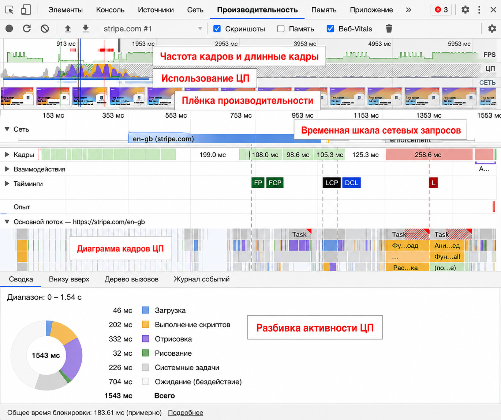

# Тема 6. DOM API и работа с браузером

В предыдущей теме мы изучали объекты, прототипы и основы объектно-ориентированного программирования в JavaScript.
Но до сих пор наши объекты почти не взаимодействовали с веб-страницей.

В программах не было кнопок, заголовков, форм, списков и изображений. Мы не меняли содержимое страницы и не реагировали на действия пользователя. Теперь знания об объектах потребуются для работы с объектами, которые создаёт не наша программа, а браузер.

> Ранее мы изучали, как JavaScript работает с объектами языка. Теперь мы увидим, как с помощью объектов JavaScript управляет страницей, созданной браузером.

## Перед началом попробуем угадать ответы

Перед началом основной части попробуй ответить на четыре вопроса. Не обязательно знать точный ответ — к каждому вопросу мы вернёмся по ходу материала.

### Вопрос 1

Пользователь вводит своё имя, а программа вставляет его на страницу:

```javascript
element.innerHTML = userName;
```

Пользователь ввёл:

```html

```

Что может произойти?
Изменится ли результат, если использовать:

```javascript
element.textContent = userName;
```

Ответ ищи в разделе 2: там разберём разницу между текстом и HTML-разметкой, а также риск XSS при вставке пользовательских данных.

### Вопрос 2

Внутри элемента `div` находится кнопка:

```html
<div class="card">
    <button type="button">Удалить</button>
</div>
```

Обработчик клика установлен только на `div`.
Сработает ли этот обработчик, если пользователь нажмёт кнопку?
Почему событие, произошедшее на одном элементе, может попасть к другому?

Ответ ищи в разделе 4: там вернёмся к всплытию событий, `event.target` и делегированию.

### Вопрос 3

Программе нужно добавить тысячу элементов в список.
Что произойдёт, если каждый элемент сразу вставлять на страницу в цикле?

```javascript
for (let index = 0; index < 1000; index += 1) {
    const item = document.createElement("li");
    list.append(item);
}
```

Можно ли сначала собрать элементы отдельно, а потом вставить их одной операцией?

Ответ ищи в разделах 3 и 8: сначала появится `DocumentFragment`, а затем связь с layout, reflow и производительностью.

### Вопрос 4

Нужно загружать новые элементы, когда пользователь приближается к концу списка.
Следует ли постоянно отслеживать прокрутку:

```javascript
window.addEventListener("scroll", handler);
```

Или браузер предоставляет более подходящий инструмент?

Ответ ищи в разделе 6: там разберём `IntersectionObserver` как более подходящую модель для таких задач.

## Содержание

- [Перед началом попробуем угадать ответы](#перед-началом-попробуем-угадать-ответы)
- [1. DOM как дерево и выбор элементов](#1-dom-как-дерево-и-выбор-элементов)
  - [От HTML к объектной модели](#от-html-к-объектной-модели)
  - [Почему DOM представлен деревом](#почему-dom-представлен-деревом)
  - [Узлы и элементы](#узлы-и-элементы)
  - [Поиск внутри контейнера](#поиск-внутри-контейнера)
  - [`getElementById`](#getelementbyid)
  - [Статические и живые коллекции](#статические-и-живые-коллекции)
- [2. Чтение и изменение элементов](#2-чтение-и-изменение-элементов)
  - [`textContent` и `innerHTML`](#textcontent-и-innerhtml)
  - [`textContent` не сохраняет вложенную разметку](#textcontent-не-сохраняет-вложенную-разметку)
  - [Значения полей формы](#значения-полей-формы)
  - [Состояние интерактивных элементов](#состояние-интерактивных-элементов)
  - [Атрибуты и свойства](#атрибуты-и-свойства)
  - [Общие методы работы с атрибутами](#общие-методы-работы-с-атрибутами)
  - [Пользовательские атрибуты `data-*`](#пользовательские-атрибуты-data-)
  - [CSS-классы как описание состояния](#css-классы-как-описание-состояния)
  - [Изменение инлайновых стилей](#изменение-инлайновых-стилей)
- [3. Создание, вставка и удаление элементов](#3-создание-вставка-и-удаление-элементов)
  - [Создание нового элемента](#создание-нового-элемента)
  - [Подготовка элемента до вставки](#подготовка-элемента-до-вставки)
  - [Вставка в конец и начало контейнера](#вставка-в-конец-и-начало-контейнера)
  - [Вставка рядом с элементом](#вставка-рядом-с-элементом)
  - [Вставка перемещает существующий элемент](#вставка-перемещает-существующий-элемент)
  - [Клонирование узла](#клонирование-узла)
  - [Удаление элемента](#удаление-элемента)
  - [Почему большое количество вставок может быть дорогим](#почему-большое-количество-вставок-может-быть-дорогим)
  - [`DocumentFragment` как черновик вне страницы](#documentfragment-как-черновик-вне-страницы)
  - [Когда нужен `DocumentFragment`](#когда-нужен-documentfragment)
- [4. События: обработчики, фазы, делегирование](#4-события-обработчики-фазы-делегирование)
  - [Обработчик события](#обработчик-события)
  - [Событие связано с DOM-деревом](#событие-связано-с-dom-деревом)
  - [Фазы распространения события](#фазы-распространения-события)
  - [`target` и `currentTarget`](#target-и-currenttarget)
  - [Проблема множества обработчиков](#проблема-множества-обработчиков)
  - [Делегирование событий](#делегирование-событий)
  - [Почему используется `closest`](#почему-используется-closest)
  - [Делегирование работает с будущими элементами](#делегирование-работает-с-будущими-элементами)
  - [Стандартное действие браузера](#стандартное-действие-браузера)
  - [Остановка распространения события](#остановка-распространения-события)
  - [`preventDefault` и `stopPropagation` решают разные задачи](#preventdefault-и-stoppropagation-решают-разные-задачи)
  - [Удаление обработчика](#удаление-обработчика)
  - [Доступность событий](#доступность-событий)
  - [Drag-and-drop на чистом JavaScript](#drag-and-drop-на-чистом-javascript)
- [5. Формы через JavaScript](#5-формы-через-javascript)
  - [Что происходит при отправке формы](#что-происходит-при-отправке-формы)
  - [Сбор данных через `FormData`](#сбор-данных-через-formdata)
  - [Событие `input`](#событие-input)
  - [Событие `change`](#событие-change)
  - [Проверка допустимости формы из JavaScript](#проверка-допустимости-формы-из-javascript)
  - [Сброс формы](#сброс-формы)
- [6. Наблюдатели: Intersection и Mutation](#6-наблюдатели-intersection-и-mutation)
  - [Проблема постоянной проверки прокрутки](#проблема-постоянной-проверки-прокрутки)
  - [Что наблюдает `IntersectionObserver`](#что-наблюдает-intersectionobserver)
  - [Бесконечный список через маячок](#бесконечный-список-через-маячок)
  - [Если хотим загрузить данные заранее?](#если-хотим-загрузить-данные-заранее)
  - [Остановка наблюдения](#остановка-наблюдения)
  - [Что наблюдает `MutationObserver`](#что-наблюдает-mutationobserver)
  - [Обновление счётчика через `MutationObserver`](#обновление-счётчика-через-mutationobserver)
  - [Что сообщает наблюдатель изменений](#что-сообщает-наблюдатель-изменений)
  - [Остановка `MutationObserver`](#остановка-mutationobserver)
- [7. Загрузка скриптов: `async` и `defer`](#7-загрузка-скриптов-async-и-defer)
  - [Как браузер читает HTML](#как-браузер-читает-html)
  - [Атрибут `defer`](#атрибут-defer)
  - [Атрибут `async`](#атрибут-async)
  - [Когда подходит `async`?](#когда-подходит-async)
  - [`async` и асинхронное программирование — не одно и то же](#async-и-асинхронное-программирование--не-одно-и-то-же)
  - [Нужно ли ждать `DOMContentLoaded`](#нужно-ли-ждать-domcontentloaded)
- [8. Rendering pipeline и производительность](#8-rendering-pipeline-и-производительность)
  - [От HTML и CSS к изображению](#от-html-и-css-к-изображению)
  - [Layout: размеры и положение](#layout-размеры-и-положение)
  - [Paint: рисование элементов](#paint-рисование-элементов)
  - [Composite: сборка слоёв](#composite-сборка-слоёв)
  - [Почему `transform` лучше `top` и `left` для анимации](#почему-transform-лучше-top-и-left-для-анимации)
  - [Почему массовые изменения DOM могут быть дорогими](#почему-массовые-изменения-dom-могут-быть-дорогими)
  - [Браузер откладывает работу](#браузер-откладывает-работу)
  - [Принудительный пересчёт раскладки](#принудительный-пересчёт-раскладки)
  - [Layout thrashing](#layout-thrashing)
  - [Сначала чтения, потом записи](#сначала-чтения-потом-записи)
  - [Изменение класса вместо набора стилей](#изменение-класса-вместо-набора-стилей)
  - [Не все оптимизации одинаково полезны](#не-все-оптимизации-одинаково-полезны)
  - [Измерение производительности в DevTools](#измерение-производительности-в-devtools)
- [Если кратко](#итог-темы)
- [★ Глубже](#глубже)
- [Что дальше](#что-дальше)

В конце каждого раздела идут блоки **«Практика»** и **«Если кратко»**.


## 1. DOM как дерево и выбор элементов

### От HTML к объектной модели

HTML-документ записывается как текст:

```html
<main>
    <h1>Каталог</h1>

    <ul class="product-list">
        <li>Ноутбук</li>
        <li>Монитор</li>
    </ul>
</main>
```

Но JavaScript не работает с HTML-файлом как с обычной строкой.

Когда браузер получает документ, он разбирает разметку и создаёт в памяти систему объектов:

```text
document
└── html
    └── body
        └── main
            ├── h1
            │   └── "Каталог"
            └── ul.product-list
                ├── li
                │   └── "Ноутбук"
                └── li
                    └── "Монитор"
```

Эта система называется **DOM — Document Object Model**, объектная модель документа.

Каждый HTML-элемент становится объектом, с которым JavaScript может работать:

```javascript
const heading = document.querySelector("h1");
```

В переменной `heading` находится не строка `<h1>Каталог</h1>`, а объект, созданный браузером.

У него есть свойства и методы:

```javascript
console.log(heading.textContent);

heading.remove();
```

#### Главная модель

```text
HTML
  ↓ Браузер разбирает разметку
DOM-дерево
  ↓ JavaScript получает объекты
Изменение страницы
```

> DOM — это не сам HTML-файл, а текущее объектное представление документа в памяти браузера.

### Почему DOM представлен деревом

HTML-элементы вложены друг в друга:

```html
<article class="card">
    <h2>Ноутбук</h2>

    <p>Описание товара</p>

    <button type="button">Добавить в корзину</button>
</article>
```

Поэтому созданные браузером объекты тоже образуют вложенную структуру:

```text
article.card
├── h2
├── p
└── button
```

У элементов появляются отношения:

- `article` — родитель для `h2`, `p` и `button`;
- `h2`, `p` и `button` — дочерние элементы `article`;
- `h2` и `p` — соседние элементы;
- `button` является потомком `article`.

Эти отношения важны не только для описания документа.

Позже они помогут понять:

- почему событие кнопки может попасть к родительской карточке;
- как работает делегирование событий;
- почему элемент удобно искать внутри конкретного контейнера;
- куда вставляется новый узел;
- какие части страницы браузеру придётся обновлять.

То есть дерево — не просто способ нарисовать HTML. Оно определяет поведение DOM API.

### Узлы и элементы

DOM состоит из узлов.

Рассмотрим:

```html
<h1>Каталог</h1>
```

Здесь есть два узла:

```text
h1
└── "Каталог"
```

`h1` — узел элемента. `"Каталог"` — текстовый узел.

В DOM также могут существовать комментарии:

```html
<!-- Заголовок страницы -->
<h1>Каталог</h1>
```

Поэтому понятия **узел** и **элемент** не полностью совпадают:

> Каждый элемент является узлом, но не каждый узел является элементом.

Объект `document` представляет весь документ и служит основной точкой входа в DOM:

Через него JavaScript ищет элементы:

```javascript
document.querySelector("h1");
```

И создаёт новые:

```javascript
document.createElement("li");
```

Чтобы прочитать или изменить элемент, сначала нужно получить ссылку на его объект.

Для этого удобно использовать `querySelector`.

```javascript
const heading = document.querySelector("h1");
```

Метод принимает CSS-селектор.

По классу:

```javascript
const card = document.querySelector(".card");
```

По идентификатору:

```javascript
const catalog = document.querySelector("#catalog");
```

По атрибуту:

```javascript
const submitButton =
    document.querySelector('button[type="submit"]');
```

Составной селектор:

```javascript
const cardButton =
    document.querySelector(".card button");
```

`querySelector` возвращает первый подходящий элемент.

При наличии нескольких карточек

```html
<article class="card">Первая карточка</article>
<article class="card">Вторая карточка</article>
```

следующий код найдёт только первую карточку.

```javascript
const card = document.querySelector(".card");
```

Если элемент отсутствует, метод возвращает `null`:

```javascript
const dialog = document.querySelector(".dialog");

console.log(dialog); // null
```

Поэтому нельзя без проверки вызывать у результата методы:

```javascript
const dialog = document.querySelector(".dialog");

if (dialog !== null) {
    dialog.remove();
}
```

Когда нужны все подходящие элементы, используется `querySelectorAll`.

```html
<ul>
    <li class="product">Ноутбук</li>
    <li class="product">Монитор</li>
    <li class="product">Клавиатура</li>
</ul>
```

```javascript
const products = document.querySelectorAll(".product");
```

В `products` находится коллекция элементов.

```javascript
console.log(products.length); // 3
```

Можно перебрать коллекцию:

```javascript
for (const product of products) {
    console.log(product);
}
```

Или использовать `forEach`:

```javascript
products.forEach((product) => {
    console.log(product);
});
```

Сейчас нам важно не запоминать все особенности коллекций, а видеть общую последовательность:

```text
выбираем элементы
      ↓
получаем объекты
      ↓
перебираем объекты
      ↓
выполняем действие с каждым
```

Позже мы будем использовать эту модель, чтобы изменять текст, классы и атрибуты.

### Поиск внутри контейнера

Поиск не обязательно начинать со всего документа.

Рассмотрим две карточки:

```html
<article class="card">
    <h2 class="card__title">Ноутбук</h2>
    <button type="button">Подробнее</button>
</article>

<article class="card">
    <h2 class="card__title">Монитор</h2>
    <button type="button">Подробнее</button>
</article>
```

Сначала найдём первую карточку:

```javascript
const card = document.querySelector(".card");
```

Затем найдём кнопку только внутри неё:

```javascript
const button = card.querySelector("button");
```

Поиск отражает структуру дерева:

```text
document
  ↓ найти карточку
card
  ↓ найти кнопку внутри карточки
button
```

Это надёжнее, чем пытаться искать все элементы только от `document`.

> Область поиска лучше ограничивать контейнером, которому принадлежит элемент.

### `getElementById`

Если у элемента есть уникальный `id`, его можно найти специальным методом:

```html
<main id="catalog">
    Каталог товаров
</main>
```

```javascript
const catalog =
    document.getElementById("catalog");
```

Знак `#` здесь не используется.

Сравним:

```javascript
document.querySelector("#catalog");
```

```javascript
document.getElementById("catalog");
```

Оба способа находят один элемент.

Разница в назначении:

- `querySelector` принимает любой CSS-селектор;
- `getElementById` ищет только по `id`.

Для основной работы достаточно помнить:

```javascript
document.querySelector();
document.querySelectorAll();
document.getElementById();
```

Остальные методы поиска можно изучать по справочнику, когда они потребуются в конкретной задаче.

### Статические и живые коллекции

Разницу между коллекциями важно не заучить, а увидеть на примере.

Рассмотрим список:

```html
<ul class="list">
    <li class="item">Первый</li>
    <li class="item">Второй</li>
</ul>
```

Получим две коллекции:

```javascript
const staticItems =
    document.querySelectorAll(".item");

const liveItems =
    document.getElementsByClassName("item");
```

Добавим новый элемент:

```javascript
const list = document.querySelector(".list");
const item = document.createElement("li");

item.className = "item";
item.textContent = "Третий";

list.append(item);
```

Проверим длину:

```javascript
console.log(staticItems.length); // 2
console.log(liveItems.length);   // 3
```

Почему результаты различаются?

`querySelectorAll` вернул статический снимок элементов на момент поиска.
`getElementsByClassName` вернул живую коллекцию, которая следит за текущим состоянием DOM.

```text
Статическая коллекция
    → результат поиска зафиксирован

Живая коллекция
    → результат меняется вместе с DOM
```

Это важно, потому что живая коллекция может изменяться прямо во время цикла.
Поэтому в большинстве задач предсказуемее использовать:

```javascript
document.querySelectorAll();
```

Знать все разновидности DOM-коллекций наизусть не требуется. Важно проверять, какой результат возвращает выбранный метод.

Рассмотрим пример выбора элементов интерфейса.

Дана разметка:

```html
<section class="catalog">
    <h2 class="catalog__title">Каталог</h2>

    <ul class="catalog__list">
        <li class="product">Ноутбук</li>
        <li class="product">Монитор</li>
    </ul>

    <button type="button" class="catalog__button">
        Показать ещё
    </button>
</section>
```

Получим необходимые элементы:

```javascript
const catalog =
    document.querySelector(".catalog");

const title =
    catalog.querySelector(".catalog__title");

const products =
    catalog.querySelectorAll(".product");

const button =
    catalog.querySelector(".catalog__button");
```

Здесь поиск повторяет устройство интерфейса:

```text
catalog
├── title
├── products
└── button
```

Мы не перебираем весь DOM API и не изучаем все свойства элемента. Мы получаем только объекты, которые нужны для дальнейшей задачи.

В следующем разделе мы научимся:

- читать их содержимое;
- безопасно изменять текст;
- изменять классы и атрибуты;
- работать со значениями полей формы.

### Практика

Дана разметка:

```html
<section id="courses">
    <h2 class="section-title">Курсы</h2>

    <article class="course-card">
        <h3 class="course-card__title">HTML и CSS</h3>
        <button type="button">Подробнее</button>
    </article>

    <article class="course-card">
        <h3 class="course-card__title">JavaScript</h3>
        <button type="button">Подробнее</button>
    </article>
</section>
```

#### Задание

1. Представь фрагмент как дерево.
2. Найди секцию по `id`.
3. Найди все карточки.
4. Найди первую карточку.
5. Найди кнопку только внутри первой карточки.
6. Определи, какой метод вернёт один элемент, а какой — коллекцию.

### Если кратко

DOM — это объектное представление HTML-документа, которое браузер создаёт в памяти. Элементы страницы образуют дерево: у них есть родители, потомки и соседи. Чтобы работать с элементом из JavaScript, сначала нужно получить ссылку на его объект — чаще всего через `querySelector` или `querySelectorAll`. При этом важно понимать, что разные способы поиска могут возвращать разные типы коллекций — например, статический `NodeList` или живую `HTMLCollection`. Главная идея — не запоминать все способы поиска, а видеть страницу как дерево объектов и выбирать только те его узлы, которые нужны для конкретной задачи.

## 2. Чтение и изменение элементов

В предыдущем разделе мы увидели, что браузер представляет HTML-документ как дерево объектов. Мы разобрались, как достигать конкретного узла, теперь разберём, как узнать, что он содержит.

### `textContent` и `innerHTML`

Рассмотрим HTML:

```html
<h1 class="page-title">Каталог</h1>
```

Найдём элемент:

```javascript
const heading = document.querySelector(".page-title");
```

Теперь переменная `heading` содержит объект, представляющий заголовок.

Через него можно получить текущее содержимое:

```javascript
console.log(heading.textContent); // Каталог
```

Можно изменить содержимое:

```javascript
heading.textContent = "Каталог товаров";
```

После присваивания пользователь увидит:

```text
Каталог товаров
```

При этом исходный HTML-файл не изменяется. Меняется DOM — текущее состояние документа в памяти браузера.

```text
Исходный HTML
      ↓
Браузер создаёт DOM
      ↓
JavaScript изменяет свойство объекта
      ↓
Браузер показывает новое состояние
```

Если мы хотим передать не текст, а HTML-разметку, можно воспользоваться `innerHTML`.

Но DOM позволяет передать строку, которая будет интерпретирована как HTML:

```javascript
heading.innerHTML =
    `<strong>Здравствуйте, ${userName}!</strong>`;
```

Браузер разберёт строку как разметку и создаст элемент `strong`:

```html
<p class="heading">
    <strong>Здравствуйте, Анна!</strong>
</p>
```

Вернёмся к первому вопросу из начала лекции. `innerHTML` заставляет браузер воспринимать строку как разметку, поэтому пользователь способен передать не только элементы оформления, но и потенциально опасный HTML.

Например:

```html

```

При вставке через `innerHTML` браузер создаст изображение. Загрузка завершится ошибкой, после чего может выполниться код из атрибута `onerror`.

Это пример **XSS** — атаки, при которой чужой код попадает на страницу и выполняется в браузере пользователя. На первой неделе XSS уже встречался в теме `HttpOnly`: тогда мы смотрели на защиту cookie, а здесь видим другой вход для той же проблемы — небезопасную вставку пользовательского HTML.

> Если строка содержит данные, а не доверенную разметку, используй `textContent`.

Если разметку от пользователя всё-таки нужно вставлять, её нельзя передавать в `innerHTML` напрямую. Такой HTML сначала очищают специальным санитайзером: он оставляет разрешённые теги и атрибуты, но удаляет обработчики событий вроде `onerror`, опасные URL и другие конструкции, через которые можно выполнить код.

### `textContent` не сохраняет вложенную разметку

Рассмотрим элемент:

```html
<p class="price">
    Цена:
    <strong>10 000 ₽</strong>
</p>
```

Если выполнить:

```javascript
const price = document.querySelector(".price");

price.textContent = "Цена недоступна";
```

Будет удалено всё прежнее содержимое, включая элемент `strong`.

Получится:

```html
<p class="price">Цена недоступна</p>
```

`textContent` заменяет всё содержимое элемента обычным текстом.

Если требуется изменить только вложенный элемент, лучше выбрать его отдельно:

```javascript
const priceValue = document.querySelector(".price strong");

priceValue.textContent = "9 000 ₽";
```

Теперь структура сохранится:

```html
<p class="price">
    Цена:
    <strong>9 000 ₽</strong>
</p>
```

Это ещё один пример того, что область поиска и структура DOM имеют значение.

### Значения полей формы

Текст внутри обычного элемента читается через `textContent`.
Но текущее значение поля формы хранится в свойстве `value`.

HTML:

```html
<label>
    Имя
    <input class="name-input" type="text">
</label>
```

JavaScript:

```javascript
const input = document.querySelector(".name-input");

console.log(input.value);
```

Если пользователь ввёл:

```text
Мария
```

То:

```javascript
console.log(input.value); // Мария
```

Значение можно изменить программно:

```javascript
input.value = "Анна";
```

После этого в поле появится текст «Анна».

### Состояние интерактивных элементов

Не всё состояние элемента является текстом.

Например, флажок может быть выбран или не выбран:

```html
<label>
    <input class="agreement" type="checkbox">
    Я принимаю условия
</label>
```

Его состояние хранится в свойстве `checked`:

```javascript
const agreement =
    document.querySelector(".agreement");

console.log(agreement.checked); // true or false
```

Состояние можно изменить:

```javascript
agreement.checked = true;
```

Кнопка или поле могут быть недоступны:

```html
<button class="submit-button" type="submit">
    Отправить
</button>
```

```javascript
const submitButton =
    document.querySelector(".submit-button");

submitButton.disabled = true;
```

После этого кнопка станет недоступна.

Вернуть активное состояние:

```javascript
submitButton.disabled = false;
```

Здесь важно использовать нативное свойство `disabled`, а не только визуальный CSS-класс.

### Атрибуты и свойства

В HTML состояние элемента изначально описывается атрибутами:

```html
<a class="profile-link" href="/profile">
    Профиль
</a>
```

После создания DOM браузер предоставляет объект элемента со свойствами:

```javascript
const link = document.querySelector(".profile-link");

console.log(link.href);
```

Можно изменить адрес:

```javascript
link.href = "/account";
```

У большинства часто используемых атрибутов есть соответствующие свойства:

```javascript
image.src;
image.alt;
link.href;
input.name;
button.disabled;
```

Например:

```html

```

```javascript
const image =
    document.querySelector(".product-image");

image.src = "monitor.jpg";
image.alt = "Монитор на рабочем столе";
```

Для обычных свойств предпочтительно использовать прямой доступ:

```javascript
image.alt = "Новое описание";
```

Так код читается как изменение состояния объекта.

### Общие методы работы с атрибутами

Для универсальной работы с атрибутами существуют методы:

```javascript
element.getAttribute();
element.setAttribute();
element.removeAttribute();
element.hasAttribute();
```

Прочитаем значение:

```javascript
const link = document.querySelector(".profile-link");

const href = link.getAttribute("href");

console.log(href);
```

Изменим атрибут:

```javascript
link.setAttribute("href", "/account");
```

Проверим наличие:

```javascript
console.log(link.hasAttribute("target"));
```

Удалим:

```javascript
link.removeAttribute("target");
```

Не требуется использовать `setAttribute` для каждого изменения.

Вместо:

```javascript
input.setAttribute("value", "Анна");
```

для текущего значения поля обычно нужно:

```javascript
input.value = "Анна";
```

А вместо:

```javascript
button.setAttribute("disabled", "");
```

понятнее:

```javascript
button.disabled = true;
```

### Пользовательские атрибуты `data-*`

Иногда элементу нужно передать дополнительные данные, которые не являются текстом или визуальным состоянием.

Например, карточка товара может хранить идентификатор:

```html
<article
    class="product-card"
    data-product-id="42"
    data-category="laptops"
>
    <h2>Ноутбук</h2>
</article>
```

Такие атрибуты начинаются с `data-`.

Получить их можно через `dataset`:

```javascript
const card =
    document.querySelector(".product-card");

console.log(card.dataset.productId);
console.log(card.dataset.category);
```

Результат:

```text
42
laptops
```

Имя атрибута преобразуется:

```text
data-product-id
        ↓
dataset.productId
```

Значение можно изменить:

```javascript
card.dataset.category = "computers";
```

В DOM получится:

```html
data-category="computers"
```

`data-*` полезны, когда элемент должен хранить небольшие данные, связанные с интерфейсом:

- идентификатор записи,
- тип элемента,
- состояние фильтра,
- имя действия.

Не следует помещать в атрибуты большие объекты или конфиденциальные данные: содержимое DOM доступно пользователю через инструменты разработчика.

### CSS-классы как описание состояния

С помощью JavaScript мы можем добавлять и удалять классы стилей, тем самым динамически изменяя стили HTML-страницы. Предположим, уведомление должно быть скрыто:

```html
<p class="notification notification--hidden">
    Данные сохранены
</p>
```

Можно заменить строку `className`:

```javascript
notification.className = "notification";
```

Но это удалит все предыдущие классы и потребует вручную собирать строку.
Для управления отдельными классами используется `classList`.
Добавить класс:

```javascript
notification.classList.add("notification--success");
```

Удалить класс:

```javascript
notification.classList.remove(
    "notification--hidden"
);
```

Проверить наличие:

```javascript
const isHidden =
    notification.classList.contains(
        "notification--hidden"
    );
```

Переключить:

```javascript
notification.classList.toggle(
    "notification--hidden"
);
```

### Изменение инлайновых стилей

У элемента есть свойство `style`. Мы также можем ими управлять и задавать свойства классов непосредственно в скрипте JavaScript:

```javascript
const message =
    document.querySelector(".message");

message.style.fontSize = "20px";
message.style.display = "none";
```

```javascript
message.style.backgroundColor = "lightyellow";
```

Однако большое количество стилей лучше не задавать из JavaScript:

```javascript
message.style.padding = "16px";
message.style.border = "1px solid";
message.style.borderRadius = "8px";
message.style.fontWeight = "700";
```

Так поведение и оформление смешиваются.

Предпочтительнее описать оформление в CSS:

```css
.message--warning {
    padding: 16px;
    border: 1px solid;
    border-radius: 8px;
    font-weight: 700;
}
```

И менять состояние классом:

```javascript
message.classList.add("message--warning");
```

Использование `style` оправдано, когда значение действительно вычисляется во время работы программы:

```javascript
progressBar.style.width = `${progress}%`;
```

Здесь ширина зависит от данных, поэтому её сложно заранее описать конечным набором классов.

### Практика

#### Задача. Обновление карточки пользователя

Дана HTML-разметка:

```html
<article
    class="profile-card profile-card--offline"
    data-user-id="42"
>
    <h2 class="profile-card__name">
        Имя пользователя
    </h2>

    <p class="profile-card__role">
        Роль не указана
    </p>

    <a
        class="profile-card__link"
        href="/users/0"
    >
        Открыть профиль
    </a>

    <button
        class="profile-card__button"
        type="button"
        aria-pressed="false"
    >
        Добавить в избранное
    </button>

    <p
        class="profile-card__status"
        role="status"
        aria-live="polite"
    ></p>
</article>
```

Данные пользователя:

```javascript
const user = {
    name: '',
    role: "Frontend-разработчик",
    isOnline: true,
    isFavorite: true
};
```

Напиши JavaScript-код, который:

- найдёт карточку и необходимые вложенные элементы;
- получит идентификатор пользователя из `data-user-id` как число;
- выведет имя и роль пользователя;
- не позволит строке из `user.name` интерпретироваться как HTML;
- изменит адрес ссылки на `/users/42`;
- отобразит онлайн-состояние карточки:
    - удалит класс `profile-card--offline`;
    - добавит класс `profile-card--online`;
- обновит состояние кнопки избранного:
    - установит текст «Удалить из избранного»;
    - установит `aria-pressed="true"`;
- выведет в область статуса сообщение:

```text
Пользователь добавлен в избранное
```

Используй подходящие свойства и методы DOM. Не заменяй всё содержимое карточки через `innerHTML`.

### Если кратко

DOM-элемент — это объект, свойства которого отражают текущее состояние интерфейса. Текст безопасно выводить через `textContent`, а `innerHTML` использовать только тогда, когда действительно нужна HTML-разметка и источник строки является доверенным. Значения полей читаются через `value`, дополнительные данные можно хранить в `dataset`, а визуальные состояния удобно выражать CSS-классами через `classList`. Главное правило безопасности: пользовательские данные должны оставаться данными, а не превращаться в HTML-код.


## 3. Создание, вставка и удаление элементов

В предыдущих разделах мы работали с элементами, которые уже находились в HTML:

```javascript
const heading = document.querySelector("h1");

heading.textContent = "Новый заголовок";
```

Но многие элементы интерфейса заранее не существуют в документе.

JavaScript создаёт их во время работы страницы:

- сообщения в чате;
- результаты поиска;
- карточки товаров;
- уведомления;
- пункты списка;
- строки таблицы.

В этом случае программа должна:

```text
создать узел
      ↓
настроить его
      ↓
выбрать место в дереве
      ↓
вставить узел в DOM
```

Главная идея раздела:

> Добавление элемента — это не изменение HTML-файла, а изменение текущего DOM-дерева.

### Создание нового элемента

Рассмотрим список уведомлений:

```html
<ul class="notifications">
    <li>Добро пожаловать!</li>
</ul>
```

Чтобы добавить ещё одно уведомление, сначала создадим новый элемент:

```javascript
const notification =
    document.createElement("li");
```

Метод `createElement` создаёт объект элемента указанного типа.

В нашем случае создаётся объект, соответствующий элементу `li`.

```text
document.createElement("li")
             ↓
      новый объект li
```

Однако на странице пока ничего не изменилось.

Новый элемент существует в памяти, но ещё не включён в DOM-дерево документа.

Условно это можно представить так:

```text
DOM страницы

ul.notifications
└── li
    └── "Добро пожаловать!"

Отдельно созданный объект

li
```

Пока новый `li` не связан с деревом документа, браузеру нечего отображать.

### Подготовка элемента до вставки

Созданный элемент можно настроить:

```javascript
notification.textContent =
    "Данные успешно сохранены";

notification.classList.add("notification");
```

На этом этапе объект уже содержит текст и CSS-класс, но всё ещё находится вне страницы.

```text
li.notification
└── "Данные успешно сохранены"
```

Удобно сначала полностью подготовить элемент:

```javascript
const notification =
    document.createElement("li");

notification.classList.add("notification");

notification.textContent =
    "Данные успешно сохранены";
```

И только после этого добавлять его в DOM.

Так код отражает жизненный цикл элемента:

```text
создание
   ↓
настройка
   ↓
вставка
```

Кроме того, изменения объекта вне DOM обычно не требуют от браузера немедленно обновлять отображаемую страницу.

### Вставка в конец и начало контейнера

Найдём список:

```javascript
const notifications =
    document.querySelector(".notifications");
```

Чтобы добавить новый элемент в конец списка, используют `append`:

```javascript
notifications.append(notification);
```

До вставки дерево выглядело так:

```text
ul.notifications
└── li
    └── "Добро пожаловать!"
```

После вставки:

```text
ul.notifications
├── li
│   └── "Добро пожаловать!"
└── li.notification
    └── "Данные успешно сохранены"
```

Если элемент должен появиться в начале контейнера, используется `prepend`:

```javascript
notifications.prepend(notification);
```

Результат:

```text
ul.notifications
├── li.notification
│   └── "Данные успешно сохранены"
└── li
    └── "Добро пожаловать!"
```

### Вставка рядом с элементом

Иногда новый узел нужно добавить не внутрь контейнера, а рядом с конкретным элементом.

Рассмотрим разметку:

```html
<section class="catalog">
    <h2 class="catalog__title">Каталог</h2>

    <ul class="catalog__list">
        ...
    </ul>
</section>
```

Создадим пояснение:

```javascript
const description =
    document.createElement("p");

description.textContent =
    "Найдено 10 товаров";
```

Найдём заголовок:

```javascript
const title =
    document.querySelector(".catalog__title");
```

Чтобы вставить описание после заголовка:

```javascript
title.after(description);
```

Результат:

```html
<h2 class="catalog__title">Каталог</h2>
<p>Найдено 10 товаров</p>

<ul class="catalog__list">
    ...
</ul>
```

Чтобы вставить элемент перед заголовком:

```javascript
title.before(description);
```

Если нужно вставить уже готовую доверенную HTML-разметку, часто используют `insertAdjacentHTML`:

```javascript
title.insertAdjacentHTML(
    "afterend",
    "<p>Найдено 10 товаров</p>"
);
```

Первый аргумент указывает позицию относительно элемента:

```text
beforebegin → перед элементом
afterbegin  → внутрь, в начало
beforeend   → внутрь, в конец
afterend    → после элемента
```

По смыслу это похоже на `before`, `prepend`, `append` и `after`, но строка разбирается как HTML. Поэтому правило из предыдущего раздела остаётся тем же: пользовательские данные нельзя вставлять через `insertAdjacentHTML` без очистки.

Если уже создан DOM-элемент, можно использовать соседний метод `insertAdjacentElement`:

```javascript
title.insertAdjacentElement(
    "afterend",
    description
);
```

### Вставка перемещает существующий элемент

DOM-узел не может одновременно находиться в двух местах дерева.

Рассмотрим:

```html
<ul class="first-list">
    <li class="item">Элемент</li>
</ul>

<ul class="second-list"></ul>
```

Получим существующий элемент:

```javascript
const item =
    document.querySelector(".item");

const secondList =
    document.querySelector(".second-list");
```

Добавим его во второй список:

```javascript
secondList.append(item);
```

Элемент не скопируется. Он переместится:

```text
До:

first-list
└── item

second-list

После:

first-list

second-list
└── item
```

Это важное следствие объектной модели DOM:

> Переменная содержит ссылку на один конкретный объект. При новой вставке этот объект меняет положение в дереве.

Если нужны два одинаковых элемента, существующий узел необходимо клонировать.

### Клонирование узла

Рассмотрим шаблон карточки:

```html
<article class="product-card">
    <h2 class="product-card__title">
        Название товара
    </h2>

    <button type="button">
        Подробнее
    </button>
</article>
```

Найдём карточку:

```javascript
const card =
    document.querySelector(".product-card");
```

Создадим копию:

```javascript
const cardCopy =
    card.cloneNode(true);
```

Аргумент `true` означает, что нужно скопировать не только сам элемент, но и всё его содержимое:

```text
article.product-card
├── h2
│   └── "Название товара"
└── button
    └── "Подробнее"
```

Если передать `false`, будет скопирован только сам элемент без дочерних узлов:

```javascript
const emptyCardCopy =
    card.cloneNode(false);
```

Получится структура:

```html
<article class="product-card"></article>
```

После клонирования копию можно изменить независимо:

```javascript
const copyTitle =
    cardCopy.querySelector(".product-card__title");

copyTitle.textContent = "Монитор";
```

Затем вставить в документ:

```javascript
card.after(cardCopy);
```

Следует помнить, что клонирование копирует атрибуты элемента. Поэтому при наличии уникального `id` его нужно изменить или удалить:

```javascript
cardCopy.removeAttribute("id");
```

На странице не должно появляться несколько элементов с одинаковым уникальным идентификатором.

Клонирование удобно, когда уже существует готовая DOM-структура, которую требуется использовать повторно. Однако в более крупных интерфейсах для повторяемой разметки часто применяются HTML-шаблоны или функции создания компонентов.

### Удаление элемента

Чтобы удалить узел из DOM-дерева, используется `remove`:

```javascript
notification.remove();
```

До удаления:

```text
ul.notifications
├── li
└── li.notification
```

После удаления:

```text
ul.notifications
└── li
```

Удаляется именно выбранный узел вместе с его дочерним содержимым.

Например:

```html
<article class="product-card">
    <h2>Монитор</h2>
    <button type="button">Удалить</button>
</article>
```

```javascript
const card =
    document.querySelector(".product-card");

card.remove();
```

Из дерева исчезнет вся карточка:

```text
article
├── h2
└── button
```

Удаление меняет структуру DOM так же, как вставка, только в обратную сторону.

### Почему большое количество вставок может быть дорогим

Предположим, нужно вывести список из тысячи элементов:

```javascript
const list =
    document.querySelector(".product-list");

for (let index = 1; index <= 1000; index += 1) {
    const item =
        document.createElement("li");

    item.textContent = `Товар ${index}`;

    list.append(item);
}
```

Код работает, но каждый новый элемент сразу добавляется в живой DOM.

Вернёмся к третьему вопросу из начала лекции. Тысяча последовательных вставок не обязательно означает тысячу полных перерисовок, но это тысяча изменений живого DOM, после которых браузеру может понадобиться обновлять стили, раскладку и изображение.

```text
Создали li
    ↓
Вставили в DOM

Создали li
    ↓
Вставили в DOM

Создали li
    ↓
Вставили в DOM
```

DOM называется «живым», потому что он связан с отображаемой страницей.

После изменений браузеру может потребоваться выполнить часть своего конвейера отображения:

```text
изменение DOM
      ↓
пересчёт стилей
      ↓
пересчёт расположения элементов
      ↓
отрисовка
```

Пересчёт размеров и положения элементов называют **layout**, или перерасчётом раскладки.

Это не означает, что после каждой операции `append` браузер обязательно полностью перерисует страницу: современные браузеры умеют откладывать и объединять часть работы.

Но большое количество изменений живого DOM создаёт условия для лишних вычислений, особенно если код чередует запись и чтение размеров:

```javascript
list.append(item);

console.log(list.offsetHeight);
```

Чтение геометрии может заставить браузер немедленно обработать накопленные изменения, чтобы вернуть актуальное значение.

Упрощённо проблема выглядит так:

```text
изменили DOM
      ↓
запросили размер
      ↓
браузер вынужден пересчитать layout
      ↓
снова изменили DOM
      ↓
снова запросили размер
      ↓
новый layout
```

Поэтому полезна общая модель:

> Сначала подготовить изменения, затем применить их к живому DOM одной группой.

Такой подход называют **батчингом**, то есть пакетной обработкой изменений.

### `DocumentFragment` как черновик вне страницы

Для подготовки группы узлов можно использовать `DocumentFragment`.

Создадим фрагмент:

```javascript
const fragment =
    document.createDocumentFragment();
```

Фрагмент — это временный контейнер для DOM-узлов.

Он не отображается на странице и не является обычным HTML-элементом.

Можно представить его как черновик:

```text
Живой DOM страницы

ul.product-list

Черновик вне страницы

DocumentFragment
├── li
├── li
└── li
```

Пока элементы добавляются во фрагмент, структура отображаемой страницы не меняется.

```javascript
for (let index = 1; index <= 1000; index += 1) {
    const item =
        document.createElement("li");

    item.textContent = `Товар ${index}`;

    fragment.append(item);
}
```

После подготовки весь набор вставляется в список одной операцией:

```javascript
list.append(fragment);
```

При этом сам `DocumentFragment` не появляется в DOM.

В дерево перемещается его содержимое:

```text
До вставки:

DocumentFragment
├── li
├── li
└── li

ul.product-list

После вставки:

DocumentFragment

ul.product-list
├── li
├── li
└── li
```

Фрагмент после вставки становится пустым, потому что узлы были перемещены в документ.

### Когда нужен `DocumentFragment`

Фрагмент полезен, когда программа создаёт группу связанных элементов:

- список результатов поиска;
- строки таблицы;
- карточки каталога;
- пункты меню;
- сообщения, загруженные с сервера.

Для одного элемента отдельный фрагмент обычно не нужен:

```javascript
const item =
    document.createElement("li");

item.textContent = "Один элемент";

list.append(item);
```

Для группы элементов он помогает выразить намерение:

```text
Сначала собрать результат полностью.
Затем одним действием добавить его на страницу.
```

Главная ценность `DocumentFragment` — не просто в сокращении количества вызовов `append`. Он отделяет две фазы:

```text
подготовка структуры
        ↓
публикация структуры в живой DOM
```

Это делает код понятнее и уменьшает количество промежуточных состояний интерфейса.

### Практика

#### Задача. Построение списка товаров

Дана разметка:

```html
<section class="catalog">
    <h2>Каталог</h2>

    <ul class="product-list"></ul>
</section>
```

И массив данных:

```javascript
const products = [
    {
        id: 1,
        title: "Ноутбук",
        price: 90000
    },
    {
        id: 2,
        title: "Монитор",
        price: 30000
    },
    {
        id: 3,
        title: "Клавиатура",
        price: 7000
    }
];
```

Создай для каждого товара элемент следующего вида:

```html
<li class="product" data-product-id="1">
    <span class="product__title">Ноутбук</span>
    <span class="product__price">90000 ₽</span>
</li>
```

Требования:

1. Найди список `.product-list`.
2. Создай `DocumentFragment`.
3. Для каждого товара создай элементы с помощью DOM API.
4. Название и цену добавь через `textContent`.
5. Идентификатор сохрани в `data-product-id`.
6. Сначала добавляй карточки во фрагмент.
7. После завершения цикла вставь содержимое фрагмента в список одной операцией.
8. Не используй `innerHTML`.

### Если кратко

JavaScript может не только изменять существующие элементы, но и менять саму структуру DOM: создавать узлы, вставлять их в нужное место, удалять, перемещать и клонировать. Новый элемент сначала удобно полностью подготовить вне страницы, а затем добавить в DOM. Если элементов много, их лучше собрать в `DocumentFragment` и вставить группой: это уменьшает количество промежуточных изменений живого DOM. Главная модель — сначала подготовить структуру, затем одним действием опубликовать её на странице.

## 4. События: обработчики, фазы, делегирование

До этого момента JavaScript самостоятельно изменял страницу:

```javascript
const notification =
    document.createElement("p");

notification.textContent =
    "Данные успешно сохранены";

document.body.append(notification);
```

Но интерактивный интерфейс должен реагировать на действия пользователя:

- нажатие на кнопку,
- ввод текста,
- отправку формы,
- выбор значения,
- перемещение указателя.

JavaScript не проверяет страницу каждую секунду в поисках изменений. Браузер сообщает программе, что произошло определённое событие.

```text
Пользователь нажал кнопку
          ↓
Браузер создал событие
          ↓
Вызвал связанный обработчик
          ↓
JavaScript изменил интерфейс
```

Но событие связано не только с элементом, на который нажали. Оно распространяется по DOM-дереву. Именно это позволяет использовать делегирование: обрабатывать действия множества элементов одним обработчиком на их общем родителе.

### Обработчик события

Рассмотрим кнопку:

```html
<button class="save-button" type="button">
    Сохранить
</button>

<p class="status" role="status"></p>
```

Найдём элементы:

```javascript
const saveButton =
    document.querySelector(".save-button");

const status =
    document.querySelector(".status");
```

Чтобы выполнить код при нажатии, зарегистрируем обработчик:

```javascript
saveButton.addEventListener("click", () => {
    status.textContent = "Данные сохранены";
});
```

`addEventListener` связывает три части:

```text
элемент
   +
тип события
   +
функция-обработчик
```

В данном случае:

```text
saveButton
   +
click
   +
функция, изменяющая status
```

Функция не выполняется сразу. Она будет вызвана браузером, когда произойдёт событие `click`.

Это отличает обработчик события от обычного вызова функции:

```javascript
function saveData() {
    status.textContent = "Данные сохранены";
}
```

Обычный вызов

```javascript
saveData();
```

выполнится в момент чтения этой строки.

Регистрация обработчика

```javascript
saveButton.addEventListener(
    "click",
    saveData
);
```

означает:

> Когда браузер обнаружит нажатие, вызови `saveData`.

Важно передать саму функцию:

```javascript
saveData
```

а не результат её немедленного вызова:

```javascript
saveData()
```

### Событие связано с DOM-деревом

Рассмотрим карточку:

```html
<article class="product-card">
    <h2>Монитор</h2>

    <button class="buy-button" type="button">
        Купить
    </button>
</article>
```

Добавим обработчик не на кнопку, а на карточку:

```javascript
const card =
    document.querySelector(".product-card");

card.addEventListener("click", () => {
    console.log("Клик внутри карточки");
});
```

Вернёмся ко второму вопросу из начала лекции. Если пользователь нажмёт кнопку, обработчик карточки тоже сработает: он зарегистрирован на `article`, но кнопка находится внутри этой карточки, а событие распространяется по DOM-дереву.

```text
article.product-card
├── h2
└── button.buy-button
```

Событие распространяется по DOM-дереву.

Клик начинается на кнопке, а затем доходит до её родителей:

```text
button
   ↓
article
   ↓
body
   ↓
html
   ↓
document
```

Этот процесс называется **всплытием события**.

> Большинство событий взаимодействия не остаются на исходном элементе, а всплывают вверх по DOM-дереву.

Именно поэтому обработчик родителя может узнать о клике на дочернем элементе.

### Фазы распространения события

Полный путь события состоит из трёх фаз.

1. Погружение.
2. Достижение цели.
3. Всплытие.

Рассмотрим структуру:

```html
<body>
    <main>
        <article>
            <button>Купить</button>
        </article>
    </main>
</body>
```

При нажатии на кнопку событие сначала движется сверху вниз:

```text
document
   ↓
html
   ↓
body
   ↓
main
   ↓
article
   ↓
button
```

Это фаза **погружения**, или `capturing`.

Затем событие достигает элемента, на котором произошло действие:

```text
button
```

Это фаза **цели**, или `target`.

После этого событие движется обратно вверх:

```text
button
   ↓
article
   ↓
main
   ↓
body
   ↓
html
   ↓
document
```

Это фаза **всплытия**, или `bubbling`.

Упрощённая схема:

```text
document
   ↓ погружение
родитель
   ↓
цель
   ↑
родитель
   ↑ всплытие
document
```

По умолчанию обработчики, зарегистрированные через `addEventListener`, работают на фазе всплытия.

```javascript
card.addEventListener("click", handler);
```

Поэтому в повседневном коде чаще всего достаточно модели:

```text
клик произошёл на вложенном элементе
             ↓
событие всплыло к родителю
             ↓
обработчик родителя его получил
```

Фаза погружения используется реже. Для её включения можно передать дополнительную настройку:

```javascript
card.addEventListener(
    "click",
    handler,
    { capture: true }
);
```

Но для понимания делегирования важнее именно всплытие.

### `target` и `currentTarget`

Вернёмся к карточке:

```html
<article class="product-card">
    <h2>Монитор</h2>

    <button class="buy-button" type="button">
        Купить
    </button>
</article>
```

Обработчик находится на карточке:

```javascript
card.addEventListener("click", (event) => {
    console.log(event.target);
    console.log(event.currentTarget);
});
```

Пользователь нажимает на кнопку.

В этом случае

```javascript
event.target
```

указывает на элемент, где событие началось:

```html
<button class="buy-button">Купить</button>
```

А `event.currentTarget` указывает на элемент, чей обработчик сейчас выполняется:

```html
<article class="product-card">...</article>
```

Модель:

```text
target
    → где произошло действие

currentTarget
    → где зарегистрирован текущий обработчик
```

Если нажать на заголовок карточки, `currentTarget` останется тем же, а `target` изменится:

```text
target
    → h2

currentTarget
    → article.product-card
```

Это различие лежит в основе делегирования событий.

### Проблема множества обработчиков

Рассмотрим список товаров:

```html
<ul class="product-list">
    <li class="product">
        <span>Ноутбук</span>
        <button
            class="product__delete"
            type="button"
        >
            Удалить
        </button>
    </li>

    <li class="product">
        <span>Монитор</span>
        <button
            class="product__delete"
            type="button"
        >
            Удалить
        </button>
    </li>
</ul>
```

Можно найти все кнопки и назначить каждой отдельный обработчик:

```javascript
const deleteButtons =
    document.querySelectorAll(
        ".product__delete"
    );

deleteButtons.forEach((button) => {
    button.addEventListener("click", () => {
        button.closest(".product").remove();
    });
});
```

Для двух элементов это решение выглядит допустимо.

Но если в списке тысяча товаров, получится тысяча обработчиков:

```text
кнопка 1 → обработчик 1
кнопка 2 → обработчик 2
кнопка 3 → обработчик 3
...
кнопка 1000 → обработчик 1000
```

Кроме того, появляется другая проблема.

Предположим, после загрузки страницы JavaScript добавил ещё один товар:

```javascript
const product =
    document.createElement("li");

product.classList.add("product");

product.innerHTML = `
    <span>Клавиатура</span>
    <button
        class="product__delete"
        type="button"
    >
        Удалить
    </button>
`;

productList.append(product);
```

Новая кнопка не входила в исходный результат `querySelectorAll`. Поэтому ранее зарегистрированный обработчик у неё отсутствует.

Можно повторно искать кнопки и снова назначать обработчики, но код становится сложнее.

Всплытие позволяет решить обе проблемы одним способом.

### Делегирование событий

Вместо обработчика на каждой кнопке зарегистрируем один обработчик на общем родителе:

```javascript
const productList =
    document.querySelector(".product-list");

productList.addEventListener(
    "click",
    (event) => {
        console.log(event.target);
    }
);
```

Когда пользователь нажмёт кнопку внутри списка, событие всплывёт к `productList`.

```text
button.product__delete
          ↓
li.product
          ↓
ul.product-list
          ↓
обработчик списка
```

Но обработчик списка будет получать клики и по другим элементам:

- названию товара,
- пустому месту внутри списка,
- самой карточке,
- кнопке удаления.

Поэтому нужно определить, связан ли клик с нужной кнопкой.

```javascript
productList.addEventListener(
    "click",
    (event) => {
        const deleteButton =
            event.target.closest(
                ".product__delete"
            );

        if (!deleteButton) {
            return;
        }

        const product =
            deleteButton.closest(".product");

        product.remove();
    }
);
```

Этот подход называется **делегированием событий**.

> Родительский элемент принимает всплывшее событие и определяет, какой дочерний элемент должен его обработать.

Схема:

```text
один обработчик на родителе
             ↓
получает события от потомков
             ↓
проверяет event.target
             ↓
выполняет нужное действие
```

### Почему используется `closest`

Внутри кнопки может находиться другой элемент:

```html
<button
    class="product__delete"
    type="button"
>
    <span aria-hidden="true">×</span>
    Удалить
</button>
```

Пользователь может нажать на `span`.

Тогда

```javascript
event.target
```

будет указывать не на кнопку, а на вложенный элемент:

```html
<span aria-hidden="true">×</span>
```

Проверка

```javascript
event.target.matches(
    ".product__delete"
);
```

не пройдёт.

Метод `closest` поднимается от исходного элемента вверх и ищет ближайшего подходящего предка:

```javascript
const deleteButton =
    event.target.closest(
        ".product__delete"
    );
```

Поэтому он найдёт кнопку как при нажатии на её текст, так и при нажатии на вложенную иконку.

Однако событие может прийти от элемента, который не относится к нужному контейнеру. В более универсальном коде полезно проверить границу делегирования:

```javascript
if (
    !deleteButton ||
    !productList.contains(deleteButton)
) {
    return;
}
```

Для простого списка, в котором обработчик установлен непосредственно на контейнер, обычно достаточно проверки наличия кнопки.

### Делегирование работает с будущими элементами

Предположим, после регистрации обработчика в список добавили новый товар:

```javascript
const product =
    document.createElement("li");

product.classList.add("product");

const title =
    document.createElement("span");

title.textContent = "Клавиатура";

const deleteButton =
    document.createElement("button");

deleteButton.type = "button";
deleteButton.classList.add(
    "product__delete"
);
deleteButton.textContent = "Удалить";

product.append(title, deleteButton);
productList.append(product);
```

На новую кнопку не назначался отдельный обработчик.

Тем не менее удаление будет работать.

Причина в том, что событие всплывает не только от элементов, существовавших при загрузке страницы:

```text
новая кнопка
     ↓
новая карточка
     ↓
существующий список
     ↓
существующий обработчик
```

Обработчик принадлежит родителю, который уже находится в DOM. Состав его дочерних элементов может изменяться.

Это делает делегирование особенно полезным:

- для динамических списков;
- таблиц;
- каталогов;
- сообщений чата;
- элементов, загружаемых с сервера;
- интерфейсов, где элементы часто создаются и удаляются.

### Стандартное действие браузера

Некоторые элементы уже имеют встроенное поведение.

Например, ссылка открывает адрес:

```html
<a href="/catalog">Перейти в каталог</a>
```

Форма отправляет данные:

```html
<form class="search-form">
    <input name="query">

    <button type="submit">
        Найти
    </button>
</form>
```

При отправке формы браузер по умолчанию переходит на новый адрес или перезагружает страницу.

Иногда JavaScript должен самостоятельно обработать данные без перезагрузки.

```javascript
const searchForm =
    document.querySelector(".search-form");

searchForm.addEventListener(
    "submit",
    (event) => {
        event.preventDefault();

        console.log("Обрабатываем форму в JS");
    }
);
```

`preventDefault()` отменяет стандартное действие браузера, связанное с событием.

```text
Событие submit
      ↓
Стандартное действие:
отправить форму
      ↓
preventDefault()
      ↓
Стандартное действие отменено
```

При этом само событие продолжает распространяться по дереву.

### Остановка распространения события

Иногда требуется остановить движение события к родителям:

```javascript
event.stopPropagation();
```

Рассмотрим карточку, которая открывается при клике:

```javascript
card.addEventListener("click", () => {
    console.log("Открываем карточку");
});
```

Внутри неё находится кнопка:

```javascript
deleteButton.addEventListener(
    "click",
    (event) => {
        event.stopPropagation();

        console.log("Удаляем карточку");
    }
);
```

Теперь клик по кнопке не дойдёт до обработчика карточки.

Однако `stopPropagation()` следует использовать осознанно.

Всплытие — нормальный механизм браузера, на котором строится делегирование. Если без необходимости останавливать события в дочерних элементах, обработчики родителей могут перестать работать.

Часто вместо остановки распространения родительский обработчик может проверить цель события:

```javascript
card.addEventListener("click", (event) => {
    if (
        event.target.closest(
            ".product__delete"
        )
    ) {
        return;
    }

    console.log("Открываем карточку");
});
```

Так код явно описывает правило: карточка открывается при клике, кроме клика по кнопке удаления.

### `preventDefault` и `stopPropagation` решают разные задачи

Эти методы часто путают.

#### `preventDefault()`

Отменяет встроенное действие браузера:

```javascript
event.preventDefault();
```

Например:

- не отправлять форму,
- не переходить по ссылке,
- не выполнять другое стандартное действие.

Но событие продолжает всплывать.

#### `stopPropagation()`

Останавливает распространение события по DOM-дереву:

```javascript
event.stopPropagation();
```

Но само по себе не отменяет стандартное действие браузера.

Сравнение:

```text
preventDefault()
    → что браузер сделает после события?

stopPropagation()
    → какие элементы получат событие?
```

Например, для ссылки:

```javascript
link.addEventListener("click", (event) => {
    event.stopPropagation();
});
```

Клик не дойдёт до родителя, но переход по адресу всё ещё может произойти.

А при

```javascript
link.addEventListener("click", (event) => {
    event.preventDefault();
});
```

переход отменится, но событие сможет всплыть к родителю.

Эти методы можно использовать вместе, но только если действительно нужно решить обе задачи.

### Удаление обработчика

Иногда обработчик должен работать, только пока существует определённая часть интерфейса.

Чтобы его можно было удалить, функцию нужно сохранить:

```javascript
function handleSave() {
    status.textContent = "Данные сохранены";
}
```

Регистрация:

```javascript
saveButton.addEventListener(
    "click",
    handleSave
);
```

Удаление:

```javascript
saveButton.removeEventListener(
    "click",
    handleSave
);
```

Для удаления необходимо передать ту же функцию, которая использовалась при регистрации.

Такой код не сработает:

```javascript
saveButton.addEventListener(
    "click",
    () => {
        console.log("Сохранение");
    }
);

saveButton.removeEventListener(
    "click",
    () => {
        console.log("Сохранение");
    }
);
```

Несмотря на одинаковый текст, это две разные функции.

```text
первая функция !== вторая функция
```

Поэтому обработчик останется зарегистрированным.

В обычной небольшой странице с элементами, существующими до её закрытия, это может быть незаметно. Но при создании и удалении сложных частей интерфейса важно контролировать время жизни обработчиков.

Подробно связанные с этим утечки памяти будут рассмотрены в разделе «★ Глубже».

### Доступность событий

Интерактивность должна опираться на семантичные HTML-элементы.

Нежелательный вариант:

```html
<div class="save-button">
    Сохранить
</div>
```

```javascript
saveButton.addEventListener(
    "click",
    saveData
);
```

Для мыши такой элемент может работать, но обычный `div`:

- не является кнопкой;
- не получает клавиатурный фокус по умолчанию;
- не активируется клавишами Enter и Space как кнопка;
- не передаёт вспомогательным технологиям роль кнопки.

Правильнее использовать:

```html
<button class="save-button" type="button">
    Сохранить
</button>
```

Тогда браузер уже предоставляет нужное поведение.

JavaScript добавляет обработчик:

```javascript
saveButton.addEventListener(
    "click",
    saveData
);
```

А HTML обеспечивает семантику и доступность.

> Не следует заменять доступный интерактивный элемент обычным `div`, а затем вручную восстанавливать его поведение через события.

В случае с формой нужно слушать `submit`, а не только клик по кнопке:

```javascript
form.addEventListener(
    "submit",
    handleSubmit
);
```

Форма может быть отправлена не только нажатием кнопки мыши, но и клавишей Enter внутри поля.

### Drag-and-drop на чистом JavaScript

Перетаскивание элементов тоже строится на событиях. Браузер сообщает JavaScript, когда пользователь начинает тащить элемент, наводит его на возможную область сброса и отпускает кнопку мыши.

Минимальная разметка списка:

```html
<ul class="task-list">
    <li class="task" draggable="true">Изучить DOM</li>
    <li class="task" draggable="true">Разобрать события</li>
    <li class="task" draggable="true">Сделать практику</li>
</ul>
```

Атрибут `draggable="true"` делает элемент перетаскиваемым. Дальше нужны события:

```text
dragstart → пользователь начал перетаскивание
dragover  → перетаскиваемый элемент находится над целью
drop      → пользователь отпустил элемент над целью
dragend   → перетаскивание закончилось
```

Главная особенность `drop`: чтобы браузер разрешил сброс, в обработчике `dragover` нужно отменить стандартное действие.

```javascript
const taskList =
    document.querySelector(".task-list");

let draggedTask = null;

taskList.addEventListener("dragstart", (event) => {
    const task = event.target.closest(".task");

    if (!task) {
        return;
    }

    draggedTask = task;
    task.classList.add("task--dragging");
});

taskList.addEventListener("dragover", (event) => {
    event.preventDefault();
});

taskList.addEventListener("drop", (event) => {
    event.preventDefault();

    const targetTask =
        event.target.closest(".task");

    if (
        !draggedTask ||
        !targetTask ||
        draggedTask === targetTask
    ) {
        return;
    }

    targetTask.before(draggedTask);
});

taskList.addEventListener("dragend", () => {
    if (draggedTask) {
        draggedTask.classList.remove(
            "task--dragging"
        );
    }

    draggedTask = null;
});
```

Здесь используется тот же принцип делегирования: обработчики стоят на списке, а конкретная задача определяется через `event.target.closest(".task")`. Если в список позже добавят новый элемент с классом `.task` и атрибутом `draggable="true"`, отдельные обработчики для него не понадобятся.

Сброшенная задача вставляется перед задачей, над которой её отпустили:

```javascript
targetTask.before(draggedTask);
```

Это не копирование, а перемещение существующего DOM-узла. Такое поведение мы уже видели в разделе о вставке элементов.

У drag-and-drop есть важное ограничение: нативные события перетаскивания по-разному ощущаются на мыши, тач-экранах и клавиатуре. Для учебной задачи достаточно понять модель событий и перемещение DOM-узлов, но в рабочем интерфейсе сортировку нужно дополнить доступным управлением с клавиатуры или использовать компонент, который уже решает эту задачу.

### Практика

#### Задача. Делегирование в динамическом списке задач

Дана HTML-разметка:

```html
<form class="task-form">
    <label>
        Новая задача
        <input
            class="task-input"
            name="task"
            required
        >
    </label>

    <button type="submit">
        Добавить
    </button>
</form>

<ul class="task-list">
    <li class="task">
        <span class="task__text">
            Изучить события
        </span>

        <button
            class="task__toggle"
            type="button"
        >
            Выполнено
        </button>

        <button
            class="task__delete"
            type="button"
        >
            Удалить
        </button>
    </li>
</ul>

<p class="task-status" role="status"></p>
```

Напиши JavaScript-код, который реализует следующее поведение.

**Добавление задачи**

При отправке формы:

1. Отмени стандартную отправку страницы.
2. Получи текст из поля.
3. Создай новый элемент `.task`.
4. Добавь в него:
    - текст задачи,
    - кнопку «Выполнено»,
    - кнопку «Удалить».
5. Вставь задачу в конец списка.
6. Очисти поле.
7. Выведи сообщение:

```text
Задача добавлена
```

**Работа со списком**

Используй один обработчик `click` на `.task-list`.
При нажатии на кнопку «Выполнено»:

1. Найди соответствующий элемент `.task`.
2. Переключи класс `.task--completed`.
3. Измени текст кнопки:
    - на «Вернуть», если задача выполнена;
    - на «Выполнено», если выполнение отменено.

При нажатии на кнопку «Удалить»:

1. Удали соответствующий элемент `.task`.
2. Выведи сообщение:

```text
Задача удалена
```

Не назначай отдельные обработчики каждой кнопке. Новые задачи должны автоматически поддерживать обе операции.

#### Задача. Drag-and-drop для сортировки задач

Расширь предыдущую задачу сортировкой списка.

Требования:

1. Каждая задача должна быть перетаскиваемой.
2. Используй события `dragstart`, `dragover`, `drop` и `dragend`.
3. Храни ссылку на перетаскиваемую задачу.
4. Разреши сброс через `event.preventDefault()` в `dragover`.
5. При `drop` перемещай задачу перед элементом, на который её сбросили.
6. Используй один набор обработчиков на `.task-list`.
7. Во время перетаскивания добавляй класс `.task--dragging`, а после завершения удаляй его.
8. После изменения порядка выведи в `.task-status` сообщение:

```text
Порядок задач изменён
```

### Если кратко

Событие — это способ браузера сообщить JavaScript, что в интерфейсе что-то произошло. События распространяются по DOM-дереву: проходят фазу погружения, достигают целевого элемента и обычно всплывают к родителям. `event.target` показывает, где событие началось, а `event.currentTarget` — чей обработчик выполняется. Благодаря всплытию можно использовать делегирование: установить один обработчик на общий контейнер и обрабатывать действия его дочерних элементов, включая добавленные позже. `preventDefault()` отменяет стандартное действие браузера, а `stopPropagation()` останавливает распространение события — это разные задачи. Drag and drop тоже строится на событиях: элемент делают перетаскиваемым через `draggable`, разрешают сброс в `dragover` и перемещают DOM-узел в `drop`.

## 5. Формы через JavaScript

В предыдущем разделе мы разобрали события браузера и увидели, как JavaScript реагирует на действия пользователя. Обычно все взаимодействия с данными пользователя происходят через форму.

Через форму пользователь может:

- ввести текст,
- выбрать значение,
- отправить данные.

### Что происходит при отправке формы

Рассмотрим форму поиска:

```html
<form class="search-form">
    <label>
        Поисковый запрос
        <input
            class="search-form__input"
            type="search"
            name="query"
            required
        >
    </label>

    <button type="submit">
        Найти
    </button>
</form>
```

Форма отправляется не только при клике по кнопке. Пользователь также может нажать Enter, находясь в поле ввода.

Поэтому обработчик следует устанавливать на событие формы `submit`:

```javascript
const searchForm =
    document.querySelector(".search-form");

searchForm.addEventListener(
    "submit",
    (event) => {
        console.log("Форма отправлена");
    }
);
```

Если форма прошла встроенную проверку, браузер по умолчанию отправит её данные и откроет новый документ или перезагрузит текущую страницу.

Если данные нужно обработать через JavaScript без перехода на другую страницу, стандартное действие отменяют:

```javascript
searchForm.addEventListener(
    "submit",
    (event) => {
        event.preventDefault();

        console.log(
            "Форма обработана без перезагрузки"
        );
    }
);
```

Почему нужно слушать `submit`, а не только `click`?

Но форма может быть отправлена:

- нажатием Enter,
- другой кнопкой отправки,
- программным вызовом.

Используя `submit`, мы покрываем все корнер-кейсы отправки формы.

### Сбор данных через `FormData`

Создадим объект на основе формы:

```javascript
const formData =
    new FormData(profileForm);
```

`FormData` собирает значения успешных элементов формы, у которых есть атрибут `name`.

Получим отдельные значения:

```javascript
const name =
    formData.get("name");

const email =
    formData.get("email");

const role =
    formData.get("role");
```

Имена в `get()` соответствуют атрибутам `name`:

```html
<input name="email">
```

Форма может содержать несколько флажков с одинаковым `name`:

```html
<fieldset>
    <legend>Изучаемые технологии</legend>

    <label>
        <input
            type="checkbox"
            name="technologies"
            value="html"
        >
        HTML
    </label>

    <label>
        <input
            type="checkbox"
            name="technologies"
            value="css"
        >
        CSS
    </label>

    <label>
        <input
            type="checkbox"
            name="technologies"
            value="javascript"
        >
        JavaScript
    </label>
</fieldset>
```

Метод `get()` вернёт только одно значение:

```javascript
formData.get("technologies");
```

Чтобы получить все выбранные значения:

```javascript
const technologies =
    formData.getAll("technologies");
```

Результат может выглядеть так:

```javascript
["html", "javascript"]
```

Важно не заучивать методы `FormData` целиком. Достаточно понимать модель:

- одно поле — `get`;
- несколько полей с одним именем — `getAll`.

### Событие `input`

Иногда интерфейс должен не реагировать на отправку формы, а действовать прямо во время ввода.

Например, показывать количество введённых символов:

```html
<label>
    О себе
    <textarea
        class="bio-input"
        name="bio"
        maxlength="200"
    ></textarea>
</label>

<p class="character-counter">
    Введено символов: 0
</p>
```

Обработчик:

```javascript
const bioInput =
    document.querySelector(".bio-input");

const characterCounter =
    document.querySelector(
        ".character-counter"
    );

bioInput.addEventListener(
    "input",
    () => {
        characterCounter.textContent =
            `Введено символов: ${
                bioInput.value.length
            }`;
    }
);
```

Событие `input` возникает при каждом изменении значения пользователем.

### Событие `change`

Но часто бывает, что нам необходимо выполнить определённые действия, когда пользователь закончил изменять значение. Событие `change` означает, что пользователь завершил изменение значения. Для текстового поля оно обычно возникает после изменения значения и потери фокуса.

Для `select`, флажка или переключателя — после выбора нового состояния.

```javascript
const roleSelect =
    document.querySelector(
        '[name="role"]'
    );

roleSelect.addEventListener(
    "change",
    () => {
        console.log(
            `Выбрана роль: ${roleSelect.value}`
        );
    }
);
```

### Проверка допустимости формы из JavaScript

С помощью JS можно также и выполнять валидацию полей. Иногда программе нужно узнать, проходит ли форма встроенную проверку.

Для этого можно использовать:

```javascript
form.checkValidity();
```

Или можно использовать собственные проверки

```javascript
if (emailInput.value === "") {
    // собственная проверка
}
```

Важно помнить, что JavaScript может добавлять правила, которые невозможно выразить стандартными атрибутами, но не должен дублировать всю встроенную валидацию без причины.
Также хочется добавить, что, как мы рассматривали ранее, все эти клиентские проверки не защищают данные: серверная проверка по-прежнему обязательна.

Сервер обязан повторно проверить:

- обязательность полей,
- допустимый формат,
- длину,
- права пользователя,
- существование связанных данных,
- бизнес-правила.

> Доверять данным только потому, что они прошли проверку формы в браузере, нельзя.

### Сброс формы

После успешной обработки форму можно очистить:

```javascript
profileForm.reset();
```

`reset()` возвращает поля к их начальным значениям из HTML.

Например:

```html
<input
    name="city"
    value="Москва"
>
```

Если пользователь изменил значение, после

```javascript
profileForm.reset();
```

в поле снова появится:

```text
Москва
```

Это не всегда желаемое поведение. Например, после ошибки очищать всю форму не следует: пользователю пришлось бы вводить данные заново.

Обычно сброс выполняют только после успешного завершения действия:

```javascript
formStatus.textContent =
    "Данные сохранены";

profileForm.reset();
```

### Практика

#### Задача. Форма регистрации участника

Дана HTML-разметка:

```html
<form class="registration-form">
    <label>
        Имя
        <input
            name="name"
            required
            minlength="2"
        >
    </label>

    <label>
        Электронная почта
        <input
            name="email"
            type="email"
            required
        >
    </label>

    <label>
        Направление
        <select name="track" required>
            <option value="">
                Выберите направление
            </option>

            <option value="frontend">
                Frontend
            </option>

            <option value="backend">
                Backend
            </option>

            <option value="design">
                Дизайн
            </option>
        </select>
    </label>

    <label>
        О себе
        <textarea
            class="registration-form__about"
            name="about"
            maxlength="150"
        ></textarea>
    </label>

    <p class="registration-form__counter">
        Введено символов: 0 из 150
    </p>

    <label>
        <input
            type="checkbox"
            name="agreement"
            value="accepted"
            required
        >
        Я принимаю условия участия
    </label>

    <button
        class="registration-form__submit"
        type="submit"
    >
        Зарегистрироваться
    </button>
</form>

<section
    class="registration-result"
    aria-labelledby="registration-result-title"
    hidden
>
    <h2 id="registration-result-title">
        Данные участника
    </h2>

    <dl>
        <div>
            <dt>Имя</dt>
            <dd class="registration-result__name"></dd>
        </div>

        <div>
            <dt>Электронная почта</dt>
            <dd class="registration-result__email"></dd>
        </div>

        <div>
            <dt>Направление</dt>
            <dd class="registration-result__track"></dd>
        </div>
    </dl>
</section>

<p
    class="registration-status"
    role="status"
    aria-live="polite"
></p>
```

Напиши JavaScript-код, который реализует следующее поведение.

**Во время ввода**

При изменении текста в поле «О себе» обновляй счётчик:

```text
Введено символов: 25 из 150
```

Используй событие `input`.

**При отправке формы**

1. Обработай событие `submit`.
2. Отмени стандартную отправку.
3. Собери данные через `FormData`.
4. Получи:
    - имя,
    - электронную почту,
    - направление,
    - состояние согласия.
5. Отобрази имя, почту и направление в блоке результата.
6. Все данные выводи через `textContent`.
7. Покажи скрытый блок результата.
8. Выведи сообщение:

```text
Регистрация успешно завершена
```

9. Очисти форму.
10. Верни счётчик к начальному значению.

Не создавай отдельный обработчик клика на кнопке отправки. Используй нативные ограничения HTML для проверки обязательных полей.

### Если кратко

HTML-форма уже предоставляет семантику, управление с клавиатуры и встроенную валидацию, поэтому JavaScript должен дополнять её, а не заменять. Форму целиком следует обрабатывать через событие `submit`, а данные удобно собирать с помощью `FormData`. Событие `input` подходит для реакции прямо во время ввода, а `change` — для реакции на завершённое изменение значения. Клиентская проверка помогает пользователю исправлять ошибки, но не является защитой: сервер должен проверять полученные данные повторно.

## 6. Наблюдатели: Intersection и Mutation

В предыдущих разделах JavaScript реагировал в основном на различные действия пользователя: клик, ввод, изменение поля и отправку формы. Но иногда программе нужно реагировать не на прямое действие, а на изменение состояния страницы.

Например:

- пользователь прокрутил страницу до конца списка;
- карточка впервые появилась в области видимости;
- изображение приблизилось к экрану, и его пора загружать;
- в DOM был добавлен новый элемент;
- внутри контейнера изменилось содержимое.

Можно попытаться постоянно проверять состояние страницы вручную. Но браузер предоставляет специальные инструменты наблюдения — **Observer API**.

### Проблема постоянной проверки прокрутки

Предположим, на странице находится длинный список товаров. Когда пользователь приближается к его концу, нужно добавить следующую группу элементов.

Вернёмся к четвёртому вопросу из начала лекции. Первое возможное решение — слушать событие `scroll`:

```javascript
window.addEventListener("scroll", () => {
    console.log("Страница прокручена");
});
```

Проблема заключается в частоте этого события.

Во время прокрутки обработчик может вызываться много раз подряд:

```text
пользователь начал прокрутку
          ↓
scroll
scroll
scroll
scroll
scroll
...
```

При каждом вызове программа должна определить:

- где сейчас находится пользователь;
- какова высота страницы;
- где расположен конец списка;
- пора ли загружать новые элементы.

Например:

```javascript
window.addEventListener("scroll", () => {
    const pageBottom =
        window.innerHeight +
        window.scrollY;

    const documentHeight =
        document.documentElement.scrollHeight;

    if (pageBottom >= documentHeight - 200) {
        console.log("Пора добавлять элементы");
    }
});
```

Код работает, но создаёт две проблемы.

Во-первых, обработчик запускается при каждом изменении прокрутки, даже если конец страницы ещё далеко.
Во-вторых, для проверки положения часто приходится читать размеры и координаты элементов. Такие чтения могут требовать от браузера актуального расчёта раскладки.

Для этого существует `IntersectionObserver`.

### Что наблюдает `IntersectionObserver`

Он отслеживает, пересекается ли выбранный элемент с заданной областью. Чаще всего это область просмотра браузера — видимая часть страницы.
Пока маячок находится ниже экрана, ничего не происходит.

Рассмотрим разметку:

```html
<ul class="product-list"></ul>

<div
    class="load-sentinel"
    aria-hidden="true"
></div>
```

Элемент `.load-sentinel` — это маячок в конце списка.

Найдём его:

```javascript
const sentinel =
    document.querySelector(".load-sentinel");
```

Создадим наблюдатель:

```javascript
const observer =
    new IntersectionObserver((entries) => {
        console.log(entries);
    });
```

Затем укажем, за каким элементом нужно наблюдать:

```javascript
observer.observe(sentinel);
```

Функция наблюдателя получает массив записей `entries`.

Каждая запись описывает состояние одного наблюдаемого элемента.

Для одного маячка можно взять первую запись:

```javascript
const observer =
    new IntersectionObserver((entries) => {
        const entry = entries[0];

        console.log(entry.isIntersecting);
    });
```

Свойство `entry.isIntersecting` показывает, пересекается ли элемент с наблюдаемой областью.

Пример:

```javascript
const observer =
    new IntersectionObserver((entries) => {
        const entry = entries[0];

        if (!entry.isIntersecting) {
            return;
        }

        console.log(
            "Маячок появился в области видимости"
        );
    });

observer.observe(sentinel);
```

### Бесконечный список через маячок

Предположим, список уже содержит несколько товаров:

```html
<ul class="product-list">
    <li>Товар 1</li>
    <li>Товар 2</li>
    <li>Товар 3</li>
</ul>

<div
    class="load-sentinel"
    aria-hidden="true"
></div>
```

Создадим функцию добавления следующей группы:

```javascript
let nextProductNumber = 4;

function appendProducts() {
    const fragment =
        document.createDocumentFragment();

    for (let index = 0; index < 5; index += 1) {
        const item =
            document.createElement("li");

        item.textContent =
            `Товар ${nextProductNumber}`;

        nextProductNumber += 1;

        fragment.append(item);
    }

    productList.append(fragment);
}
```

Свяжем её с наблюдателем:

```javascript
const observer =
    new IntersectionObserver((entries) => {
        const entry = entries[0];

        if (!entry.isIntersecting) {
            return;
        }

        appendProducts();
    });

observer.observe(sentinel);
```

Теперь работает следующая цепочка:

```text
пользователь прокручивает список
          ↓
маячок становится видимым
          ↓
IntersectionObserver вызывает функцию
          ↓
добавляется следующая группа товаров
          ↓
маячок снова смещается ниже
```

Когда новые элементы вставляются перед маячком, он уходит вниз за пределы экрана. При следующем приближении пользователя наблюдатель снова сработает.

Так появляется базовая модель бесконечной прокрутки.

### Если хотим загрузить данные заранее?

Необязательно ждать, пока маячок полностью появится на экране.

Можно попросить браузер считать область наблюдения немного больше видимой части страницы.

```javascript
const observer =
    new IntersectionObserver(
        handleIntersection,
        {
            rootMargin: "300px"
        }
    );
```

Теперь условие может сработать примерно за 300 пикселей до появления маячка на экране. Это позволяет подготовить следующую порцию контента заранее, чтобы пользователь не увидел пустую паузу.
Остальные варианты конфигурации можно уточнить в справочнике под конкретную задачу.

### Остановка наблюдения

Наблюдение не всегда должно продолжаться бесконечно.
В обработчике можно прекратить наблюдение:

```javascript
function handleIntersection(entries) {
    const entry = entries[0];

    if (!entry.isIntersecting) {
        return;
    }

    if (!hasMoreProducts) {
        observer.unobserve(sentinel);
        return;
    }

    appendProducts();
}
```

Метод:

```javascript
observer.unobserve(sentinel);
```

останавливает наблюдение за конкретным элементом.

Если наблюдатель больше не нужен вообще:

```javascript
observer.disconnect();
```

Принцип такой же, как при удалении обработчиков событий:

> Когда наблюдение больше не связано с жизненным циклом интерфейса, его следует прекратить.

### Что наблюдает `MutationObserver`

`IntersectionObserver` следит за положением элемента относительно области. Но иногда нужно узнать, изменился ли сам DOM.

Например:

- в контейнер добавили новый узел,
- из списка удалили элемент,
- изменился атрибут,
- поменялось текстовое содержимое.

Для этого используется `MutationObserver`.

Предположим, на странице существует список уведомлений:

```html
<ul class="notifications"></ul>
```

Разные части программы могут добавлять в него элементы.

Нужно автоматически обновлять счётчик:

```html
<p>
    Уведомлений:
    <span class="notification-count">0</span>
</p>
```

Если весь код добавления находится под нашим контролем, проще обновить счётчик непосредственно в функции:

```javascript
function addNotification(text) {
    const item =
        document.createElement("li");

    item.textContent = text;

    notifications.append(item);

    updateNotificationCount();
}
```

В этом случае наблюдатель не требуется.

`MutationObserver` нужен, когда изменение DOM происходит в другом месте, а текущая часть программы должна узнать о нём.

Найдём список:

```javascript
const notifications =
    document.querySelector(".notifications");
```

Создадим наблюдатель:

```javascript
const mutationObserver =
    new MutationObserver((mutations) => {
        console.log(mutations);
    });
```

Начнём наблюдение:

```javascript
mutationObserver.observe(
    notifications,
    {
        childList: true
    }
);
```

Настройка

```javascript
childList: true
```

означает:

> Сообщай, когда у выбранного элемента добавляются или удаляются непосредственные дочерние узлы.

Теперь при вставке следующего кода наблюдатель получит информацию об изменении.

```javascript
const item =
    document.createElement("li");

item.textContent = "Новое уведомление";

notifications.append(item);
```

### Обновление счётчика через `MutationObserver`

Свяжем изменения списка со счётчиком:

```javascript
const notificationCount =
    document.querySelector(
        ".notification-count"
    );

function updateNotificationCount() {
    notificationCount.textContent =
        String(notifications.children.length);
}
```

Наблюдатель:

```javascript
const mutationObserver =
    new MutationObserver(() => {
        updateNotificationCount();
    });

mutationObserver.observe(
    notifications,
    {
        childList: true
    }
);
```

### Что сообщает наблюдатель изменений

Обработчик получает массив записей об изменениях:

```javascript
const mutationObserver =
    new MutationObserver((mutations) => {
        for (const mutation of mutations) {
            console.log(mutation);
        }
    });
```

Для изменения дочерних узлов полезны свойства:

```javascript
mutation.addedNodes;
mutation.removedNodes;
```

Например:

```javascript
const mutationObserver =
    new MutationObserver((mutations) => {
        for (const mutation of mutations) {
            console.log(
                "Добавлено:",
                mutation.addedNodes.length
            );

            console.log(
                "Удалено:",
                mutation.removedNodes.length
            );
        }
    });
```

Не требуется запоминать все варианты наблюдения за атрибутами, текстом и поддеревом. Подробные настройки следует подбирать по справочнику под конкретную задачу.

### Остановка `MutationObserver`

Когда наблюдение больше не требуется:

```javascript
mutationObserver.disconnect();
```

После этого изменения DOM больше не будут вызывать обработчик. Это важно для интерфейсов, которые создаются и уничтожаются во время работы страницы.

### Практика

#### Задача. Бесконечный список статей

Дана HTML-разметка:

```html
<section
    class="articles"
    aria-labelledby="articles-title"
>
    <h2 id="articles-title">
        Статьи
    </h2>

    <ul class="article-list"></ul>

    <div
        class="article-sentinel"
        aria-hidden="true"
    ></div>

    <button
        class="load-more-button"
        type="button"
    >
        Показать ещё
    </button>

    <p
        class="article-status"
        role="status"
        aria-live="polite"
    ></p>
</section>
```

Массив данных:

```javascript
const articles = [
    "DOM как дерево",
    "Безопасная работа с текстом",
    "Создание элементов",
    "События браузера",
    "Делегирование",
    "Формы через JavaScript",
    "IntersectionObserver",
    "MutationObserver",
    "Производительность DOM",
    "Rendering pipeline",
    "Доступность динамических страниц",
    "Подготовка к фреймворкам"
];
```

Реализуй вывод статей группами по три элемента.

Требования:

1. Создай функцию `loadMoreArticles`.
2. За один вызов функция должна добавлять не более трёх статей.
3. Элементы сначала собирай в `DocumentFragment`.
4. После вставки выводи сообщение:

```text
Добавлено статей: 3
```

5. Кнопка «Показать ещё» должна вызывать ту же функцию.
6. Создай `IntersectionObserver` для `.article-sentinel`.
7. Когда маячок входит в область видимости, вызывай `loadMoreArticles`.
8. Используй `rootMargin`, чтобы загрузка начиналась немного заранее.
9. Когда статьи закончатся:
    - прекрати наблюдение за маячком,
    - скрой кнопку,
    - выведи сообщение:

```text
Все статьи загружены
```

10. Не перемещай фокус после автоматической загрузки.

### Если кратко

Observer API позволяет не проверять состояние страницы постоянно, а попросить браузер сообщить, когда произойдёт интересующее изменение. `IntersectionObserver` отвечает на вопрос «появился ли элемент в нужной области?» и подходит, например, для бесконечной загрузки через маячок в конце списка. Это обычно эффективнее постоянной обработки `scroll`, если программе важен именно факт появления элемента, а не каждый шаг прокрутки. `MutationObserver` решает другую задачу — сообщает об изменениях DOM. Он полезен, когда источник этих изменений находится вне текущей логики программы.

## 7. Загрузка скриптов: `async` и `defer`

До этого момента в примерах JavaScript уже имел доступ к элементам страницы:

```javascript
const button =
    document.querySelector(".save-button");
```

Но такой код сработает только в том случае, если к моменту его выполнения браузер уже создал соответствующий DOM-элемент.

Рассмотрим документ:

```html
<!DOCTYPE html>
<html lang="ru">
<head>
    <meta charset="UTF-8">
    <title>Загрузка скриптов</title>

    <script src="script.js"></script>
</head>
<body>
    <button class="save-button" type="button">
        Сохранить
    </button>
</body>
</html>
```

Файл `script.js` выполняется в момент, когда браузер встречает тег `script`.

Но кнопка находится ниже — в `body`. Браузер ещё не успел прочитать её и создать соответствующий объект в DOM.

Поэтому код:

```javascript
const button =
    document.querySelector(".save-button");

console.log(button);
```

может вывести:

```text
null
```

Проблема связана не с методом `querySelector`, а с порядком работы браузера.

### Как браузер читает HTML

Браузер разбирает HTML последовательно — сверху вниз.
По мере чтения разметки браузер создаёт DOM.

```text
HTML-разметка
      ↓
Последовательный разбор
      ↓
Создание DOM-узлов
```

Когда браузер встречает обычный внешний скрипт:

```html
<script src="script.js"></script>
```

он обычно должен:

- остановить разбор HTML;
- загрузить файл JavaScript;
- выполнить его;
- продолжить разбор документа.

Такой скрипт называют блокирующим, потому что он временно останавливает разбор документа.

Один из традиционных способов избежать проблемы — подключить скрипт в конце документа:

```html
<body>
    <h1>Каталог</h1>

    <button class="save-button" type="button">
        Сохранить
    </button>

    <script src="script.js"></script>
</body>
```

К моменту выполнения скрипта браузер уже разобрал элементы, расположенные выше.

Поэтому:

```javascript
const button =
    document.querySelector(".save-button");
```

найдёт кнопку.

Такой вариант работает, но у него есть недостаток: загрузка файла начинается только после того, как браузер дошёл до конца документа.

Более современный подход — подключать файл в `head` с атрибутом `defer`.

### Атрибут `defer`

Подключение:

```html
<head>
    <script src="script.js" defer></script>
</head>
```

`defer` сообщает браузеру:

> Загружай файл параллельно с разбором HTML, но выполни его только после того, как документ будет разобран.

В результате:

- загрузка файла не блокирует разбор документа;
- JavaScript выполняется после построения DOM;
- элементы страницы уже доступны к моменту выполнения кода.

Поэтому для скрипта, который работает с DOM, `defer` обычно является подходящим выбором:

```html
<script src="script.js" defer></script>
```

В `script.js` можно сразу искать элементы:

```javascript
const button =
    document.querySelector(".save-button");

button.addEventListener("click", () => {
    console.log("Кнопка нажата");
});
```

А что будет, если мы подключим сразу несколько файлов?

Предположим, подключены два файла:

```html
<script src="helpers.js" defer></script>
<script src="app.js" defer></script>
```

Браузер может загружать их параллельно, но выполнит в порядке подключения:

```text
1. helpers.js
2. app.js
```

Даже если `app.js` загрузился раньше, он дождётся выполнения `helpers.js`. Это важно, если второй файл зависит от первого.

Например, в `helpers.js` объявлена функция:

```javascript
function formatPrice(value) {
    return `${value} ₽`;
}
```

А в `app.js` она используется:

```javascript
console.log(formatPrice(1000));
```

Порядок выполнения сохраняется:

```text
helpers.js
    ↓
app.js
```

Главные свойства `defer`:

- загружается параллельно с HTML;
- выполняется после разбора документа;
- сохраняет порядок подключения.

### Атрибут `async`

Другой вариант подключения:

```html
<script src="analytics.js" async></script>
```

`async` также позволяет загружать файл параллельно с разбором HTML.

Но выполняется такой скрипт сразу после завершения загрузки.

Браузер временно останавливает разбор документа, как только файл готов к выполнению.

Поэтому заранее не известно:

- успел ли к этому моменту построиться весь DOM;
- какой из нескольких `async`-скриптов выполнится первым.

А что будет, если мы будем подключать сразу несколько файлов с помощью `async`?

Рассмотрим:

```html
<script src="first.js" async></script>
<script src="second.js" async></script>
```

Порядок подключения не гарантирует порядок выполнения.

Если `second.js` загрузится быстрее, он выполнится первым:

```text
Возможный порядок:

second.js
first.js
```

В другой загрузке порядок может быть обратным:

```text
first.js
second.js
```

Это делает `async` неподходящим для файлов, которые зависят друг от друга.

Например:

```javascript
// first.js
function initializeApp() {
    console.log("Приложение запущено");
}
```

```javascript
// second.js
initializeApp();
```

Если `second.js` выполнится первым, функции ещё не будет.

Главные свойства `async`:

- загружается параллельно с HTML;
- выполняется сразу после загрузки;
- не ждёт полного разбора документа;
- не гарантирует порядок между скриптами.

### Когда подходит `async`?

`async` подходит для независимых скриптов, которым не нужен весь DOM и которые не зависят от других файлов.

Файл может выполниться тогда, когда загрузится, не ожидая основного приложения.

```html
<script
    src="analytics.js"
    async
></script>
```

Но для основного файла интерфейса:

```html
<script
    src="app.js"
    defer
></script>
```

обычно предпочтительнее `defer`.

### `async` и асинхронное программирование — не одно и то же

Атрибут

```html
<script src="analytics.js" async></script>
```

управляет загрузкой и выполнением HTML-скрипта.

Он не связан напрямую с ключевыми словами JavaScript:

```javascript
async function loadData() {
    // ...
}
```

Это разные механизмы.

```text
async в HTML
    → когда загружать и выполнять файл

async в JavaScript
    → особый вид функции
```

Асинхронные функции, промисы, `fetch` и сетевые запросы относятся к следующей теме.

В этом разделе `async` рассматривается только как атрибут элемента `script`.

### Нужно ли ждать `DOMContentLoaded`

Можно встретить такой код:

```javascript
document.addEventListener(
    "DOMContentLoaded",
    () => {
        const button =
            document.querySelector(".save-button");

        // Работа с кнопкой
    }
);
```

Событие `DOMContentLoaded` сообщает, что HTML был разобран и DOM построен.

Такой обработчик полезен, если скрипт по какой-то причине загружается до элементов без `defer`.

Но при подключении

```html
<script src="app.js" defer></script>
```

основной код уже выполняется после разбора HTML.

Поэтому дополнительная обёртка часто не нужна:

```javascript
const button =
    document.querySelector(".save-button");
```

Не следует одновременно использовать все возможные способы ожидания DOM без необходимости.

Для обычного внешнего файла интерфейса достаточно понятной модели:

```html
<script src="app.js" defer></script>
```

### Практика

#### Задача. Выбор способа подключения скриптов

Дана HTML-страница:

```html
<!DOCTYPE html>
<html lang="ru">
<head>
    <meta charset="UTF-8">
    <title>Каталог</title>

    <script src="analytics.js"></script>
    <script src="helpers.js"></script>
    <script src="catalog.js"></script>
</head>
<body>
    <main>
        <h1>Каталог</h1>

        <button
            class="load-button"
            type="button"
        >
            Загрузить товары
        </button>

        <ul class="product-list"></ul>
    </main>
</body>
</html>
```

Известно, что:

- `analytics.js` отправляет независимую статистику и не работает с DOM;
- `helpers.js` содержит функции, которые использует `catalog.js`;
- `catalog.js` находит кнопку и список, а затем добавляет товары на страницу.

Измени подключение файлов так, чтобы:

- разбор HTML не блокировался загрузкой файлов;
- аналитика выполнялась независимо;
- `helpers.js` обязательно выполнялся раньше `catalog.js`;
- `catalog.js` запускался после построения DOM.

Объясни выбор атрибутов.

### Если кратко

Способ подключения JavaScript определяет, когда файл загрузится и когда начнёт выполняться относительно разбора HTML. Обычный внешний `script` может остановить разбор страницы на время загрузки и выполнения. `defer` загружает файл параллельно, но выполняет его после разбора HTML и сохраняет порядок нескольких скриптов — поэтому это обычный выбор для кода, работающего с DOM. `async` тоже загружает файл параллельно, но выполняет сразу после загрузки и не гарантирует порядок, поэтому подходит для независимых скриптов.

## 8. Rendering pipeline и производительность

В предыдущих разделах мы создавали элементы, изменяли классы, добавляли списки и реагировали на действия пользователя.

Для JavaScript это одна операция: добавить класс объекту.

Но после неё браузеру может потребоваться выполнить значительно больше работы.

1. Определить, какие CSS-правила теперь применяются.
2. Пересчитать размеры и положение элементов.
3. Заново нарисовать изменившуюся часть страницы.
4. Собрать итоговое изображение на экране.

То есть изменение DOM или CSS — только начало процесса.

```text
JavaScript изменил страницу
            ↓
Браузер пересчитал представление
            ↓
Пользователь увидел результат
```

Последовательность действий, через которую браузер превращает HTML, CSS и изменения DOM в изображение, называется **rendering pipeline** — конвейер отображения.

### От HTML и CSS к изображению

Браузер получает два основных источника информации.

HTML описывает структуру:

```html
<article class="card">
    <h2>Ноутбук</h2>
    <p>Цена: 90 000 ₽</p>
</article>
```

CSS описывает оформление:

```css
.card {
    width: 320px;
    padding: 20px;
    background-color: white;
}
```

На основе HTML браузер строит DOM.
На основе CSS браузер создаёт модель стилей — CSSOM.
Затем браузер объединяет информацию о структуре и стилях и начинает рассчитывать отображение страницы.

Основной конвейер можно представить так:

```text
DOM + CSSOM
      ↓
Layout
      ↓
Paint
      ↓
Composite
```

Разберём смысл каждого этапа.

### Layout: размеры и положение

На этапе `Layout` браузер определяет геометрию элементов:

- ширину,
- высоту,
- положение,
- отступы,
- размеры дочерних элементов,
- влияние элемента на соседей.

Рассмотрим:

```css
.card {
    width: 300px;
    padding: 20px;
}
```

Браузеру нужно определить:

- сколько места занимает карточка;
- где начинается её содержимое;
- куда сдвинутся соседние элементы;
- какой высоты станет родительский контейнер.

Если изменить ширину:

```javascript
card.style.width = "500px";
```

может измениться не только сама карточка.

Из-за новой ширины:

- текст начнёт переноситься иначе;
- изменится высота карточки;
- соседние элементы могут сдвинуться;
- родительский контейнер может изменить размер.

Поэтому пересчёт раскладки способен затронуть часть дерева или значительную часть страницы.

Повторный расчёт геометрии часто называют **reflow**. На собеседованиях и в статьях `layout` и `reflow` часто используют почти как синонимы: речь идёт о пересчёте размеров и положения элементов.

```text
Изменился размер элемента
          ↓
Нужно пересчитать его геометрию
          ↓
Возможно, пересчитать соседей и родителей
```

### Paint: рисование элементов

После расчёта размеров браузер должен нарисовать элементы.

На этапе `Paint` определяются пиксели:

- цвет фона,
- текст,
- границы,
- тени,
- изображения,
- декоративные элементы.

Размер и положение карточки могли не измениться, но браузеру нужно нарисовать другой цвет.

Это называют **repaint** — повторной отрисовкой. Если `reflow` отвечает на вопрос «где и какого размера элемент», то `repaint` отвечает на вопрос «какими пикселями его нарисовать».
Изменение цвета обычно дешевле пересчёта раскладки, потому что браузеру не нужно заново определять положение всех элементов.

Но Paint тоже может быть дорогим, особенно если:

- изменяется большая область;
- на странице много теней и сложных эффектов;
- обновления происходят много раз за секунду;
- перерисовывается значительная часть экрана.

### Composite: сборка слоёв

Некоторые элементы браузер может разместить на отдельных графических слоях.

На этапе `Composite` эти слои собираются в итоговое изображение.
Некоторые изменения могут быть обработаны на этапе Composite без нового Layout и Paint.

В первую очередь это относится к свойствам:

```css
transform
opacity
```

Например:

```javascript
card.style.transform =
    "translateX(100px)";
```

Браузер может переместить уже нарисованный слой, не рассчитывая заново расположение соседей.

Или:

```javascript
card.style.opacity = "0.5";
```

Можно изменить прозрачность готового слоя.

Упрощённое сравнение:

```text
Изменение width
    → Layout
    → Paint
    → Composite

Изменение background-color
    → Paint
    → Composite

Изменение transform
    → обычно Composite
```

Фактическое поведение зависит от страницы и браузера, но эта модель помогает выбирать более подходящие свойства.

### Почему `transform` лучше `top` и `left` для анимации

Предположим, нужно плавно переместить элемент.
Первый вариант:

```javascript
element.style.left = "200px";
```

Изменение `left` влияет на положение элемента в раскладке.

Браузеру может потребоваться:

```text
пересчитать положение
        ↓
перерисовать элемент
        ↓
собрать итоговый кадр
```

Другой вариант:

```javascript
element.style.transform =
    "translateX(200px)";
```

`transform` не меняет место элемента в обычной раскладке. Он визуально преобразует готовый слой.

```text
готовый слой
    ↓
переместить при композиции
```

Поэтому для анимации обычно предпочитают:

```css
transform
opacity
```

Например:

```css
.notification {
    opacity: 0;
    transform: translateY(10px);
    transition:
        opacity 200ms,
        transform 200ms;
}

.notification--visible {
    opacity: 1;
    transform: translateY(0);
}
```

JavaScript меняет только класс:

```javascript
notification.classList.add(
    "notification--visible"
);
```

При этом важно учитывать предпочтение пользователя по уменьшению движения:

```css
@media (prefers-reduced-motion: reduce) {
    .notification {
        transition: none;
    }
}
```

Производительная анимация не должна ухудшать доступность.

### Почему массовые изменения DOM могут быть дорогими

В разделе о создании элементов мы сравнивали два подхода.

Вставка по одному:

```javascript
for (const product of products) {
    const item =
        createProductElement(product);

    productList.append(item);
}
```

Пакетная вставка:

```javascript
const fragment =
    document.createDocumentFragment();

for (const product of products) {
    const item =
        createProductElement(product);

    fragment.append(item);
}

productList.append(fragment);
```

Во втором варианте элементы сначала собираются вне живого DOM.

```text
Данные
   ↓
Создание элементов во фрагменте
   ↓
Одна публикация в DOM
```

Это уменьшает количество промежуточных изменений отображаемого дерева.

Однако важно сформулировать причину точно.

Нельзя гарантировать, что браузер обязательно выполнит полный Layout после каждого `append`: современные браузеры умеют откладывать и объединять изменения.

Но множество операций с живым DOM:

- создаёт больше промежуточных состояний;
- увеличивает вероятность лишних расчётов;
- особенно опасно при чередовании изменений с чтением геометрии.

Поэтому батчинг — хорошая модель по умолчанию.

> Сначала подготовить изменения, затем применить их группой.

### Браузер откладывает работу

Браузер старается не пересчитывать страницу после каждой строки JavaScript.

Рассмотрим код:

```javascript
card.style.width = "300px";
card.style.padding = "20px";
card.style.fontSize = "18px";
```

Браузер может накопить изменения и применить их вместе после завершения текущей задачи.

Упрощённо:

```text
запись
запись
запись
   ↓
один пересчёт перед отображением
```

Это оптимизация браузера.

Но JavaScript способен заставить его выполнить расчёт раньше.

Так происходит, когда после изменения программа запрашивает актуальную геометрию.

### Принудительный пересчёт раскладки

Рассмотрим:

```javascript
card.style.width = "500px";

console.log(card.offsetWidth);
```

Сначала ширина была изменена.

Но новое состояние могло ещё не пройти через Layout.

Затем программа запрашивает:

```javascript
card.offsetWidth
```

Чтобы вернуть точное значение, браузер должен убедиться, что раскладка актуальна.

```text
Изменили ширину
        ↓
браузер отложил расчёт
        ↓
JavaScript запросил точную ширину
        ↓
браузер вынужден выполнить Layout сейчас
```

Кроме `offsetWidth`, геометрию можно читать, например, через:

```javascript
element.getBoundingClientRect();
element.offsetHeight;
element.clientWidth;
```

Эти свойства и методы сами по себе не являются плохими. Они нужны для задач, связанных с размерами.

Проблема возникает, когда чтение геометрии постоянно чередуется с изменениями.

### Layout thrashing

Рассмотрим список карточек:

```javascript
const cards =
    document.querySelectorAll(".card");
```

Неудачный вариант:

```javascript
for (const card of cards) {
    card.style.width = "300px";

    const height = card.offsetHeight;

    card.style.marginTop =
        `${height / 10}px`;
}
```

В каждой итерации происходит:

```text
запись стиля
      ↓
чтение размера
      ↓
возможный принудительный Layout
      ↓
новая запись
```

Затем цикл повторяется.

```text
write → read → Layout
write → read → Layout
write → read → Layout
```

Такое поведение называют **layout thrashing** — постоянным принудительным пересчётом раскладки.

При большом количестве элементов интерфейс может начать заметно тормозить.

Главное правило:

> Не чередуй многократно чтение геометрии и изменение DOM или стилей.

### Сначала чтения, потом записи

Предыдущий код можно разделить на фазы.

Сначала получить размеры:

```javascript
const cardHeights =
    Array.from(cards, (card) => {
        return card.offsetHeight;
    });
```

Затем изменить элементы:

```javascript
cards.forEach((card, index) => {
    card.style.marginTop =
        `${cardHeights[index] / 10}px`;
});
```

Получается:

```text
read
read
read
   ↓
write
write
write
```

Вместо:

```text
read → write → read → write
```

Лучше не измерять элементы из JavaScript, если задача надёжно решается CSS.

### Изменение класса вместо набора стилей

Рассмотрим открытие панели.

Менее удачный вариант:

```javascript
panel.style.display = "block";
panel.style.opacity = "1";
panel.style.transform = "translateY(0)";
panel.style.pointerEvents = "auto";
```

JavaScript начинает отвечать одновременно:

- за состояние,
- оформление,
- детали анимации.

Предпочтительнее описать внешний вид в CSS:

```css
.panel {
    opacity: 0;
    transform: translateY(-10px);
    pointer-events: none;
}

.panel--open {
    opacity: 1;
    transform: translateY(0);
    pointer-events: auto;
}
```

А в JavaScript изменить состояние:

```javascript
panel.classList.add("panel--open");
```

Преимущества:

- стили находятся в CSS;
- состояние читается по классу;
- браузер получает изменения одной логической операцией;
- код проще поддерживать;
- легче учесть адаптивность и `prefers-reduced-motion`.

Это не означает, что `element.style` нельзя использовать.

Инлайновые стили подходят для вычисляемых значений:

```javascript
progressBar.style.width =
    `${progress}%`;
```

Но устойчивые состояния интерфейса обычно лучше выражать классами.

### Не все оптимизации одинаково полезны

Можно попытаться оптимизировать каждую операцию:

```javascript
const fragment =
    document.createDocumentFragment();
```

Даже если добавляется один элемент.

Или избегать любого изменения `width`, хотя оно необходимо для интерфейса.

Это приводит к преждевременной оптимизации.

Для небольшого списка

```javascript
list.append(item);
```

является нормальным решением.

Для трёх карточек разница между вариантами может быть незаметной.

Производительность становится отдельной задачей:

- когда элементов много;
- обновления происходят часто;
- есть анимация;
- пользователь видит задержки;
- DevTools показывает долгие Layout или Paint;
- интерфейс работает на слабых устройствах.

Правильный подход:

```text
сначала понятный и корректный код
          ↓
измерить производительность
          ↓
найти реальную дорогую операцию
          ↓
оптимизировать её
```

Не следует усложнять код только потому, что теоретически одна операция может быть быстрее другой.

### Измерение производительности в DevTools

Производительность не следует оценивать только по ощущениям или предположениям.

В инструментах разработчика можно записать работу страницы во вкладке `Performance`.

Общий порядок:

1. Открыть DevTools.
2. Перейти во вкладку `Performance`.
3. Начать запись.
4. Выполнить проблемное действие.
5. Остановить запись.
6. Изучить события Layout, Paint и выполнение JavaScript.



Например, можно сравнить:

- вставку большого списка по одному;
- сборку через `DocumentFragment`;
- анимацию через `left`;
- анимацию через `transform`.

Также полезны инструменты отображения, которые подсвечивают перерисовываемые области.

Цель измерения — ответить на вопросы:

- где тратится время;
- часто ли запускается Layout;
- насколько велика область Paint;
- действительно ли проблема находится в DOM;
- улучшилось ли поведение после изменения кода.

```text
Предположение
    → измерение
    → изменение
    → повторное измерение
```

Без повторного измерения нельзя уверенно утверждать, что оптимизация помогла.

### Практика

#### Задача. Устранение лишних пересчётов раскладки

Дана разметка:

```html
<section class="dashboard">
    <h2>Результаты</h2>

    <div class="result-list">
        <article class="result-card">
            <h3>HTML</h3>
            <p>80 баллов</p>
        </article>

        <article class="result-card">
            <h3>CSS</h3>
            <p>75 баллов</p>
        </article>

        <article class="result-card">
            <h3>JavaScript</h3>
            <p>90 баллов</p>
        </article>
    </div>

    <button
        class="normalize-button"
        type="button"
    >
        Выровнять карточки
    </button>
</section>
```

Исходный JavaScript:

```javascript
const cards =
    document.querySelectorAll(".result-card");

const normalizeButton =
    document.querySelector(
        ".normalize-button"
    );

normalizeButton.addEventListener(
    "click",
    () => {
        for (const card of cards) {
            card.style.height = "auto";

            const currentHeight =
                card.offsetHeight;

            for (const otherCard of cards) {
                otherCard.style.height =
                    `${currentHeight}px`;
            }
        }
    }
);
```

Код пытается сделать все карточки одной высоты, но многократно чередует изменение стилей и чтение `offsetHeight`. Такое чередование может провоцировать лишний `reflow`; если после него меняется внешний вид, браузеру также может понадобиться `repaint`.

Перепиши решение так, чтобы:

- сначала сбросить высоту всех карточек;
- затем прочитать высоты;
- определить максимальную высоту;
- после всех чтений установить одинаковую высоту всем карточкам;
- не чередовать чтения и записи внутри одного цикла;
- визуальное состояние кнопки после выполнения изменить через CSS-класс;
- после выравнивания вывести сообщение в доступную область статуса.

Дополни HTML:

```html
<p
    class="dashboard-status"
    role="status"
></p>
```

CSS-класс для кнопки:

```css
.normalize-button--complete {
    font-weight: 700;
}
```

### Если кратко

Изменение DOM — это только начало работы браузера. Чтобы показать результат пользователю, браузер проходит через этапы `Layout`, `Paint` и `Composite`: рассчитывает размеры и положение элементов, рисует их и собирает итоговое изображение. Лишний `reflow` возникает, когда браузеру приходится заново считать раскладку, а лишний `repaint` — когда приходится заново рисовать пиксели. Изменения размеров и расположения обычно дороже изменений внешнего вида, а `transform` и `opacity` часто позволяют обойтись только композицией. При массовой работе с DOM полезно батчить изменения и не чередовать постоянно запись со считыванием геометрии. Производительность нужно не угадывать, а измерять в DevTools.

<a id="итог-темы"></a>

## Если кратко

DOM — это дерево объектов, которое браузер создаёт по HTML и отдаёт JavaScript для управления страницей. Для работы с данными пользователя безопаснее использовать `textContent`; вставка через `innerHTML` или `insertAdjacentHTML` разбирает строку как HTML и может привести к XSS, если разметка не очищена. События позволяют реагировать на действия пользователя, всплытие даёт основу для делегирования, а drag and drop использует ту же событийную модель для перемещения элементов. Формы лучше обрабатывать через `submit` и `FormData`, не заменяя нативную семантику вручную. `IntersectionObserver` и `MutationObserver` помогают реагировать на появление элементов и изменения DOM без постоянной ручной проверки. Подключение скриптов через `defer` обычно подходит для DOM-кода, а `async` — для независимых скриптов. Производительность DOM-операций связана с `Layout`, `Paint`, `Composite`, лишними `reflow` и `repaint`, поэтому массовые изменения стоит группировать, а проблемы — измерять в DevTools. В долгоживущих интерфейсах важно снимать обработчики и останавливать наблюдатели, которые больше не нужны.

<a id="глубже"></a>

## ★ Глубже

Раздел необязательный: если основной материал ещё не улёгся, спокойно пропусти его и вернись позже.

<a id="утечки-обработчиков"></a>

### ❓ Я вешаю обработчики, элементы потом удаляю — а вкладка со временем всё равно становится тяжелее. Почему?

Частая причина — обработчики, которые не были сняты. Если интерфейс удалил DOM-элемент, но где-то осталась ссылка на него или на обработчик, который замыкает этот элемент, браузер не сможет освободить память. Особенно заметно это в долгоживущих интерфейсах, где карточки, модальные окна, уведомления или строки таблицы создаются и уничтожаются много раз.

Отсюда практическая польза делегирования: один обработчик на стабильном родителе не нужно заново назначать каждому дочернему элементу и не нужно снимать при удалении каждого потомка. Если обработчик всё же вешается на `document`, `window` или другой внешний объект, его нужно снимать через `removeEventListener` или привязывать к `AbortController`. Разбирать такие случаи удобно во вкладке `Memory` в DevTools; для справки подойдут материалы MDN про `addEventListener`, `removeEventListener` и `AbortController`.

Куда смотреть дальше:

- [MDN: addEventListener](https://developer.mozilla.org/en-US/docs/Web/API/EventTarget/addEventListener);
- [MDN: removeEventListener](https://developer.mozilla.org/en-US/docs/Web/API/EventTarget/removeEventListener);
- [MDN: AbortController](https://developer.mozilla.org/en-US/docs/Web/API/AbortController);
- [Chrome DevTools: Memory](https://developer.chrome.com/docs/devtools/memory-problems).

<a id="offsetwidth-в-цикле"></a>

### ❓ Слышал, что читать `offsetWidth` в цикле дорого. В чём подвох?

Подвох в layout thrashing. Браузер обычно откладывает пересчёт раскладки и объединяет несколько изменений, но чтение геометрических свойств требует точного актуального значения. Когда код после записи стиля читает `offsetWidth`, `offsetHeight`, `clientWidth` или результат `getBoundingClientRect()`, браузер может быть вынужден выполнить `reflow` немедленно.

Если это происходит в цикле, получается повторяющаяся цепочка: запись, чтение, принудительный пересчёт раскладки, снова запись, снова чтение. Лечится разделением фаз: сначала все чтения, затем все записи. Эта тема всплывает при сортировке, drag-and-drop, самодельных анимациях, выравнивании карточек и любом коде, который измеряет много элементов подряд. Для углубления полезен список «What forces layout / reflow»: он показывает, какие свойства и методы могут принудительно запускать пересчёт раскладки.

Куда смотреть дальше:

- [Paul Irish: What forces layout / reflow](https://gist.github.com/paulirish/5d52fb081b3570c81e3a).

<a id="пользовательский-html"></a>

### ❓ `innerHTML` опасен из-за XSS. А если мне правда нужно вставить HTML от пользователя?

Тогда HTML нужно санитизировать — удалить опасные части перед вставкой. Нельзя надёжно сделать это вручную простыми заменами строк: опасность может быть не только в теге `script`, но и в обработчиках событий, URL, SVG, нестандартных атрибутах и сочетаниях разметки, которые браузер всё равно выполнит.

На практике для этого берут проверенную библиотеку, например DOMPurify. Общее правило остаётся простым: обычный пользовательский текст вставляется через `textContent`, а пользовательский HTML — только после очистки. В современных браузерах также развивается механизм Trusted Types: он помогает запретить передачу обычной строки в опасные места вроде `innerHTML` и требует явно подготовленного значения. Тема понадобится в первом же проекте с пользовательским контентом: комментариями, описаниями профиля, сообщениями или редактором текста. В качестве входных материалов подойдут MDN и OWASP про XSS, а также документация DOMPurify.

Куда смотреть дальше:

- [MDN: Cross-site scripting (XSS)](https://developer.mozilla.org/en-US/docs/Web/Security/Attacks/XSS);
- [OWASP: Cross Site Scripting Prevention Cheat Sheet](https://cheatsheetseries.owasp.org/cheatsheets/Cross_Site_Scripting_Prevention_Cheat_Sheet.html);
- [DOMPurify](https://github.com/cure53/DOMPurify);
- [MDN: Trusted Types API](https://developer.mozilla.org/en-US/docs/Web/API/Trusted_Types_API).

<a id="shadow-dom-и-веб-компоненты"></a>

### ❓ Слышал про Shadow DOM и веб-компоненты. Это замена фреймворкам?

Не прямая замена, но близкая идея на уровне браузерной платформы. Shadow DOM позволяет создать внутри элемента изолированное поддерево: стили компонента не вытекают наружу, а внешние стили не так легко ломают его внутреннюю разметку. На этом строятся веб-компоненты и пользовательские элементы вроде `<custom-element>`.

Фреймворки всё ещё чаще используют для управления состоянием приложения, маршрутизации, шаблонов, сборки и общей архитектуры. Но знать про Shadow DOM полезно: он помогает понять, что часть компонентной модели уже есть в браузере. Эта тема всплывёт, когда понадобится переиспользуемый виджет, который должен работать на чужой странице и не конфликтовать с её CSS. Точка входа — MDN про Web Components и Shadow DOM.

Куда смотреть дальше:

- [MDN: Web Components](https://developer.mozilla.org/en-US/docs/Web/API/Web_components);
- [MDN: Using shadow DOM](https://developer.mozilla.org/en-US/docs/Web/API/Web_components/Using_shadow_DOM).

<a id="requestanimationframe"></a>

### ❓ `requestAnimationFrame` — это как `setTimeout`, только красивее?

Нет. `requestAnimationFrame` нужен не просто для задержки, а для синхронизации с отрисовкой. Браузер вызывает переданную функцию перед следующим кадром, поэтому изменения для анимации попадают в естественный ритм rendering pipeline. `setTimeout` работает по таймеру и не знает, когда браузер собирается рисовать следующий кадр.

Если нужно двигать элемент по кадрам из JavaScript, `requestAnimationFrame` обычно правильнее: он помогает избежать лишней работы между кадрами и делает анимацию стабильнее. При этом сами свойства всё равно важны: анимировать `transform` и `opacity` обычно дешевле, чем `top`, `left`, `width` или `height`, потому что так меньше шансов спровоцировать лишний `reflow` и `repaint`. Подробнее можно читать на MDN про `requestAnimationFrame` и в материалах про производительность анимаций.

Куда смотреть дальше:

- [MDN: requestAnimationFrame](https://developer.mozilla.org/en-US/docs/Web/API/Window/requestAnimationFrame);
- [web.dev: How to create high-performance CSS animations](https://web.dev/articles/animations-guide).

## Что дальше

В следующей теме мы перейдём от работы со страницей к асинхронному JavaScript: промисам, `fetch` и загрузке данных из сети.