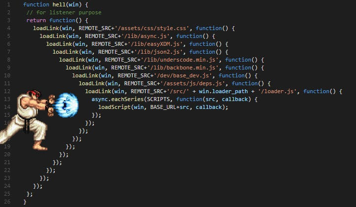

# Тема 7. Асинхронность в JavaScript

Мы уже затронули работу JS в браузере — естественной среде обитания всех пользователей и приложений — и теперь можем постепенно подходить к реальным задачам, которые решают разработчики интерфейсов. Одна из базовых потребностей — взаимодействие с пользователем и сервером. Пользователь вводит почту и пароль, мы отправляем запрос на логин. Запрос уходит, но выполняется не мгновенно — и, пока ответ не пришёл, код не может просто остановиться и ждать: браузер должен успевать рисовать интерфейс, реагировать на клики, обрабатывать другие события. Большое количество полезных функций в приложении выполняется *асинхронно*, то есть не мешая обработке остального кода. Но JavaScript — однопоточный язык программирования, и весь этот параллелизм — иллюзия, которая держится на конкретном механизме.

Не разобравшись в нём, легко поймать баги, которые не воспроизводятся стабильно: данные выводятся в неожиданном порядке, запрос не отменяется при переходе на другую страницу, ошибка сервера тихо проглатывается, потому что `fetch` не бросает исключение там, где ты его ждёшь.

Асинхронность — это не одна тема, а набор связанных инструментов, которые JavaScript и браузер дают для работы с операциями, растянутыми во времени: от event loop, который решает, какой код выполнить следующим, до Storage API, который неожиданно оказывается синхронным на фоне всего остального.

## Перед началом попробуем угадать ответы

В рамках этой темы полезно не столько запомнить названия API, сколько научиться распознавать ситуации, которые постоянно возникают в реальном коде. Перед чтением попробуй без запуска кода ответить на четыре вопроса. В лонгриде мы разберём каждый из них и покажем, в каком месте искать причину, если подобная ситуация встретится в проекте.

1. Почему `setTimeout(fn, 0)` выполняется позже, чем `.then`, хотя вызов `setTimeout` написан выше в коде?

   **Где искать ответ:** раздел «Однопоточность и event loop», затем «Колбэки и промисы».

2. Почему `fetch` не попадает в `.catch()`, когда сервер вернул `500` или `404`?

   **Где искать ответ:** раздел «Fetch API и ошибки сети».

3. Почему три независимых `await` в цикле или подряд могут сделать загрузку в три раза дольше, чем запуск этих операций вместе?

   **Где искать ответ:** раздел «async/await», подраздел о последовательной и параллельной загрузке.

4. Что произойдёт с запросом, если пользователь ушёл со страницы, пока тот ещё выполняется? Как сделать так, чтобы старый запрос больше не был нужен приложению?

   **Где искать ответ:** раздел «AbortController: отмена и тайм-ауты».

## Содержание

- [Перед началом попробуем угадать ответы](#перед-началом-попробуем-угадать-ответы)
- [1. Однопоточность и event loop](#1-однопоточность-и-event-loop)
  - [Event loop (цикл событий)](#event-loop-цикл-событий)
- [2. Колбэки и промисы](#2-колбэки-и-промисы)
  - [Цепочки промисов](#цепочки-промисов)
- [3. Promise.all / allSettled / race / any](#3-promiseall--allsettled--race--any)
- [4. async/await](#4-asyncawait)
  - [Обработка ошибок](#обработка-ошибок)
  - [Пример посложнее: `await` и event loop](#пример-посложнее-await-и-event-loop)
- [5. Fetch API и ошибки сети](#5-fetch-api-и-ошибки-сети)
- [6. AbortController: отмена и тайм-ауты](#6-abortcontroller-отмена-и-тайм-ауты)
  - [Тайм-ауты](#тайм-ауты)
- [7. Web Storage](#7-web-storage)
- [Если кратко](#если-кратко)
- [★ Глубже](#глубже)
- [Что дальше](#что-дальше)
- [Полезные материалы](#полезные-материалы)

В конце каждого раздела идут блоки **«Вывод»** и **«Практика»**.

## 1. Однопоточность и event loop

### Как это устроено

JavaScript выполняется в одном потоке — это значит, что в один момент времени выполняется конкретная строчка кода. Нет параллельного выполнения двух кусков JS-кода.

При этом браузер прекрасно справляется с задачами, которые занимают время: сетевыми запросами, таймерами, обработкой событий пользователя. Он это делает не за счёт многопоточности самого JS, а за счёт разделения обязанностей между движком (V8, например) и окружением — браузером.

> Здесь стоит уточнить, что сам по себе JS может выполняться только в какой-то оболочке, будь то браузер или Node.js. Внутри этой оболочки движок JS выполняет код, а окружение предоставляет API, которые расширяют существующую функциональность. Асинхронность как раз относится к этой функциональности. Далее мы будем рассматривать работу JS именно в браузере, но в Node.js всё работает по схожему принципу.

У браузера есть несколько ключевых частей, которые работают вместе:

> **Call Stack (стек вызовов)** — сюда попадают функции, которые выполняются прямо сейчас. Стек работает по принципу LIFO (последний зашёл — первый вышел). Пока стек не пуст, JS не может заняться ничем другим.

> **Web APIs** — API, которые предоставляет браузер: `setTimeout`, `fetch`, обработчики DOM-событий, `XMLHttpRequest` и так далее. Они не являются частью языка JS, работа с ними происходит в предоставленном окружении. Это позволяет выносить реальную работу (ожидание таймера или сетевой запрос) в браузер и тем самым освобождать JS-поток, который может выполнять следующий код.

> **Callback Queue / Task Queue (МАКРОзадачи)** — очередь, куда попадают колбэки от `setTimeout`, событий, `setInterval` после того, как связанная с ними работа в Web API завершилась.

> **Microtask Queue (МИКРОзадачи)** — отдельная очередь для колбэков промисов (`.then`, `.catch`, `.finally`), а также `queueMicrotask`. Эта очередь имеет более высокий приоритет, чем очередь макрозадач.

### Event loop (цикл событий)

Это механизм, который оркестрирует всеми этими очередями и стеками и решает, что именно должно выполняться в данный момент. Порядок такой:

- выполняет весь синхронный код, пока стек вызовов не опустеет;
- выполняет ВСЕ микрозадачи;
- выполняет ОДНУ макрозадачу;
- повторяет цикл заново.

Соответственно, если какая-либо очередь пустая, event loop просто пропускает её и идёт к следующей.

Разберём такой пример:

```javascript
console.log("1: старт");

setTimeout(() => {
  console.log("2: setTimeout");
}, 0);

console.log("3: конец синхронного кода");
```

Функция `setTimeout` вызывает переданный колбэк (в нашем случае это стрелочная функция, которая выводит `2: setTimeout`) после указанной задержки (0 миллисекунд). Тайм-аут является частью Web APIs.

> **Callback (колбэк)** — функция, которая выполняется в результате какого-либо события или действия. В нашем случае колбэк передан в `setTimeout` и будет вызван после того, как истечёт таймер. Колбэк также может вызываться в результате выполнения какой-то другой функции. Чуть позже мы подробнее разберём колбэки и промисы.

### Разбор

Порядок вывода в консоли будет такой:

```text
1: старт
3: конец синхронного кода
2: setTimeout
```

Несмотря на то что задержка тайм-аута была 0 миллисекунд, переданная функция выполнилась не сразу. Дело в том, что тайм-аут является макрозадачей — асинхронным кодом, который подчиняется механизму работы event loop. `setTimeout` отправляет колбэк в очередь макрозадач, а event loop выполняет его только после того, как опустеет стек вызовов и очередь микрозадач.

Это уже отвечает на половину вопроса 1 из начала темы: `setTimeout(fn, 0)` не мгновенный, потому что таймер — макрозадача, а event loop берётся за неё только после того, как весь синхронный код закончится. Вторую половину — куда в этой очерёдности встаёт `Promise.resolve().then(...)` — разберём чуть позже, как только доберёмся до промисов: если коротко, промисы попадают в отдельную очередь микрозадач с более высоким приоритетом, чем у `setTimeout`, так что вывод в исходном вопросе будет таким: `A`, `D`, `C`, `B`.

Далее мы разберём ещё несколько похожих примеров. Асинхронность может путать поначалу: становится непонятно, какой код читать дальше, что выполнять. На самом деле всё довольно просто: читаем код синхронно, сверху вниз, каждую строчку подряд, и, как только встречаем асинхронный код, запоминаем, что он будет выполнен позже (по сути, то же самое делает и event loop, только дополнительно разделяя выполнение на разные очереди). Синхронный код сразу попадает в стек вызовов и тут же выполняется. После того как стек вызовов опустеет, event loop проверяет очередь микрозадач и выполняет их все до полного опустошения очереди. После этого берёт одну макрозадачу из очереди и выполняет её. И так далее. В нашем случае после выполнения синхронного кода (консоль-логи 1 и 3) event loop проверил очередь микрозадач, но она была пуста, поэтому он перешёл к очереди макрозадач и выполнил колбэк от `setTimeout`, который вывел в консоль `2: setTimeout`.

У однопоточности есть и обратная сторона, о которой стоит сказать отдельно. Асинхронный код не выполняется где-то в стороне от остального — он выполняется на том же самом единственном потоке и получает время только тогда, когда этот поток свободен. Event loop берётся за следующую задачу лишь после того, как стек вызовов опустеет. Если внутри обработчика клика запустить тяжёлый синхронный код — например, цикл на несколько миллионов итераций, — он полностью займёт единственный поток на всё время своего выполнения. Пока стек не опустеет, event loop не может ни отрисовать следующий кадр, ни обработать клик, ни выполнить хотя бы одну макро- или микрозадачу:

```javascript
button.addEventListener('click', () => {
  const start = Date.now();
  while (Date.now() - start < 3000) {
    // тяжёлые синхронные вычисления
  }
  console.log('Готово');
});
```

Это ответ на вопрос 4 из начала темы. Все эти три секунды страница не реагирует ни на что: клики по другим элементам не обрабатываются, скролл не работает, анимации замирают — не потому, что браузер завис, а потому, что единственный поток занят этим циклом и физически не может переключиться ни на что другое. Разница с асинхронным кодом принципиальна: `setTimeout` или `fetch` не занимают поток на время ожидания — они отдают управление обратно и возвращаются в игру только тогда, когда результат готов. Именно поэтому тяжёлые вычисления в браузере выносят в Web Worker (отдельный поток) или на сервер, а не пытаются оптимизировать синхронным кодом на основном потоке.

### Вывод

Однопоточность не означает невозможность параллельной обработки, но требует понимать, как именно работает делегирование задач внутри языка. Тяжёлые или асинхронные операции делегируются окружению (Web API). Event loop — это диспетчер, который решает, какой код выполнять дальше, и делает это в строгом соответствии с приоритетом. Понимание этой очерёдности — основа для того, чтобы предсказывать порядок выполнения асинхронного кода и чтобы понимать, почему асинхронность — это не то же самое, что параллельность: код всё ещё выполняется по одному куску за раз, просто ожидание не тратит время впустую.

### Практика

Предскажи, в каком порядке появятся строки в консоли, а потом проверь себя в DevTools:

```javascript
console.log("A");

setTimeout(() => console.log("B"), 0);

const start = Date.now();
while (Date.now() - start < 1000) {
  // занимаем поток на одну секунду
}

console.log("C");
```

Объясни через стек вызовов и очередь макрозадач, почему `B` появится последним, хотя задержка таймера — 0 миллисекунд, и почему он появится примерно через секунду, а не сразу.

Дальше разберём, как работать с асинхронным кодом и какие существуют подходы к его организации, чтобы не запутаться в колбэках и не потерять контроль над потоком выполнения.

## 2. Колбэки и промисы

Исторически асинхронные операции в JS обрабатывались через **колбэки** — функции, которые передаются как аргумент и вызываются, когда операция завершена. Это работает, но плохо масштабируется: если нужно последовательно выполнить несколько асинхронных операций, каждая из которых зависит от результата предыдущей, колбэки начинают вкладываться друг в друга. Такой код называют callback hell или pyramid of doom — читать и поддерживать его тяжело, обработка ошибок размазывается по каждому уровню вложенности, а любое изменение порядка операций требует переписывать структуру целиком.



Поэтому придумали более удобный способ работы с асинхронностью — **промисы**. Промис (англ. promise — обещание) — это объект, который представляет результат асинхронной операции и позволяет регистрировать колбэки на успешное завершение или на ошибку, а также строить цепочки вызовов. То есть мы можем как бы заранее создать результат нужной нам асинхронной операции и далее работать с ним, а сам промис «обещает» нам, что, когда результат будет готов, он будет доступен.

> **Promise** — объект, представляющий результат асинхронной операции, которая либо ещё не завершена, либо уже завершена успешно, либо завершена с ошибкой. У промиса есть три состояния:
>
> - `pending` — начальное состояние, «ожидание»;
> - `fulfilled` — операция завершилась успешно;
> - `rejected` — операция завершилась с ошибкой.
>
> Промис может перейти из `pending` только один раз — либо в `fulfilled`, либо в `rejected`. После этого состояние зафиксировано навсегда (промис называют settled — то есть уже не в ожидании).

Промис создаётся через конструктор `Promise`, в который передаётся функция-исполнитель (executor). Эта функция получает два аргумента — `resolve` и `reject` — и вызывается сразу же, синхронно, в момент создания промиса.

```javascript
const promise = new Promise((resolve, reject) => {
  const isSuccess = true;

  if (isSuccess) {
    resolve('Данные получены');
  } else {
    reject(new Error('Что-то пошло не так'));
  }
});
```

`resolve` и `reject` — это не обычные аргументы, которые ты передаёшь сам, а функции, которые тебе даёт сам `Promise` при создании. Вызов `resolve(значение)` переводит промис в состояние `fulfilled` и записывает это значение как результат — именно оно потом придёт в `.then`. Вызов `reject(ошибка)` переводит промис в `rejected`, и переданная ошибка окажется в `.catch`. О методах `.then`, `.catch` и `.finally` мы поговорим чуть позже.

На практике внутри executor редко пишут `if (true)` — там обычно реальная асинхронная операция, а `resolve`/`reject` вызываются уже внутри её колбэка, когда результат готов.

Разберём такой пример:

```javascript
function getUser(id) {
  return new Promise((resolve, reject) => {
    setTimeout(() => {
      if (id > 0) {
        resolve({ id, name: 'Alex' });
      } else {
        reject(new Error('Некорректный id пользователя'));
      }
    }, 500);
  });
}

getUser(1).then((user) => console.log(user)); // { id: 1, name: Alex }
getUser(-1).catch((error) => console.error(error.message));
```

Здесь `setTimeout` имитирует задержку, как если бы это был реальный сетевой запрос. `resolve` и `reject` вызываются не сразу, а внутри колбэка `setTimeout` — то есть тогда, когда результат действительно стал известен. До этого момента промис остаётся в состоянии `pending`: `getUser(1)` возвращает промис мгновенно, но у этого промиса пока нет ни значения, ни ошибки — они появятся только через 500 миллисекунд, когда сработает `resolve` или `reject` внутри таймера.

> **Важно**: `new Promise(...)` нужен только тогда, когда ты сам оборачиваешь что-то асинхронное в промис вручную. Большинство встроенных браузерных API уже возвращают готовый промис сами, и оборачивать их ещё раз не нужно.

Основные методы:

- `.then(onFulfilled, onRejected)` — регистрирует колбэки на успех и на ошибку;
- `.catch(onRejected)` — синтаксический сахар для `.then(undefined, onRejected)`, обрабатывает ошибку;
- `.finally(onFinally)` — выполняется в любом случае, независимо от результата, обычно используется для очистки (убрать спиннер загрузки и тому подобное).

Все методы являются микрозадачами — их колбэки выполняются после того, как стек вызовов опустеет, но до того, как будут обработаны макрозадачи. Также методы `.then` и `.catch` передают результат предыдущего шага внутрь колбэков. То есть функции `onFulfilled` и `onRejected` получают аргументом результат промиса, на котором они были вызваны:

```javascript
const promise = new Promise((resolve, reject) => {
  setTimeout(() => resolve("resolved data"), 1000);
});

const myCallback = (someData) => {
  console.log("Результат промиса:", someData);
};

promise.then(myCallback); // Результат промиса: resolved data
```

После резолва промиса через 1000 мс вызывается метод `.then`, и строка `"resolved data"` передаётся в `myCallback` как аргумент, после чего выводится в консоль.

### Цепочки промисов

Ключевая особенность промисов — **чейнинг** (цепочки вызовов). Каждый `.then` возвращает новый промис, поэтому вызовы можно выстраивать в цепочку, и каждый следующий шаг получает результат предыдущего. Это превращает вложенную пирамиду колбэков в плоскую последовательную цепочку.

Ещё важный момент: если в цепочке `.then` происходит ошибка (выбрасывается исключение или промис зафиксирован как `rejected`), выполнение перескакивает к ближайшему `.catch` дальше по цепочке, минуя все промежуточные `.then`.

### Пример

Есть несколько асинхронных функций, которые получают данные пользователя, его заказы и детали заказа. Сначала посмотрим на одну и ту же задачу в колбэк-интерфейсе:

```javascript
function getUserWithCallback(id, callback) {
  setTimeout(() => {
    callback({ id, name: "Alex" });
  }, 500);
}

function getOrdersWithCallback(userId, callback) {
  setTimeout(() => {
    callback([{ id: 1, total: 250 }]);
  }, 500);
}

function getOrderDetailsWithCallback(orderId, callback) {
  setTimeout(() => {
    callback({ id: orderId, items: ["book", "pen"] });
  }, 500);
}
```

Чтобы получить детальную информацию о заказе пользователя, нужно вызвать эти функции последовательно, передавая результат каждой в следующую. С колбэками это выглядит так:

```javascript
getUserWithCallback(1, (user) => {
  getOrdersWithCallback(user.id, (orders) => {
    getOrderDetailsWithCallback(orders[0].id, (details) => {
      console.log(details);
    });
  });
});
```

Теперь перепишем **те же самые функции**: вместо колбэка они будут возвращать промис.

```javascript
function getUser(id) {
  return new Promise((resolve) => {
    setTimeout(() => {
      resolve({ id, name: "Alex" });
    }, 500);
  });
}

function getOrders(userId) {
  return new Promise((resolve) => {
    setTimeout(() => {
      resolve([{ id: 1, total: 250 }]);
    }, 500);
  });
}

function getOrderDetails(orderId) {
  return new Promise((resolve) => {
    setTimeout(() => {
      resolve({ id: orderId, items: ["book", "pen"] });
    }, 500);
  });
}
```

Теперь тот же сценарий можно записать через промисы:

```javascript
getUser(1)
  .then((user) => getOrders(user.id))
  .then((orders) => getOrderDetails(orders[0].id))
  .then((details) => console.log(details))
  .catch((error) => console.error("Что-то пошло не так", error))
  .finally(() => console.log("Запрос завершён"));
```

### Разбор

В варианте с колбэками каждая следующая асинхронная операция физически вложена внутрь предыдущей. Это создаёт несколько проблем: во-первых, растущий уровень вложенности делает код нечитаемым при увеличении числа шагов; во-вторых, если на каждом уровне нужна обработка ошибок, придётся дублировать проверку ошибки в каждом колбэке отдельно; в-третьих, сложно комбинировать такие операции (например, запустить их параллельно).

В варианте с промисами каждая функция возвращает объект `Promise` вместо приёма колбэка. Это позволяет строить цепочку `.then`, где каждый шаг явно передаёт результат следующему, а сама цепочка визуально плоская — уровень вложенности не растёт независимо от количества шагов.

Единственный `.catch` в конце цепочки перехватывает ошибку с _любого_ из предыдущих шагов — не нужно писать обработку ошибок в каждом `.then` отдельно. Это работает благодаря механизму промисов: если один из промисов в цепочке переходит в `rejected`, все последующие `.then` пропускаются, пока не встретится обработчик ошибки.

`.finally` полезен для действий, которые должны произойти вне зависимости от результата, — например, выключить индикатор загрузки.

### Вывод

Колбэки и промисы — это два способа решить одну и ту же задачу: сообщить коду, что делать, когда асинхронная операция закончится. Колбэк для этого передаётся напрямую как аргумент функции, и это работает, пока операций одна-две. Промис оформляет тот же результат в отдельный объект — с ним можно работать так же, как с любым другим значением: сохранять в переменную, передавать дальше, выстраивать в цепочку через `.then`, ловить ошибку одним `.catch` вместо проверки на каждом шаге. Это не отменяет колбэки — они по-прежнему используются под капотом (в том числе в самих промисах), — а даёт более удобный интерфейс поверх той же идеи. Дальше это пригодится: `Promise.all` и другие комбинаторы, которые разберём в следующем блоке, работают именно потому, что промис — самостоятельный объект, а не функция, спрятанная внутри другой функции.

### Практика

Перепиши следующую функцию с колбэками на промисы, сохранив логику: сначала получить данные пользователя, затем на их основе получить список его подписок, и в конце вывести количество подписок в консоль. Добавь единую обработку ошибок в конце цепочки.

```javascript
function fetchUser(id, callback) {
  setTimeout(() => callback({ id, name: "Nina" }), 300);
}

function fetchSubscriptions(userId, callback) {
  setTimeout(() => callback(["news", "sport", "tech"]), 300);
}

fetchUser(1, (user) => {
  fetchSubscriptions(user.id, (subs) => {
    console.log(subs.length);
  });
});
```

Помимо предсказуемого поведения, промисы позволяют комбинировать несколько асинхронных операций, которые не зависят друг от друга, и получать результат в удобной форме. Для этого у `Promise` есть встроенные методы. Разберём их подробнее.

## 3. Promise.all / allSettled / race / any

Возьмём наши функции `getUser`, `getOrders` и `getOrderDetails` из прошлого блока. Там мы вызывали их последовательно — каждая следующая ждала результата предыдущей, потому что действительно от неё зависела: без `id` пользователя не получить его заказы. Но что, если операции друг от друга не зависят? Например, нужно параллельно загрузить профиль пользователя, список уведомлений и курс валют для дашборда — ждать их по очереди бессмысленно, они не связаны данными.

Для таких случаев у `Promise` есть четыре статических метода. Все они принимают массив промисов и возвращают один новый промис с совокупным результатом — разница только в том, как именно этот результат собирается.

> **`Promise.all(promises)`** — ждёт, пока _все_ промисы завершатся успешно, и возвращает массив результатов в том же порядке, в каком промисы были переданы (не в порядке завершения). Если хотя бы один промис из массива падает, `Promise.all` немедленно отклоняется с этой же ошибкой, не дожидаясь остальных.
>
> _Где встречается:_ при загрузке страницы профиля, где нужны сразу и данные пользователя, и его права доступа, и настройки. Без прав доступа страницу вообще нельзя корректно отрисовать, так что, если хоть один из трёх запросов упал, показывать половину профиля бессмысленно, проще сразу показать ошибку целиком.

> **`Promise.allSettled(promises)`** — ждёт завершения _всех_ промисов независимо от исхода и сам никогда не падает. Возвращает массив объектов `{ status: 'fulfilled', value }` или `{ status: 'rejected', reason }` — по одному на каждый исходный промис.
>
> _Где встречается:_ массовая отправка аналитических событий или логов на несколько разных сервисов одновременно (свой бэкенд, Sentry, Google Analytics и тому подобное) — если один из сервисов недоступен, это не должно мешать остальным событиям дойти и уж тем более не должно ронять основной поток приложения. Похожая ситуация — загрузка виджетов независимого дашборда, где каждый блок (курс валют, погода, новости) должен отрисоваться сам по себе, даже если сосед не загрузился.

> **`Promise.race(promises)`** — возвращает результат _первого_ промиса, который завершится, неважно, успешно или с ошибкой.
>
> _Где встречается:_ запрос к нескольким зеркалам CDN или региональным инстансам API одновременно, когда важна скорость ответа, а не то, какой конкретно сервер откликнулся первым, — так делают, чтобы не ждать самый медленный из доступных серверов. Похожий случай — гонка между несколькими источниками одного и того же ресурса, например между разными поставщиками карт или геоданных: запрашиваем у всех сразу, а используем ответ того, кто оказался быстрее.

> **`Promise.any(promises)`** — возвращает результат _первого успешного_ промиса. Если упали все, `any` тоже отклоняется, но с особым `AggregateError`, который хранит в поле `errors` массив всех причин отказа.
>
> _Где встречается:_ запрос данных из нескольких резервных источников одновременно — например, основной и резервный регион API или несколько провайдеров геолокации (браузерный API, IP-based-сервис, кеш последней известной позиции) — годится любой ответивший первым, а разбираться, почему остальные не сработали, не нужно.

### Пример

```javascript
function request(name, delay, shouldFail = false) {
  return new Promise((resolve, reject) => {
    setTimeout(() => {
      if (shouldFail) {
        reject(new Error(`${name} упал с ошибкой`));
      } else {
        resolve(`${name} готов`);
      }
    }, delay);
  });
}

const profile = request("Профиль", 300);
const orders = request("Заказы", 500);
const notifications = request("Уведомления", 200, true);

Promise.all([profile, orders, notifications])
  .then((results) => console.log("all:", results))
  .catch((error) => console.log("all упал:", error.message));

Promise.allSettled([profile, orders, notifications]).then((results) => {
  console.log("allSettled:", results);
});

Promise.race([profile, orders, notifications]).then(
  (value) => console.log("race успех:", value),
  (error) => console.log("race ошибка:", error.message),
);

Promise.any([profile, orders, notifications])
  .then((value) => console.log("any:", value))
  .catch((aggregateError) => console.log("any упал:", aggregateError.errors));
```

### Разбор

`notifications` специально настроен так, чтобы упасть быстрее всех — за 200 миллисекунд. Это по-разному сказывается на каждом из четырёх методов.

Вот и ответ на вопрос 3 из начала темы: `Promise.all` отклонится примерно через 200 мс, как только упадёт `notifications`, — и неважно, что `profile` и `orders` тоже были бы успешны, `all` не станет их дожидаться. Сами `profile` и `orders` при этом никуда не деваются и по-прежнему выполнятся — просто `Promise.all` больше не будет следить за их результатом, он уже отклонился раньше.

`Promise.allSettled` дождётся всех трёх — то есть максимум 500 мс, по самому долгому `orders`, — и вернёт массив из трёх объектов: два `fulfilled` и один `rejected`.

`Promise.race` завершится первым по времени — это `notifications` за 200 мс, но, так как он падает с ошибкой, `race` тоже отклонится, и сработает не `.then`, а колбэк ошибки.

`Promise.any` проигнорирует ошибку `notifications` и продолжит ждать, пока хоть один промис не выполнится успешно, — им окажется `profile` за 300 мс.

### Вывод

Выбор между `all`, `allSettled`, `race` и `any` зависит от того, что вообще нужно от результата: полный набор данных без права на частичный сбой (`all`); максимум данных, даже если часть отвалилась (`allSettled`); только первый ответ вне зависимости от исхода (`race`); или любой первый успешный результат из нескольких источников (`any`). Использование `all` там, где логически нужен `allSettled`, — частая причина багов: один неудачный запрос роняет отображение всех остальных виджетов.

### Практика

Перед отправкой формы регистрации нужно выполнить три обязательные проверки одновременно: убедиться, что email ещё не занят, что пароль проходит проверку на утечки и что промокод (если он введён) действителен. Отправлять форму можно, только если все три проверки прошли успешно. Напиши функцию `validateBeforeSubmit`, которая использует подходящий метод `Promise`.

```javascript
function checkEmailAvailable(email) {
  return new Promise((resolve) => setTimeout(() => resolve(true), 300));
}

function checkPasswordSafe(password) {
  return new Promise((_, reject) =>
    setTimeout(() => reject(new Error('Пароль найден в утечках, выбери другой')), 200),
  );
}

function checkPromoCode(code) {
  return new Promise((resolve) => setTimeout(() => resolve(true), 400));
}
```

Мы рассмотрели работу с асинхронными операциями через колбэки, промисы и их комбинаторы. Но есть ещё одна синтаксическая конструкция, которая делает асинхронный код более линейным и читаемым, — `async/await`.

## 4. async/await

Цепочки `.then` уже читаются лучше, чем вложенные колбэки, но у них остаётся особенность: каждый шаг — это отдельная функция-колбэк, обёрнутая в `.then(...)`. Из-за этого асинхронный код визуально сильно отличается от обычного, последовательного кода, к которому ты привык(ла) при чтении синхронных функций. `async/await` решает именно эту проблему — это синтаксис, который позволяет писать асинхронный код так, будто он выполняется сверху вниз, строка за строкой, без единого `.then`.

Важно сразу понять: `async/await` — это не какая-то отдельная, новая система асинхронности. Под капотом всё так же работают промисы, event loop и очереди задач. `async/await` — это просто более удобный синтаксис поверх уже существующего механизма, синтаксический сахар.

### Как это устроено

Чтобы явно объявить функцию как асинхронную, используется ключевое слово `async` перед `function`:

```javascript
async function loadUser() {}
```

Это работает и со стрелочными функциями:

```javascript
const loadUser = async () => {};
```

У `async`-функции есть особенность, которая часто ускользает от внимания: она **всегда** возвращает промис. Неважно, что внутри функции возвращается — объект, число или `undefined`. Всё это будет обёрнуто в промис, и, даже если внутри функции выбрасывается исключение, всё равно именно промис будет отклонён с этой ошибкой.

```javascript
async function getFive() {
  return 5;
}

const result = getFive();
console.log(result);
result.then((value) => console.log(value)); // Promise {<fulfilled>: 5}
```

В консоли `result` будет показан как промис. Точное представление зависит от окружения — например, Node.js может вывести `Promise { 5 }`, а Chrome DevTools — `Promise {<fulfilled>: 5}`. Это отладочное представление самого объекта, а не объект с публичными свойствами `status` и `value`.

Нет публичного способа из обычного кода прочитать состояние промиса или получить сохранённое значение напрямую. Чтобы получить результат, нужно подписаться на завершение через `.then` либо дождаться его через `await`. То, что DevTools показывает состояние и значение промиса в консоли, — дополнительная информация для разработчика, а не свойства, к которым можно обратиться как к `result.status` или `result.value`.

Ключевое слово `await` можно использовать только внутри `async`-функции (в современных окружениях также на верхнем уровне модуля, но это частный случай, не будем подробно разбирать его сейчас). Оно ставится перед выражением, которое возвращает промис, и «разворачивает» его — вместо самого промиса ты сразу получаешь значение, с которым этот промис завершился, без `.then`. Чтобы достичь такого результата, выполнение функции на строчке с await приостанавливается и дожидается выполнения асинхронной операции:

```javascript
async function loadUser() {
  const response = await fetch("/api/user");
  const user = await response.json();
  return user;
}
```

> **fetch** — функция, которая отправляет HTTP-запрос и возвращает промис с ответом.

Здесь `await fetch(...)` приостанавливает выполнение функции `loadUser` до тех пор, пока промис от `fetch` не завершится, и возвращает объект `Response` напрямую, будто это была синхронная операция. То же самое происходит со вторым `await` — для `response.json()`.

Важно понимать, что такое «приостанавливает». `await` не блокирует браузер целиком, не мешает пользователю кликать по кнопкам и не останавливает выполнение другого кода в приложении. Приостанавливается только выполнение конкретной `async`-функции — управление в этот момент возвращается в event loop, который продолжает обрабатывать всё остальное, а когда промис, на котором стоит `await`, завершится, выполнение функции возобновится с того же места. Как раз это и делает `async/await` похожим на синхронный код: читаешь сверху вниз, а асинхронные операции выглядят как обычные присваивания.

### Обработка ошибок

В цепочках промисов для ошибок используется `.catch`. В `async/await` для этого применяется обычная конструкция `try/catch`, привычная по синхронному коду:

```javascript
async function loadUser() {
  try {
    const response = await fetch("/api/user");
    const user = await response.json();
    return user;
  } catch (error) {
    console.error("Не удалось загрузить пользователя:", error.message);
    return null;
  }
}
```

`try/catch` здесь перехватывает ошибку с любого шага внутри блока `try` — неважно, упал ли `fetch` из-за сетевой проблемы, или `response.json()` не смог разобрать тело ответа, или где-то было явно выброшено исключение через `throw`. Это удобно именно потому, что не нужно оборачивать в проверку каждую строчку отдельно: один `try/catch` покрывает весь последовательный сценарий.

### Пример

Возьмём знакомые функции `getUser`, `getOrders` и `getOrderDetails` из блока про колбэки и промисы. Раньше мы получали детальную информацию о заказе пользователя через цепочку `.then`:

```javascript
getUser(1)
  .then((user) => getOrders(user.id))
  .then((orders) => getOrderDetails(orders[0].id))
  .then((details) => console.log(details))
  .catch((error) => console.error("Что-то пошло не так", error))
  .finally(() => console.log("Запрос завершён"));
```

Перепишем это через `async/await`:

```javascript
async function loadOrderDetails() {
  try {
    const user = await getUser(1);
    const orders = await getOrders(user.id);
    const details = await getOrderDetails(orders[0].id);
    console.log(details);
  } catch (error) {
    console.error("Что-то пошло не так", error);
  } finally {
    console.log("Запрос завершён");
  }
}

loadOrderDetails();
```

Количество логических шагов и их порядок остались теми же, что и в цепочке `.then`, но код читается сверху вниз как последовательность обычных присваиваний, а не как цепочка вложенных вызовов. `const user = await getUser(1)` читается почти так же, как обычная синхронная строка `const user = getUser(1)`, — разница только в слове `await`, которое сигнализирует: здесь мы дожидаемся асинхронного результата. Единый `try/catch` вокруг всей последовательности заменяет `.catch` в конце цепочки, а `finally` работает так же, как одноимённый метод у промисов, — выполняется в любом случае.

Теперь разберём другой сценарий — параллельную загрузку независимых данных, где разница между последовательным и параллельным `await` видна наглядно:

```javascript
function delay(value, ms) {
  return new Promise((resolve) => setTimeout(() => resolve(value), ms));
}

async function loadSequential() {
  console.time("sequential");
  const profile = await delay("профиль", 500);
  const settings = await delay("настройки", 500);
  console.timeEnd("sequential");
  return [profile, settings];
}

async function loadParallel() {
  console.time("parallel");
  const profilePromise = delay("профиль", 500);
  const settingsPromise = delay("настройки", 500);
  const [profile, settings] = await Promise.all([
    profilePromise,
    settingsPromise,
  ]);
  console.timeEnd("parallel");
  return [profile, settings];
}
```

Разница между `loadSequential` и `loadParallel` — это именно то, о чём говорилось в объяснении. В `loadSequential` первый `await` держит функцию «на паузе» все 500 мс, и только после его завершения начинается вторая задержка ещё на 500 мс — суммарно около 1000 мс, хотя между функциями нет никакой зависимости по данным.

В `loadParallel` вызовы `delay(...)` происходят один за другим ещё _до_ первого `await` — это обычные синхронные вызовы функций, которые сразу возвращают промисы и запускают оба таймера почти одновременно. Дожидаемся мы двух уже запущенных промисов вместе через `Promise.all`, поэтому суммарное время — около 500 мс, а не 1000. Само слово `await` не создаёт параллельность — оно лишь ждёт то, что уже запущено. Параллельность создаётся тем, в какой момент промисы были вызваны.

### Пример посложнее: `await` и event loop

Теперь вернёмся к event loop и разберём пример посложнее:

```javascript
function delay(ms) {
  return new Promise((resolve) => setTimeout(resolve, ms));
}

async function asyncFn() {
  console.log('2');
  await delay(0);
  console.log('3');
}

console.log('1');

console.log('4');
asyncFn();
console.log('5');

setTimeout(() => console.log('6'), 0);

Promise.resolve().then(() => console.log('7'));

console.log('8');
```

Попробуй без консоли понять, в каком порядке будут выведены числа.

### Разбор

Порядок вывода в консоли:

```text
1
4
2
5
8
7
3
6
```

Синхронный код выполняется первым. `1`, `4` — обычные вызовы `console.log`.

`asyncFn()` выполняется синхронно до первого `await`: печатается `2`. `delay(0)` создаёт промис и синхронно ставит таймер в очередь макрозадач; сам промис ещё `pending`. На `await` `asyncFn` приостанавливается, управление возвращается в вызывающий код.

Дальше выполняется оставшийся синхронный код: `5`, регистрация `setTimeout` для `6` (вторая макрозадача, после таймера из `delay`), `Promise.resolve().then(...)` кладёт колбэк `7` в очередь микрозадач, `8`.

Стек пуст — event loop опустошает очередь микрозадач: печатается `7`. Продолжения `asyncFn` там ещё нет — промис `delay(0)` не зарезолвлен.

Дальше по одной макрозадаче за раз. Первой — таймер из `delay(0)` (зарегистрирован раньше `setTimeout` с `6`): он резолвит промис, что ставит продолжение `asyncFn` в очередь микрозадач. Сама эта макрозадача ничего не печатает.

Event loop снова опустошает микрозадачи перед следующей макрозадачей: `asyncFn` возобновляется, печатается `3`.

Последняя оставшаяся макрозадача — `setTimeout` с `6`: печатается `6`.

`await delay(0)` — это не одна асинхронная пауза, а минимум два прохода event loop — макрозадача (резолв промиса) и следующая за ней микрозадача (возобновление функции). Поэтому `3` печатается позже `7`, хотя обе строки выглядят одинаково асинхронными.

> Лучше избегать смешивания разных синтаксических конструкций асинхронности в одном месте — например, `async/await` с колбэками или с `.then`. Это не лучшая практика и может запутать порядок выполнения. Если используешь `async/await`, старайся держаться этого синтаксиса в пределах одной функции или модуля.

### Вывод

`async/await` не отменяет всё, что было рассказано про промисы и event loop раньше в курсе, — он строится поверх этого же механизма и просто даёт синтаксис, который выглядит как синхронный код. Это обеспечивает большой выигрыш в читаемости, особенно для длинных последовательностей асинхронных шагов и для обработки ошибок через привычный `try/catch`. Но именно из-за похожести на синхронный код легко машинально расставить `await` после каждого вызова функции, даже если между вызовами нет зависимости, и незаметно потерять параллельность, которая была бы доступна. Правило простое: если результат одной операции нужен для запуска другой — жди через `await` последовательно; если операции независимы — сначала запусти все, потом дожидайся вместе.

### Практика

Перепиши функцию так, чтобы три независимых запроса (`fetchProfile`, `fetchSettings`, `fetchNotifications`) выполнялись параллельно, а не последовательно, сохранив обработку ошибок через `try/catch`. Замерь время выполнения через `console.time`/`console.timeEnd` до и после изменений.

```javascript
async function loadEverything() {
  const profile = await fetchProfile();
  const settings = await fetchSettings();
  const notifications = await fetchNotifications();
  return { profile, settings, notifications };
}
```

Мы разобрали принцип работы и основные синтаксические конструкции для работы с асинхронным кодом в JS: колбэки, промисы и `async/await`. Далее мы рассмотрим, как это всё работает на практике с реальными сетевыми запросами и какие ошибки при этом могут возникать.

## 5. Fetch API и ошибки сети

Во всех предыдущих блоках мы использовали условные функции вроде `getUser` или `delay`, которые сами создавали промисы вручную через `new Promise(...)` и `setTimeout`. На практике же самый частый источник промисов на фронтенде — это реальные сетевые запросы к серверу, и основной встроенный инструмент для этого в браузере — `fetch`.

Ты уже видел(а) эти запросы со стороны — во вкладке Network можно посмотреть, какие статус-коды возвращает сервер, какие заголовки летят туда и обратно. Дальше — то же самое, но с другой стороны: те же самые запросы, только теперь ты делаешь их из кода самостоятельно.

`fetch` принимает URL (и, опционально, объект с настройками запроса: метод, заголовки, тело запроса и так далее) и возвращает промис. Базовый вызов выглядит так:

```javascript
fetch("https://api.example.com/users/1")
  .then((response) => response.json())
  .then((data) => console.log(data));
```

Или то же самое через `async/await`:

```javascript
async function loadUser() {
  const response = await fetch("https://api.example.com/users/1");
  const data = await response.json();
  console.log(data);
}
loadUser();
```

Оба примера выше — это GET-запрос без каких-либо дополнительных настроек, и для него достаточно одного URL. Но `fetch` принимает и второй, необязательный аргумент — объект с настройками запроса, и на практике он нужен почти всегда, как только речь заходит не о простом получении данных, а, например, об отправке формы.

Самые частые поля в этом объекте:

- `method` — HTTP-метод запроса: `'GET'` (по умолчанию, можно не указывать), `'POST'`, `'PUT'`, `'PATCH'`, `'DELETE'`;
- `headers` — заголовки запроса в виде объекта, например `{ 'Content-Type': 'application/json' }` — сообщает серверу, в каком формате ты отправляешь тело, или `{ Authorization: 'Bearer <token>' }` — для передачи токена авторизации;
- `body` — тело запроса. Для JSON его нужно превратить в строку через `JSON.stringify(...)` — `fetch` не делает это сам;
- `signal` — сигнал отмены от `AbortController`, о котором подробно поговорим в следующем блоке.

Собранный вместе POST-запрос с телом в формате JSON выглядит так:

```javascript
async function createUser(user) {
  const response = await fetch('https://api.example.com/users', {
    method: 'POST',
    headers: {
      'Content-Type': 'application/json',
    },
    body: JSON.stringify(user),
  });

  if (!response.ok) {
    throw new Error(`Не удалось создать пользователя: статус ${response.status}`);
  }

  return response.json();
}
```

Здесь важно не перепутать по невнимательности две вещи: заголовок `Content-Type` говорит серверу, в каком формате прислано тело, а `JSON.stringify(user)` — это то, что реально превращает объект `user` в строку для передачи. Забыть `JSON.stringify` — частая ошибка: `fetch` в этом случае либо отправит `[object Object]`, либо (если `body` — это, например, `FormData`) вообще не потребует ручной сериализации, потому что `FormData` `fetch` умеет сериализовать сам, без `JSON.stringify` и без ручного указания `Content-Type` — он выставит его автоматически с нужным `boundary`.

На первый взгляд, всё просто: сделал запрос, дождался ответа, получил данные. Но здесь есть особенность `fetch`, которая почти всегда ловит новичков и приводит к незаметным багам в продакшене: **`fetch` не отклоняет свой промис при HTTP-ошибках вида 404 или 500**. Промис `fetch` переходит в `rejected` только при _сетевых_ сбоях — например, нет соединения с интернетом, не резолвится DNS, запрос заблокирован политикой CORS или запрос был отменён. Если же сервер вообще ответил, пусть даже кодом ошибки 500 или 404, `fetch` считает, что сетевой запрос выполнен успешно, и резолвит промис с объектом `Response`. То есть даже «Internal Server Error» с точки зрения `fetch` — это успех, просто успех с неудачным содержимым.

Из-за этого статус ответа приходится проверять вручную. У объекта `Response` для этого есть свойство `response.ok` — оно равно `true`, если код ответа находится в диапазоне 200–299, и `false` в противном случае. Есть также `response.status`, где лежит числовой код (200, 404, 500 и так далее), если нужно отреагировать на конкретный код по-разному.

```javascript
async function fetchUser(id) {
  const response = await fetch(`https://api.example.com/users/${id}`);

  if (!response.ok) {
    throw new Error(`Ошибка сервера: статус ${response.status}`);
  }

  return response.json();
}
```

Это прямой ответ на вопрос 2 из начала темы: сам по себе `.catch()` на `fetch`, отправленном на `404`, не сработает — промис `fetch` зарезолвится, а не зареджектится, потому что сервер ответил, пусть и с кодом ошибки. Именно поэтому здесь мы вручную выбрасываем исключение, если `response.ok` равен `false`, — иначе код продолжил бы выполняться так, будто запрос прошёл успешно, и попытался бы распарсить, например, тело ошибки как обычные данные пользователя.

Есть и ещё один источник ошибок, о котором тоже легко забыть. Метод `response.json()`, который разбирает тело ответа как JSON, сам по себе тоже возвращает промис, и этот промис может завершиться с ошибкой — если тело ответа не является валидным JSON. Такое случается чаще, чем кажется: например, сервер может при внутренней ошибке вернуть не JSON, а страницу с HTML-текстом ошибки, при этом с кодом 200 (если сконфигурирован неправильно) — и тогда `response.ok` будет `true`, а `response.json()` всё равно упадёт.

Собирая всё вместе, при работе с `fetch` стоит различать три принципиально разных типа ошибок.

> 1. **Сетевая ошибка** — сам `fetch` падает (`reject`), запрос физически не дошёл до сервера или не смог получить ответ.
> 2. **HTTP-ошибка** — запрос дошёл, сервер ответил, но статус говорит о проблеме (4xx, 5xx). Промис `fetch` при этом успешен, ошибку нужно поднимать вручную через `response.ok`.
> 3. **Ошибка парсинга тела** — статус успешный, но тело ответа не соответствует ожидаемому формату (например, не JSON).

Каждый из этих трёх случаев требует своей проверки, и путать их не стоит — по крайней мере, в местах, где важно понимать, что именно пошло не так (например, чтобы решить, стоит ли повторить запрос: сетевую ошибку часто имеет смысл повторить, а 404 — нет).

### Пример

```javascript
async function fetchUserData(id) {
  const response = await fetch(`https://api.example.com/users/${id}`);

  if (!response.ok) {
    throw new Error(`Ошибка сервера: статус ${response.status}`);
  }

  return response.json();
}

async function renderUser(id) {
  try {
    const user = await fetchUserData(id);
    console.log('Пользователь загружен:', user);
  } catch (error) {
    if (error instanceof TypeError) {
      console.error('Сетевая ошибка: проверь соединение');
    } else if (error instanceof SyntaxError) {
      console.error('Сервер вернул некорректный JSON');
    } else {
      console.error('Ошибка сервера:', error.message);
    }
  }
}
```

### Разбор

`fetchUserData` намеренно остаётся простой: один `await fetch(...)`, одна проверка `response.ok` с ручным `throw`, и `return response.json()` — если тело окажется не JSON, `response.json()` сам отклонит промис, и эта ошибка всплывёт наружу точно так же, как и ошибка из `throw` строкой выше. Функция не пытается сама разбираться, что именно пошло не так, — она просто даёт ошибке дойти до вызывающего кода.

Вся диагностика сосредоточена в `renderUser`, в одном `catch`, и опирается на то, что сетевой сбой и ошибка парсинга JSON — это разные встроенные типы ошибок JavaScript, а не просто два случая, которые нужно различать вручную. Если сам `fetch` не смог выполнить запрос (нет соединения, DNS не резолвится, CORS заблокировал), выбрасывается `TypeError` — это стандартное поведение `fetch`. Если `response.json()` не смог разобрать тело как JSON, выбрасывается `SyntaxError` — тоже стандартное поведение `JSON.parse` под капотом. Проверка `error instanceof TypeError` и `error instanceof SyntaxError` в `catch` различает эти два случая без единой ручной обёртки внутри `fetchUserData`. Всё, что осталось, — HTTP-ошибка, поднятая через `throw new Error(...)` вручную, — попадает в `else` и обрабатывается по `error.message`.

Такой подход даёт тот же результат, что и разбиение на несколько `try/catch`, — три причины сбоя по-прежнему различимы, — но перекладывает эту работу на уже существующие типы ошибок вместо того, чтобы городить вложенные обработчики на каждом шаге внутри вспомогательной функции.

### Вывод

`fetch` — встроенная функция сетевых запросов в браузере, которая возвращает промис. Она не отклоняет промис при HTTP-ошибках, поэтому нужно проверять `response.ok` и обрабатывать ошибки парсинга тела ответа. Разделение ошибок на сетевые, HTTP и ошибки парсинга позволяет давать пользователю и разработчику точную диагностику вместо общего «что-то пошло не так», а также по-разному реагировать на них в зависимости от причины, например отображать для пользователя соответствующую ошибку или повторять запрос.

### Практика

Напиши функцию `safeFetchJson(url)`, которая:

- выполняет `fetch` по переданному `url`;
- если запрос не удался физически — возвращает `{ error: 'network', message: '...' }`;
- если сервер ответил с ошибкой статуса — возвращает `{ error: 'http', status: response.status }`;
- если тело не парсится как JSON — возвращает `{ error: 'parse', message: '...' }`;
- если всё успешно — возвращает `{ data: <распарсенные данные> }`.

Проверь функцию на трёх случаях: рабочий URL, несуществующий домен и URL, который отдаёт HTML вместо JSON.

Мы разобрали, как `fetch` работает с ошибками, но в реальных приложениях часто возникает ещё одна ситуация: нужно отменить запрос до того, как он завершится.

## 6. AbortController: отмена и тайм-ауты

В предыдущем блоке мы разобрали, как `fetch` сообщает об ошибках, но не затронули один сценарий: что делать, если запрос нужно остановить ещё до того, как он завершился сам? Асинхронные операции по умолчанию нельзя просто взять и остановить — промис либо выполнится, либо завершится ошибкой сам по себе, никакого встроенного способа остановить его нет.

На практике возникает такая необходимость. Пользователь переходит на другую страницу приложения — запрос, начатый на предыдущей странице, больше никому не нужен, и, если он всё-таки завершится и попытается обновить уже размонтированный компонент, это может привести к ошибке. Или запрос выполняется подозрительно долго — сеть плохая, сервер завис, — и вместо того, чтобы ждать бесконечно, разумно прервать его по тайм-ауту и показать пользователю сообщение об ошибке.

Для всех этих случаев в браузере есть встроенный инструмент — **`AbortController`**. Это объект, который создаёт так называемый сигнал отмены и умеет сигнализировать браузеру об отмене запроса.

У `AbortController` два основных элемента:

> - свойство `signal` — объект `AbortSignal`, который передаётся в отменяемую операцию. У `fetch` для этого предусмотрен специальный параметр в объекте опций — второй аргумент: `fetch(url, { signal })`;
> - метод `abort(reason?)` — вызов этого метода помечает связанный `signal` как отменённый и уведомляет об этом всё, что на этот сигнал подписано.

Базовое использование выглядит так:

```javascript
const controller = new AbortController();

fetch("https://api.example.com/data", { signal: controller.signal })
  .then((response) => response.json())
  .then((data) => console.log(data));

controller.abort();
```

Здесь мы создаём контроллер, передаём его сигнал в `fetch`, а затем сразу же вызываем `abort()` — в реальном коде вызов `abort()` обычно происходит по какому-то событию: клику по кнопке отмены, переходу на другую страницу, срабатыванию таймера. Когда `fetch` получает уже отменённый сигнал (или сигнал отменяется, пока запрос ещё выполняется), его промис переходит в `rejected` с ошибкой особого типа — `AbortError`. Определить именно этот тип ошибки можно по свойству `error.name`, которое будет равно строке `'AbortError'`.

Отдельная обработка `AbortError` важна потому, что отмена — это не сбой в привычном смысле, а ожидаемое, специально вызванное поведение. Если показывать пользователю сообщение «ошибка сети» каждый раз, когда сработала отмена устаревшего запроса, это будет вводить в заблуждение — на самом деле всё работает штатно, просто новый запрос отменил старый.

Один и тот же `signal` можно передать сразу в несколько операций: вызов `abort()` отменит их все одновременно, что удобно, если несколько связанных запросов нужно отменять как единое целое.

### Тайм-ауты

Отдельный частый сценарий использования `AbortController` — не отмена по действию пользователя, а автоматическая отмена по времени, то есть тайм-аут. Для этого `AbortController` комбинируют с уже знакомым тебе по первому блоку `setTimeout`: запускаем таймер, который по истечении заданного времени сам вызывает `abort()`.

```javascript
async function fetchWithTimeout(url, timeoutMs) {
  const controller = new AbortController();
  const timeoutId = setTimeout(() => controller.abort(), timeoutMs);

  try {
    const response = await fetch(url, { signal: controller.signal });
    return response;
  } catch (error) {
    if (error.name === "AbortError") {
      throw new Error(`Запрос превысил тайм-аут ${timeoutMs} мс`);
    }
    throw error;
  } finally {
    clearTimeout(timeoutId);
  }
}
```

Здесь важна одна деталь, которую легко упустить: если запрос успевает завершиться раньше, чем истечёт таймер, таймер всё равно продолжает «тикать» где-то в фоне и рано или поздно вызовет `controller.abort()` — на контроллере, результат которого уже никому не нужен. Само по себе это не сломает код (промис `fetch` уже settled, повторный `abort` ни на что не повлияет), но это лишняя, ничем не оправданная отложенная операция. Поэтому таймер обязательно нужно очищать через `clearTimeout(timeoutId)`, как только запрос завершился — неважно, успешно или с ошибкой; отсюда `clearTimeout` в блоке `finally`.

Есть и более новый, короткий способ получить тайм-аут без ручного создания `AbortController` и `setTimeout` — статический метод `AbortSignal.timeout(ms)`. Он сразу возвращает готовый `signal`, который автоматически становится отменённым спустя указанное количество миллисекунд:

```javascript
async function fetchWithBuiltInTimeout(url, timeoutMs) {
  try {
    return await fetch(url, { signal: AbortSignal.timeout(timeoutMs) });
  } catch (error) {
    if (error.name === "TimeoutError") {
      throw new Error(`Запрос превысил тайм-аут ${timeoutMs} мс`);
    }
    throw error;
  }
}
```

Для простых случаев, где нужен только тайм-аут и больше ничего, этот способ предпочтительнее — он короче и не требует думать про `clearTimeout`. Ручной вариант с `AbortController` остаётся нужен там, где логика отмены сложнее одного тайм-аута — например, если запрос должен отменяться одновременно и по тайм-ауту, и по действию пользователя. Ещё одна деталь, которую стоит знать: в отличие от `AbortError`, ошибка тайм-аута имеет имя `TimeoutError`, поэтому их нужно различать, если в коде есть то и другое.

### Вывод

`AbortController` — стандартный способ добавить отмену в код, построенный на промисах, которые сами по себе неотменяемы. Он тесно связан с прошлыми темами: сигнал передаётся в `fetch`, а результат отменённого запроса — это тот же самый механизм отклонённого промиса и `try/catch`, который был разобран в блоке про `async/await`. Два основных сценария применения — отмена устаревших запросов, когда новый запрос делает предыдущий неактуальным, и тайм-ауты, когда операция не должна выполняться дольше разумного времени. В обоих случаях важно отличать `AbortError` от остальных ошибок, потому что отмена — ожидаемое поведение, а не сбой.

### Практика

Реализуй функцию `fetchWithTimeoutAndCancel(url, timeoutMs)`, которая одновременно поддерживает и тайм-аут, и внешнюю отмену, — то есть функция должна возвращать объект `{ promise, cancel }`, где `promise` — это промис самого запроса, а `cancel()` — функция, вызвав которую снаружи можно отменить запрос вручную ещё до истечения тайм-аута. Проверь оба сценария: истечение тайм-аута и ручную отмену через `cancel()`.

## 7. Web Storage

Все темы этого курса до сих пор так или иначе строились вокруг одной идеи: есть операция, которая занимает время, и есть механизм (промисы, `async/await`, event loop), который помогает с этим временем работать. Web Storage — единственная тема курса, которая выпадает из этой логики полностью, и об этом важно сказать прямо в начале, чтобы не переносить сюда привычки из предыдущих блоков: **`localStorage` и `sessionStorage` — синхронные API**. Здесь нет ни промисов, ни `await`, ни колбэков: обращение к хранилищу выполняется мгновенно и блокирует текущий код до своего завершения, ровно как обычная синхронная функция вроде `Math.max()`.

Web Storage — это два похожих API для хранения данных прямо в браузере, на стороне клиента, без обращения к серверу: `localStorage` и `sessionStorage`. Оба хранят данные в виде пар «ключ — значение», где и ключ, и значение — всегда строки, независимо от того, что именно в них пытаются положить.

Разница между `localStorage` и `sessionStorage` — исключительно во времени жизни данных:

> **`localStorage`** — данные сохраняются между сессиями, то есть остаются после закрытия вкладки или даже всего браузера, пока не будут удалены явно (через код или пользователем вручную в настройках браузера). Данные привязаны к origin (протокол + домен + порт) и общие для всех вкладок этого origin.

> **`sessionStorage`** — данные живут только в рамках одной вкладки и одной сессии: они очищаются, как только вкладка закрывается. Важный нюанс: если открыть ту же страницу в новой вкладке, `sessionStorage` там будет пустым — в отличие от `localStorage`, он не шарится между вкладками, даже если это вкладки одного и того же сайта.

Основные методы одинаковы для обоих API:

- `setItem(key, value)` — сохранить значение под ключом `key`;
- `getItem(key)` — получить значение по ключу или `null`, если такого ключа нет;
- `removeItem(key)` — удалить конкретный ключ;
- `clear()` — удалить вообще всё содержимое хранилища;
- `key(index)` и свойство `length` — перебрать все сохранённые ключи, если нужно пройтись по всему хранилищу.

Использование выглядит предельно просто:

```javascript
localStorage.setItem("theme", "dark");
const theme = localStorage.getItem("theme");
localStorage.removeItem("theme");
```

Но раз значения — всегда строки, для хранения чего-то более сложного, чем отдельное слово или число, — объекта, массива, — нужно вручную сериализовать данные в JSON перед записью через `JSON.stringify`, и разбирать обратно при чтении через `JSON.parse`:

```javascript
const settings = { theme: "dark", fontSize: 16 };

localStorage.setItem("settings", JSON.stringify(settings));

const raw = localStorage.getItem("settings");
const parsedSettings = JSON.parse(raw);
```

Если пропустить `JSON.stringify` и попытаться сохранить объект напрямую, JavaScript неявно приведёт его к строке — и вместо данных в хранилище окажется бесполезная строка `"[object Object]"`. Это одна из самых частых и самых незаметных на первый взгляд ошибок при работе с Web Storage, потому что код не падает и не выдаёт предупреждения — он просто молча теряет данные.

Хранилище имеет ограничение по объёму — обычно в районе 5–10 МБ на один origin, точное значение зависит от браузера. При превышении этого лимита вызов `setItem` не проваливается молча, а выбрасывает исключение с именем `QuotaExceededError`, которое стоит оборачивать в `try/catch`, если приложение активно и много пишет в хранилище.

Ещё одна возможность, о которой стоит знать: событие `storage`, которое срабатывает на объекте `window`, но не в той вкладке, где произошло изменение, а в _других_ вкладках и окнах того же origin, если в одной из них поменяли `localStorage`. Это позволяет синхронизировать состояние между несколькими одновременно открытыми вкладками одного и того же сайта — например, если пользователь вышел из аккаунта в одной вкладке, остальные вкладки могут узнать об этом через событие `storage` и тоже показать состояние «не авторизован».

### Пример

```javascript
function saveSettings(settings) {
  try {
    localStorage.setItem("userSettings", JSON.stringify(settings));
  } catch (error) {
    if (error.name === "QuotaExceededError") {
      console.error("Хранилище переполнено, не удалось сохранить настройки");
    } else {
      console.error("Не удалось сохранить настройки:", error.message);
    }
  }
}

function loadSettings() {
  const raw = localStorage.getItem("userSettings");

  if (raw === null) {
    return { theme: "light", fontSize: 14 };
  }

  try {
    return JSON.parse(raw);
  } catch (error) {
    console.error(
      "Повреждённые данные в хранилище, использую значения по умолчанию",
    );
    return { theme: "light", fontSize: 14 };
  }
}

saveSettings({ theme: "dark", fontSize: 16 });
console.log(loadSettings());

window.addEventListener("storage", (event) => {
  if (event.key === "userSettings") {
    console.log("Настройки изменены в другой вкладке");
    console.log("Старое значение:", event.oldValue);
    console.log("Новое значение:", event.newValue);
  }
});
```

### Разбор

В `saveSettings` объект настроек оборачивается в `JSON.stringify` перед сохранением — это тот самый обязательный шаг сериализации, без которого мы потеряли бы данные, как описано в объяснении выше. Обёртка в `try/catch` здесь нужна не для асинхронных ошибок (их тут просто нет — вся функция синхронная), а на случай, если запись физически не удастся из-за переполнения квоты хранилища.

В `loadSettings` разбирается два принципиально разных случая. Первый — когда ключа `userSettings` вообще нет в хранилище и `getItem` возвращает `null`; это совершенно нормальная ситуация, например, для пользователя, который открыл приложение впервые и ещё ни разу ничего не сохранял, поэтому мы просто возвращаем значения по умолчанию без какой-либо ошибки. Второй случай — когда данные по ключу есть, но они повреждены или не являются валидным JSON; такое может произойти, если формат хранимых данных менялся между версиями приложения или кто-то вручную отредактировал значение через DevTools. Оба случая в итоге приводят к одному и тому же результату — возврату настроек по умолчанию, — но по разным причинам, и в реальном проекте вторую ситуацию имеет смысл ещё и залогировать отдельно, как признак возможной проблемы, которую стоит расследовать.

Обработчик события `storage` в конце — демонстрация межвкладочной синхронизации. Обрати внимание, что событие содержит не только `event.key` (какой именно ключ поменялся), но и `event.oldValue` вместе с `event.newValue` — то есть можно узнать не только факт изменения, но и что именно изменилось. Важно ещё раз подчеркнуть: этот обработчик сработает только в _других_ вкладках того же origin — в той вкладке, где сам вызов `saveSettings` произошёл, событие `storage` не сработает, потому что изменение и так уже известно коду этой же вкладки, который его вызвал.

### Вывод

Web Storage — простой, но не безусловно «бесплатный» инструмент: он синхронный и блокирующий, ограничен по объёму и умеет хранить только строки, что требует ручной сериализации сложных данных. Выбор между `localStorage` и `sessionStorage` определяется вопросом, должны ли данные пережить закрытие вкладки и нужны ли они в других вкладках того же сайта.

### Практика

Напиши модуль с двумя функциями: `addToCart(item)` и `getCart()`, которые работают поверх `localStorage` и хранят корзину покупок как массив объектов `{ id, name, price }`. `addToCart` должен добавлять новый товар к уже существующему массиву в хранилище (а не перезаписывать его), а `getCart` — безопасно возвращать текущий массив, даже если в хранилище ещё ничего нет или данные там повреждены. Проверь работу через несколько последовательных вызовов `addToCart` и один `getCart`.

## Если кратко

В этой главе мы прошли весь путь, который проходит создатель практически любого современного фронтенд-кода при работе с асинхронностью.

Сначала мы разобрались, почему JavaScript остаётся однопоточным языком, но при этом способен выполнять огромное количество задач, не блокируя интерфейс. Секрет не в параллельном выполнении JavaScript-кода, а во взаимодействии движка с окружением браузера и в механизме event loop, который управляет порядком выполнения синхронного кода, микрозадач и макрозадач.

Затем мы рассмотрели способы организации асинхронного кода. Колбэки показали исторический подход, который быстро приводит к глубокой вложенности. Промисы решили эту проблему, превратив результат асинхронной операции в самостоятельный объект, позволяющий строить цепочки, комбинировать несколько операций и централизованно обрабатывать ошибки. Поверх промисов появился `async/await` — более удобная синтаксическая конструкция, позволяющая писать асинхронный код почти так же, как обычный последовательный.

Отдельно мы изучили комбинаторы Promise: теперь ты знаешь, в каких случаях использовать `Promise.all`, когда лучше подходит `allSettled`, чем отличаются `race` и `any` и почему выбор неправильного комбинатора способен привести к трудноуловимым ошибкам в приложении.

После этого мы перешли к работе с реальными HTTP-запросами через `fetch`. Здесь важно было понять, что успешный сетевой запрос ещё не означает успешный ответ сервера: `fetch` разделяет сетевые ошибки, HTTP-ошибки и ошибки разбора данных, а значит, каждая из них требует собственной обработки.

Следующим шагом стала отмена асинхронных операций через `AbortController`. Мы увидели, что далеко не каждый запрос должен обязательно завершиться: иногда его необходимо отменить при переходе пользователя на другую страницу или по тайм-ауту, чтобы приложение не продолжало выполнять уже бесполезную работу.

И наконец, мы познакомились с Web Storage — единственной темой главы, которая принципиально отличается от остальных. В отличие от `fetch`, промисов и таймеров, `localStorage` и `sessionStorage` работают синхронно. Несмотря на простоту API, при работе с ними важно помнить про сериализацию объектов, ограничения по объёму, обработку ошибок и различия между долговременным и сессионным хранением данных.

Если после изучения главы ты можешь без запуска кода предсказать порядок выполнения нескольких асинхронных операций, объяснить его через event loop, выбрать подходящий способ организации асинхронного кода и грамотно обработать сетевой запрос — значит, фундамент для дальнейшей работы с современным JavaScript сформирован.

<a id="глубже"></a>

## ★ Глубже

Базовая модель event loop, которую ты уже знаешь, — упрощение, сделанное специально для того, чтобы предсказывать порядок выполнения кода. Для большинства задач фронтенда этого достаточно. Но в реальной работе появляются ситуации, где этой модели уже мало: анимация начинает дёргаться, сервер присылает большой ответ частями, запрос одновременно может отмениться по нескольким причинам, а ошибка промиса не имеет понятного места возникновения.

Разберём три таких случая.

<a id="почему-settimeout-не-подходит-для-анимации"></a>

### ❓ Почему `setTimeout` не подходит для анимации?

Ты уже знаешь, что `setTimeout(fn, 0)` ставит колбэк в очередь задач. Но представь, что тебе нужно каждый раз немного менять положение элемента на экране. Если запускать следующую итерацию через `setTimeout`, таймер никак не связан с моментом, когда браузер собирается рисовать следующий кадр.

```javascript
let position = 0;

function moveWithTimeout() {
  position += 2;
  element.style.transform = `translateX(${position}px)`;
  setTimeout(moveWithTimeout, 0);
}

function moveWithRAF() {
  position += 2;
  element.style.transform = `translateX(${position}px)`;
  requestAnimationFrame(moveWithRAF);
}
```

`moveWithTimeout` может запускаться чаще, чем браузер успевает отрисовывать кадры. Часть промежуточных значений `position` никогда не попадёт на экран, а лишняя работа продолжит расходовать CPU и батарею. Кроме того, таймеры в фоновых вкладках браузер искусственно замедляет, поэтому после возврата к вкладке такая анимация может меняться рывками.

`requestAnimationFrame` специально предназначен для визуальных изменений. Браузер вызывает его перед отрисовкой очередного кадра и приостанавливает такие callbacks для неактивных вкладок. Поэтому он лучше согласован с реальным циклом отрисовки.

Вспомни этот механизм, когда анимация, плавный скролл или отрисовка `canvas` начнут дёргаться. В такой ситуации сначала стоит проверить, не пытается ли код синхронизировать визуальные изменения через `setTimeout`.

Куда смотреть дальше:

- [MDN: `requestAnimationFrame`](https://developer.mozilla.org/docs/Web/API/Window/requestAnimationFrame) — описание API, его аргументов и поведения браузера.
- [MDN: `setTimeout`](https://developer.mozilla.org/docs/Web/API/Window/setTimeout) — чтобы сравнить таймер с механизмом, привязанным к отрисовке.

<a id="как-обрабатывать-ответ-который-приходит-частями"></a>

### ❓ Как обрабатывать ответ, который приходит частями?

До этого момента `fetch` использовался привычным образом: дождаться ответа, вызвать `response.json()` и получить результат целиком. Но некоторые данные приходят постепенно: лог в реальном времени, большой CSV, потоковый ответ от сервера или текст, который генерируется частями.

Тело ответа `response.body` — это `ReadableStream`. Его можно перебирать через `for await...of` и обрабатывать каждый пришедший фрагмент, не дожидаясь полного ответа.

```javascript
async function streamResponse(url) {
  const response = await fetch(url);

  if (!response.ok) {
    throw new Error(`Ошибка сервера: статус ${response.status}`);
  }

  const decoder = new TextDecoder();
  let result = "";

  for await (const chunk of response.body) {
    result += decoder.decode(chunk, { stream: true });
    console.log("Получен новый фрагмент, всего символов:", result.length);
  }

  return result;
}
```

`response.body` отдаёт сырые байты, поэтому нужен `TextDecoder`. Параметр `{ stream: true }` сообщает декодеру, что следующий кусок данных может продолжить многобайтовый символ, поэтому его нужно корректно собрать вместе со следующим chunk.

Это хороший пример связи с темой следующей недели: `for await...of` работает через асинхронный протокол итерации. Ты уже встречал(а) `await`, а здесь он становится частью самого способа перебора данных, которые появляются во времени.

Вспомни этот механизм, когда обычный `await response.json()` начнёт означать лишнее ожидание перед первым отображением данных. Для потокового UI, больших ответов и постепенно поступающей информации может быть полезнее обрабатывать данные по мере их появления.

Куда смотреть дальше:

- [MDN: `ReadableStream`](https://developer.mozilla.org/docs/Web/API/ReadableStream) — устройство потоков и их чтение.
- [MDN: `for await...of`](https://developer.mozilla.org/docs/Web/JavaScript/Reference/Statements/for-await...of) — асинхронный протокол итерации, который станет прямым мостиком к следующей теме.
- [MDN: Fetch API и streaming responses](https://developer.mozilla.org/docs/Web/API/Streams_API/Using_readable_streams) — практический пример чтения `response.body` по частям.

<a id="отмена-по-нескольким-причинам-и-необработанные-ошибки"></a>

### ❓ Что делать, если запрос можно отменить по нескольким причинам, а ошибка осталась без обработчика?

Ты уже умеешь отменять `fetch` через `AbortController`. Но в реальном приложении у запроса может быть несколько независимых причин для отмены: пользователь ушёл со страницы, истёк тайм-аут или внешний компонент сообщил, что запрос больше не нужен.

Для объединения нескольких сигналов есть `AbortSignal.any()`:

```javascript
function fetchProduct(id, { timeoutMs = 5000, externalSignal } = {}) {
  const timeoutSignal = AbortSignal.timeout(timeoutMs);
  const signal = externalSignal
    ? AbortSignal.any([timeoutSignal, externalSignal])
    : timeoutSignal;

  return fetch(`/api/products/${id}`, { signal });
}
```

Теперь достаточно передать итоговый `signal` в `fetch`: запрос отменится, если сработает любой из исходных сигналов.

Есть и другая практическая проблема. Что будет, если промис отклонится, а `.catch()` или `try/catch` никто не использует? В браузере для такого случая существует событие `unhandledrejection`:

```javascript
window.addEventListener("unhandledrejection", (event) => {
  console.error("Необработанный промис:", event.reason);
  event.preventDefault();
});
```

Такой обработчик полезен как последняя точка диагностики. Например, если в консоли появляется ошибка без понятного места, где был создан проблемный промис, `unhandledrejection` позволяет зафиксировать причину и отправить её в систему мониторинга. Но он не должен заменять нормальную обработку ошибок рядом с тем кодом, который может завершиться с ошибкой.

Вспомни эти механизмы, когда один запрос должен отменяться одновременно по нескольким условиям или когда в консоли появляется необъяснимая ошибка промиса. Первый случай решается объединением сигналов, второй — поиском места, где потерялся обработчик ошибки, с помощью `unhandledrejection`.

Куда смотреть дальше:

- [MDN: `AbortSignal.any()`](https://developer.mozilla.org/docs/Web/API/AbortSignal/any_static) — объединение нескольких сигналов отмены.
- [MDN: `AbortSignal.timeout()`](https://developer.mozilla.org/docs/Web/API/AbortSignal/timeout_static) — создание сигнала тайм-аута.
- [MDN: `unhandledrejection`](https://developer.mozilla.org/docs/Web/API/Window/unhandledrejection_event) — событие для диагностики необработанных отклонений промисов.

---

## Что дальше

В следующей теме перейдём к продвинутым механизмам JavaScript: итерации и генераторы, коллекции Map и Set, Symbol, Proxy и Reflect, а также модули.

Разберём, как эти возможности расширяют стандартное поведение языка и помогают создавать более гибкие структуры данных, управлять объектами и организовывать код в больших приложениях.

## Полезные материалы

**Официальная документация**

* MDN Web Docs — главный справочник по JavaScript и Web API:
    * [event loop](https://developer.mozilla.org/docs/Web/JavaScript/Event_loop);
    * [Promise](https://developer.mozilla.org/docs/Web/JavaScript/Reference/Global_Objects/Promise);
    * [async function](https://developer.mozilla.org/docs/Web/JavaScript/Reference/Statements/async_function);
    * [await](https://developer.mozilla.org/docs/Web/JavaScript/Reference/Operators/await);
    * [Fetch API](https://developer.mozilla.org/docs/Web/API/Fetch_API);
    * [AbortController](https://developer.mozilla.org/docs/Web/API/AbortController);
    * [Web Storage API](https://developer.mozilla.org/docs/Web/API/Web_Storage_API).
* [WHATWG HTML Standard (раздел Event Loop)](https://html.spec.whatwg.org/multipage/webappapis.html#event-loops) — для тех, кто хочет разобраться в механизме на уровне спецификации.
* [ECMAScript Language Specification](https://tc39.es/ecma262/).

**Подробные статьи**

* [javascript.info — Event loop](https://javascript.info/event-loop)
* [javascript.info — Promise](https://javascript.info/promise-basics)
