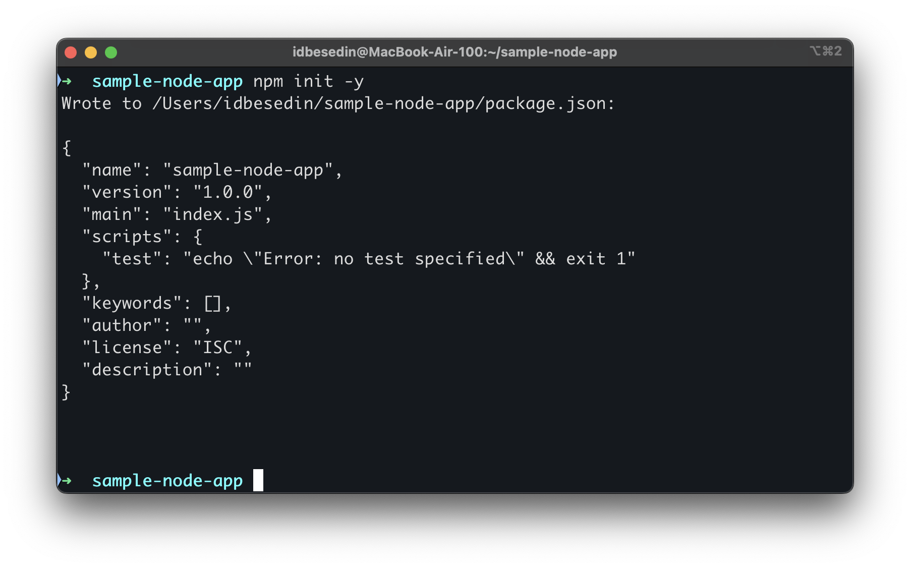
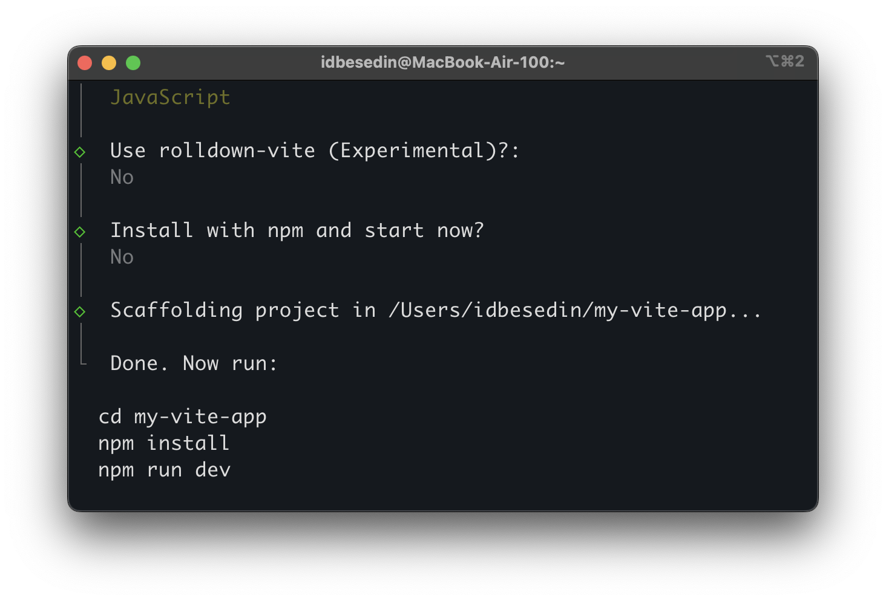
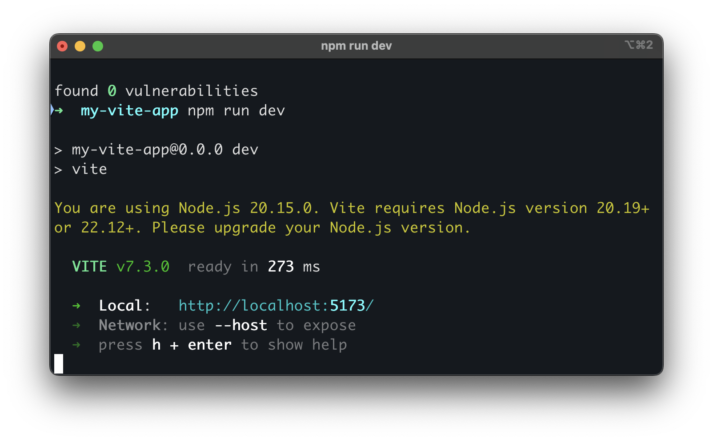
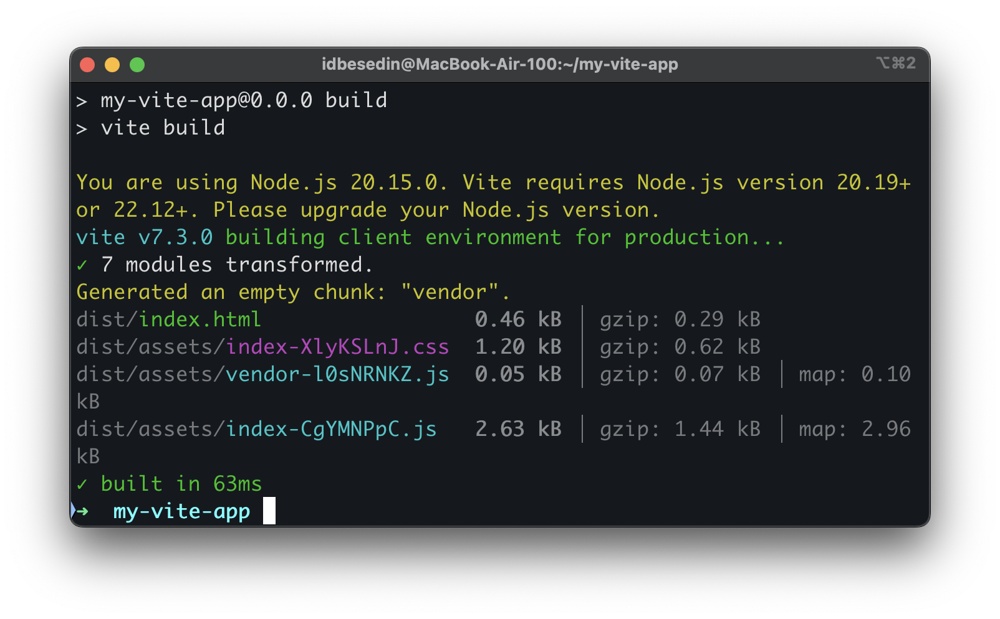
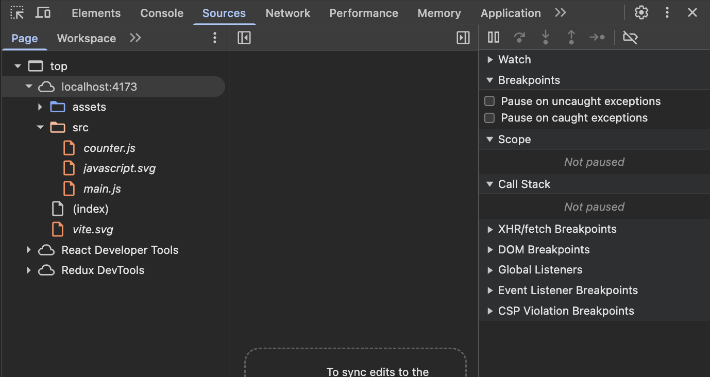
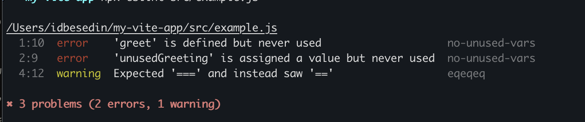

# Инструментальная среда фронтенд-разработки

Ты знаешь язык и знаешь его границы.
Ещё на неделе 8, перед контрольной, синтез привёл к выводу, что весь инструментарий фронтенда вырос из ограничений самого JavaScript и среды, в которой он живёт.

Для браузера неэффективно грузить по сети сотни отдельных модулей напрямую.
Динамический язык молча пропускает ошибки, которые строгий язык бы не пропустил.
А понятия «подготовить код к продакшену» в самом JavaScript попросту нет.
Настало время познакомиться с инструментарием, который позволяет решать эти проблемы.

Ты уже разбил(а) код на модули и написал(а) программу, которая по частям складывается в единое целое.
Нужна среда вокруг кода, чтобы это стало настоящим проектом, а не набором файлов, которые открывают руками и запускают через первую попавшуюся кнопку Live Server в редакторе.
Нужно место, где живут инструменты и куда их ставят.

Нужен способ управлять зависимостями так, чтобы через полгода проект всё ещё собирался.
Нужна сборка, которая превращает исходники в то, что реально попадёт к пользователю.
И нужен контроль качества, который ловит ошибки до того, как их поймает пользователь.

Ровно об этом сегодняшняя тема.
Это первая неделя курса, где предметом разговора становится не язык и не браузер, а среда вокруг них.
Ты выходишь из DevTools в терминал.
Если для части группы это непривычно, ничего страшного: дальше пойдём по командам не спеша и объясним, зачем каждая из них вообще нужна.

К концу темы ты сможешь:

- инициализировать npm-проект и осознанно решать, куда должна попасть каждая новая зависимость, в `dependencies` или в `devDependencies`;
- создать фронтенд-проект на JavaScript с помощью Vite и уверенно ориентироваться в его структуре;
- работать в dev-режиме, пользоваться HMR и объяснять, что при этом происходит под капотом;
- собрать production-сборку, заглянуть в `dist` и объяснить, почему она совсем не похожа на исходный код;
- настроить ESLint и Prettier в проекте, запускать их через npm scripts и чинить то, на что они указывают.

Дальше в тексте несколько раз всплывёт то же ощущение, которое, возможно, появилось при чтении абзаца выше, конкретная ситуация, ответ на которую пока не очевиден, но появится по ходу раздела.
Вот несколько таких ситуаций.

1. Зачем вообще открывать терминал и что-то ставить через Node.js, если весь код в итоге всё равно выполняется в браузере?
2. Ты ставишь `eslint` в проект, но в `package.json` он почему-то не в `dependencies`.
   Это баг или так и задумано?
3. В `package.json` у зависимости написано `"vite": "^5.0.0"`, а у одногруппника после `npm install` встала версия `5.4.2`.
   Как заранее понять, какая версия установится именно у тебя?
4. Ты меняешь одну строчку в файле, и браузер обновляет только нужный кусок страницы, не потеряв текст, который ты уже успел(а) ввести в поле формы.
   А правка в соседнем файле почему-то перезагрузила страницу целиком. Что вообще произошло и от чего это зависит?
5. Файл `main.js` весит три килобайта, а после `npm run build` в `dist` лежит файл на сто с лишним килобайт с непонятным именем из букв и цифр.
   Откуда взялась разница?
6. Код упал в проде из-за опечатки в имени переменной, хотя автор был уверен, что всё работает, а ревьюер ничего не заметил при чтении диффа.
   Мог ли инструмент поймать это до деплоя?

Если ни на один вопрос пока нет ответа, это нормально, тема для того и существует.
Первый разбирается в разделе 1, второй и третий — в разделах 2 и 3, четвёртый — в разделе 4, пятый — в разделе 5, а шестой — в разделе 6.

## Содержание

- [1. Зачем фронтенду вообще нужна инструментальная среда](#1-зачем-фронтенду-вообще-нужна-инструментальная-среда)
  - [Node.js как среда выполнения для инструментов](#nodejs-как-среда-выполнения-для-инструментов)
  - [Зачем фронтенду вообще понадобился весь этот инструментарий](#зачем-фронтенду-вообще-понадобился-весь-этот-инструментарий)
- [2. npm и package.json](#2-npm-и-packagejson)
  - [npm как менеджер пакетов](#npm-как-менеджер-пакетов)
  - [package.json как паспорт проекта](#packagejson-как-паспорт-проекта)
  - [dependencies и devDependencies](#dependencies-и-devdependencies)
  - [npm scripts](#npm-scripts)
- [3. Lock-файлы и semver](#3-lock-файлы-и-semver)
  - [Semver: как устроены версии пакетов](#semver-как-устроены-версии-пакетов)
  - [package-lock.json: фиксация фактических версий](#package-lockjson-фиксация-фактических-версий)
  - [npm install и npm ci](#npm-install-и-npm-ci)
- [4. Vite и dev-режим](#4-vite-и-dev-режим)
  - [Создаём проект](#создаём-проект)
  - [Структура проекта на Vite](#структура-проекта-на-vite)
  - [Dev server и HMR](#dev-server-и-hmr)
- [5. Production build](#5-production-build)
  - [Зачем нужна отдельная сборка](#зачем-нужна-отдельная-сборка)
  - [npm run build и что лежит в dist](#npm-run-build-и-что-лежит-в-dist)
  - [Tree shaking](#tree-shaking)
  - [Code splitting](#code-splitting)
  - [Preview production-сборки](#preview-production-сборки)
  - [Source maps](#source-maps)
- [6. ESLint и Prettier](#6-eslint-и-prettier)
  - [Почему языку самому не хватает контроля](#почему-языку-самому-не-хватает-контроля)
  - [ESLint: линтер](#eslint-линтер)
  - [Prettier: форматтер](#prettier-форматтер)
  - [Зачем разделять роли](#зачем-разделять-роли)
  - [Настройка и интеграция в проект](#настройка-и-интеграция-в-проект)
  - [Проверка перед коммитом: husky и lint-staged](#проверка-перед-коммитом-husky-и-lint-staged)
- [Практика на паре](#практика-на-паре)
- [Если кратко](#если-кратко)
- [★ Глубже](#глубже)

Разделы дальше идут именно в таком порядке не случайно, каждый следующий на самом деле опирается на то, что было в предыдущем, поэтому лучше не перескакивать через один.

## 1. Зачем фронтенду вообще нужна инструментальная среда

### Node.js как среда выполнения для инструментов

Браузер выполняет JavaScript в песочнице и намеренно многого не даёт делать коду.
Скрипт на странице не может просто так прочитать файл с диска пользователя, запустить другую программу или самостоятельно решить, какие файлы отдать браузеру дальше.
Это разумное ограничение с точки зрения безопасности веб-страницы, но оно же означает, что сам JavaScript в браузере не годится для написания программ, которые должны собирать проект, проверять код или поднимать локальный сервер разработки.
Для таких задач языку нужна другая площадка.

> Node.js — это среда выполнения JavaScript вне браузера, которая берёт движок V8 и добавляет к нему доступ к файловой системе, процессам и сети, то есть ровно то, что браузерный JavaScript намеренно не может делать из соображений безопасности.

Важно не перепутать роли.
Node.js в этом курсе не для того, чтобы отправить код пользователю или заменить браузер.
Он для того, чтобы разработчик мог писать и запускать программы, которые работают с файлами его собственного проекта.
Именно на Node.js написаны почти все инструменты, о которых пойдёт речь дальше, npm, Vite, ESLint и Prettier.
Все они существуют как обычные JS-программы, которые выполняются не на странице, а в терминале через `node`.

Разница хорошо видна на маленьком примере.

```js
// list-files.js
// Модуль fs даёт доступ к файловой системе — то, чего в браузерном JS нет по соображениям безопасности
import { readdirSync } from "node:fs";

// Читаем список файлов в текущей папке
const files = readdirSync(".");
console.log("Файлы в этой папке:", files);
```

Запускаем этот файл в терминале.

```bash
node list-files.js
```

Скрипт честно распечатает список файлов рядом с собой.
Если попробовать выполнить `import("node:fs")` в консоли DevTools на любой открытой странице, браузер не сможет найти такой модуль.
Его там попросту нет, он существует только в Node.js.
Префикс `node:` как раз и означает «встроенный модуль Node.js», а не файл из проекта и не пакет из npm.

В чужих примерах для Node.js ты будешь часто встречать другую запись того же самого, `const fs = require("fs")`.
Это CommonJS, старая система модулей Node.js, которая появилась задолго до `import`/`export`.
Мы пишем на ES-модулях, как и с недели 8, а чем `require` мешает сборщику — разберём в разделе 5.

Попробуй создать такой файл у себя, запустить его через `node` и убедиться, что список файлов в выводе совпадает с тем, что реально лежит рядом со скриптом.

### Зачем фронтенду вообще понадобился весь этот инструментарий

Неделя 8 закончилась выводом, что у модулей, у прокси и у других продвинутых механизмов языка есть конкретные ограничения, и именно из-за них вокруг JavaScript появился отдельный инструментарий.
Неделя 10 разбирает первую часть этих ограничений, а дальше в курсе будет ещё несколько похожих тем.

Модули из недели 8 не решают одну практическую задачу.
Грузить сотни отдельных файлов по сети в продакшене неэффективно, и для этого нужен бандлер.
Динамическая природа языка создаёт вторую задачу.
Опечатка в имени переменной не ломает код сразу, а проявляется только в момент выполнения, и для этого нужен линтер.

На следующей неделе к этой же проблеме добавится ещё и статическая типизация.
Ручная работа с DOM из недели 6 тоже упирается в свои ограничения, и это в итоге приводит к фреймворкам, но это уже разговор весеннего курса.

Здесь же, в рамках сегодняшней темы, стоит закрепить главную мысль.
У каждого инструмента, который появится дальше, есть конкретная проблема, которую он решает, и без которой он был бы просто лишней сущностью.

Node.js даёт языку среду выполнения вне браузера.
Дальше на этой среде работает npm, который решает задачу управления сторонним кодом.
Поверх npm работает Vite, который решает задачу сборки и быстрой разработки.

ESLint и Prettier стоят особняком.
Они следят за качеством и единообразием кода, и их задачи не пересекаются с задачами Node.js, npm и Vite.
Разберём их по порядку.

## 2. npm и package.json

### npm как менеджер пакетов

Node.js даёт среду выполнения, но сама по себе она не решает задачу «взять чужой код и подключить его к своему проекту».
Этим занимается `npm`, менеджер пакетов, который устанавливается вместе с Node.js и работает поверх той же самой среды выполнения.

> npm (Node Package Manager) — менеджер пакетов для JavaScript, который устанавливает, обновляет и удаляет сторонние библиотеки, хранит информацию о зависимостях проекта и умеет запускать именованные команды.

### package.json как паспорт проекта

Любой проект, где используется npm, начинается с файла `package.json`.
В нём в явном виде записано, как называется проект, какая у него версия, какие команды можно запустить и какие сторонние библиотеки ему нужны для работы.

Создаётся этот файл командой `npm init`.
Флаг `-y` отвечает «да» на все интерактивные вопросы по умолчанию, чтобы не отвечать на них вручную.

Для экспериментов в разделах 2 и 3 заведи отдельную папку-песочницу.
Настоящий проект на Vite появится в разделе 4, и у него будет своя папка.

```bash
mkdir sample-node-app
cd sample-node-app
npm init -y
```

npm сразу же печатает получившийся файл прямо в терминал.


Реальный вывод терминала после `npm init -y`: npm сообщает, куда записал файл, и показывает его содержимое.

В упрощённом виде, если оставить только то, что важно для этой темы, файл выглядит так.

```json
{
  "name": "sample-node-app",
  "version": "1.0.0",
  "scripts": {
    "test": "echo \"Error: no test specified\" && exit 1"
  }
}
```

Поле `name` — это идентификатор проекта, обычно в нижнем регистре и без пробелов.
`version` записывается в формате semver, о котором подробнее в следующем разделе.
А `scripts` — это именованные команды проекта, к которым мы вернёмся чуть ниже.
По мере установки зависимостей в этом же файле появятся ещё два раздела, `dependencies` и `devDependencies`.

### dependencies и devDependencies

Когда ты устанавливаешь пакет командой `npm install`, он по умолчанию попадает в раздел `dependencies`.
Флаг `--save-dev` (или короткий `-D`) кладёт пакет вместо этого в `devDependencies`.

> `dependencies` — пакеты, без которых собранное приложение не будет работать у пользователя, то есть код, который реально импортируется в приложении и попадает в итоговую сборку.
> `devDependencies` — пакеты, нужные только во время разработки и сборки, но не являющиеся частью того, что видит пользователь.

Разница не формальная, а вполне практическая.
Библиотека вроде `dayjs`, которую приложение импортирует и использует прямо в коде для форматирования дат, это `dependencies`.
А `eslint`, `prettier` или `vite`, это `devDependencies`: без них приложение прекрасно продолжит работать в браузере, просто разработчику будет неудобнее его создавать.
На серверах и в CI-окружениях установку часто выполняют командой `npm install --omit=dev`, которая пропускает `devDependencies`.
Там, где приложение реально исполняется, инструменты разработки попросту не нужны, и незачем тратить на них время установки и место на диске.

```bash
# Библиотека, которую импортирует сам код приложения
npm install dayjs

# Инструмент, нужный только на этапе разработки
npm install eslint --save-dev
```

После этих двух команд `package.json` получит примерно такой вид.

```json
{
  "dependencies": {
    "dayjs": "^1.11.10"
  },
  "devDependencies": {
    "eslint": "^9.9.0"
  }
}
```

Установи в песочницу какую-нибудь маленькую библиотеку, например `dayjs`, обычной командой `npm install`.
Затем поставь любой инструмент разработки, скажем `eslint`, с флагом `--save-dev`.
Убедись, что они действительно попали в разные секции package.json.

Удаляются пакеты симметрично, командой `npm uninstall` (или короткой `npm rm`), которая одинаково хорошо работает и с `dependencies`, и с `devDependencies`.

```bash
npm uninstall dayjs
```

### npm scripts

Раздел `scripts` в package.json хранит именованные команды, которые можно запускать одним словом вместо того, чтобы каждый раз вспоминать и печатать длинную команду целиком.

```json
{
  "scripts": {
    "dev": "vite",
    "build": "vite build",
    "lint": "eslint ."
  }
}
```

Запускаются такие скрипты командой `npm run <имя>`.

```bash
npm run dev
npm run build
npm run lint
```

Пара скриптов с зарезервированными именами, `start` и `test`, запускаются без слова `run`, просто `npm start` и `npm test`, остальные требуют `npm run` явно.
Ценность npm scripts не в том, что без них нельзя было бы напечатать команду руками, а в том, что вся команда договаривается об одинаковых коротких именах.
И никому не нужно помнить, какие именно флаги нужны сборщику или линтеру в этом конкретном проекте.

Добавь в свой package.json собственный скрипт с именем `hello`, который выполняет `echo "Привет от npm scripts"`, и запусти его через `npm run hello`.

Мы поставили пакеты и договорились об именах команд.
Но пока не ответили на вопрос из второй строчки актуализации: почему на двух разных машинах после `npm install` иногда встают разные версии одного и того же пакета?
Разберёмся с этим дальше.

## 3. Lock-файлы и semver

### Semver: как устроены версии пакетов

Версия каждого пакета в npm-экосистеме записывается по строгому соглашению.

> Semantic Versioning (semver) — соглашение о нумерации версий вида `MAJOR.MINOR.PATCH`, где увеличение `MAJOR` означает несовместимые изменения, `MINOR` добавляет новую функциональность с сохранением обратной совместимости, а `PATCH` исправляет ошибки без изменения поведения.

Если бы версии значили что попало, диапазоны версий в package.json были бы бессмысленны.
А раз значение каждой части версии зафиксировано соглашением, можно доверить npm самому решать, какую именно версию ставить, указав не точное число, а диапазон.

Диапазоны задаются двумя основными символами перед номером версии.
Без префикса версия фиксируется жёстко, `"vite": "5.0.0"` установит только эту версию и никакую другую.
Тильда разрешает обновления только внутри того же `MINOR`, то есть только `PATCH`-изменения, значит `"vite": "~5.0.0"` может поставить `5.0.7`, но не `5.1.0`.
Каретка разрешает обновления `MINOR` и `PATCH` в пределах одного `MAJOR`.
Значит, `"vite": "^5.0.0"` установит и `5.4.2`, и `5.9.9`, но не `6.0.0`, потому что смена `MAJOR` может сломать обратную совместимость.

Номера версий в примерах этого раздела условные.
В твоём проекте Vite будет новее (на момент написания актуальна восьмая мажорная версия), но правила чтения диапазонов от этого не меняются.

Возьми тот же пример, `"vite": "^5.0.0"`, и ответь, что установится при `npm install`, если разработчики Vite завтра выпустят версию `5.9.0`, а через неделю версию `6.0.0`.
Проект на Vite ты создашь чуть позже, в разделе 4, и там же сможешь свериться с реальным package.json.

### package-lock.json: фиксация фактических версий

Диапазон вроде `^5.0.0` описывает, что можно поставить, но не гарантирует, что именно поставится завтра или на чужой машине.
У современных проектов есть не только прямые зависимости, но и зависимости зависимостей.
У каждой из них тоже есть свои диапазоны версий, поэтому итоговое дерево версий может оказаться разным при установке в разные моменты времени.
Отсюда и растёт классическая фраза «у меня работает»: один и тот же код на двух машинах ведёт себя по-разному просто потому, что где-то в глубине дерева зависимостей встала другая патч-версия какого-то пакета.

> package-lock.json — файл, который фиксирует точные версии всех установленных пакетов и их вложенных зависимостей, чтобы установка `npm install` в любой момент и на любой машине давала одинаковый результат.

По содержанию `package-lock.json` похож на `package.json`, только гораздо подробнее, там для каждого пакета явно записана точная версия, а не диапазон, и структура всего дерева зависимостей целиком.
Именно поэтому этот файл обязательно попадает в git вместе с исходным кодом.
С папкой `node_modules` всё наоборот: туда npm физически скачивает код всех библиотек, она обычно весит сотни мегабайт и поэтому идёт в `.gitignore`.

### npm install и npm ci

Пока package.json и package-lock.json согласованы между собой, обычный `npm install` ставит ровно то дерево версий, которое записано в лок-файле.
Но если они разошлись, например кто-то из команды поправил диапазон в package.json руками и не переустановил зависимости, `npm install` молча пересчитает нужную часть дерева и перепишет лок-файл.
Для случаев, где важна полная и безусловная точность, у npm есть отдельная команда.

```bash
npm ci
```

`npm ci` полностью удаляет `node_modules`, если она уже есть, и ставит зависимости строго по package-lock.json.
Сам лок-файл при этом не пересчитывается и не обновляется.
Если package.json и package-lock.json хоть немного разошлись, команда просто завершится с ошибкой вместо того, чтобы тихо всё поправить, как это может сделать `npm install`.
Именно поэтому `npm ci` это стандартный выбор для CI-систем и серверов: там нужна не гибкость, а гарантия, что установится ровно то дерево версий, которое зафиксировано в репозитории.

Открой `package-lock.json` в песочнице `sample-node-app`, найди там запись про `eslint`, которая была поставлена в разделе 2, и сравни точную зафиксированную версию с диапазоном из `package.json`, чтобы увидеть своими глазами, что лок-файл фиксирует куда более узкую вещь, чем диапазон.
Затем запусти `npm ci` в той же песочнице и сравни её вывод с обычным `npm install`, а заодно проверь, что произойдёт, если вручную поменять версию какого-нибудь пакета в package.json так, чтобы она разошлась с package-lock.json.

Теперь у нас есть Node.js, npm, заполненный package.json и воспроизводимые версии зависимостей.
Пора наконец создать настоящий фронтенд-проект и посмотреть, что всё это даёт на практике, начиная с Vite.

## 4. Vite и dev-режим

### Создаём проект

Vite поставляется вместе с генератором стартовых шаблонов, который скачивается и запускается одной командой, без предварительной установки чего-либо вручную.

```bash
npm create vite@latest my-app -- --template vanilla
cd my-app
npm install
```


Вывод терминала после `npm create vite@latest`, где генератор спрашивает шаблон проекта и сообщает, какие команды выполнить дальше.

Команда `npm create vite@latest` использует механизм npm для запуска пакетов без установки их насовсем.
Она скачивает генератор проекта от команды Vite и создаёт папку `my-app` с шаблоном на обычном JavaScript, без какого-либо фреймворка.
Следующая команда, `npm install`, ставит зависимости проекта, включая сам Vite, ровно так же, как это разбиралось в разделе про npm.

### Структура проекта на Vite

Свежесозданный проект выглядит примерно так.

```text
my-app/
├── index.html
├── package.json
├── package-lock.json
├── node_modules/
├── public/
└── src/
    ├── main.js
    └── style.css
```

`index.html` в проекте на Vite лежит в корне, а не спрятан внутри `src`, и это не случайность оформления, а осознанный выбор.
Vite считает HTML-файл настоящей точкой входа всего приложения, именно с него браузер начинает загрузку, а уже из него подключается твой JavaScript.
`src` содержит исходный код приложения, который Vite будет обрабатывать и трансформировать.
`public` предназначен для файлов, которые нужно скопировать в итоговую сборку без каких-либо изменений, например `favicon.ico`.
Это отличает их от файлов в `src`, которые проходят через сборщик.
`node_modules` это установленные зависимости, ровно то же самое, что и в любом другом npm-проекте.
Папки `dist` в свежесозданном проекте пока нет, она появится только после первой production-сборки, к которой мы вернёмся в разделе 5.

Отдельно стоит конфигурационный файл `vite.config.js`.
Для простого проекта на обычном JavaScript Vite прекрасно работает вообще без него, разумные настройки уже встроены по умолчанию.
Файл понадобится, как только нужно что-то донастроить, например подключить плагин для React или явно включить генерацию source maps для продакшена, о чём пойдёт речь в разделе 5.

Открой `index.html` в свежесозданном проекте и найди там тег `script` с атрибутом `type="module"`, который подключает `src/main.js`.
Это и есть та самая точка входа, с которой Vite начинает строить граф зависимостей всего приложения.

### Dev server и HMR

Запускаем сервер разработки одной командой.

```bash
npm run dev
```


Вывод терминала после `npm run dev` с локальным адресом, обычно [localhost:5173](http://localhost:5173).

В dev-режиме Vite не собирает заранее весь проект в один файл.
Вместо этого он раздаёт браузеру исходные ES-модули почти как есть и трансформирует конкретный файл только в момент, когда браузер его реально запросил.
Поэтому запуск дев-сервера остаётся быстрым даже на большом проекте, ведь работа делается маленькими порциями по требованию, а не одним большим проходом по всем файлам сразу.

Пока страница открыта и сервер разработки запущен, изменения в коде подхватываются автоматически, причём особым образом.

> Hot Module Replacement (HMR) — механизм, при котором дев-сервер подменяет изменившийся модуль прямо в открытой странице, не перезагружая её целиком, и поэтому может сохранить текущее состояние приложения.

Ключевое слово здесь «может».
Разница с обычной перезагрузкой хорошо видна на маленьком примере со счётчиком.
В шаблоне `vanilla` в `index.html` лежит только пустой `<div id="app"></div>`, а всё содержимое страницы создаёт `src/main.js`.
Замени содержимое `src/main.js` на код ниже: он создаёт кнопку и кладёт её внутрь `#app`.

```js
// src/main.js
import "./style.css"; // Стили шаблона, понадобятся для первого опыта

let count = 0;

const button = document.createElement("button");
button.type = "button";
button.textContent = `Кликов: ${count}`;
button.addEventListener("click", () => {
  count++;
  button.textContent = `Кликов: ${count}`;
});

document.querySelector("#app").replaceChildren(button);
```

Покликай по кнопке, чтобы счётчик вырос, скажем, до пяти, и проведи два опыта.
Держи перед глазами и браузер, и терминал с дев-сервером: после каждого сохранения Vite пишет туда, что сделал, строку с `hmr update` или с `page reload`.

1. Поменяй в `src/style.css` любое свойство, например цвет фона у `body`, и сохрани файл.
   Стиль применится, а на кнопке останется «Кликов: 5».
2. Добавь в `src/main.js` строку `console.log("правка");` и сохрани файл.
   Страница перезагрузится целиком, и на кнопке снова будет «Кликов: 0», ровно как после F5.

Почему так.
Vite не может подменить на лету любой модуль: кто-то должен быть готов принять новую версию.

> HMR-граница — модуль, который объявил через `import.meta.hot.accept()`, что умеет принять свою новую версию без перезагрузки страницы.

Когда файл меняется, Vite ищет границу: сначала смотрит на сам изменившийся модуль, потом на те модули, которые его импортируют, и так вверх по цепочке импортов.
Нашлась граница — подменяется только эта часть графа модулей.
Не нашлась — Vite остаётся только перезагрузить страницу целиком, и всё, что лежало в памяти, пропадает.

CSS-файлы Vite принимает сам, поэтому первый опыт прошёл без перезагрузки.
А `main.js` никто не принял, ни он сам, ни кто-то выше по цепочке (выше никого и нет, это точка входа), поэтому второй опыт закончился полной перезагрузкой.
Правка `index.html` тоже всегда приводит к полной перезагрузке.
Во фреймворковых шаблонах, например для React или Vue, границы за тебя объявляет плагин фреймворка, поэтому там кажется, что HMR «просто работает» для любого компонента.
В проекте без фреймворка границу объявляют руками.

Добавь в конец `src/main.js` такой блок и повтори второй опыт.

```js
if (import.meta.hot) {
  import.meta.hot.accept();
}
```

Объект `import.meta.hot` существует только в dev-режиме, поэтому обращение к нему обёрнуто в проверку: в production-сборке этого объекта нет, и весь блок из неё выпадает.

Теперь полной перезагрузки нет, в терминале будет `hmr update`.
Но счётчик всё равно начнётся с нуля.
Vite выполнил новую версию `main.js` целиком, она заново объявила `let count = 0` и создала новую кнопку, а старое значение осталось в переменной старой версии модуля.
HMR сам по себе ничего не сохраняет, он только даёт модулю возможность передать состояние своей следующей версии.
Для этого есть объект `import.meta.hot.data`: он один на файл и переживает замену модуля.

```js
// src/main.js
import "./style.css";

let count = import.meta.hot?.data.count ?? 0; // Берём значение, оставленное прошлой версией модуля

const button = document.createElement("button");
button.type = "button";
button.textContent = `Кликов: ${count}`;
button.addEventListener("click", () => {
  count++;
  button.textContent = `Кликов: ${count}`;
});

document.querySelector("#app").replaceChildren(button);

if (import.meta.hot) {
  // Вызывается у старой версии модуля прямо перед заменой
  import.meta.hot.dispose((data) => {
    data.count = count;
  });
  import.meta.hot.accept();
}
```

Повтори второй опыт ещё раз: теперь правка `main.js` не трогает ни страницу, ни счётчик.
Объясни своими словами, почему в этот момент обычная перезагрузка по F5 всё равно обнулит счётчик.

Dev-режим оптимизирован для скорости и удобства разработки, а не для того, что в итоге получит пользователь.
Что происходит, когда Vite готовит проект к реальному деплою, разберём в следующем разделе.

## 5. Production build

### Зачем нужна отдельная сборка

В dev-режиме браузер грузит модули по одному, по запросу, и это прекрасно работает локально, когда сервер и браузер разделяет доля миллисекунды.
Но отдавать пользователю в интернете сотни отдельных файлов, каждый со своим отдельным сетевым запросом, было бы медленно и расточительно, к тому же исходный код никак не оптимизирован под финальный размер.
Для продакшена нужен другой процесс.

> Bundling — процесс, при котором сборщик берёт весь граф модулей проекта, начиная с точки входа, и объединяет его в один или несколько файлов, готовых к отдаче браузеру.

### npm run build и что лежит в dist

```bash
npm run build
```


Вывод терминала после успешной сборки со списком получившихся файлов и их размерами.

После сборки в проекте появляется папка `dist` примерно такого вида.

```text
dist/
├── index.html
└── assets/
    ├── index-4f3a9c21.js
    └── index-8b7ac0f4.css
```

Странные наборы букв и цифр в именах файлов это хеш от содержимого файла, а не случайный мусор.
Он нужен для того, чтобы браузер мог кешировать такой файл надолго и безопасно.
Как только содержимое изменится, изменится и хеш в имени, и браузер сразу поймёт, что нужно скачать новую версию, а не старую из кеша.

Содержимое файлов внутри `assets` тоже сильно отличается от исходников в `src`, потому что применена минификация: пробелы и переносы строк убраны, комментарии вырезаны, а часто ещё и имена локальных переменных заменены на однобуквенные.
Для браузера это не имеет значения, а вот вес файла ощутимо уменьшается.

Открой один из файлов из `dist/assets` в текстовом редакторе и сравни с исходным `src/main.js`.
Найди, что в нём стало короче, а что осталось по смыслу прежним.

### Tree shaking

Одной минификации бывает мало, потому что в проекте вообще может остаться код, которым никто не пользуется.

> Tree shaking — оптимизация сборки, при которой бандлер анализирует, какие именно экспорты модуля реально импортируются и используются в проекте, и исключает из финального бандла всё остальное как недостижимый код.

Работает это надёжно там, где модули оформлены через `import`/`export`, потому что такие связи статически видны бандлеру ещё до запуска кода.
Иначе обстоит дело со старым способом подключения модулей через `require`: там то же самое решается динамически прямо во время выполнения, и заранее предсказать это намного сложнее.
Есть и второе условие.
Некоторые модули выполняют код не только внутри своих функций, но и сразу на верхнем уровне файла, в момент самого импорта, например меняют что-то глобальное или пишут в консоль.
Бандлер не может знать заранее, важен ли этот побочный эффект для работы приложения, поэтому на всякий случай оставляет такой модуль в сборке целиком, а не выбрасывает его как неиспользуемый.

```js
// src/analytics.js
// Эта строка выполнится сразу при импорте файла, а не при вызове какой-то функции
window.__analyticsInitialized = true;

export function track(event) {
  console.log("Событие:", event);
}
```

Даже если функцию `track` из этого файла нигде не вызывают, сам `import` этого модуля запустит строку `window.__analyticsInitialized = true`.

```js
// src/utils.js
export function used() {
  return "Эта функция реально импортируется";
}

export function unused() {
  return "А эта не импортируется нигде в проекте";
}
```

```js
// src/main.js
import { used } from "./utils.js";

console.log(used());
```

После `npm run build` открой получившийся файл в `dist/assets` и поищи там строку «А эта не импортируется нигде в проекте».
Если tree shaking сработал как надо, ты её не найдёшь, хотя сама функция `unused` целиком присутствует в исходниках.

### Code splitting

Даже после минификации и tree shaking один огромный файл сам по себе может быть проблемой, потому что пользователь скачивает целиком весь код приложения, даже если на первом экране реально используется небольшая его часть.

> Code splitting — разбиение единого бандла на несколько отдельных файлов, чанков, которые браузер загружает не все разом, а по мере необходимости, например при переходе на определённую страницу приложения.

Сегодня достаточно понимать саму идею на уровне «зачем», без конкретных приёмов её реализации.
К конкретным паттернам ленивой загрузки, вроде динамического `import()` по клику или по переходу на маршрут, ты вернёшься на неделе 15, когда будешь собирать полноценное SPA и вплотную займёшься его производительностью.

### Preview production-сборки

Dev-сервер из раздела 4 отдаёт модули по требованию и содержит служебный код вроде обработчика HMR, которого в продакшене попросту не должно быть.
Чтобы честно проверить именно то, что получит пользователь, а не приближённую версию через dev-сервер, у Vite есть отдельная команда.

```bash
npm run build
npm run preview
```

`vite preview` поднимает минимальный статический сервер именно поверх папки `dist`.
То есть показывает ровно тот набор файлов, который в итоге попадёт на прод, без HMR и без каких-либо преобразований на лету.

### Source maps

Минифицированный код невозможно осмысленно читать.
Значит, если ошибка произойдёт именно в собранном файле, стек вызовов укажет на нечитаемую строку из `index-4f3a9c21.js`, а не на понятную строку в `src/main.js`.

> Source map — файл-карта, который связывает позиции в собранном, минифицированном коде с соответствующими позициями в исходном, немодифицированном коде, чтобы отладка велась по оригинальным файлам, даже когда реально выполняется совсем другой, собранный код.

Для продакшен-сборки генерацию source maps нужно явно включить в конфиге.
В шаблоне `vanilla` файла `vite.config.js` нет, создай его в корне проекта, рядом с `package.json`.

```js
// vite.config.js
import { defineConfig } from "vite";

export default defineConfig({
  build: {
    sourcemap: true, // Генерируем source map вместе с production-сборкой
  },
});
```


Вкладка Sources в DevTools, где рядом со скомпилированными файлами видны исходные файлы из src благодаря source map.

Запусти `npm run build` с `sourcemap: true` в конфиге, затем `npm run preview`, открой адрес, который он покажет, и сравни ощущения от работы приложения с тем, что было в dev-режиме.
После этого открой вкладку Sources в DevTools и поставь точку останова прямо в `src/main.js`, хотя по факту в браузере выполняется совсем другой, собранный файл.
Убедись, что отладчик реально останавливается там, где поставлена точка.

У `sourcemap: true` есть цена, и платит её не пользователь, а автор.
Файлы карт лежат в `dist` рядом с бандлом, собранный файл ссылается на них, и любой, кто откроет DevTools на твоём сайте, увидит исходники из `src` ровно в том виде, в каком они написаны, вместе с комментариями.
Скорость загрузки при этом почти не страдает: браузер скачивает карты только тогда, когда открыты DevTools, обычный посетитель их не грузит.
Поэтому на реальных проектах часто ставят `sourcemap: "hidden"`: карты генерируются, но собранный код на них не ссылается, и их отдают не браузеру, а системе сбора ошибок, которая по ним восстанавливает читаемый стек вызовов.

Мы прошли путь от исходников до финальной сборки.
Остался последний кусок инструментальной среды — тот, что следит за качеством кода ещё до того, как этот код вообще попадёт в сборку.

## 6. ESLint и Prettier

### Почему языку самому не хватает контроля

JavaScript не проверяет код при запуске так, как строгий язык проверил бы его при компиляции.
Обращение к необъявленной переменной, неиспользуемая переменная, которую забыли удалить после рефакторинга, нестрогое сравнение через `==` вместо `===`, — всё это не мешает коду запуститься.
Иногда код с такими проблемами даже отрабатывает правильно, а ошибка проявляется только в отдельном случае на проде.
У JavaScript нет компилятора, который бы отказался собирать такой код.
Значит, эту роль должен взять на себя отдельный инструмент, который читает код статически и не выполняет его.

### ESLint: линтер

> Линтер — инструмент статического анализа кода, который проверяет исходный код на соответствие набору правил, находя вероятные ошибки и небезопасные конструкции ещё до запуска программы.

ESLint строит из кода дерево разбора, сверяет каждый узел с включёнными правилами и сообщает о нарушениях.
Часть из них он даже способен исправить автоматически.

```js
// src/example.js
function greet(name) {
  const unusedGreeting = "Привет"; // Объявлена, но нигде не используется

  if (name == "") {
    return "Аноним";
  }

  return name;
}
```

```bash
npx eslint src/example.js
```


Вывод терминала: две ошибки по правилу no-unused-vars (функция `greet` и переменная `unusedGreeting` нигде не используются) и предупреждение по правилу eqeqeq.

Сравнение `name == ""` здесь не придирка: с `==` условие сработает не только для пустой строки, но и, например, для числа `0` или пустого массива, потому что перед сравнением JavaScript приведёт их к строке.

Обрати внимание на два уровня в выводе, `error` и `warning`.
Правило `no-unused-vars` в базовом наборе `recommended` включено как ошибка, а `eqeqeq` мы в конфиге ниже включим как предупреждение.
Уровень можно менять для каждого правила, и разница практическая: если есть хотя бы одна ошибка, `eslint` завершается с ненулевым кодом, и всё, что от него зависит (скрипт в CI, хук перед коммитом), остановится; предупреждения только печатаются.

Специально оставь в файле неиспользуемую переменную, как в примере выше, и запусти линтер, чтобы увидеть ошибку своими глазами.
Затем удали переменную и прогони линтер снова, убедившись, что ошибка пропала.

### Prettier: форматтер

> Форматтер — инструмент, который переписывает код по единым правилам оформления, отступам, кавычкам, точкам с запятой, не анализируя логику кода и не находя в ней ошибок.

```bash
npx prettier --write src/example.js
```

После такой команды двойные кавычки в коде превратятся в одинарные или наоборот, в зависимости от настроек, а точки с запятой появятся или исчезнут.
Но логика кода не поменяется ни на йоту, потому что Prettier в неё попросту не заглядывает.

### Зачем разделять роли

Линтер ищет ошибки и подозрительные конструкции, но ничего не знает про отступы и кавычки, а форматтер приводит стиль к единому виду, но ничего не понимает про логику кода.
Это не взаимозаменяемые инструменты, а взаимодополняющие.
Одна голова следит за тем, чтобы код был правильным, а другая, чтобы он одинаково выглядел у всех участников команды.
Более того, если позволить обоим инструментам одновременно лезть в вопросы форматирования, они начнут противоречить друг другу.
Поэтому на практике из настроек ESLint стилистические правила обычно намеренно убирают, а форматирование целиком оставляют Prettier.
Технически это делает пакет `eslint-config-prettier`: он выключает все правила ESLint, которые могли бы спорить с Prettier, и подключается в конфиге последним, чтобы перекрыть всё, что включено до него.

### Настройка и интеграция в проект

```bash
npm install eslint @eslint/js globals prettier eslint-config-prettier --save-dev
```

Пакетов пять, и каждый нужен.
`eslint` и `prettier` это сами инструменты.
`@eslint/js` содержит базовый набор правил `recommended`, `globals` знает списки глобальных переменных разных сред (браузера, Node.js), а `eslint-config-prettier` выключает пересекающиеся с Prettier правила.

```js
// eslint.config.js
import js from "@eslint/js";
import globals from "globals";
import eslintConfigPrettier from "eslint-config-prettier";

export default [
  js.configs.recommended, // Базовый набор правил для JS
  {
    languageOptions: {
      globals: globals.browser, // window, document, fetch и другие браузерные глобальные переменные
    },
    rules: {
      eqeqeq: "warn", // Требует === и !== вместо == и !=, в recommended этого правила нет
    },
  },
  eslintConfigPrettier, // Последним: выключает правила, которые спорят с Prettier
];
```

Настройки Prettier лежат в файле `.prettierrc` в корне проекта.
Это JSON, а в JSON комментариев не бывает, поэтому копируй блок ниже как есть.

```json
{
  "singleQuote": true,
  "semi": true
}
```

Осталось добавить пару npm scripts, чтобы не набирать `npx eslint .` и `npx prettier . --write` каждый раз вручную.

```json
{
  "scripts": {
    "lint": "eslint .",
    "format": "prettier . --write"
  }
}
```

Добавь в свой package.json скрипты `lint` и `format`, запусти оба через `npm run` и убедись, что первый находит логические проблемы в коде, а второй меняет только оформление, вообще не трогая поведение программы.

### Проверка перед коммитом: husky и lint-staged

Скрипты `lint` и `format` работают, только если их не забыли запустить.
Надёжнее, когда они запускаются сами в тот момент, когда код уходит в репозиторий.

> Git-хук — скрипт, который git сам запускает при определённом событии, например перед созданием коммита (`pre-commit`). Если скрипт завершился с ошибкой, коммит не создаётся.

Писать хуки руками неудобно: они лежат в `.git/hooks`, а эта папка не попадает в репозиторий, и у одногруппника после клонирования хуков не будет.
Эту задачу решают два пакета.
`husky` хранит хуки в обычной папке `.husky/` внутри проекта и подключает их к git автоматически после `npm install`.
`lint-staged` запускает команды не по всему проекту, а только по файлам, которые ты добавил(а) в коммит через `git add`.

```bash
git init   # если в проекте ещё нет git-репозитория, например сразу после npm create vite
npm install husky lint-staged --save-dev
npx husky init
```

`npx husky init` создаёт папку `.husky/` с файлом `pre-commit` и добавляет в `package.json` скрипт `"prepare": "husky"`.
Скрипт с именем `prepare` npm запускает сам после каждого `npm install`, поэтому хуки подключатся у любого, кто склонирует проект и установит зависимости.

По умолчанию в `.husky/pre-commit` записана команда `npm test`.
Замени всё содержимое файла одной строкой.

```bash
npx lint-staged
```

Осталось сказать `lint-staged`, что запускать для каких файлов.
Это отдельная секция верхнего уровня в `package.json`, рядом со `scripts`.

```json
{
  "lint-staged": {
    "*.js": ["eslint --fix", "prettier --write"],
    "*.{css,html,json,md}": "prettier --write"
  }
}
```

Хук запускает не `npm run lint`, а `npx lint-staged`, потому что `npm run lint` проверял бы весь проект: на большом проекте это долго, и ты получал(а) бы замечания по файлам, которых в этом коммите не трогал(а).
`lint-staged` передаёт каждой команде только застейдженные файлы, подходящие под шаблон, а исправления, которые сделали `--fix` и `--write`, сам добавляет обратно в коммит.

Проверь, что хук работает: оставь в каком-нибудь `.js`-файле неиспользуемую переменную, сделай `git add` и попробуй закоммитить.
Коммит должен остановиться с выводом ESLint.

---

## Практика на паре

1. Создай новый проект на JavaScript через `npm create vite@latest` с шаблоном `vanilla`.
   Осмысленно заполни поля `name` и `version` в package.json, добавь собственный npm-скрипт, установи одну библиотеку в `dependencies` и один инструмент разработки в `devDependencies`.
   Убедись, что они оказались в разных секциях package.json.
2. Добавь в `main.js` небольшой кусочек состояния, например тот же счётчик кликов, запусти dev-сервер и проверь на практике, какие правки Vite применяет без перезагрузки страницы, а какие перезагружают её целиком.
   Затем сделай так, чтобы правка `main.js` не сбрасывала счётчик, и объясни, что для этого понадобилось.
   После этого создай `src/utils.js` с двумя экспортируемыми функциями, импортируй и вызови в `main.js` только одну, собери production-сборку через `npm run build`, открой `dist` и убедись, что вторая функция не попала в собранный файл.
   Запусти `npm run preview` и сравни ощущения от работы приложения с dev-режимом.
3. Настрой в проекте ESLint и Prettier с npm-скриптами `lint` и `format`.
   Намеренно внеси в код два-три нарушения разного типа, например неиспользуемую переменную и нестрогое сравнение, прогони `npm run lint`, почини все замечания, а затем прогони `npm run format` и сравни оформление файла до и после.

**Вопросы для обсуждения**

- Если в vite.config.js выставить `sourcemap: false` для продакшен-сборки, что теряет разработчик и что выигрывает в этот момент пользователь?
- Почему tree shaking надёжно работает с `import`/`export`, но не гарантированно с `require`?
- Чем задача линтера принципиально отличается от задачи компилятора статически типизированного языка, если заглянуть на неделю вперёд к TypeScript?
- Зачем вообще нужен package-lock.json, если версии в package.json и так более-менее ограничены диапазонами через `^` и `~`?

## Если кратко

**Зачем фронтенду инструментальная среда.**
Node.js даёт JavaScript-коду возможность выполняться вне браузера с доступом к файловой системе, процессам и сети, и без этого не смогли бы существовать ни npm, ни Vite, ни ESLint.
Модули, сборка и оптимизация требуют отдельного слоя инструментов именно потому, что ни сам браузер, ни сам язык эти задачи не решают, и весь инструментарий фронтенда, по сути, вырос из этих нерешённых задач.

**npm и package.json.**
`package.json` описывает проект через поля `name`, `version`, `scripts`, `dependencies` и `devDependencies`.
Разделение на `dependencies` и `devDependencies` важно не потому, что одни пакеты лучше других. Оно важно, потому что первые нужны собранному приложению, а вторые — только на этапе разработки.
npm scripts дают команде единый короткий способ запускать длинные команды одинаково у всех.

**Lock-файлы и semver.**
Semver-диапазоны через тильду и каретку определяют, какие версии в принципе могут установиться, но не гарантируют, что установится одна и та же версия на разных машинах в разное время, и именно эту задачу решает `package-lock.json`, фиксируя точное дерево версий целиком.

**Vite и dev-режим.**
Vite создаёт проект со входной точкой `index.html` и папкой `src`.
В dev-режиме он обслуживает модули по требованию вместо предварительной сборки, что даёт почти мгновенный запуск и HMR, то есть подмену изменившегося модуля без полной перезагрузки страницы.
Подмена возможна, только если по цепочке импортов нашлась HMR-граница: CSS Vite принимает сам, а в JS без фреймворка границу объявляют через `import.meta.hot.accept()`, иначе страница перезагружается целиком.
Состояние HMR сам не сохраняет, его передают следующей версии модуля через `import.meta.hot.data`.

**Production build.**
Сборка объединяет граф модулей в оптимизированные файлы.
Заодно она убирает неиспользуемый код через tree shaking и разбивает большой бандл на чанки через code splitting.
А source maps позволяют отлаживать этот минифицированный результат по исходным файлам.
Команда preview поднимает сервер именно поверх готовой сборки, а не поверх dev-режима, поэтому только через неё видно то, что реально получит пользователь.

**ESLint и Prettier.**
Линтер ищет вероятные ошибки и плохие практики статическим анализом кода, а форматтер приводит оформление к единому виду, и оба инструмента специально не совмещают эти роли, чтобы не спорить друг с другом за одни и те же строки.
Связка husky и lint-staged запускает их автоматически перед каждым коммитом и только по изменённым файлам.

<a id="глубже"></a>

## ★ Глубже

Кто-то обязательно спросит, почему у Vite дев-режим стартует настолько быстро, а у более старых сборщиков вроде классического Webpack запуск дев-сервера на крупном проекте иногда занимал десятки секунд.
Webpack исторически сначала честно собирал весь граф модулей целиком и только потом отдавал что-то браузеру, поэтому время старта росло вместе с размером проекта.

Vite обходит эту проблему тем же способом, который уже был в разделе 4.
Он раздаёт исходные модули браузеру напрямую и не собирает их предварительно.
Когда дело доходит до продакшен-сборки, Vite собирает всё целиком точно так же, как это делают другие бандлеры, поэтому итоговый размер и число сетевых запросов у разных инструментов в итоге сопоставимы.
Долгое время у Vite под капотом было два разных инструмента: esbuild для дев-режима и Rollup для продакшен-сборки.
Начиная с Vite 8 обе роли выполняет один бандлер на Rust, Rolldown, а разбор, трансформацию и минификацию кода берёт на себя Oxc.
Ты вспомнишь об этом, когда в статье или ответе на форуме прочитаешь, что «Vite собирает прод через Rollup», или наткнёшься на жалобу «в деве работает, а после сборки нет»: для версий до восьмой это правда, дев и прод обрабатывались разными инструментами, и такие расхождения случались.
Разница подробно разобрана на странице документации Vite под названием [«Why Vite»](https://vite.dev/guide/why.html).

В разделе 3 уже разобрали, чем `npm ci` отличается от `npm install` по поведению, но остаётся практический нюанс.
`npm ci` вообще не умеет работать без уже существующего package-lock.json.
Если лок-файла в проекте ещё нет, команда сразу завершится с ошибкой, тогда как `npm install` в такой ситуации спокойно создаст его с нуля.
Из-за этого `npm ci` годится там, где лок-файл уже закоммичен и является источником истины, то есть в CI и на серверах, а не в качестве самой первой команды в свежесозданном проекте.
Подробности можно найти в документации npm [по команде `ci`](https://docs.npmjs.com/cli/v10/commands/npm-ci).

У истории с побочными эффектами из раздела 5 есть более тонкая настройка на уровне отдельного пакета.
Поле `sideEffects: false` в package.json — это способ автора пакета явно сказать бандлеру, что ни один модуль внутри пакета не делает ничего важного просто от факта импорта, и агрессивный tree shaking для него безопасен.
Именно поэтому многие библиотеки выставляют его у себя.
Это разрешает вырезать из финального бандла куда больше кода тем, кто их использует.
Практическая сторона вопроса хорошо разобрана в документации Webpack по [tree shaking](https://webpack.js.org/guides/tree-shaking/), хотя сам механизм одинаково актуален и для Vite.

Хук перед коммитом из раздела 6 ловит проблемы в последний момент, а можно ли раньше, прямо во время набора кода?
Можно, и так работает большинство команд: ESLint и Prettier подключаются к редактору, линтер подчёркивает проблему сразу в строке, а Prettier форматирует файл по сохранению.
Хук при этом не лишний, он страхует от тех, у кого редактор не настроен.
Ты вспомнишь об этом в первый же раз, когда коммит остановится на ошибке, которую редактор мог показать ещё десять минут назад.
Как подключить оба инструмента к популярным редакторам, описано на страницах интеграций [ESLint](https://eslint.org/docs/latest/use/integrations) и [Prettier](https://prettier.io/docs/editors).

Ещё один нюанс диапазонов semver, который иногда ловит на практике, это поведение каретки для версий с нулевым major, то есть вида `0.x.y`.
Формально в таких версиях у пакета ещё нет стабильного публичного API, поэтому npm считает изменение `MINOR`-части настолько же потенциально опасным, насколько обычно ведёт себя смена `MAJOR`.
Из-за этого диапазон `^0.4.2` фактически разрешает только патч-обновления, а не минорные, в отличие от привычного поведения при `MAJOR` больше нуля.
Это ровно то место, где стоит свериться с описанием диапазонов [в документации пакета node-semver](https://github.com/npm/node-semver#ranges), если версия нужного пакета в проекте начинается с нуля.

На следующей неделе этот же самый проект получит первое серьёзное расширение.
Статическая типизация закрывает ту же самую динамическую природу JavaScript ещё раньше, прямо на этапе компиляции: именно из-за неё сегодня в дело вступил ESLint.
С недели 11 ты начнёшь переводить сегодняшний Vite-проект на TypeScript.
